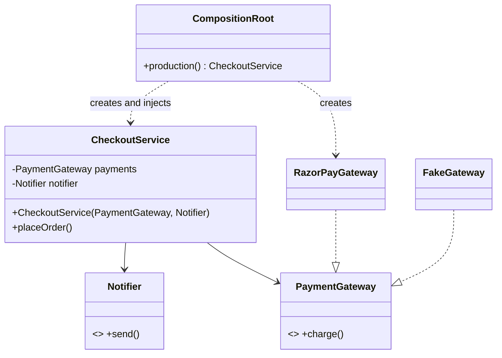
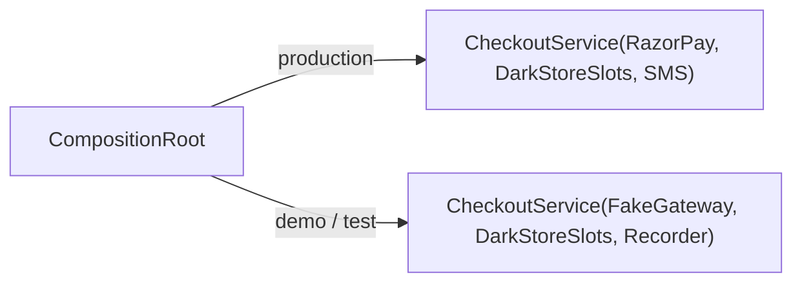
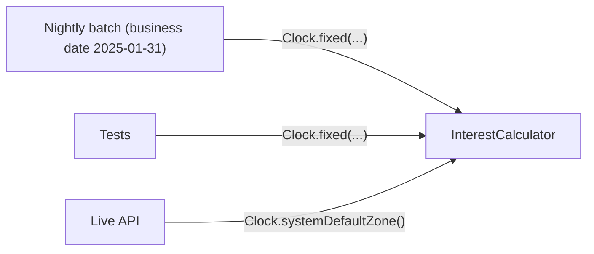
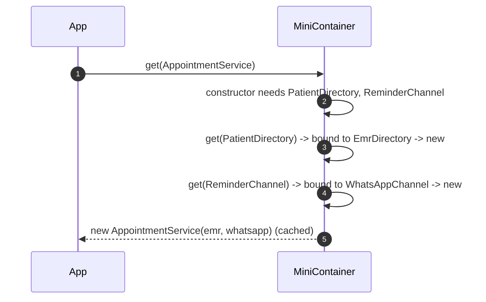

---
tags:
  - Enterprise
  - Beginner
---

# Dependency Injection (IoC)

<span class="badge badge--beginner">🟢 Beginner → 🔴 Advanced</span>
<span class="badge badge--category">Enterprise</span>
<span class="badge badge--interview">Interview frequency ⭐⭐⭐⭐⭐</span>

!!! abstract "TL;DR"
    **An object receives the things it depends on from outside (usually through its constructor) instead of creating or looking them up itself.**
    Use it everywhere a class talks to something you might want to swap: databases, payment gateways, clocks, HTTP clients. It is the pattern underneath all of Spring.

---

## See It in Motion

<iframe class="motion-embed" src="../../motion/index.html?p=dependency-injection&amp;embed=1" title="Animated walkthrough of the Dependency Injection pattern" loading="lazy"></iframe>

Press **Play** to watch the calls travel between objects, or step through with **Next** and **Back**. Switch to **Without it** to see what goes wrong without the pattern. [Open the full explorer with all 75 patterns](../motion/index.html#dependency-injection){ target=_blank }

## 1. Intent & Problem It Solves

**The problem in plain English:** a `CheckoutService` that does `new RazorPayGateway()` inside its methods is welded to RazorPay. You can't test it without charging a real card, you can't run a demo without network access, and switching to another gateway means editing checkout code. The class is doing two jobs: the business rule *and* deciding which concrete classes to use.

**Definition (Martin Fowler, 2004):**
> Separate the *configuration* of services from their *use*. A separate object, an assembler, populates fields in a class with appropriate implementations of the interfaces it needs.

**Inversion of Control (IoC)** is the broader idea: the framework or the `main` method controls object creation, not your class. **Dependency Injection** is the most common way to achieve it; **Service Locator** is the other (see the coding challenge for why DI usually wins).

Three injection styles:

| Style | How | Verdict |
|---|---|---|
| **Constructor** | `new CheckoutService(payments, slots, notifier)` | ✅ Default. Dependencies are explicit, fields can be `final`, objects are never half-built |
| Setter | `service.setNotifier(n)` | For genuinely optional dependencies only |
| Field (`@Autowired private X x;`) | Reflection writes the field | ❌ Hides dependencies, can't be `final`, needs a container even in unit tests |

## 2. Real-World Analogy

!!! example "A restaurant kitchen"
    A chef doesn't grow vegetables or forge knives. The restaurant **supplies** ingredients and tools to the station. The same chef can cook with organic or regular tomatoes, and a trainee can practise with plastic food, without the chef changing how they cook. The restaurant manager (the **composition root**) decides what each station gets.

## 3. Structure



| Participant | Responsibility |
|---|---|
| **Client** (`CheckoutService`) | Business logic. Declares what it needs as constructor parameters typed by interfaces |
| **Service interface** (`PaymentGateway`) | The abstraction the client depends on (owned by the client's layer, per DIP) |
| **Service implementation** | A concrete class: real, fake, or decorated |
| **Injector / composition root** | The only code that knows concrete classes; builds the object graph once at startup |

## 4. Naive Approach (Without the Pattern)

```java
public class CheckoutService {
    public String placeOrder(Order o) {
        String ref = new RazorPayGateway(System.getenv("RZP_KEY")).charge(o);   // hard-wired
        if (LocalDate.now().getDayOfWeek() == SUNDAY) { ... }                  // hidden clock
        new SmsNotifier().send(o.phone(), "confirmed");                          // hard-wired
        return ref;
    }
}
```

- :material-close-circle:{ style="color:#e53935" } **Untestable**: every test hits RazorPay and sends a real SMS.
- :material-close-circle:{ style="color:#e53935" } **Violates DIP and OCP**: high-level policy depends on low-level details; new gateway = edit checkout.
- :material-close-circle:{ style="color:#e53935" } **Hidden dependencies**: you only learn it needs `RZP_KEY` and the system clock by reading every line.

---

## 5. Three Real-World Examples

### Example 1: One Checkout, Two Wirings (Grocery)

**Scenario:** A quick-commerce app places 3,000 orders a minute at peak. The checkout needs a payment gateway, a delivery-slot booker for the dark store, and a notifier. In production it uses RazorPay and SMS; in the sales demo and in tests it must use a fake gateway and record messages instead of sending them, with **no change** to checkout code.

**Design:**



**Full Code:**

=== "Checkout.java"

    ```java
    --8<-- "code/enterprise/src/main/java/com/handbook/enterprise/di/grocery/Checkout.java"
    ```

    1.  **Constructor injection**: the three collaborators are interfaces passed in. The fields are `final`, so a `CheckoutService` can never exist without them.

=== "CompositionRoot.java"

    ```java
    --8<-- "code/enterprise/src/main/java/com/handbook/enterprise/di/grocery/CompositionRoot.java"
    ```

    1.  The **composition root** is the only place that says `new RazorPayGateway()`. In Spring this role is played by `@Configuration` classes and component scanning.
    2.  A second wiring for demos and tests. Nothing else in the codebase changes.

=== "GroceryDiDemo.java"

    ```java
    --8<-- "code/enterprise/src/main/java/com/handbook/enterprise/di/grocery/GroceryDiDemo.java"
    ```

**Output:**

```text
--8<-- "code/outputs/enterprise/di/grocery/GroceryDiDemo.txt"
```

**Why DI here:**

- Payment and notification are **side effects** you must be able to swap for tests and demos.
- Checkout depends only on interfaces it owns, so it follows **DIP**.
- All "which implementation?" decisions live in **one file**, which is easy to review.

---

### Example 2: Injecting the Clock (Banking)

**Scenario:** A bank accrues interest on fixed deposits in a nightly batch. When the batch fails, operations rerun it the next morning *for the previous business date*. Code that calls `LocalDate.now()` gives a different answer on rerun, and month-end reconciliations break. The fix is to treat time as a dependency.

**Design:**



**Full Code:**

=== "FixedDeposit.java"

    ```java
    --8<-- "code/enterprise/src/main/java/com/handbook/enterprise/di/banking/FixedDeposit.java"
    ```

    1.  `LocalDate.now()` is a **hidden dependency** on the system clock: untestable and not reproducible.
    2.  `java.time.Clock` is the JDK's built-in injectable time source. Production passes `Clock.systemUTC()`; batches and tests pass `Clock.fixed(...)`.

=== "BankingDiDemo.java"

    ```java
    --8<-- "code/enterprise/src/main/java/com/handbook/enterprise/di/banking/BankingDiDemo.java"
    ```

**Output:**

```text
--8<-- "code/outputs/enterprise/di/banking/BankingDiDemo.txt"
```

**Why DI here:**

- Not every dependency is a "service": **time, randomness, IDs and environment variables** are dependencies too.
- Reruns and tests become **deterministic**.
- Money stays in integer paise; the only moving part is the injected clock.

---

### Example 3: A Tiny IoC Container (Healthcare)

**Scenario:** A clinic platform has 40+ services. Wiring them by hand in a composition root grows to hundreds of lines. A container resolves constructors automatically: ask for `AppointmentService`, it sees the constructor needs a `PatientDirectory` and a `ReminderChannel`, finds their bindings, builds them, and caches singletons. It must also fail **at startup** with a readable message on a missing binding or a circular dependency.

**Design:**



**Full Code:**

=== "MiniContainer.java"

    ```java
    --8<-- "code/enterprise/src/main/java/com/handbook/enterprise/di/container/MiniContainer.java"
    ```

    1.  A **binding** maps an interface to an implementation, like a Spring `@Bean` method or `@Component` on the implementation.
    2.  **Cycle detection**: if a class is requested while it is still being built, the graph has a cycle. Spring Boot fails startup the same way ("The dependencies of some of the beans form a cycle").
    3.  **Constructor autowiring** by parameter type. Spring does this when a class has a single constructor, no `@Autowired` needed.

=== "Clinic.java"

    ```java
    --8<-- "code/enterprise/src/main/java/com/handbook/enterprise/di/container/Clinic.java"
    ```

=== "ContainerDemo.java"

    ```java
    --8<-- "code/enterprise/src/main/java/com/handbook/enterprise/di/container/ContainerDemo.java"
    ```

**Output:**

```text
--8<-- "code/outputs/enterprise/di/container/ContainerDemo.txt"
```

**Why a container here:**

- The classes stay **plain Java**: they don't import the container at all.
- Wiring errors surface **at startup**, not on the first patient request.
- Demystifies Spring: `ApplicationContext` is this idea plus scopes, proxies, lifecycle callbacks and configuration.

---

??? example "Unit Tests: `DependencyInjectionTest.java`"

    ```java
    --8<-- "code/enterprise/src/test/java/com/handbook/enterprise/di/DependencyInjectionTest.java"
    ```

## 6. Variations & Modern Java Take

| Variation | Notes |
|---|---|
| **Pure DI** (no framework) | A composition root in `main`. Perfect for libraries, CLIs, Lambdas and small services |
| **Reflection containers** | Spring, Guice, CDI (Jakarta EE). Scan, autowire, manage scopes and proxies at runtime |
| **Compile-time DI** | Dagger, Micronaut, Quarkus (ArC), Spring AOT. Generate wiring code at build time: fast startup, works with GraalVM native images |
| **Functional injection** | Pass a function (`Supplier<Instant>`, `Function<String,Rate>`) instead of an interface for one-method dependencies |
| Records as dependency bundles | `record Deps(PaymentGateway p, Notifier n)` when a factory needs many collaborators (but many dependencies is a smell: split the class) |

## 7. Where It Lives in Real Frameworks

| Where | DI in action |
|---|---|
| Spring | `ApplicationContext`, `@Component` + single-constructor autowiring, `@Bean` methods, `@Qualifier`, `@Profile`, `ObjectProvider` for lazy/optional |
| Jakarta EE / Quarkus | CDI `@Inject`, `@ApplicationScoped`, `@Produces` |
| Google Guice / Dagger | `Module.bind(X.class).to(Y.class)`, `@Provides`; Dagger generates the code |
| JDK | `java.time.Clock`, `ServiceLoader` (a locator, not DI), `HttpClient.newBuilder().executor(...)` |
| Testing | `@MockitoBean`/`@TestConfiguration` in Spring Boot tests replace beans in the context |

## 8. Pros, Cons & Trade-offs

| ✅ Pros | ❌ Cons |
|---|---|
| **Testable**: pass fakes into constructors | Indirection: "where does this come from?" needs IDE support with a container |
| Honest APIs: the constructor lists every dependency | Containers add startup time and "magic" (reflection, proxies) |
| Swap implementations per environment without code changes | Misconfiguration errors move from compile time to startup time with reflection containers |
| Encourages small, single-purpose classes | Easy to over-abstract: an interface for every class "just in case" |

## 9. Pitfalls & Anti-Patterns

!!! danger "Field injection"
    `@Autowired private PaymentGateway gateway;` hides the dependency, prevents `final`, and forces a Spring context (or reflection) into unit tests. Use a constructor. Lombok's `@RequiredArgsConstructor` removes the boilerplate.

!!! danger "Constructor over-injection"
    Eight constructor parameters isn't a DI problem, it's an **SRP** problem. DI just makes it visible. Split the class or introduce a facade.

!!! warning "Injecting the container"
    `@Autowired ApplicationContext ctx; ctx.getBean(...)` inside business code is the **Service Locator** anti-pattern wearing DI clothes.

!!! warning "Captive dependency"
    A singleton holding a request-scoped or prototype bean keeps the first instance forever. Use `ObjectProvider<T>` or a scoped proxy.

## 10. Senior / Architect Deep Dive (10–15 yrs)

**Composition root placement.** Only the outermost layer (`main`, Spring `@Configuration`, the `config` package in hexagonal services) should know concrete classes. Your domain and application layers should compile without the framework on the classpath. ArchUnit can enforce that: "classes in `..domain..` must not depend on `org.springframework..`".

**Startup vs. runtime cost.** Reflection-based scanning of thousands of beans can take seconds, which matters for autoscaling and serverless. Spring AOT, Micronaut and Dagger move the graph computation to build time. Measure with `-Dspring.context.startup` / `ApplicationStartup` before optimizing.

**Lifecycles and scopes.** Singleton beans must be thread-safe (stateless or immutable). Request/session scopes are implemented with proxies that look up the real instance per call. Lazy beans hide startup failures until first use: prefer eager creation and fail fast.

!!! bug "War story: the Sunday surcharge that only failed on Sundays"
    A grocery app added a weekend delivery surcharge using `LocalDate.now()` inside the pricing service. Tests passed Monday to Saturday and failed every Sunday in CI, and nobody could reproduce the bug on weekdays. Worse, the nightly order-reconciliation job ran after midnight and priced Saturday orders as Sunday orders.
    **Fix:** `Clock` became a constructor dependency; the batch injected `Clock.fixed(businessDate)`; tests pinned specific weekdays.
    **Lesson:** time, randomness and environment are dependencies. Inject them.

## 11. Related Patterns & Comparisons

| | Dependency Injection | Service Locator | Factory | Strategy |
|---|---|---|---|---|
| Who finds the dependency | An outside assembler **pushes** it in | The class **pulls** it from a registry | The class asks a factory to create it | The caller passes a behaviour |
| Dependencies visible in API | ✅ Constructor | ❌ Hidden | Partly (the factory) | ✅ |
| Typical use | All application wiring | Legacy code, plugin systems | Runtime choice of what to create | Swapping an algorithm |

DI is how you supply **Strategies**, **Repositories**, **Adapters** and **Decorators**. It is the practical tool for the **Dependency Inversion Principle** (the "D" in SOLID).

## 12. Interview Corner

=== "🟢 Beginner / Service Companies"

    **Q1. What is dependency injection?**

    Giving an object its dependencies from outside (constructor, setter or field) instead of the object creating them with `new`.

    **Q2. What is IoC?**

    Inversion of Control: the framework (or `main`) creates objects and calls your code, rather than your code controlling everything. DI is one way to implement IoC.

    **Q3. Constructor vs setter vs field injection?**

    Constructor for required dependencies (immutable, explicit, test-friendly). Setter for optional ones. Avoid field injection.

    **Q4. What does `@Autowired` do?**

    Tells Spring to inject a matching bean. On a class with one constructor, it's not needed.

    **Q5. Two beans implement the same interface. How does Spring choose?**

    `@Primary` on one, `@Qualifier("name")` at the injection point, or inject `List<Interface>` to get all of them.

=== "🟡 Mid-Level"

    **Q1. DI vs Service Locator?**

    DI pushes dependencies in and makes them visible in the constructor. A locator is pulled from inside methods, hiding dependencies and failing only at runtime (coding challenge).

    **Q2. DIP vs DI?**

    DIP is a design principle (depend on abstractions you own). DI is a technique for supplying the implementations. You can use DI without DIP (injecting concrete classes) and still benefit from testability.

    **Q3. How does Spring resolve a circular dependency?**

    With constructor injection it **can't**, and Boot 2.6+ fails at startup by default. That's good: a cycle usually means two classes should be merged or a third extracted (e.g., an event).

    **Q4. How do you inject a prototype bean into a singleton?**

    `ObjectProvider<T>.getObject()`, `@Lookup` methods, or a scoped proxy. Otherwise the singleton captures a single instance.

    **Q5. How do you test a Spring service without starting Spring?**

    Call the constructor with fakes or Mockito mocks. That's the payoff of constructor injection.

=== "🔴 Senior / FAANG / SAP"

    **Q1. "Design the wiring for a hexagonal service."**

    Domain and application depend only on port interfaces; adapters implement them; a `config` package is the composition root (`@Configuration` classes) and is the only code that sees adapters. Enforce with ArchUnit.

    **Q2. "Startup takes 25 seconds and autoscaling is slow. What do you do?"**

    Profile bean creation (`ApplicationStartup`), remove unnecessary auto-configs, lazy-init only non-critical beans, consider Spring AOT / native images or compile-time DI (Dagger, Micronaut).

    **Q3. "How would you implement a DI container?"**

    Bindings map, recursive constructor resolution by type, singleton cache, a resolution stack for cycle detection, scopes via per-scope caches, proxies for AOP (Example 3 plus `java.lang.reflect.Proxy`).

    **Q4. "When is a DI framework overkill?"**

    Libraries (never force a container on users), CLIs, Lambdas and small tools. Pure DI in `main` is clearer and starts instantly.

    **Q5. "What should never be a singleton bean?"**

    Anything with per-request mutable state. Singletons are shared across threads: keep them stateless or immutable.

=== "💻 Coding Challenge"

    **Problem:** `LocatorInvoice` gets its tax rates from a global `ServiceLocator`. Show how this fails, and refactor it to constructor injection.

    ??? success "Solution"

        === "LocatorDemo.java"

            ```java
            --8<-- "code/enterprise/src/main/java/com/handbook/enterprise/di/locator/LocatorDemo.java"
            ```

        **Output:**

        ```text
        --8<-- "code/outputs/enterprise/di/locator/LocatorDemo.txt"
        ```

        **Key points to say:** the locator version *constructs* fine and fails deep inside a call at runtime; its constructor lies about what it needs; tests must mutate global state. With DI the dependency is in the signature, so forgetting it doesn't compile, and tests pass a lambda.

!!! info "Behavioural tie-in (STAR) for experienced candidates"
    - **S:** Our pricing tests were flaky on Sundays and the nightly reconciliation mispriced orders after midnight.
    - **T:** Make pricing deterministic and reruns reproducible.
    - **A:** Moved all `now()` calls behind an injected `Clock`, introduced constructor injection across the pricing module, and added an ArchUnit rule banning `LocalDate.now()` in the domain.
    - **R:** Zero time-related flaky tests in six months; reconciliation reruns matched the original run exactly.

## 13. Quick Revision Card

!!! tip "Remember in 30 seconds"
    - **Don't `new` your collaborators; ask for them in the constructor.**
    - Constructor injection by default; avoid field injection.
    - One **composition root** knows the concrete classes.
    - Clocks, random and env vars are dependencies too.
    - DI pushes, Service Locator pulls (and hides).

    ```java
    public CheckoutService(PaymentGateway payments, Notifier notifier, Clock clock) { ... }
    ```

## Practice

- [ ] Add a `@Profile`-style switch to `CompositionRoot` driven by an environment variable.
- [ ] Extend `MiniContainer` with a `prototype` scope (new instance per `get`).
- [ ] Find a `new SomethingClient()` inside a service in your own code and move it to the constructor.

---

[:material-arrow-left: Enterprise & DDD](index.md){ .md-button }
[Next: Repository :material-arrow-right:](repository.md){ .md-button .md-button--primary }
