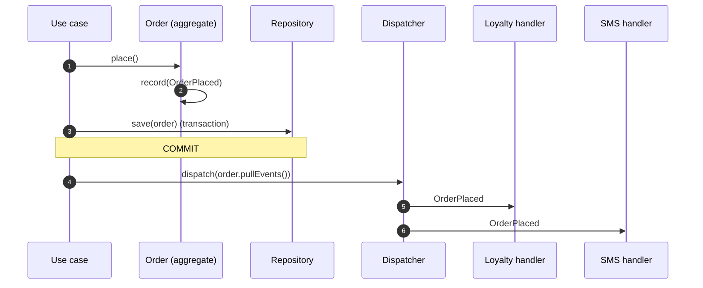
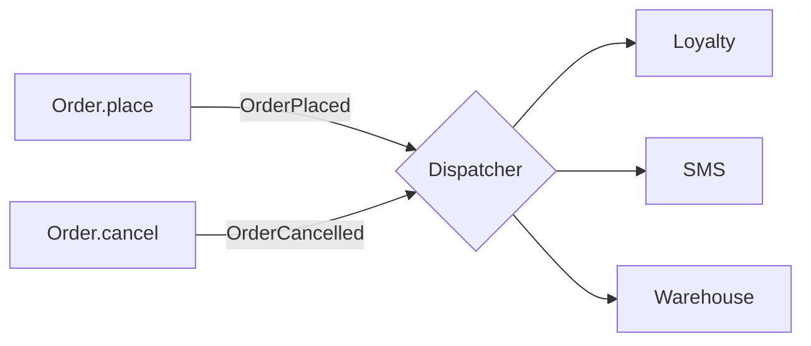
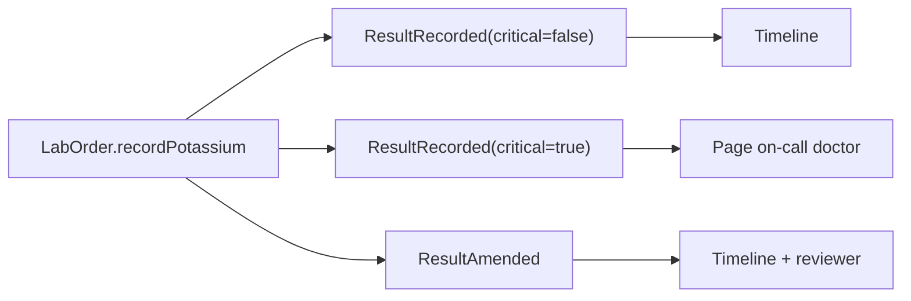
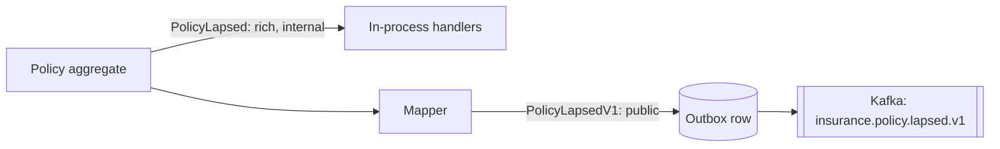

---
tags:
  - Enterprise
  - Intermediate
---

# Domain Events

<span class="badge badge--intermediate">🟡 Intermediate</span>
<span class="badge badge--category">Enterprise / DDD</span>
<span class="badge badge--interview">Interview frequency ⭐⭐⭐⭐</span>

!!! abstract "TL;DR"
    **A Domain Event is an immutable record of something that happened in the business (`OrderPlaced`, `PolicyLapsed`), raised by an aggregate and handled by whoever cares, after the change is committed.**
    Use it to keep aggregates small and decoupled: the order says *what happened*, and loyalty, SMS and the warehouse decide *what to do about it*.

---

## See It in Motion

<iframe class="motion-embed" src="../../motion/index.html?p=domain-events&amp;embed=1" title="Animated walkthrough of the Domain Events pattern" loading="lazy"></iframe>

Press **Play** to watch the calls travel between objects, or step through with **Next** and **Back**. Switch to **Without it** to see what goes wrong without the pattern. [Open the full explorer with all 75 patterns](../motion/index.html#domain-events){ target=_blank }

## 1. Intent & Problem It Solves

**The problem in plain English:** `placeOrder()` starts simple, then grows: award loyalty points, send an SMS, tell the warehouse, update analytics, notify the fraud team. Each addition makes the order module depend on another module, the transaction gets longer, and a failing SMS gateway now blocks orders.

**Definition (Eric Evans; Vaughn Vernon, *Implementing DDD*):**
> Something that happened in the domain that domain experts care about, modelled as an immutable fact in the past tense. Aggregates publish events; other parts of the system subscribe and react, usually eventually consistent.

**Domain event vs integration event:**

| | Domain event | Integration event |
|---|---|---|
| Audience | Same service / bounded context, in-process | Other services, over a broker |
| Shape | Rich, can change with the model | Public contract: versioned, minimal, stable |
| Delivery | After commit, in memory | Through the [Transactional Outbox](../microservices/transactional-outbox.md) |

## 2. Real-World Analogy

!!! example "A hospital PA announcement"
    When a baby is born, the nurse doesn't personally phone the paediatrician, the records office, the billing desk and the family. She announces "baby born in room 12". Each team knows what to do when it hears that. The nurse's job stays the same no matter how many teams start listening.

## 3. Structure



| Participant | Responsibility |
|---|---|
| **Event** | Immutable record, past-tense name, ids + the facts handlers need, `occurredAt` |
| **Aggregate** | Records events as part of a state change; doesn't know the handlers |
| **Dispatcher / publisher** | Delivers events to handlers **after commit** (Spring `ApplicationEventPublisher`) |
| **Handlers** | React: update another aggregate, send notifications, write an outbox row |

## 4. Naive Approach (Without the Pattern)

```java
@Transactional
public void placeOrder(Order o) {
    orders.save(o);
    loyaltyService.addPoints(o.customerId(), o.total() / 100);   // order module depends on loyalty
    smsClient.send(o.phone(), "Order confirmed");                  // network call inside the transaction
    warehouseClient.startPicking(o.id());                          // another one
    analytics.track("order_placed", o);                            // and another
}
```

- :material-close-circle:{ style="color:#e53935" } **High coupling**: every new reaction edits the order module.
- :material-close-circle:{ style="color:#e53935" } **Long, fragile transactions**: an SMS timeout rolls back the order.
- :material-close-circle:{ style="color:#e53935" } Side effects can happen even if the commit later fails.

---

## 5. Three Real-World Examples

### Example 1: Order Raises Events, Modules React (Grocery)

**Scenario:** A grocery modular monolith has ordering, loyalty, notifications and warehouse modules. When an order is placed, loyalty awards 1 point per INR 100, notifications send an SMS and the warehouse starts picking. On cancellation only the warehouse cares. New listeners (analytics, referral bonus) are added every quarter, and the ordering team doesn't want to touch their code each time.

**Design:**



**Full Code:**

=== "DomainEvents.java"

    ```java
    --8<-- "code/enterprise/src/main/java/com/handbook/enterprise/domainevents/grocery/DomainEvents.java"
    ```

    1.  A **sealed** hierarchy lists every event this context can raise; records make each one an immutable fact.
    2.  The aggregate only **records** events in memory; publishing is the application layer's job. Spring Data's `AbstractAggregateRoot.registerEvent` works the same way.

=== "Order.java"

    ```java
    --8<-- "code/enterprise/src/main/java/com/handbook/enterprise/domainevents/grocery/Order.java"
    ```

=== "GroceryEventsDemo.java"

    ```java
    --8<-- "code/enterprise/src/main/java/com/handbook/enterprise/domainevents/grocery/GroceryEventsDemo.java"
    ```

    1.  Events are pulled from the aggregate and dispatched **after** the commit. If the transaction had failed, they'd be discarded with it.

**Output:**

```text
--8<-- "code/outputs/enterprise/domainevents/grocery/GroceryEventsDemo.txt"
```

**Why domain events here:**

- `Order` has **zero** dependencies on loyalty, SMS or warehouse.
- New reactions are new handlers; the order module is closed for modification (OCP).
- Each handler can later move to its own service by switching to integration events.

---

### Example 2: Lab Results and Critical Values (Healthcare)

**Scenario:** A hospital lab system records 40,000 results a day. A potassium value below 2.5 or above 6.0 mmol/L is **critical** and must page the on-call doctor within minutes; normal values just go on the patient timeline. Amended results (e.g., a haemolysed sample re-run) must be flagged for review. Events carry the time they happened for the audit trail.

**Design:**



**Full Code:**

=== "LabEvents.java"

    ```java
    --8<-- "code/enterprise/src/main/java/com/handbook/enterprise/domainevents/healthcare/LabEvents.java"
    ```

    1.  The **aggregate** decides what is critical; the event carries that decision as a fact, so handlers don't re-implement clinical rules.
    2.  An **exhaustive switch** over a sealed interface: add a new event type and every handler that doesn't handle it stops compiling.

=== "LabEventsDemo.java"

    ```java
    --8<-- "code/enterprise/src/main/java/com/handbook/enterprise/domainevents/healthcare/LabEventsDemo.java"
    ```

**Output:**

```text
--8<-- "code/outputs/enterprise/domainevents/healthcare/LabEventsDemo.txt"
```

**Why domain events here:**

- Events are **facts with timestamps**, which is exactly what clinical audit needs.
- Paging, timelines and review queues evolve independently of the lab model.
- Pattern matching keeps handlers explicit and complete.

---

### Example 3: Domain Event to Integration Event (Insurance)

**Scenario:** When a policy lapses (three missed premiums), the policy service's own modules react in-process (renewals schedules a win-back call, claims blocks new claims). Other services (CRM, marketing, the data lake) also need to know, but must **not** see underwriter notes or internal risk scores, and they need a stable, versioned contract. The integration event is written to the outbox in the same transaction.

**Design:**



**Full Code:**

=== "PolicyEvents.java"

    ```java
    --8<-- "code/enterprise/src/main/java/com/handbook/enterprise/domainevents/insurance/PolicyEvents.java"
    ```

    1.  An explicit **mapping** from the internal event to the public contract: anything not copied stays private.
    2.  The integration event is stored as an **outbox row** in the same transaction; a relay publishes it to the broker.

=== "PolicyEventsDemo.java"

    ```java
    --8<-- "code/enterprise/src/main/java/com/handbook/enterprise/domainevents/insurance/PolicyEventsDemo.java"
    ```

**Output:**

```text
--8<-- "code/outputs/enterprise/domainevents/insurance/PolicyEventsDemo.txt"
```

**Why two kinds of event here:**

- The internal model can evolve without breaking other teams.
- Sensitive data is never published by accident.
- The outbox makes cross-service delivery reliable without distributed transactions.

---

??? example "Unit Tests: `DomainEventsTest.java`"

    ```java
    --8<-- "code/enterprise/src/test/java/com/handbook/enterprise/domainevents/DomainEventsTest.java"
    ```

## 6. Variations & Modern Java Take

| Variation | Notes |
|---|---|
| **Record & dispatch after commit** (Example 1) | Aggregate collects; application dispatches after `save` commits |
| **Static `DomainEvents.raise(...)`** | Udi Dahan's original style: convenient but hidden global state; harder to test |
| **Spring `@TransactionalEventListener(phase = AFTER_COMMIT)`** | Handler runs only if the transaction commits; `@Async` to decouple further |
| **Spring Modulith** | `@ApplicationModuleListener` + an event publication registry (persisted, retried) between modules |
| **Event sourcing** | Domain events *are* the state ([Event Sourcing](../microservices/event-sourcing.md)) |
| **Sealed + records + pattern matching** | Exhaustive, type-safe event handling (Example 2) |

## 7. Where It Lives in Real Frameworks

| Where | Domain events |
|---|---|
| Spring | `ApplicationEventPublisher`, `@EventListener`, `@TransactionalEventListener`, Spring Data `AbstractAggregateRoot` / `@DomainEvents` |
| Spring Modulith | Module-to-module events with an outbox-like publication log, `Scenario` testing API |
| Axon | `AggregateLifecycle.apply(event)`, event handlers, sagas |
| Jakarta CDI | `Event<T>.fire()`, `@Observes(during = TransactionPhase.AFTER_SUCCESS)` |
| Debezium / outbox | Integration events leave the database via CDC |

## 8. Pros, Cons & Trade-offs

| ✅ Pros | ❌ Cons |
|---|---|
| Decouples the aggregate from its consequences | Flow is harder to follow ("who handles this?") |
| Small transactions; side effects outside them | Eventual consistency between aggregates |
| Natural audit trail and integration point | Handler failures need retries and monitoring |
| Easy to add reactions (OCP) | Event schemas become contracts to version |

## 9. Pitfalls & Anti-Patterns

!!! danger "Publishing before commit"
    Sending the SMS inside the transaction means a later commit failure leaves the customer with a confirmation for an order that doesn't exist (coding challenge). Dispatch after commit, or use an outbox.

!!! danger "Leaking internal events to other services"
    Publishing domain events straight to Kafka turns every internal refactor into a breaking change and may leak sensitive fields. Map to integration events.

!!! warning "Command disguised as an event"
    `SendSmsEvent` is a command with one intended receiver. Events describe what **happened** (`OrderPlaced`), not what someone should do.

!!! warning "Fat events vs thin events"
    Thin events (`{orderId}`) force every handler to call back for data; fat events (full order) couple consumers to your model. Include what consumers *need* to act, plus ids.

## 10. Senior / Architect Deep Dive (10–15 yrs)

**Delivery guarantees in-process.** `@TransactionalEventListener(AFTER_COMMIT)` runs after commit, but if the JVM crashes in between, the event is lost. For must-not-lose reactions inside one service, persist the event (Spring Modulith's publication registry, or your own outbox table) and retry until handlers succeed.

**Ordering and idempotency.** Handlers should tolerate duplicates (an at-least-once relay) and out-of-order arrival. Include the aggregate id and a sequence/version so consumers can detect gaps or stale events.

**Events as the integration backbone.** Once integration events flow through a broker, they become the API between teams: give each a schema in a registry (Avro/Protobuf/JSON Schema), a topic naming convention (`<context>.<aggregate>.<event>.v1`) and compatibility rules (backward-compatible changes only).

!!! bug "War story: the confirmation for a phantom order"
    A grocery checkout sent the "order confirmed" SMS from inside the `@Transactional` method. On busy evenings, a unique-constraint violation on the invoice number occasionally failed the commit after the SMS was sent. About 200 customers a week waited for orders that didn't exist and then called support.
    **Fix:** the aggregate records `OrderPlaced`; the SMS handler became an `@TransactionalEventListener(AFTER_COMMIT)` reading from a persisted publication log.
    **Lesson:** side effects follow the commit, never precede it.

## 11. Related Patterns & Comparisons

| | Domain Event | Observer | Integration Event | Command |
|---|---|---|---|---|
| Meaning | A business fact | "Something changed" callback | Business fact as a public contract | A request to do something |
| Coupling | Aggregate doesn't know handlers | Subject holds observer list | Producer doesn't know consumers | Sender knows the receiver |
| Delivery | In-process, after commit | Immediate, synchronous | Broker via outbox | Direct call / queue |

Domain events are the domain-level form of [Observer](../behavioral/observer.md); across services they travel via [Transactional Outbox](../microservices/transactional-outbox.md) to [Idempotent Consumers](../microservices/idempotent-consumer.md).

## 12. Interview Corner

=== "🟢 Beginner / Service Companies"

    **Q1. What is a domain event?**

    An immutable record of something meaningful that happened in the business, named in the past tense, like `OrderPlaced`.

    **Q2. Why past tense?**

    Because it's a fact that already happened; handlers can't reject it, only react.

    **Q3. How do you publish events in Spring?**

    `ApplicationEventPublisher.publishEvent(event)` and handle with `@EventListener` or `@TransactionalEventListener`.

    **Q4. What's in an event?**

    Ids, the relevant facts, and when it happened (`occurredAt`).

    **Q5. Event vs command?**

    A command asks for something to be done (may be rejected); an event reports something that was done.

=== "🟡 Mid-Level"

    **Q1. `@EventListener` vs `@TransactionalEventListener`?**

    The first runs immediately when published (inside the transaction); the second waits for a transaction phase, usually after commit.

    **Q2. Domain vs integration events?**

    Domain events are internal and can change freely; integration events are a versioned public contract sent through a broker.

    **Q3. How do you make handler side effects reliable?**

    Persist events (outbox / publication registry), retry handlers, make them idempotent.

    **Q4. Where should events be raised?**

    In aggregate methods that change state, so an event can't exist without the state change.

    **Q5. How do you test events?**

    Call the aggregate method and assert on `pullEvents()`; test handlers separately with a given event.

=== "🔴 Senior / FAANG / SAP"

    **Q1. "Design event-driven integration between ordering, payments and inventory."**

    Each service publishes integration events via an outbox; consumers are idempotent; a saga coordinates the multi-step flow; schemas in a registry with compatibility checks.

    **Q2. "How do you version events?"**

    Additive changes stay in v1 (optional fields); breaking changes get a new type/topic (v2) published alongside v1 during migration.

    **Q3. "Fat vs thin events?"**

    Trade-off between consumer autonomy and coupling; a common middle ground is "event-carried state transfer" for data consumers need, plus ids.

    **Q4. "Handlers are slow and delay the response."**

    Make them async after commit, move them out of process via the broker, or give them their own thread pool/bulkhead.

    **Q5. "How do you keep the flow understandable?"**

    Event catalogue (AsyncAPI), tracing across handlers, Spring Modulith's documentation generation, and naming conventions.

=== "💻 Coding Challenge"

    **Problem:** A use case sends a confirmation SMS while saving the order. The commit sometimes fails. Show the bug and fix it by recording the event and publishing after commit.

    ??? success "Solution"

        === "PublishTimingDemo.java"

            ```java
            --8<-- "code/enterprise/src/main/java/com/handbook/enterprise/domainevents/timing/PublishTimingDemo.java"
            ```

        **Output:**

        ```text
        --8<-- "code/outputs/enterprise/domainevents/timing/PublishTimingDemo.txt"
        ```

        **Key points to say:** side effects that can't be rolled back (SMS, email, HTTP calls) must happen after commit. Recorded events live and die with the transaction. For other services, write an outbox row in the same transaction instead.

!!! info "Behavioural tie-in (STAR) for experienced candidates"
    - **S:** Around 200 customers a week got confirmations for orders that had rolled back.
    - **T:** Guarantee notifications only for committed orders, without slowing checkout.
    - **A:** Introduced domain events recorded by the `Order` aggregate, moved notifications to after-commit listeners backed by a persisted publication log, and added retries with idempotency keys.
    - **R:** Phantom confirmations dropped to zero; checkout p95 improved by 120 ms because the SMS call left the transaction.

## 13. Quick Revision Card

!!! tip "Remember in 30 seconds"
    - **Past-tense, immutable business facts** raised by aggregates.
    - Record during the change; **dispatch after commit**.
    - Handlers decouple consequences from the aggregate.
    - Domain events internal; **integration events** public, versioned, via outbox.
    - Handlers idempotent; events carry ids and `occurredAt`.

    ```java
    @TransactionalEventListener(phase = TransactionPhase.AFTER_COMMIT) void on(OrderPlaced e) { sms.send(...); }
    ```

## Practice

- [ ] Add an `OrderDelivered` event and a handler that asks for a rating 2 hours later.
- [ ] Make `Dispatcher` catch handler exceptions so one failing handler doesn't stop the others; log the failure.
- [ ] Map `OrderPlaced` to an integration event `ordering.order.placed.v1` with only ids and total.

---

[:material-arrow-left: Aggregate](aggregate.md){ .md-button }
[Next: Testing Patterns :material-arrow-right:](../testing/index.md){ .md-button .md-button--primary }
