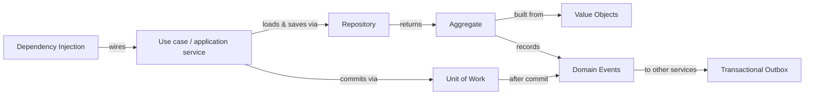

# Enterprise & DDD Patterns

These patterns sit **between** the GoF classics and the architecture styles. They answer the questions every business application hits on day one: how objects get their collaborators, how domain objects are loaded and saved, how several changes commit together, how to model concepts precisely, where consistency boundaries go, and how one part of the domain tells the others that something happened.

They come mostly from Martin Fowler's *Patterns of Enterprise Application Architecture* (2002) and Eric Evans' *Domain-Driven Design* (2003), and they are what Spring, JPA/Hibernate and Spring Data implement for you. Knowing them is the difference between *using* `@Transactional` and `JpaRepository` and *understanding* them.

| Pattern | Problem it solves | Interview frequency | Status |
|---|---|---|---|
| [Dependency Injection (IoC)](dependency-injection.md) | Classes get collaborators from outside, so they can be swapped and tested | ⭐⭐⭐⭐⭐ | ✅ |
| [Repository](repository.md) | Collection-like access to aggregates; business logic free of SQL | ⭐⭐⭐⭐⭐ | ✅ |
| [Unit of Work & Identity Map](unit-of-work.md) | Commit many changes atomically; one object per row per transaction | ⭐⭐⭐⭐ | ✅ |
| [Value Object](value-object.md) | Model concepts like Quantity or PhoneNumber precisely, instead of primitives | ⭐⭐⭐⭐ | ✅ |
| [Aggregate](aggregate.md) | Consistency boundaries: what must be true at commit, and what can be eventual | ⭐⭐⭐⭐ | ✅ |
| [Domain Events](domain-events.md) | Aggregates announce what happened; other modules react after commit | ⭐⭐⭐⭐ | ✅ |

## How they fit together

A typical request in a hexagonal Spring service: the controller calls a **use case** (wired by **DI**) that opens a **unit of work** (`@Transactional`), loads an **aggregate** through its **repository**, calls a command method that checks invariants using **value objects** and records **domain events**, saves, commits, and then dispatches the events.

## Suggested learning order

1. [Dependency Injection](dependency-injection.md): the foundation for everything else.
2. [Value Object](value-object.md) → [Aggregate](aggregate.md): how to model the domain.
3. [Repository](repository.md) → [Unit of Work & Identity Map](unit-of-work.md): how to persist it.
4. [Domain Events](domain-events.md): how aggregates communicate, leading into the [microservices](../microservices/index.md) patterns.

!!! tip "The one-sentence interview answer"
    "I keep business rules in **aggregates** built from **value objects**, load and save them through **repositories**, make each use case one **unit of work**, let aggregates raise **domain events** that are handled after commit, and wire it all with **constructor injection** so every piece is testable on its own."

---

[:material-arrow-left: Modular Monolith](../architecture/modular-monolith.md){ .md-button }
[Start: Dependency Injection :material-arrow-right:](dependency-injection.md){ .md-button .md-button--primary }
