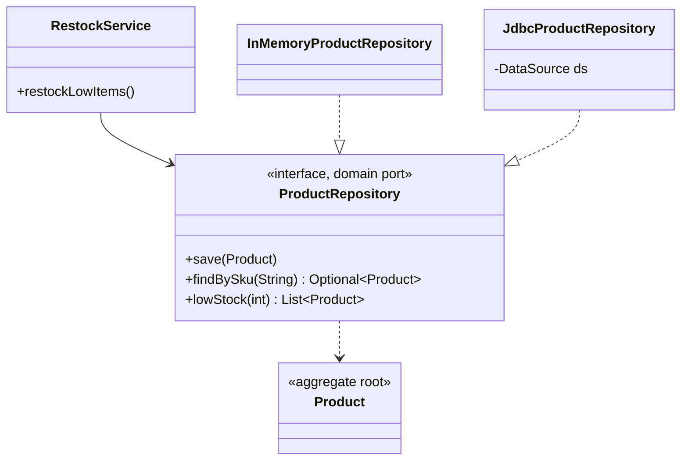
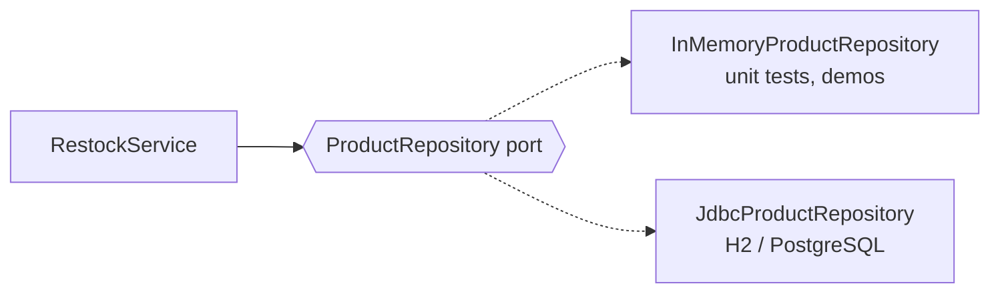
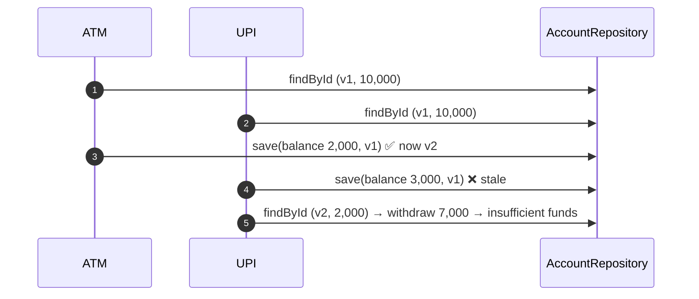
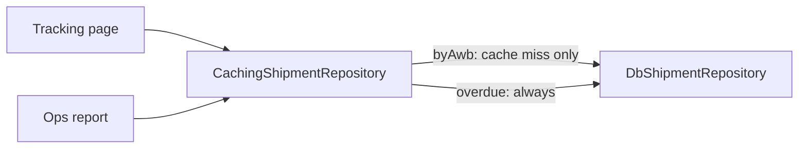

---
tags:
  - Enterprise
  - Intermediate
---

# Repository

<span class="badge badge--intermediate">🟡 Intermediate</span>
<span class="badge badge--category">Enterprise</span>
<span class="badge badge--interview">Interview frequency ⭐⭐⭐⭐⭐</span>

!!! abstract "TL;DR"
    **A Repository looks like an in-memory collection of domain objects (`save`, `findBySku`, `lowStock`) and hides how they are stored.**
    Use it whenever business logic needs to load or save aggregates, so the logic never contains SQL, JPA queries or HTTP calls to a storage service.

---

## See It in Motion

<iframe class="motion-embed" src="../../motion/index.html?p=repository&amp;embed=1" title="Animated walkthrough of the Repository pattern" loading="lazy"></iframe>

Press **Play** to watch the calls travel between objects, or step through with **Next** and **Back**. Switch to **Without it** to see what goes wrong without the pattern. [Open the full explorer](../motion/index.html#repository){ target=_blank }

## 1. Intent & Problem It Solves

**The problem in plain English:** when a restock rule contains `SELECT ... WHERE stock < ?` and `ResultSet` mapping, three things go wrong. You can't unit-test the rule without a database; changing the schema means editing business code; and the same query gets copy-pasted into five services with five slightly different bugs.

**Definition (Martin Fowler, *PoEAA*; Eric Evans, *DDD*):**
> Mediates between the domain and data mapping layers using a collection-like interface for accessing domain objects. In DDD, there is one repository per **aggregate root**.

In a hexagonal service the repository **interface is a port** in the domain layer; the JDBC/JPA class is an **adapter** in infrastructure.

**Repository vs DAO:** a DAO mirrors a **table** (`insertRow`, `updateColumn`) and lives in the data layer. A Repository speaks the **domain's** language (`overdue(asOf)`, `lowStock(threshold)`), returns whole aggregates, and its interface belongs to the domain. A repository is often *implemented* with one or more DAOs.

## 2. Real-World Analogy

!!! example "A library's front desk"
    You ask the librarian for "the latest edition of *Clean Code*". You don't care whether it's on shelf 4B, in the basement archive or on loan from another branch. The desk (repository) speaks in **books and editions**, not in shelf coordinates (tables and rows).

## 3. Structure



| Participant | Responsibility |
|---|---|
| **Aggregate root** (`Product`) | The domain object that is loaded and saved as a unit |
| **Repository interface** | Domain-language operations; owned by the domain/application layer |
| **Repository implementation** | SQL/JPA/NoSQL/HTTP details, mapping rows ↔ objects, optimistic locking |
| **Client** (`RestockService`) | Business logic that only sees the interface |

## 4. Naive Approach (Without the Pattern)

```java
public List<String> restockLowItems(int threshold) throws SQLException {
    try (var c = dataSource.getConnection();
         var ps = c.prepareStatement("SELECT sku, stock FROM product WHERE stock < ?")) {   // SQL in business code
        ps.setInt(1, threshold);
        var rs = ps.executeQuery();
        while (rs.next()) { /* mapping + business rule + UPDATE, all tangled */ }
    }
}
```

- :material-close-circle:{ style="color:#e53935" } **Business rule untestable** without a database.
- :material-close-circle:{ style="color:#e53935" } **SRP violation**: persistence and policy in one method.
- :material-close-circle:{ style="color:#e53935" } Queries duplicated wherever products are needed.

---

## 5. Three Real-World Examples

### Example 1: One Restock Service, Two Adapters (Grocery)

**Scenario:** A dark store tracks 8,000 SKUs. Every 15 minutes a job tops up anything below 10 units. The rule must be unit-tested in milliseconds and run against PostgreSQL in production. Both adapters must behave **identically**, so a single contract test runs against each.

**Design:**



**Full Code:**

=== "ProductRepository.java"

    ```java
    --8<-- "code/enterprise/src/main/java/com/handbook/enterprise/repository/grocery/ProductRepository.java"
    ```

    1.  The interface speaks **domain language** and returns domain objects. No `ResultSet`, no `EntityManager`.
    2.  An **intention-revealing finder**. Prefer `lowStock(threshold)` over a generic `findBy(String where)`.

=== "JdbcProductRepository.java"

    ```java
    --8<-- "code/enterprise/src/main/java/com/handbook/enterprise/repository/grocery/JdbcProductRepository.java"
    ```

    1.  `save` is an **upsert**: callers think "put it in the collection", not "insert vs update".
    2.  All row ↔ object mapping is here. Schema changes stop at this file.

=== "InMemoryProductRepository.java"

    ```java
    --8<-- "code/enterprise/src/main/java/com/handbook/enterprise/repository/grocery/InMemoryProductRepository.java"
    ```

=== "RestockService.java"

    ```java
    --8<-- "code/enterprise/src/main/java/com/handbook/enterprise/repository/grocery/RestockService.java"
    ```

=== "Product.java"

    ```java
    --8<-- "code/enterprise/src/main/java/com/handbook/enterprise/repository/grocery/Product.java"
    ```

=== "GroceryRepositoryDemo.java"

    ```java
    --8<-- "code/enterprise/src/main/java/com/handbook/enterprise/repository/grocery/GroceryRepositoryDemo.java"
    ```

**Output:**

```text
--8<-- "code/outputs/enterprise/repository/grocery/GroceryRepositoryDemo.txt"
```

**Why a repository here:**

- The restock rule is tested against the in-memory adapter in **microseconds**.
- The **same contract test** (see Unit Tests) runs against both adapters, so the fake can't drift from reality.
- Switching PostgreSQL for DynamoDB touches one class.

---

### Example 2: Optimistic Locking in the Repository (Banking)

**Scenario:** A savings account has INR 10,000. The customer withdraws INR 8,000 at an ATM while a UPI payment of INR 7,000 is in flight. Both channels loaded the same balance. Without protection, the second save overwrites the first and the bank loses INR 7,000 (a **lost update**). The repository rejects stale writes using a version number, like `UPDATE account SET ... WHERE id = ? AND version = ?`.

**Design:**



**Full Code:**

=== "AccountRepository.java"

    ```java
    --8<-- "code/enterprise/src/main/java/com/handbook/enterprise/repository/banking/AccountRepository.java"
    ```

    1.  The repository enforces **optimistic concurrency**: the save succeeds only if the stored version equals the version the caller loaded. JPA does this with `@Version`.

=== "BankingRepositoryDemo.java"

    ```java
    --8<-- "code/enterprise/src/main/java/com/handbook/enterprise/repository/banking/BankingRepositoryDemo.java"
    ```

    1.  The correct reaction to a version conflict: **reload and re-run the business rule** on fresh state, never blindly retry the same write.

**Output:**

```text
--8<-- "code/outputs/enterprise/repository/banking/BankingRepositoryDemo.txt"
```

**Why a repository here:**

- Concurrency control belongs with **persistence**, so every caller gets it for free.
- The aggregate (`Account`) still enforces its own invariant (no overdraft).
- Callers work with whole aggregates, never with half-updated rows.

---

### Example 3: Domain Finders and a Caching Decorator (Logistics)

**Scenario:** A courier's tracking page is refreshed about 1,000 times per parcel on delivery day. Ops also run an "overdue shipments" report. The tracking lookup should be cached; the report must always be fresh. Because callers depend on the `ShipmentRepository` interface, caching is added as a **decorator** without touching them.

**Design:**



**Full Code:**

=== "Shipments.java"

    ```java
    --8<-- "code/enterprise/src/main/java/com/handbook/enterprise/repository/logistics/Shipments.java"
    ```

    1.  A **domain question** as a method (`overdue(asOf)`), not `findByDeliveredFalseAndPromisedBefore`. Spring Data can generate either; the domain name reads better at call sites.
    2.  A **decorator** implementing the same port: callers can't tell it's there.

=== "LogisticsRepositoryDemo.java"

    ```java
    --8<-- "code/enterprise/src/main/java/com/handbook/enterprise/repository/logistics/LogisticsRepositoryDemo.java"
    ```

**Output:**

```text
--8<-- "code/outputs/enterprise/repository/logistics/LogisticsRepositoryDemo.txt"
```

**Why a repository here:**

- An interface gives you a seam for **cross-cutting concerns** (caching, metrics, tenant filters).
- Finder names document the business questions the system answers.
- The cached and uncached paths are explicit, not hidden in an ORM's second-level cache.

---

??? example "Unit Tests: `RepositoryTest.java`"

    ```java
    --8<-- "code/enterprise/src/test/java/com/handbook/enterprise/repository/RepositoryTest.java"
    ```

## 6. Variations & Modern Java Take

| Variation | Notes |
|---|---|
| **Spring Data repositories** | `interface ProductRepository extends JpaRepository<Product, String>`: derived queries, `@Query`, paging. Fast to write; leaks JPA types into callers unless you wrap it |
| **Port + adapter** (hexagonal) | Your own interface in `domain`; a Spring Data repository used *inside* the adapter. Keeps the domain framework-free |
| **Specification-based** | `findAll(Specification<T>)` for dynamic filters (see [Specification](../behavioral/specification.md)) |
| **Read-only query repositories** | For CQRS read models: return DTOs/projections, not aggregates |
| Records as aggregates | Immutable records + `withX` methods; the repository saves the new version |

## 7. Where It Lives in Real Frameworks

| Where | Repository |
|---|---|
| Spring Data | `CrudRepository`, `JpaRepository`, `MongoRepository`, `R2dbcRepository`, `@Repository` (also translates exceptions to `DataAccessException`) |
| Jakarta Data (EE 11) | `@Repository` interfaces with `@Find`, `@Insert`, `@Query` |
| Hibernate / JPA | `EntityManager` is the Unit of Work underneath; `@Version` for optimistic locking |
| Micronaut Data | Compile-time generated repositories |
| Axon / event-sourced systems | `Repository<Aggregate>` that loads by replaying events |

## 8. Pros, Cons & Trade-offs

| ✅ Pros | ❌ Cons |
|---|---|
| Business logic is **storage-agnostic** and unit-testable | Another layer of interfaces and mapping code |
| Queries live in one place, named by intent | Easy to over-generalize into a leaky "generic repository" |
| Seam for caching, auditing, multi-tenancy, optimistic locking | Hides query cost: an innocent `findAll()` can load a million rows |
| One repository per aggregate enforces consistency boundaries | Mapping domain ↔ entity is extra work in rich domains |

## 9. Pitfalls & Anti-Patterns

!!! danger "Generic repository with `findBy(String where)`"
    `Repository<T>.query(String sql)` pushes SQL back into business code and makes every caller depend on the schema. Expose **named, typed** finders.

!!! danger "Returning `IQueryable`-style builders or JPA entities everywhere"
    If callers build `CriteriaQuery` or touch lazy-loaded `@Entity` graphs, the repository hides nothing. Lazy-loading outside a transaction becomes `LazyInitializationException` in a controller.

!!! warning "One repository per table"
    Repositories are per **aggregate root**. An `OrderLineRepository` lets code modify lines without going through `Order`, bypassing its invariants.

!!! warning "In-memory fakes that don't copy"
    A `HashMap` that hands out stored objects lets tests "save" without calling `save()`. See the coding challenge.

## 10. Senior / Architect Deep Dive (10–15 yrs)

**Where transactions go.** The repository does *not* open transactions per call; the application service (use case) owns the transaction boundary (`@Transactional`) so several repository calls commit together. That's the [Unit of Work](unit-of-work.md).

**Performance.** Design finders for the access patterns you actually have: `lowStock(threshold)` can use an index on `stock`; a generic `findAll().stream().filter(...)` can't. Watch for N+1 queries when aggregates contain collections; use fetch joins or batch loading inside the adapter.

**Contract tests for adapters.** Write one abstract test suite for the port and run it against the in-memory and the real adapter (Testcontainers PostgreSQL in CI). That is what keeps fakes honest.

!!! bug "War story: the fake that hid a lost update"
    A team's checkout tests used an in-memory `InventoryRepository` backed by a `HashMap` that returned stored objects directly. A refactor dropped a `save()` call; tests still passed because the mutated object was the stored one. In production with JPA in a read-only transaction, stock never decreased and the store oversold 400 units of mangoes during a sale.
    **Fix:** the fake now copies in and out, and the same contract suite runs against the JPA adapter with Testcontainers.
    **Lesson:** a fake repository must behave like a database, not like a shared object.

## 11. Related Patterns & Comparisons

| | Repository | DAO | Active Record | Unit of Work |
|---|---|---|---|---|
| Speaks in | Aggregates, domain terms | Tables, rows | The object saves itself (`order.save()`) | Changes to track |
| Interface owned by | Domain | Data layer | The entity | Infrastructure |
| Best for | Rich domains, hexagonal | Simple data access | CRUD apps (Rails, Panache) | Committing many changes atomically |

## 12. Interview Corner

=== "🟢 Beginner / Service Companies"

    **Q1. What is the Repository pattern?**

    A collection-like interface (`save`, `findById`) that hides how domain objects are stored.

    **Q2. What does Spring's `@Repository` do?**

    Marks a persistence bean and enables translation of vendor exceptions to Spring's `DataAccessException` hierarchy.

    **Q3. `CrudRepository` vs `JpaRepository`?**

    `JpaRepository` extends it with JPA-specific features: `flush`, batch deletes, `findAll(Sort)`, paging via `PagingAndSortingRepository`.

    **Q4. Repository vs DAO?**

    DAO is table-oriented; Repository is aggregate- and domain-oriented. Repositories often use DAOs internally.

    **Q5. How do you test a service that uses a repository?**

    Pass an in-memory implementation or a mock into its constructor.

=== "🟡 Mid-Level"

    **Q1. Why one repository per aggregate root?**

    So all changes go through the root, which enforces invariants (an order total can't diverge from its lines).

    **Q2. What is optimistic locking and where does it live?**

    A version column checked on update; a mismatch means someone else changed the row. In the repository/ORM (`@Version`).

    **Q3. How do you avoid N+1 queries?**

    Fetch joins / entity graphs, batch fetching, or purpose-built read models.

    **Q4. Should repositories return `Optional`?**

    Yes for single lookups (`findById`), so "not found" is explicit.

    **Q5. Where should `@Transactional` go?**

    On the application service/use case, not on each repository method.

=== "🔴 Senior / FAANG / SAP"

    **Q1. "Spring Data in the domain, or your own interface?"**

    For CRUD services Spring Data directly is fine. For rich domains, define a domain port and implement it with Spring Data inside an adapter; the domain then doesn't depend on Spring or JPA.

    **Q2. "How do you keep in-memory fakes honest?"**

    A shared contract test suite run against every adapter, including the real database via Testcontainers.

    **Q3. "A report query is slow and joins five aggregates."**

    Don't bend the aggregate repositories. Add a **read model** (SQL view, materialized view or CQRS projection) with its own query repository.

    **Q4. "How do repositories work with event sourcing?"**

    `load(id)` replays the aggregate's events (plus snapshot); `save` appends new events with an expected-version check.

    **Q5. "Multi-tenant data: where do you enforce tenant isolation?"**

    In the repository adapter (or with PostgreSQL row-level security), never trusting callers to add `WHERE tenant_id = ?`.

=== "💻 Coding Challenge"

    **Problem:** An in-memory `CartRepository` is used in tests. Show how it can make a test pass even when the code forgets to call `save()`, and fix it.

    ??? success "Solution"

        === "LeakyRepositoryDemo.java"

            ```java
            --8<-- "code/enterprise/src/main/java/com/handbook/enterprise/repository/copies/LeakyRepositoryDemo.java"
            ```

        **Output:**

        ```text
        --8<-- "code/outputs/enterprise/repository/copies/LeakyRepositoryDemo.txt"
        ```

        **Key points to say:** a real database stores a *copy*; your fake must too (copy in on `save`, copy out on `find`), or use immutable aggregates. Then back it with a contract test against the real adapter.

!!! info "Behavioural tie-in (STAR) for experienced candidates"
    - **S:** A sale oversold 400 units because a missing `save()` was hidden by a leaky in-memory repository.
    - **T:** Make repository fakes trustworthy and prevent the regression.
    - **A:** Rewrote fakes to copy in/out, created one contract test suite per port, and ran it against PostgreSQL in Testcontainers in CI.
    - **R:** Two more latent persistence bugs were caught in the first week; no stock-related incidents in the next three sales.

## 13. Quick Revision Card

!!! tip "Remember in 30 seconds"
    - **Collection-like interface for aggregates**; hides storage.
    - Interface in the **domain**, implementation in **infrastructure**.
    - One repository per **aggregate root**; named, intention-revealing finders.
    - Optimistic locking (`@Version`) belongs here; transactions belong in the use case.
    - Contract-test every adapter, including the fake.

    ```java
    interface ProductRepository { void save(Product p); Optional<Product> findBySku(String sku); List<Product> lowStock(int t); }
    ```

## Practice

- [ ] Add `delete(String sku)` to the port and both adapters, with a contract test.
- [ ] Add a `version` column to `JdbcProductRepository` and reject stale saves.
- [ ] Add a metrics decorator that counts calls per finder.

---

[:material-arrow-left: Dependency Injection](dependency-injection.md){ .md-button }
[Next: Unit of Work & Identity Map :material-arrow-right:](unit-of-work.md){ .md-button .md-button--primary }
