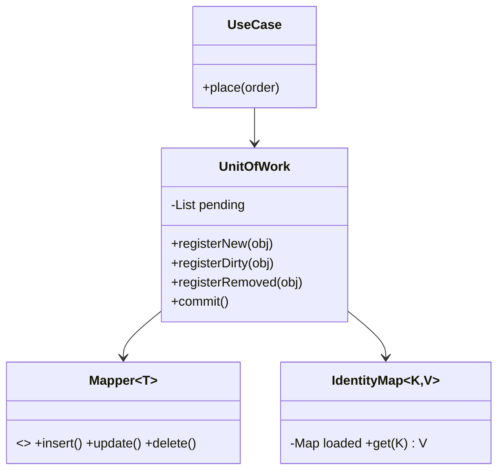
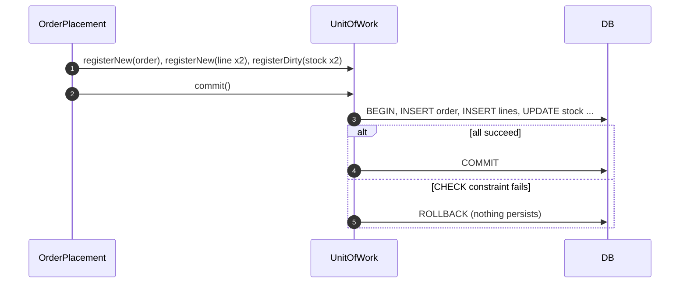
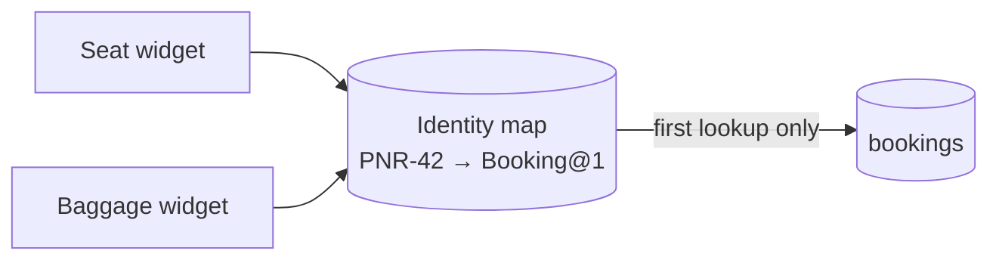
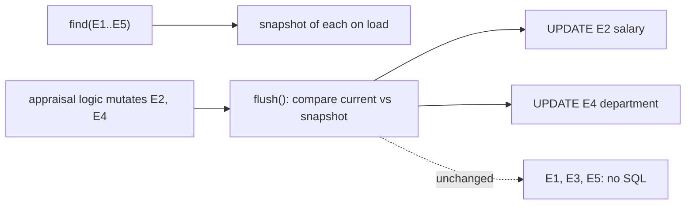

---
tags:
  - Enterprise
  - Intermediate
---

# Unit of Work & Identity Map

<span class="badge badge--intermediate">🟡 Intermediate → 🔴 Advanced</span>
<span class="badge badge--category">Enterprise</span>
<span class="badge badge--interview">Interview frequency ⭐⭐⭐⭐</span>

!!! abstract "TL;DR"
    **A Unit of Work tracks every object a business transaction creates, changes or deletes, and writes them all in one database transaction at the end. An Identity Map makes sure each record is loaded into exactly one object per unit of work.**
    You use both every day: JPA's `EntityManager` / Hibernate's `Session` *is* a unit of work with an identity map (the persistence context).

---

## 1. Intent & Problem It Solves

**The problem in plain English:** placing a grocery order inserts an order row, inserts several line rows and decrements stock for each product. If every repository call commits on its own and the third write fails, you're left with an order that has no lines, or stock taken for an order that doesn't exist. Separately, if two parts of the same request load the same booking, they get **two different objects**; one changes the seat, the other still has the old one and may save it back.

**Definitions (Martin Fowler, *PoEAA*):**
> **Unit of Work:** maintains a list of objects affected by a business transaction and coordinates the writing out of changes and the resolution of concurrency problems.
>
> **Identity Map:** ensures that each object gets loaded only once by keeping every loaded object in a map. Looks up objects using the map when referring to them.

## 2. Real-World Analogy

!!! example "A supermarket trolley and the checkout counter"
    You walk the aisles adding and removing items (registering changes), but **nothing is paid for until the checkout** (commit). If your card is declined, the whole trolley is rejected, not half of it. And there's only **one** trolley per shopper: you don't push two trolleys holding different versions of your shopping (identity map).

## 3. Structure



| Participant | Responsibility |
|---|---|
| **Unit of Work** | Tracks new / dirty / removed objects; opens one transaction on `commit`; rolls back on failure |
| **Identity Map** | One in-memory object per database identity within the unit of work |
| **Mapper** | Knows how to write one kind of object (SQL); the unit of work orders and calls them |
| **Use case / application service** | Starts a unit of work, runs business logic, commits |

## 4. Naive Approach (Without the Pattern)

```java
orderRepo.insert(order);            // auto-commit #1
for (Line l : lines) {
    lineRepo.insert(l);             // auto-commit #2, #3
    stockRepo.decrement(l.sku(), l.qty());   // auto-commit #4 ... throws: stock would go negative
}
// The order and some lines are already committed. Manual cleanup code? Hope?
```

- :material-close-circle:{ style="color:#e53935" } **No atomicity**: partial writes survive failures.
- :material-close-circle:{ style="color:#e53935" } Many round trips and commits instead of one.
- :material-close-circle:{ style="color:#e53935" } Duplicate objects for the same row → lost updates inside one request.

---

## 5. Three Real-World Examples

### Example 1: Order + Lines + Stock, All or Nothing (Grocery)

**Scenario:** During a mango-season flash sale, a dark store receives 200 orders a minute for a product with limited stock. Placing an order writes the order, its lines and the stock decrements. The database has `CHECK (on_hand >= 0)`. If any write fails, **none** of them may persist: no orphan orders, no stock taken for a failed order.

**Design:**



**Full Code:**

=== "UnitOfWork.java"

    ```java
    --8<-- "code/enterprise/src/main/java/com/handbook/enterprise/unitofwork/grocery/UnitOfWork.java"
    ```

    1.  Business code **registers** changes; nothing is written yet. Hibernate does the same when you `persist()` or modify a managed entity.
    2.  One connection, one transaction, for every pending change.
    3.  Any failure rolls back **everything**, so the database never sees a half-placed order.

=== "OrderPlacement.java"

    ```java
    --8<-- "code/enterprise/src/main/java/com/handbook/enterprise/unitofwork/grocery/OrderPlacement.java"
    ```

=== "GroceryUowDemo.java"

    ```java
    --8<-- "code/enterprise/src/main/java/com/handbook/enterprise/unitofwork/grocery/GroceryUowDemo.java"
    ```

**Output:**

```text
--8<-- "code/outputs/enterprise/unitofwork/grocery/GroceryUowDemo.txt"
```

**Why a unit of work here:**

- One business action = one **atomic** database transaction.
- The use case contains no `commit`/`rollback` plumbing.
- Writes are batched at the end, so there are fewer round trips and locks are held for less time.

---

### Example 2: Identity Map in a Check-in Session (Travel)

**Scenario:** An airline's web check-in page renders several widgets in one request: seat map, baggage, meal choice. Each widget loads the booking. Without an identity map there are three database reads and three separate `Booking` objects. When the seat widget upgrades the passenger to 3A, the baggage widget still holds 14C and prints the wrong boarding-pass zone.

**Design:**



**Full Code:**

=== "IdentityMap.java"

    ```java
    --8<-- "code/enterprise/src/main/java/com/handbook/enterprise/unitofwork/travel/IdentityMap.java"
    ```

    1.  Load on first access, then always return **the same instance**. This is why `em.find(Booking.class, id) == em.find(Booking.class, id)` is `true` inside one JPA transaction.

=== "TravelIdentityMapDemo.java"

    ```java
    --8<-- "code/enterprise/src/main/java/com/handbook/enterprise/unitofwork/travel/TravelIdentityMapDemo.java"
    ```

**Output:**

```text
--8<-- "code/outputs/enterprise/unitofwork/travel/TravelIdentityMapDemo.txt"
```

**Why an identity map here:**

- **Consistency inside a request**: everyone sees the same booking state.
- **Fewer reads**: the second lookup is free (a first-level cache).
- Needed by the unit of work to know *which* object to write for a given row.

---

### Example 3: Dirty Checking for an Appraisal Batch (SaaS / ERP)

**Scenario:** An HR system's appraisal job loads 5,000 employee records, but only about 10% get a raise or transfer. Writing back all 5,000 rows would bloat the audit log and contend with other jobs. The unit of work **snapshots** each object when loaded and, at flush, issues an `UPDATE` only for objects whose fields actually changed, and only for those columns.

**Design:**



**Full Code:**

=== "DirtyCheckingSession.java"

    ```java
    --8<-- "code/enterprise/src/main/java/com/handbook/enterprise/unitofwork/erp/DirtyCheckingSession.java"
    ```

    1.  The **snapshot** taken at load time, exactly what Hibernate keeps in its persistence context ("loaded state").
    2.  Only changed objects produce SQL. Setting a field to its existing value is not a change.

=== "ErpDirtyCheckingDemo.java"

    ```java
    --8<-- "code/enterprise/src/main/java/com/handbook/enterprise/unitofwork/erp/ErpDirtyCheckingDemo.java"
    ```

**Output:**

```text
--8<-- "code/outputs/enterprise/unitofwork/erp/ErpDirtyCheckingDemo.txt"
```

**Why dirty checking here:**

- Business code just changes objects; it never calls `update()`.
- Minimal writes: fewer locks, smaller audit trail, less replication traffic.
- Explains JPA behaviour that surprises people: modifying a managed entity **is** a save.

---

??? example "Unit Tests: `UnitOfWorkTest.java`"

    ```java
    --8<-- "code/enterprise/src/test/java/com/handbook/enterprise/unitofwork/UnitOfWorkTest.java"
    ```

## 6. Variations & Modern Java Take

| Variation | Notes |
|---|---|
| **Caller registration** (Example 1) | Code explicitly calls `registerNew/Dirty`. Simple and explicit |
| **Object registration / dirty checking** (Example 3) | The unit of work snapshots on load and detects changes. Hibernate, EclipseLink |
| **Spring `@Transactional`** | Declares the unit-of-work boundary on a use-case method; the persistence context lives for that transaction |
| **Immutable aggregates** | With records, you `save(newVersion)` explicitly and the unit of work just batches those calls |
| **Event-sourced unit of work** | Collect new events from several aggregates and append them atomically with expected versions |
| **Outbox in the same unit of work** | Write the outbox row in the same transaction as the business change ([Transactional Outbox](../microservices/transactional-outbox.md)) |

## 7. Where It Lives in Real Frameworks

| Where | Unit of Work / Identity Map |
|---|---|
| JPA / Hibernate | `EntityManager` / `Session` = unit of work; the **persistence context** = identity map + snapshots; `flush()`, `FlushMode` |
| Spring | `@Transactional`, `TransactionTemplate`, `PlatformTransactionManager`; Open-Session-in-View (and why to disable it) |
| jOOQ / JDBC | No automatic unit of work: `DSLContext.transaction(...)` gives atomicity, you track changes yourself |
| .NET EF Core | `DbContext` + `SaveChanges()`: the same pattern, and a common interview comparison |
| Kafka | Producer transactions group writes to several partitions into one atomic unit |

## 8. Pros, Cons & Trade-offs

| ✅ Pros | ❌ Cons |
|---|---|
| **Atomic** business operations | Long units of work hold memory and, if not careful, locks |
| Fewer, batched writes; minimal `UPDATE`s with dirty checking | "Magic" saves: changing a managed entity writes it, sometimes surprisingly |
| Identity map: consistency within a request + first-level cache | Dirty checking costs CPU proportional to managed objects |
| Business code free of transaction plumbing | Doesn't span services: across services you need a [Saga](../microservices/saga.md) |

## 9. Pitfalls & Anti-Patterns

!!! danger "Units of work that span user think-time"
    Keeping a transaction (or JPA persistence context) open while the user fills a form holds locks and connections. Load, close, then use optimistic locking (a version) when the user submits.

!!! danger "Open Session in View"
    Spring Boot enables it by default (with a warning). Lazy loading in controllers/views fires queries outside your use case, causing N+1 and surprising writes. Set `spring.jpa.open-in-view=false`.

!!! warning "Global identity maps"
    An identity map guarantees **identity, not freshness**. Shared across requests it becomes a stale, thread-unsafe cache (coding challenge). Scope it to one unit of work.

!!! warning "Batch jobs with one giant persistence context"
    Loading 1 million entities in one session exhausts memory and makes every flush slower. Process in chunks: `flush()` + `clear()` every N items.

## 10. Senior / Architect Deep Dive (10–15 yrs)

**Write ordering.** A real unit of work orders writes to satisfy foreign keys: inserts parent-first, deletes child-first. Hibernate uses an action queue sorted by entity type; with `hibernate.order_inserts=true` and JDBC batching, it groups statements into batches.

**Flush vs commit.** `flush()` sends SQL but stays in the transaction; `commit()` makes it durable. JPQL queries trigger an auto-flush so queries see pending changes (`FlushModeType.AUTO`), a frequent source of "why did it run an UPDATE before my SELECT?".

**Consistency beyond one database.** A unit of work is a **local** transaction. Once a business action spans services, replace "one transaction" with a saga plus an outbox written in the same local unit of work, and idempotent consumers on the other side.

!!! bug "War story: the orphaned orders"
    A grocery platform's order service used Spring Data repositories without `@Transactional` on the use case. Each `save()` committed on its own. During a sale, a stock `CHECK` constraint failed after the order and two lines were committed: 3,100 orders appeared in customer apps with no items and no payment. Support refunded nothing (nothing was charged) but spent two days explaining "empty orders".
    **Fix:** `@Transactional` on the application service (one unit of work per use case) and an integration test asserting no rows survive a failed placement.
    **Lesson:** a repository is not a transaction boundary. The use case is.

## 11. Related Patterns & Comparisons

| | Unit of Work | Identity Map | Repository | Saga |
|---|---|---|---|---|
| Purpose | Atomic commit of many changes | One object per row per session | Collection-like access to aggregates | Consistency across services |
| Scope | One local transaction | One unit of work | Per aggregate type | Many services, long-running |
| In JPA | `EntityManager` + `@Transactional` | Persistence context | Spring Data repository | Not provided |

## 12. Interview Corner

=== "🟢 Beginner / Service Companies"

    **Q1. What is a Unit of Work?**

    An object that tracks all changes during a business operation and commits them together in one transaction.

    **Q2. What is the persistence context in JPA?**

    The set of managed entities in an `EntityManager`: an identity map plus change tracking.

    **Q3. What does `@Transactional` do?**

    Starts a transaction before the method and commits after (or rolls back on a runtime exception), via a proxy.

    **Q4. Why does modifying an entity without calling `save()` update the database?**

    Because it's managed: dirty checking at flush detects the change.

    **Q5. What is the first-level cache in Hibernate?**

    The identity map of the session: repeated `find` for the same id returns the same instance without a query.

=== "🟡 Mid-Level"

    **Q1. `flush()` vs `commit()`?**

    Flush sends pending SQL within the transaction; commit ends the transaction and makes changes durable.

    **Q2. Why is Open Session in View considered harmful?**

    It extends the persistence context into the web layer: hidden lazy-loading queries, N+1, connections held longer.

    **Q3. How do you process a million rows with JPA?**

    Chunk: page through, `flush()` and `clear()` every N, or use JDBC/stateless sessions for bulk work.

    **Q4. Why does `@Transactional` on a private method not work?**

    Spring's proxy only intercepts calls that come through the proxy from outside; self-invocation and private methods bypass it.

    **Q5. Which exceptions roll back by default?**

    Unchecked (`RuntimeException`, `Error`). Checked exceptions commit unless you set `rollbackFor`.

=== "🔴 Senior / FAANG / SAP"

    **Q1. "Design the transaction boundaries for checkout across order, payment and inventory services."**

    One local unit of work per service (business change + outbox row); an orchestrated saga connects them; consumers are idempotent; compensations undo on failure.

    **Q2. "Why might dirty checking hurt performance?"**

    Comparing snapshots of thousands of managed entities at every flush. Use read-only transactions/queries (`@Transactional(readOnly = true)`, `Session.setDefaultReadOnly`), DTO projections or smaller contexts.

    **Q3. "How does Hibernate order inserts and deletes?"**

    An action queue: inserts, updates, collection changes, then deletes; with `order_inserts/updates` it groups by entity for JDBC batching while respecting FK order.

    **Q4. "Is an identity map a cache?"**

    It's a per-unit-of-work map that guarantees **identity**. It acts like a cache inside the transaction but must never be shared across transactions or threads.

    **Q5. "How do you get atomicity with immutable aggregates?"**

    Collect `save(newVersion)` calls (plus domain events) in a unit of work and commit together, with optimistic version checks per aggregate.

=== "💻 Coding Challenge"

    **Problem:** A developer made the identity map a static singleton "to save queries". Show what goes wrong when another process updates a price, and fix it.

    ??? success "Solution"

        === "ScopeDemo.java"

            ```java
            --8<-- "code/enterprise/src/main/java/com/handbook/enterprise/unitofwork/scope/ScopeDemo.java"
            ```

        **Output:**

        ```text
        --8<-- "code/outputs/enterprise/unitofwork/scope/ScopeDemo.txt"
        ```

        **Key points to say:** an identity map has no expiry and no invalidation; it's also not thread-safe for concurrent requests. Scope it to one unit of work. If you need cross-request caching, use a real cache with TTL and invalidation ([Cache-Aside](../microservices/cache-aside.md)).

!!! info "Behavioural tie-in (STAR) for experienced candidates"
    - **S:** A sale created 3,100 "empty" orders because each repository call committed separately.
    - **T:** Make order placement atomic without rewriting the service.
    - **A:** Put `@Transactional` on the use case, disabled open-in-view, and added an integration test that injects a stock failure and asserts zero rows remain.
    - **R:** No partial orders since; checkout p95 latency also dropped 18% thanks to batched writes in one transaction.

## 13. Quick Revision Card

!!! tip "Remember in 30 seconds"
    - **Unit of Work**: register changes, then one atomic commit (or rollback).
    - **Identity Map**: one object per row per unit of work; identity, not freshness.
    - JPA `EntityManager` = both; `@Transactional` on the **use case** sets the boundary.
    - Modifying a managed entity is a save (dirty checking).
    - Across services, use a saga + outbox instead.

    ```java
    @Transactional public void place(Order o) { orders.save(o); stock.decrement(o.lines()); } // one unit of work
    ```

## Practice

- [ ] Add `registerRemoved` and order writes: inserts, then updates, then deletes.
- [ ] Make `IdentityMap` keyed by `(type, id)` so several entity types can share it.
- [ ] Add a `readOnly` mode to `DirtyCheckingSession` that skips snapshots entirely.

---

[:material-arrow-left: Repository](repository.md){ .md-button }
[Next: Value Object :material-arrow-right:](value-object.md){ .md-button .md-button--primary }
