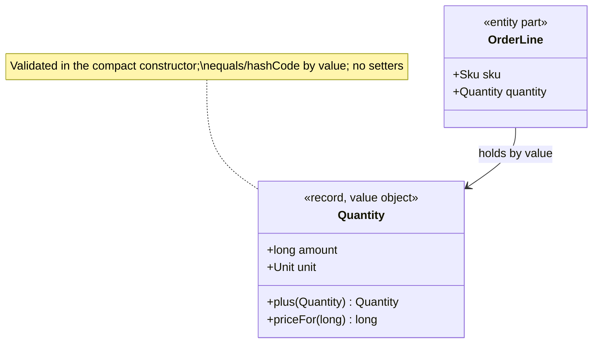
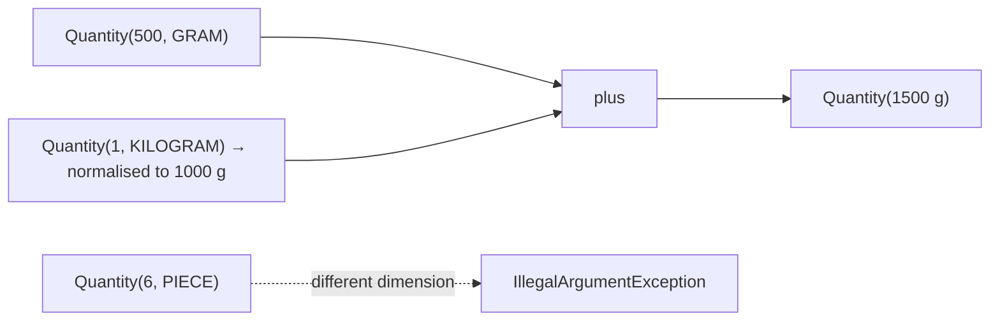
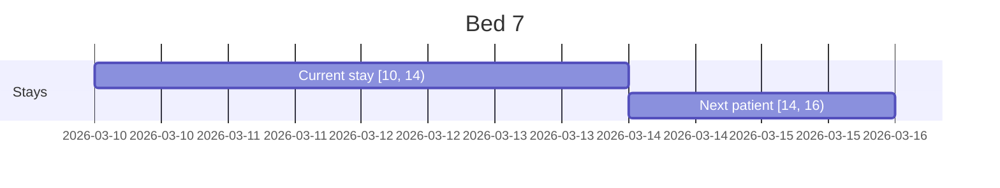
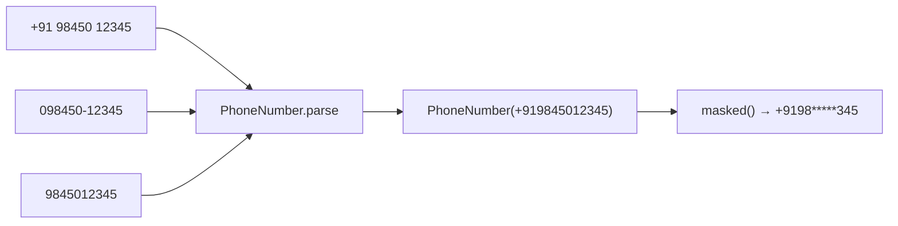

---
tags:
  - Enterprise
  - Beginner
---

# Value Object

<span class="badge badge--beginner">🟢 Beginner → 🟡 Intermediate</span>
<span class="badge badge--category">Enterprise / DDD</span>
<span class="badge badge--interview">Interview frequency ⭐⭐⭐⭐</span>

!!! abstract "TL;DR"
    **A Value Object is a small immutable type defined only by its values (`Quantity`, `PhoneNumber`, `StayPeriod`), with no identity of its own. It validates itself and carries the rules that belong to that concept.**
    Use one whenever a primitive (`String`, `long`, `LocalDate` pair) has rules, units or a format. In Java 21 this is usually a `record`.

---

## See It in Motion

<iframe class="motion-embed" src="../../motion/index.html?p=value-object&amp;embed=1" title="Animated walkthrough of the Value Object pattern" loading="lazy"></iframe>

Press **Play** to watch the calls travel between objects, or step through with **Next** and **Back**. Switch to **Without it** to see what goes wrong without the pattern. [Open the full explorer with all 75 patterns](../motion/index.html#value-object){ target=_blank }

## 1. Intent & Problem It Solves

**The problem in plain English:** `long quantity` doesn't say whether it means grams, kilograms or pieces. `String phone` accepts "098450-12345" and "+91 98450 12345" as two different customers. `LocalDate from, LocalDate to` lets someone create a stay that ends before it starts. Every service re-implements (slightly differently) the same checks. This is called **primitive obsession**.

**Definition (Eric Evans, *Domain-Driven Design*):**
> An object that describes some characteristic or attribute but carries no concept of identity. Value objects are **immutable**, compared by **value** (two `Quantity(2 kg)` are interchangeable), and should be **self-validating** and side-effect free.

**Value Object vs Entity:** an *entity* (Customer, Order) has an identity that persists while its attributes change. A *value* (Address, Money, Quantity) is replaced, not modified. Ask: "If every field is equal, are these the same thing?" If yes, it's a value.

This page is the **domain modelling** view. For the thread-safety view of the same idea, see [Immutable Object](../concurrency/immutable-object.md).

## 2. Real-World Analogy

!!! example "Banknotes"
    You don't care *which* ₹500 note you get back, only that it's ₹500: banknotes are compared by value. A forged ₹700 note can't exist (validation). And you never "edit" a note; you exchange it for different ones (immutability). Your bank account, on the other hand, is an entity: it's still *your* account when the balance changes.

## 3. Structure



| Property | How in Java |
|---|---|
| Immutable | `record` (final fields), withers return new instances |
| Equal by value | Records generate `equals`/`hashCode` from components; **normalise** first so equal values compare equal |
| Self-validating | Compact constructor throws on invalid input; invalid values can't exist |
| Behaviour-rich | Methods like `plus`, `overlaps`, `masked` live on the value, not in services |

## 4. Naive Approach (Without the Pattern)

```java
void addToCart(String sku, long qty, String unit) { ... }            // "kg"? "KG"? "Kilogram"?
boolean bedFree(LocalDate from, LocalDate to, LocalDate from2, LocalDate to2) { ... }  // overlap logic copy-pasted
customerRepo.findByPhone(rawInput);                                 // "098450-12345" ≠ "+919845012345"
```

- :material-close-circle:{ style="color:#e53935" } Validation scattered across controllers, services and SQL.
- :material-close-circle:{ style="color:#e53935" } Easy to mix units, swap arguments and duplicate records.
- :material-close-circle:{ style="color:#e53935" } The domain's vocabulary is invisible in the code.

---

## 5. Three Real-World Examples

### Example 1: Quantity with Units (Grocery)

**Scenario:** A grocery app sells loose vegetables by weight (g/kg) and eggs by count (pieces/dozen). Carts merge quantities from re-orders and substitutions. A past bug added "6 pieces" of eggs to "2 kg" of potatoes in a picking summary. Prices are per kg or per piece, in integer paise.

**Design:**



**Full Code:**

=== "Quantity.java"

    ```java
    --8<-- "code/enterprise/src/main/java/com/handbook/enterprise/valueobject/grocery/Quantity.java"
    ```

    1.  The compact constructor **validates and normalises** (1 kg becomes 1000 g, 1 dozen becomes 12 pieces), so record equality works across units.
    2.  Operations return **new** values and enforce the rule "only add like with like".

=== "QuantityDemo.java"

    ```java
    --8<-- "code/enterprise/src/main/java/com/handbook/enterprise/valueobject/grocery/QuantityDemo.java"
    ```

**Output:**

```text
--8<-- "code/outputs/enterprise/valueobject/grocery/QuantityDemo.txt"
```

**Why a value object here:**

- Units become part of the **type**, not a comment.
- Pricing and addition rules live in one place.
- `Quantity.of(1, KILOGRAM).equals(Quantity.of(1000, GRAM))`, so dedupe and comparisons just work.

---

### Example 2: StayPeriod for Bed Allocation (Healthcare)

**Scenario:** A hospital's bed manager assigns 600 beds. A stay runs from the admission date until the discharge date; a new patient can be admitted to the same bed on the discharge day. Overlap checks were duplicated across four services, and two of them treated the discharge day as occupied, leaving beds empty for a night.

**Design:**



**Full Code:**

=== "StayPeriod.java"

    ```java
    --8<-- "code/enterprise/src/main/java/com/handbook/enterprise/valueobject/healthcare/StayPeriod.java"
    ```

    1.  One correct overlap rule for **half-open** ranges `[start, end)`, used by everyone.
    2.  "Changing" a stay produces a new value; anything holding the old one is unaffected.

=== "StayPeriodDemo.java"

    ```java
    --8<-- "code/enterprise/src/main/java/com/handbook/enterprise/valueobject/healthcare/StayPeriodDemo.java"
    ```

**Output:**

```text
--8<-- "code/outputs/enterprise/valueobject/healthcare/StayPeriodDemo.txt"
```

**Why a value object here:**

- Date-range logic is notoriously easy to get wrong; centralise it once.
- An invalid stay (discharge on or before admission) can't be constructed.
- Services ask the domain question (`overlaps`, `nights`) instead of comparing dates.

---

### Example 3: PhoneNumber Normalisation (Telecom)

**Scenario:** A telecom's sign-up funnel collects numbers from web, app, retail stores and partner kiosks: "+91 98450 12345", "098450-12345", "9845012345". Stored as raw strings, one person became three subscribers with three SIM KYC records. Logs must never print a full number.

**Design:**



**Full Code:**

=== "PhoneNumber.java"

    ```java
    --8<-- "code/enterprise/src/main/java/com/handbook/enterprise/valueobject/telecom/PhoneNumber.java"
    ```

    1.  A **factory** that accepts the messy real-world formats and produces one canonical value. The constructor only accepts canonical form, so every `PhoneNumber` is valid.

=== "PhoneNumberDemo.java"

    ```java
    --8<-- "code/enterprise/src/main/java/com/handbook/enterprise/valueobject/telecom/PhoneNumberDemo.java"
    ```

**Output:**

```text
--8<-- "code/outputs/enterprise/valueobject/telecom/PhoneNumberDemo.txt"
```

**Why a value object here:**

- **Canonical form** makes equality, sets and database uniqueness constraints correct.
- Privacy rules (`masked`) travel with the value.
- Parsing happens once at the edge; the rest of the system trusts the type.

---

??? example "Unit Tests: `ValueObjectTest.java`"

    ```java
    --8<-- "code/enterprise/src/test/java/com/handbook/enterprise/valueobject/ValueObjectTest.java"
    ```

## 6. Variations & Modern Java Take

| Variation | Notes |
|---|---|
| **Records** (Java 16+) | The natural fit: final fields, value equality, compact constructors |
| **Typed IDs** | `record OrderId(UUID value)` instead of `UUID` everywhere (coding challenge) |
| **Enums** | Values with a closed set (`Unit`, `Currency`) |
| **Sealed interfaces of records** | Values with variants: `sealed interface Discount permits Percent, Flat` |
| **JPA mapping** | `@Embeddable` classes (records supported as embeddables since Hibernate 6.2), or `AttributeConverter<PhoneNumber, String>` |
| **Jackson** | Records (de)serialise via their canonical constructor; `@JsonValue`/`@JsonCreator` for single-field values |
| **Project Valhalla** (future) | `value class` will give values without identity at the JVM level (no headers, flattening) |

## 7. Where It Lives in Real Frameworks

| Where | Value objects |
|---|---|
| JDK | `LocalDate`, `Instant`, `Duration`, `BigDecimal`, `UUID`, `Currency`, `URI`, `Optional` |
| Libraries | Joda-Money `Money`, JSR 354 `MonetaryAmount`, libphonenumber `PhoneNumber` |
| Spring | `MediaType`, `HttpMethod`, `DataSize` (`10MB` in config), `Duration` binding in `@ConfigurationProperties` |
| JPA | `@Embeddable` / `@Embedded`, `AttributeConverter` |

## 8. Pros, Cons & Trade-offs

| ✅ Pros | ❌ Cons |
|---|---|
| Invalid states can't be represented | More types and small files |
| Rules live in one place, close to the data | Mapping to DB columns/JSON needs converters |
| Thread-safe and shareable (immutable) | Over-wrapping trivial strings adds ceremony |
| Code reads like the domain language | Allocation per operation (negligible in practice) |

## 9. Pitfalls & Anti-Patterns

!!! danger "Equality without normalisation"
    `record Quantity(long amount, Unit unit)` without normalising makes `1 kg ≠ 1000 g`. Normalise in the compact constructor, or write `equals` yourself.

!!! danger "Mutable value objects"
    A value with setters shared by two orders means changing one order's address changes the other's. Values must be immutable.

!!! warning "Records holding mutable components"
    `record Basket(List<Item> items)` is only shallowly immutable. `List.copyOf` in the constructor.

!!! warning "Validation in the controller only"
    If `new PhoneNumber(...)` accepts anything, every other code path (batch imports, Kafka consumers) can create invalid values. Validate in the constructor.

## 10. Senior / Architect Deep Dive (10–15 yrs)

**Parse, don't validate.** Convert raw input to value objects at the system edge (controllers, message consumers). After that, code receives `PhoneNumber`, not `String`, so the type itself is proof of validation. This removes defensive checks from deep inside services.

**Persistence.** Map values as embedded columns (`quantity_amount`, `quantity_unit`) or converters to one column. Keep the canonical form in the database too, with a unique index (`UNIQUE (phone_e164)`), so duplicates are impossible at both layers.

**APIs and events.** Value objects make great **contract types**: `{"amount": 1500, "unit": "GRAM"}` is unambiguous. Version them carefully: changing a value's canonical form (e.g., kg → g) is a breaking change for consumers.

!!! bug "War story: three subscribers, one person"
    A telecom stored raw phone strings from five channels. The fraud team found customers with up to four active SIM KYC profiles because "098450-12345" and "+91 98450 12345" never matched. Regulators asked for a cleanup within 30 days.
    **Fix:** a `PhoneNumber` value object with canonical E.164 form, used by every channel; a migration normalised 18 million rows and merged 410,000 duplicates; a unique index prevents recurrence.
    **Lesson:** if a value has a canonical form, make it a type.

## 11. Related Patterns & Comparisons

| | Value Object | Entity | Immutable Object | DTO |
|---|---|---|---|---|
| Identity | None (equal by value) | Yes (id) | N/A | None |
| Mutability | Immutable | Mutable over its life | Immutable | Usually mutable |
| Behaviour | Domain rules (`plus`, `overlaps`) | Domain rules + lifecycle | Any | None (data carrier) |
| Purpose | Model a concept precisely | Track something over time | Thread safety | Move data across boundaries |

## 12. Interview Corner

=== "🟢 Beginner / Service Companies"

    **Q1. What is a value object?**

    An immutable object defined by its values, with no identity, like `Money` or `Address`.

    **Q2. Value object vs entity?**

    An entity has an identity that stays the same while attributes change (Customer #42). A value object is equal to any other with the same values.

    **Q3. Why are records good for value objects?**

    Final fields, generated value-based `equals`/`hashCode`/`toString`, and compact constructors for validation.

    **Q4. Give JDK examples.**

    `String`, `LocalDate`, `BigDecimal`, `UUID`, `Duration`.

    **Q5. What is primitive obsession?**

    Using primitives (`String`, `int`) for domain concepts that have rules, which scatters validation and allows mix-ups.

=== "🟡 Mid-Level"

    **Q1. How do you persist a value object with JPA?**

    `@Embeddable` (embedded columns) or an `AttributeConverter` to a single column.

    **Q2. Why normalise in the constructor?**

    So that semantically equal values are also `equals()`-equal and hash the same.

    **Q3. How do typed IDs help?**

    The compiler stops you passing a `CustomerId` where an `OrderId` is expected, or swapping arguments.

    **Q4. Where should parsing happen?**

    At the edges (HTTP, messaging, files): "parse, don't validate".

    **Q5. Can a value object reference an entity?**

    It can hold an entity's **id**, but shouldn't hold the mutable entity itself.

=== "🔴 Senior / FAANG / SAP"

    **Q1. "Model money for a multi-currency marketplace."**

    `Money(long minorUnits, Currency)`; operations only within one currency; explicit `ExchangeRate` value for conversions; allocation that preserves totals; persisted as two columns.

    **Q2. "How do you evolve a value object used in events?"**

    Treat its JSON shape as a contract: add optional fields, never change meaning in place; introduce a new event version for breaking changes.

    **Q3. "When is a value object overkill?"**

    When the primitive has no rules and no ambiguity (a free-text note). Introduce types where bugs or duplication actually appear.

    **Q4. "Values vs entities in an Order aggregate?"**

    `Order` (entity, root), `OrderLine` (entity inside, identified within the order), `Quantity`, `Money`, `Address`, `Sku` (values).

    **Q5. "What will Valhalla change?"**

    Value classes without identity let the JVM flatten them in arrays and fields, removing the allocation/indirection cost of small values.

=== "💻 Coding Challenge"

    **Problem:** `transfer(String from, String to, long paise)` was called with swapped arguments in production. Redesign it so this can't compile, and so negative amounts can't exist.

    ??? success "Solution"

        === "TypedIdsDemo.java"

            ```java
            --8<-- "code/enterprise/src/main/java/com/handbook/enterprise/valueobject/ids/TypedIdsDemo.java"
            ```

        **Output:**

        ```text
        --8<-- "code/outputs/enterprise/valueobject/ids/TypedIdsDemo.txt"
        ```

        **Key points to say:** distinct types (`AccountId`, `Paise`) move mistakes from runtime to compile time; validation lives in the constructor; the method signature documents itself. Two `AccountId` parameters can still be swapped, so name them clearly or use a `Transfer(from, to, amount)` value.

!!! info "Behavioural tie-in (STAR) for experienced candidates"
    - **S:** Duplicate subscriber profiles from unnormalised phone strings triggered a regulatory audit.
    - **T:** Remove duplicates and prevent new ones across five sign-up channels.
    - **A:** Introduced a `PhoneNumber` value object with canonical E.164 form, migrated and merged existing records, added a unique index and an ArchUnit rule banning `String phone` in service signatures.
    - **R:** 410,000 duplicates merged; zero new duplicates in the following year; the audit closed on time.

## 13. Quick Revision Card

!!! tip "Remember in 30 seconds"
    - **No identity; equal by value; immutable; self-validating.**
    - Use a `record` with a compact constructor that validates **and normalises**.
    - Put the rules (`plus`, `overlaps`, `masked`) on the value.
    - Parse at the edge; pass types, not strings, inside.
    - Entity = identity over time; value = replace, don't modify.

    ```java
    record PhoneNumber(String e164) { PhoneNumber { if (!e164.matches("\\+91[6-9]\\d{9}")) throw new IllegalArgumentException(); } }
    ```

## Practice

- [ ] Add `minus` to `Quantity` that refuses to go below zero.
- [ ] Add `StayPeriod.split(LocalDate)` that returns two consecutive stays.
- [ ] Write a JPA `AttributeConverter<PhoneNumber, String>`.

---

[:material-arrow-left: Unit of Work & Identity Map](unit-of-work.md){ .md-button }
[Next: Aggregate :material-arrow-right:](aggregate.md){ .md-button .md-button--primary }
