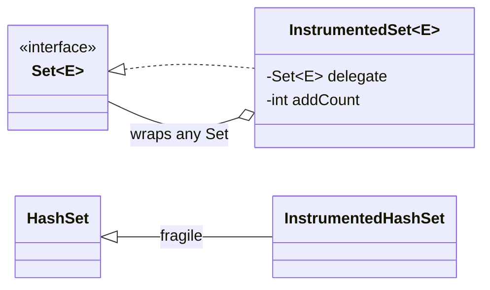

---
tags:
  - Principles
  - Intermediate
---

# Design Principles Beyond SOLID

<span class="badge badge--beginner">🟢 Beginner</span>
<span class="badge badge--intermediate">🟡 Intermediate</span>
<span class="badge badge--interview">Interview frequency ⭐⭐⭐⭐</span>

!!! abstract "TL;DR"
    SOLID tells you how to shape classes and dependencies. These seven principles keep the result **simple, honest and
    safe**: don't repeat knowledge (**DRY**), don't be clever (**KISS**), don't build for imaginary futures (**YAGNI**),
    prefer **composition** to inheritance, talk only to your friends (**Law of Demeter**), **tell** objects what to do instead of
    asking for their data, and **fail fast** on invalid input.

| # | Principle | One-liner | Smell when violated | Pattern/tool that helps |
|---|---|---|---|---|
| 1 | [DRY](#1-dry-dont-repeat-yourself) | One authoritative place for each piece of knowledge | The same rule copy-pasted and drifting | Value objects, Template Method |
| 2 | [KISS](#2-kiss-keep-it-simple) | The simplest solution that works | Clever code nobody can review | Standard library |
| 3 | [YAGNI](#3-yagni-you-arent-gonna-need-it) | Build it when it's needed, not before | Unused interfaces, flags, plug-in points | Refactoring later |
| 4 | [Composition over Inheritance](#4-composition-over-inheritance) | Has-a beats is-a for reuse | Fragile base class, deep trees | Decorator, Strategy |
| 5 | [Law of Demeter](#5-law-of-demeter-principle-of-least-knowledge) | Only talk to your immediate friends | `a.getB().getC().doX()` | Facade, Tell-Don't-Ask |
| 6 | [Tell, Don't Ask](#6-tell-dont-ask) | Send commands, don't pull data and decide | Logic in callers; anemic models | Rich domain model |
| 7 | [Fail Fast](#7-fail-fast) | Reject invalid state immediately, loudly | Wrong results far from the cause | Validating constructors |

---

## 1. DRY: Don't Repeat Yourself

> *"Every piece of knowledge must have a single, unambiguous, authoritative representation within a system."*
> (Andy Hunt & Dave Thomas, *The Pragmatic Programmer*, 1999)

**Key point:** DRY is about **knowledge**, not about text. Two identical-looking lines that represent *different* rules
are not duplication. One rule written in two different ways *is*.

=== "❌ Before: copy-pasted rule that drifted"

    ```java
    --8<-- "code/principles/src/main/java/com/handbook/principles/other/dry/SignupBefore.java"
    ```

=== "✅ After: one value object owns the rule"

    ```java
    --8<-- "code/principles/src/main/java/com/handbook/principles/other/dry/EmailAddress.java"
    ```

=== "▶ Demo + Output"

    ```java
    --8<-- "code/principles/src/main/java/com/handbook/principles/other/dry/DryDemo.java"
    ```

    ```text
    --8<-- "code/outputs/principles/other/dry/DryDemo.txt"
    ```

| ✅ Pros | ⚠️ Cons / Trade-offs |
|---|---|
| A rule change is one edit, so copies can't drift | **Wrong abstraction:** merging code that only *looks* alike couples unrelated features. *"Duplication is far cheaper than the wrong abstraction"* (Sandi Metz) |
| Bugs are fixed once | Cross-service DRY (shared libraries) couples deploys. Microservices often prefer some duplication |
| Creates meaningful types (`EmailAddress`) | Over-DRY tests become hard to read. Prefer DAMP (Descriptive And Meaningful Phrases) in tests |

**Rule of three:** tolerate the second copy, and extract on the third, once you know what really varies.

---

## 2. KISS: Keep It Simple

> *"Keep it simple, stupid."* (attributed to Kelly Johnson, Lockheed Skunk Works, 1960s)

**Key point:** prefer the solution that is easiest to **read, review and change**, even if it's less general or less "elegant".
Simplicity is about how much a reader has to keep in their head, not about line count.

=== "Code"

    ```java
    --8<-- "code/principles/src/main/java/com/handbook/principles/other/kiss/KissExamples.java"
    ```

=== "▶ Demo + Output"

    ```java
    --8<-- "code/principles/src/main/java/com/handbook/principles/other/kiss/KissDemo.java"
    ```

    ```text
    --8<-- "code/outputs/principles/other/kiss/KissDemo.txt"
    ```

| ✅ Pros | ⚠️ Cons / Trade-offs |
|---|---|
| Faster onboarding and code review | "Simple" is subjective. Agree on team conventions |
| Fewer bugs hide in simple code | Too simple can mean naive (O(n²) loops, no error handling) |
| Easier to optimise later, once you've measured | Sometimes the simple local choice adds global complexity, such as duplicated logic |

**Signs of violation:** generic frameworks written for one use case, reflection or metaprogramming where a method call
would do, deeply nested streams, one-letter names, "clever" bit tricks without a measured need.

---

## 3. YAGNI: You Aren't Gonna Need It

> *"Always implement things when you actually need them, never when you just foresee that you need them."*
> (Ron Jeffries, Extreme Programming, late 1990s)

**Key point:** speculative features have a cost you pay **now**: building them, testing them, carrying them along and
delaying other work. They usually turn out wrong, because the real requirement differs from the one you guessed.

=== "Code"

    ```java
    --8<-- "code/principles/src/main/java/com/handbook/principles/other/yagni/YagniExamples.java"
    ```

=== "▶ Demo + Output"

    ```java
    --8<-- "code/principles/src/main/java/com/handbook/principles/other/yagni/YagniDemo.java"
    ```

    ```text
    --8<-- "code/outputs/principles/other/yagni/YagniDemo.txt"
    ```

| ✅ Pros | ⚠️ Cons / Trade-offs |
|---|---|
| Ship sooner, with less code to maintain | Some decisions are **expensive to reverse** (public APIs, data formats, security, i18n). Design those up front |
| The design follows real requirements | Needs good tests and a refactoring habit, or "add it later" turns into "rewrite later" |
| Fewer unused abstractions, which serves KISS | Can be misused as an excuse for no design at all |

**YAGNI vs OCP:** OCP says "make it easy to extend". YAGNI says "don't add the extension point until it's needed". Together:
write simple code now, and **refactor** to an abstraction when the second variant actually arrives.

---

## 4. Composition over Inheritance

> *"Favor object composition over class inheritance."* (Gang of Four, *Design Patterns*, 1994)

**Key point:** inheritance gives **white-box reuse**: the child sees and depends on the parent's internals. Composition
gives **black-box reuse**: you hold a reference to an interface and forward calls to it. You can change it at run time,
combine several behaviours, and never depend on how the delegate works internally.

=== "❌ Inheritance: double counting"

    ```java
    --8<-- "code/principles/src/main/java/com/handbook/principles/other/composition/InstrumentedHashSet.java"
    ```

=== "✅ Composition: forwarding wrapper"

    ```java
    --8<-- "code/principles/src/main/java/com/handbook/principles/other/composition/InstrumentedSet.java"
    ```

=== "▶ Demo + Output"

    ```java
    --8<-- "code/principles/src/main/java/com/handbook/principles/other/composition/CompositionDemo.java"
    ```

    ```text
    --8<-- "code/outputs/principles/other/composition/CompositionDemo.txt"
    ```



| ✅ Pros | ⚠️ Cons / Trade-offs |
|---|---|
| Immune to the parent's self-use changes | Boilerplate forwarding methods (Lombok `@Delegate` and Kotlin `by` help) |
| Works with **any** implementation of the interface | Identity: `wrapper != delegate`, which matters for `equals` and callbacks (the "SELF problem") |
| Behaviour can be swapped or stacked at run time (Decorator) | More objects and indirection |

**When inheritance is still right:** a real "is-a" relationship, inside one package or team, with a parent **designed
and documented for extension** (`AbstractList`, Template Method bases, sealed hierarchies of data types).

---

## 5. Law of Demeter (Principle of Least Knowledge)

> *"Only talk to your immediate friends."* (Ian Holland, Northeastern University, Demeter project, 1987)

**Key point:** a method `m` of object `O` should only call methods on: `O` itself, `m`'s parameters, objects `m`
creates, and `O`'s direct fields. Chained calls into **someone else's internals** (`customer.getWallet().setCents(...)`)
couple you to the whole structure.

=== "Code"

    ```java title="Paperboy.java (before vs after)"
    --8<-- "code/principles/src/main/java/com/handbook/principles/other/demeter/Paperboy.java"
    ```

    ```java title="Customer.java"
    --8<-- "code/principles/src/main/java/com/handbook/principles/other/demeter/Customer.java"
    ```

=== "▶ Demo + Output"

    ```java
    --8<-- "code/principles/src/main/java/com/handbook/principles/other/demeter/DemeterDemo.java"
    ```

    ```text
    --8<-- "code/outputs/principles/other/demeter/DemeterDemo.txt"
    ```

| ✅ Pros | ⚠️ Cons / Trade-offs |
|---|---|
| Internal structure can change without breaking callers | Can lead to many small **wrapper methods** on the middle object |
| Rules live with the data (the "insufficient funds" check is in one place) | **Fluent APIs and streams are fine**: `list.stream().map().filter()` returns the *same kind* of object and isn't a violation |
| Easier mocking: one collaborator, not a chain | Data-transfer objects and records are meant to be navigated |

---

## 6. Tell, Don't Ask

> *"Rather than asking an object for data and acting on that data, we should instead tell an object what to do."*
> (Andy Hunt & Dave Thomas, *IEEE Software*, 2003; popularised by Martin Fowler)

**Key point:** if the caller does `if (obj.getX() …) obj.setY(…)`, the decision belongs **inside** `obj`. That keeps
behaviour next to the data it depends on (encapsulation) and stops callers from re-implementing the rule differently.

=== "Code"

    ```java
    --8<-- "code/principles/src/main/java/com/handbook/principles/other/telldontask/Thermostat.java"
    ```

=== "▶ Demo + Output"

    ```java
    --8<-- "code/principles/src/main/java/com/handbook/principles/other/telldontask/TellDontAskDemo.java"
    ```

    ```text
    --8<-- "code/outputs/principles/other/telldontask/TellDontAskDemo.txt"
    ```

| ✅ Pros | ⚠️ Cons / Trade-offs |
|---|---|
| Rich domain model; one place for each rule | Queries are still needed for display, reports and serialization. CQS (separate commands from queries) is the balance |
| Fewer getters/setters, which fights the anemic domain model | Taken to extremes, objects collect unrelated behaviour (an SRP violation) |
| Simpler callers, easier to test the rule | Some logic really spans several objects. Put it in a domain service |

---

## 7. Fail Fast

> *"Fail fast… makes failures immediate and visible."* (Jim Shore, *IEEE Software*, 2004)

**Key point:** detect invalid input or state **at the earliest point**, usually the constructor or method entry, and
throw a clear exception. A failure far from its cause, like a negative invoice three services later, is much harder to diagnose.

=== "❌ Fail slow"

    ```java
    --8<-- "code/principles/src/main/java/com/handbook/principles/other/failfast/LenientReservation.java"
    ```

=== "✅ Fail fast"

    ```java
    --8<-- "code/principles/src/main/java/com/handbook/principles/other/failfast/Reservation.java"
    ```

=== "▶ Demo + Output"

    ```java
    --8<-- "code/principles/src/main/java/com/handbook/principles/other/failfast/FailFastDemo.java"
    ```

    ```text
    --8<-- "code/outputs/principles/other/failfast/FailFastDemo.txt"
    ```

| ✅ Pros | ⚠️ Cons / Trade-offs |
|---|---|
| Bugs surface near their cause, with a precise message | **Not** always right at system edges. A UI or batch job may prefer to *collect* all errors (Notification pattern / Bean Validation) |
| Invalid objects can't exist, so downstream code needn't re-check | Fragile if over-applied to optional or noisy data (for example parsing third-party feeds) |
| Spring Boot does it at startup (`@ConfigurationProperties` + `@Validated`) | Needs good error handling and translation at the boundary (RFC 9457 `ProblemDetail`) |

**JDK examples:** `Objects.requireNonNull`, fail-fast iterators (`ConcurrentModificationException`), `List.of` rejecting
`null`, and record compact constructors.

---

## 8. Interview Q&A

??? question "DRY vs WET vs AHA, and when is duplication OK?"
    WET means "Write Everything Twice" (a violation). AHA means "Avoid Hasty Abstractions" (Kent C. Dodds), and it supports the *rule of three*.
    Duplication is fine when the copies represent **different knowledge** that happens to look the same today, or
    across service boundaries where a shared library would couple deploys.

??? question "Doesn't YAGNI conflict with OCP?"
    They are balanced against each other: write the simplest code now, and when a **real** second variant arrives, refactor
    to an abstraction (OCP). Good tests make that refactoring cheap. Design up front only for decisions that are expensive to reverse.

??? question "Is method chaining always a Law of Demeter violation?"
    No. LoD is about reaching into the **structure of other objects**. Fluent builders, streams and `Optional` chains
    return the same or a related abstraction, so they don't expose structure. `order.getCustomer().getAddress().getCity()` does.

??? question "Give a real example where composition beat inheritance."
    `java.util.Collections.synchronizedList` and `unmodifiableList` wrap any `List` instead of subclassing each implementation.
    Spring's `TransactionAwareDataSourceProxy` and Java I/O streams (`BufferedInputStream(new FileInputStream(...))`) work the same way, as Decorators.

??? question "Fail fast vs defensive programming?"
    Defensive programming tolerates bad input and tries to continue. Fail fast refuses bad input loudly. Inside your
    own code, fail fast (invariants, preconditions). At untrusted boundaries, validate everything, collect the errors, and respond
    gracefully.

## 9. Quick Revision Card

!!! tip "Remember in 30 seconds"
    - **DRY**: one home for each piece of *knowledge*; rule of three; avoid the wrong abstraction.
    - **KISS**: optimise for the reader; use the standard library.
    - **YAGNI**: build what's needed now; refactor when the need is real.
    - **Composition > inheritance**: wrap an interface; avoid fragile base classes.
    - **LoD**: no train wrecks; fluent chains are fine.
    - **Tell, Don't Ask**: put the decision where the data is.
    - **Fail fast**: validate in constructors; collect errors only at UX edges.
