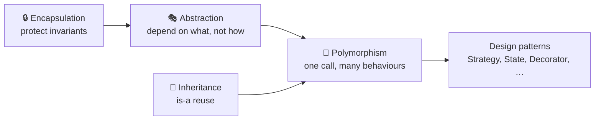
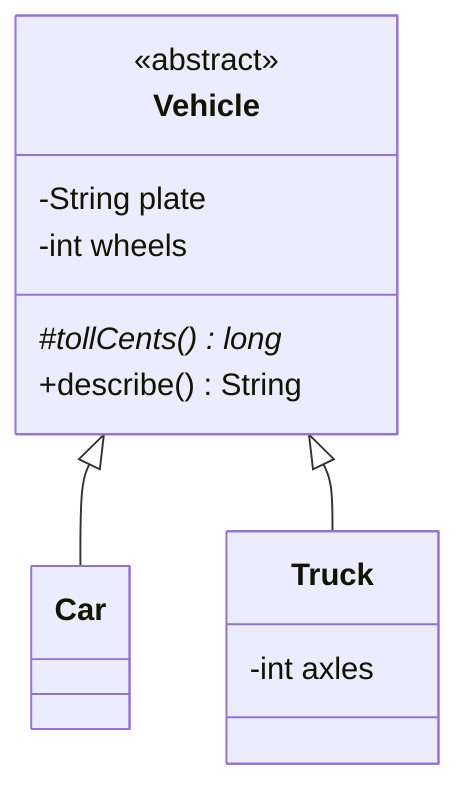

---
tags:
  - OOP
  - Beginner
---

# The Four Pillars of OOP

<span class="badge badge--beginner">🟢 Beginner</span>
<span class="badge badge--category">Foundations</span>
<span class="badge badge--interview">Interview frequency ⭐⭐⭐⭐⭐</span>

!!! abstract "TL;DR"
    **Encapsulation** protects state, **Abstraction** hides complexity behind a contract, **Inheritance** reuses
    and specialises behaviour, and **Polymorphism** lets one call do different things depending on the object. Every
    design pattern in this handbook is a combination of these four.



| Pillar | Question it answers | Java tools | Overuse risk |
|---|---|---|---|
| Encapsulation | *Who can change this state, and how?* | `private`, validated methods, immutable records, defensive copies | Getter/setter-only classes (anemic) |
| Abstraction | *What does the caller need to know?* | `interface`, `abstract class`, modules | Abstractions with one implementation forever |
| Inheritance | *What is shared, and what is specialised?* | `extends`, `abstract`, `final`, `sealed` | Fragile base classes, deep hierarchies |
| Polymorphism | *Which behaviour runs for this object?* | Overriding, overloading, generics, `switch` patterns | Clever dispatch that's hard to follow |

---

## 1. Encapsulation

**Definition.** Bundle data with the operations on it, and **hide the internal state** so it can only change through
methods that enforce the object's rules (its *invariants*). Encapsulation is about **protecting invariants**, not just
about making fields `private` and adding getters and setters.

<iframe class="motion-embed" src="../../motion/index.html?p=encapsulation&amp;embed=1" title="Animated walkthrough of Encapsulation" loading="lazy"></iframe>

Press **Play** to watch the demo below run step by step, with the matching code lit up. Switch to **Without it** to see what goes wrong without encapsulation. [Open in the explorer](../motion/index.html#encapsulation){ target=_blank }

**Key features:** private fields; behaviour methods instead of setters; validation in the constructor and methods;
immutable or read-only views of internal collections (`List.copyOf`, `unmodifiableList`); package-private helpers.

=== "Code"

    ```java
    --8<-- "code/principles/src/main/java/com/handbook/principles/oop/encapsulation/BankAccount.java"
    ```

=== "Demo + Output"

    ```java
    --8<-- "code/principles/src/main/java/com/handbook/principles/oop/encapsulation/EncapsulationDemo.java"
    ```

    ```text
    --8<-- "code/outputs/principles/oop/encapsulation/EncapsulationDemo.txt"
    ```

| ✅ Pros | ⚠️ Cons / Trade-offs |
|---|---|
| Invariants can't be broken from outside, so there are fewer "impossible" states | More methods to write than with public fields |
| You can change the internal representation without affecting callers | Too much hiding can make debugging and serialization awkward |
| One place to add validation, logging or thread-safety | Frameworks (JPA, Jackson) sometimes want no-arg constructors or setters, so you have to balance purity against tooling |

!!! warning "Pitfall: leaking mutable internals"
    `public List<String> getHistory() { return history; }` lets callers change the list and bypass every rule. Return an
    unmodifiable view or a copy, and copy incoming mutable arguments.

---

## 2. Abstraction

**Definition.** Expose **what** something does and hide **how** it does it. Callers depend on a simplified model
(an interface or abstract class), and the complexity lives behind it.

<iframe class="motion-embed" src="../../motion/index.html?p=abstraction&amp;embed=1" title="Animated walkthrough of Abstraction" loading="lazy"></iframe>

Press **Play** to watch the demo below run step by step, with the matching code lit up. Switch to **Without it** to see what goes wrong without abstraction. [Open in the explorer](../motion/index.html#abstraction){ target=_blank }

**Key features:** interfaces or abstract classes as contracts; names in the caller's language (`put`, `get`), not
the implementation's (`gzipThenWriteToBucket`); implementations you can swap.

=== "Abstraction"

    ```java title="FileStorage.java"
    --8<-- "code/principles/src/main/java/com/handbook/principles/oop/abstraction/FileStorage.java"
    ```

    ```java title="ReportArchiver.java (client knows only the abstraction)"
    --8<-- "code/principles/src/main/java/com/handbook/principles/oop/abstraction/ReportArchiver.java"
    ```

=== "Implementations"

    ```java title="InMemoryStorage.java"
    --8<-- "code/principles/src/main/java/com/handbook/principles/oop/abstraction/InMemoryStorage.java"
    ```

    ```java title="CompressingStorage.java"
    --8<-- "code/principles/src/main/java/com/handbook/principles/oop/abstraction/CompressingStorage.java"
    ```

=== "Demo + Output"

    ```java
    --8<-- "code/principles/src/main/java/com/handbook/principles/oop/abstraction/AbstractionDemo.java"
    ```

    ```text
    --8<-- "code/outputs/principles/oop/abstraction/AbstractionDemo.txt"
    ```

| ✅ Pros | ⚠️ Cons / Trade-offs |
|---|---|
| Callers stay simple and stable | Every abstraction leaks eventually (Joel Spolsky's "Law of Leaky Abstractions"), for example the latency of remote storage |
| Implementations can be swapped (memory, disk, S3, compressed) | Too many layers make the code hard to follow |
| Enables DIP and testing with fakes | A poor abstraction is worse than none: it constrains every implementation |

**Encapsulation vs Abstraction:** encapsulation *hides data* to protect it; abstraction *hides complexity* to
simplify use. `BankAccount` is mainly encapsulation; `FileStorage` is mainly abstraction.

---

## 3. Inheritance

**Definition.** A subclass **reuses and specialises** a parent class (an "is-a" relationship). The subclass inherits fields and
methods, can override behaviour, and can be used wherever the parent is expected (see [LSP](solid/lsp.md)).

<iframe class="motion-embed" src="../../motion/index.html?p=inheritance&amp;embed=1" title="Animated walkthrough of Inheritance" loading="lazy"></iframe>

Press **Play** to watch the demo below run step by step, with the matching code lit up. Switch to **Without it** to see what goes wrong without inheritance. [Open in the explorer](../motion/index.html#inheritance){ target=_blank }

**Key features:** `extends` (a single class), `abstract` hooks, `protected` members for subclasses, `final` to forbid
overriding, `sealed` to restrict who may extend, and `super(...)` constructor chaining.

=== "Code"

    ```java title="Vehicle.java (template method + abstract hook)"
    --8<-- "code/principles/src/main/java/com/handbook/principles/oop/inheritance/Vehicle.java"
    ```

    ```java
    --8<-- "code/principles/src/main/java/com/handbook/principles/oop/inheritance/Car.java"
    ```

    ```java
    --8<-- "code/principles/src/main/java/com/handbook/principles/oop/inheritance/Truck.java"
    ```

=== "Demo + Output"

    ```java
    --8<-- "code/principles/src/main/java/com/handbook/principles/oop/inheritance/InheritanceDemo.java"
    ```

    ```text
    --8<-- "code/outputs/principles/oop/inheritance/InheritanceDemo.txt"
    ```



| ✅ Pros | ⚠️ Cons / Trade-offs |
|---|---|
| Shared code is written once | **Tight coupling.** Subclasses depend on parent internals (the *fragile base class* problem) |
| Natural for true "is-a" taxonomies | Single inheritance only; deep trees become rigid |
| Template Method gives controlled extension points | Easy to break LSP; changes in the parent ripple to every child |

!!! warning "Pitfall: the fragile base class"
    A subclass that overrides methods the parent *calls internally* depends on implementation details. The classic case is
    `InstrumentedHashSet extends HashSet`, which counts elements twice because `addAll` calls `add`. See the runnable demo under
    [Composition over Inheritance](design-principles.md#4-composition-over-inheritance). Design for inheritance (document
    self-use, make hooks `protected abstract`, make the rest `final`) or forbid it.

---

## 4. Polymorphism

**Definition.** "Many forms": the **same call** produces **different behaviour** depending on the type.

<iframe class="motion-embed" src="../../motion/index.html?p=polymorphism&amp;embed=1" title="Animated walkthrough of Polymorphism" loading="lazy"></iframe>

Press **Play** to watch the demo below run step by step, with the matching code lit up. Switch to **Without it** to see what goes wrong without polymorphism. [Open in the explorer](../motion/index.html#polymorphism){ target=_blank }

| Kind | Resolved at | Java mechanism |
|---|---|---|
| **Subtype (runtime)** | Run time (dynamic dispatch) | Overriding methods from an interface or superclass |
| **Ad-hoc (compile time)** | Compile time | Method **overloading**: same name, different parameter types |
| **Parametric** | Compile time | **Generics** (`List<T>`) |
| **Pattern-based** (Java 21) | Run time, checked at compile time | `switch` with type patterns over a `sealed` hierarchy |

=== "Code"

    ```java title="Payment.java (sealed, each subtype overrides feeCents)"
    --8<-- "code/principles/src/main/java/com/handbook/principles/oop/polymorphism/Payment.java"
    ```

    ```java title="Receipt.java (overloading + exhaustive switch)"
    --8<-- "code/principles/src/main/java/com/handbook/principles/oop/polymorphism/Receipt.java"
    ```

=== "Demo + Output"

    ```java
    --8<-- "code/principles/src/main/java/com/handbook/principles/oop/polymorphism/PolymorphismDemo.java"
    ```

    ```text
    --8<-- "code/outputs/principles/oop/polymorphism/PolymorphismDemo.txt"
    ```

| ✅ Pros | ⚠️ Cons / Trade-offs |
|---|---|
| Removes `if/else` type checks, which enables OCP | Behaviour is spread across classes, so "what runs here?" needs an IDE |
| New subtypes plug in without changing callers | Overloading combined with autoboxing or varargs can pick surprising methods |
| A `sealed` + `switch` makes the compiler check every case | Virtual dispatch is slightly slower (the JIT usually removes it) |

---

## 5. Interview Q&A

??? question "Encapsulation vs abstraction: what's the difference?"
    Encapsulation is about **hiding data and enforcing invariants** (`private` fields plus validated methods). Abstraction
    is about **hiding complexity** behind a contract (an interface). A class can show both: `FileStorage` abstracts how files are stored;
    `BankAccount` encapsulates its balance.

??? question "Is a class with private fields and public getters/setters encapsulated?"
    Barely. If every field has a setter, any caller can put the object in an invalid state. Real encapsulation exposes
    **behaviour** (`withdraw`, `deposit`) that keeps the invariants, and avoids unconditional setters.

??? question "Overloading vs overriding?"
    **Overloading** means the same name with different parameters in the same class, chosen at **compile time** from static types. **Overriding**
    means the same signature in a subclass, chosen at **run time** from the object's real type. Static, private and final methods can't be overridden.

??? question "Why is 'favour composition over inheritance' so common?"
    Inheritance couples the child to the parent's implementation and fixes the relationship at compile time. Composition
    couples only to an interface, can be changed at run time, and can combine several behaviours. Use inheritance for real
    "is-a" relationships that you designed for extension.

??? question "Abstract class vs interface in modern Java?"
    Interfaces can have `default`, `static` and `private` methods but no instance state. Abstract classes can hold state and
    constructors and `protected` members, but a class can extend only one. Use an interface for a capability or contract,
    and an abstract class for a partial implementation that shares state, such as a Template Method base.

## 6. Quick Revision Card

!!! tip "Remember in 30 seconds"
    - **Encapsulation**: protect invariants; expose behaviour, not setters; avoid leaking mutable internals.
    - **Abstraction**: depend on *what*, not *how*; interfaces at boundaries.
    - **Inheritance**: real "is-a" only; design for it or mark it `final`; beware the fragile base class.
    - **Polymorphism**: overriding (runtime), overloading (compile time), generics, `sealed` + `switch` (exhaustive).
