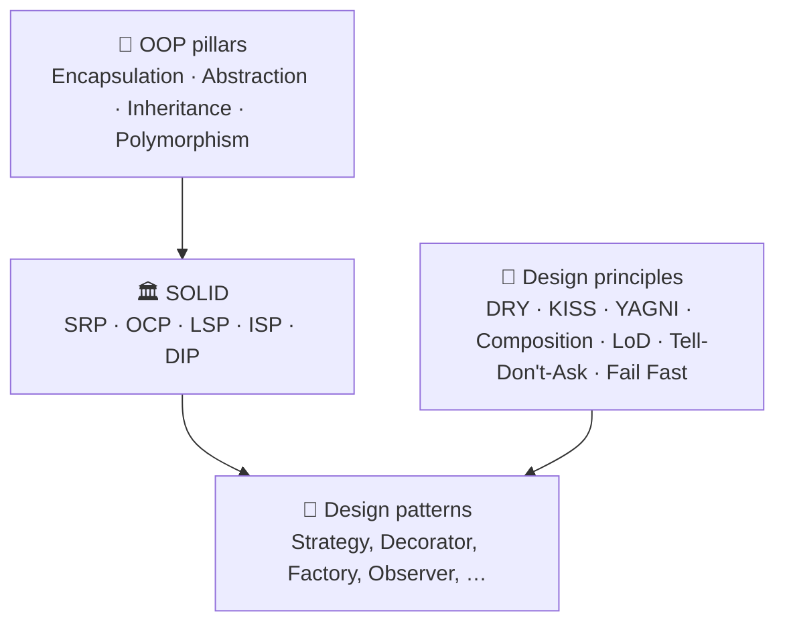

# OOP, SOLID & Design Principles

Design patterns are named, proven ways of applying a small set of principles. If you understand *why* a principle
exists, which problem it solves and what it costs, most patterns will feel obvious. Each principle below has its own
page with the definition and origin, signs of violation, a **runnable before/after Java example with real output**,
pros, cons and trade-offs, when (not) to apply it, related patterns, interview Q&A and a revision card.

!!! info "All examples are runnable"
    The code lives in the `code/principles` Maven module (`com.handbook.principles`). It's covered by unit tests, and its
    output is captured by `code/run-demos.sh`, so every output block on these pages is real.



## The four pillars of OOP

| Pillar | One-liner | Java tool | Deep dive |
|---|---|---|---|
| **Encapsulation** | Hide state, expose behaviour that protects invariants | `private` fields, validated methods, read-only views | [Encapsulation](oop-pillars.md#1-encapsulation) |
| **Abstraction** | Depend on *what*, not *how* | `interface`, `abstract class` | [Abstraction](oop-pillars.md#2-abstraction) |
| **Inheritance** | Reuse and specialise via "is-a" | `extends`, `final`, `sealed` (use sparingly) | [Inheritance](oop-pillars.md#3-inheritance) |
| **Polymorphism** | One call, many behaviours | Overriding, overloading, generics, `sealed` + `switch` | [Polymorphism](oop-pillars.md#4-polymorphism) |

## SOLID at a glance

| | Principle | Statement | Violation smell | Main benefit | Main cost | Patterns that apply it |
|---|---|---|---|---|---|---|
| **S** | [Single Responsibility](solid/srp.md) | One reason (actor) to change | `*Manager`, mixed imports, "and…and" | Focused, testable classes | More classes | Facade, Strategy, Repository |
| **O** | [Open/Closed](solid/ocp.md) | Extend by adding code, not editing it | Repeated `instanceof`/`switch` on type | Lower regression risk | Must guess the axis of change | Strategy, Decorator, Template Method |
| **L** | [Liskov Substitution](solid/lsp.md) | Subtypes are drop-in replacements | `UnsupportedOperationException` overrides | Trustworthy polymorphism | Some hierarchies must be redesigned | Null Object, Proxy, Template Method |
| **I** | [Interface Segregation](solid/isp.md) | No client depends on unused methods | Fat interfaces, stubbed methods | Compile-time capability checks | Interface proliferation | Adapter, Facade, role interfaces |
| **D** | [Dependency Inversion](solid/dip.md) | Policy owns abstractions; details implement them | `new`/static calls to infrastructure | Swappable, fast-to-test core | Indirection and wiring | Hexagonal, Factory, DI container |

=== "Before/after in one line each"

    | Principle | ❌ Before | ✅ After |
    |---|---|---|
    | SRP | `Invoice` computes tax, prints and saves | `Invoice` + `TaxCalculator` + `InvoicePrinter` + `InvoiceRepository` |
    | OCP | `AreaCalculator` with an `instanceof` chain | `Shape.area()`; `Triangle` added with no edits |
    | LSP | `Square extends Rectangle` breaks `setWidth` | Immutable `Rectangle` and `Square` records under a `sealed Shape` |
    | ISP | `OfficeMachine { print; scan; fax }` | `Printer`, `Scanner`, `Fax` role interfaces |
    | DIP | `OrderNotifier` news up `EmailSender` | `OrderNotifier(MessageSender)` with Email, SMS or a fake injected |

=== "How SOLID principles reinforce each other"

    ```mermaid
    flowchart LR
        SRP[SRP<br/>small cohesive classes] --> ISP[ISP<br/>small cohesive interfaces]
        ISP --> DIP[DIP<br/>depend on those interfaces]
        DIP --> OCP[OCP<br/>new implementations plug in]
        LSP[LSP<br/>implementations are substitutable] --> OCP
    ```

## Other principles you'll be asked about

| Principle | Meaning | Interview sound bite | Deep dive |
|---|---|---|---|
| **DRY** | Don't Repeat Yourself | "Every piece of *knowledge* has one authoritative place, but I avoid the wrong abstraction." | [DRY](design-principles.md#1-dry-dont-repeat-yourself) |
| **KISS** | Keep It Simple | "The simplest design that meets today's requirements, optimised for the reader." | [KISS](design-principles.md#2-kiss-keep-it-simple) |
| **YAGNI** | You Aren't Gonna Need It | "I don't add extension points until a second use case appears." | [YAGNI](design-principles.md#3-yagni-you-arent-gonna-need-it) |
| **Composition over inheritance** | Prefer "has-a" to "is-a" | "Inheritance is the strongest coupling in Java; composition lets me swap behaviour at run time." | [Composition](design-principles.md#4-composition-over-inheritance) |
| **Law of Demeter** | Talk only to your immediate friends | "Avoid `a.getB().getC().doX()` chains." | [LoD](design-principles.md#5-law-of-demeter-principle-of-least-knowledge) |
| **Tell, Don't Ask** | Command objects; don't pull data and decide | "The decision belongs where the data is." | [Tell-Don't-Ask](design-principles.md#6-tell-dont-ask) |
| **Fail Fast** | Reject invalid state immediately | "An invalid object should never exist." | [Fail Fast](design-principles.md#7-fail-fast) |

Want to see what happens when these principles are ignored? See [Anti-Patterns](../anti-patterns.md).

!!! question "Interview favourite"
    **"Which SOLID principle does the Strategy pattern support?"**
    Mainly **Open/Closed** (new strategies without editing the context) and **Dependency Inversion** (the context depends on the strategy interface). It also helps **Single Responsibility**, because each algorithm lives in its own class.

??? question "Is SOLID still relevant with functional programming and records?"
    Yes. The ideas carry over even where the mechanics change. A `Function<Order, Money>` parameter is a one-method interface
    (ISP + DIP); passing a different lambda is OCP; records with compact constructors give encapsulation and fail-fast;
    `sealed` hierarchies are a deliberate alternative to OCP-by-interface (the expression problem).

??? question "Can you over-apply SOLID?"
    Yes. You get interfaces with one implementation, five-class chains for a one-line rule, and abstractions guessed
    on the wrong axis. Balance SOLID with **KISS** and **YAGNI**: apply it where change actually happens and at I/O boundaries.
