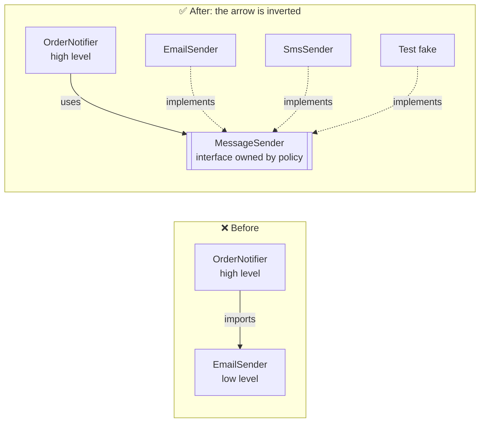

---
tags:
  - SOLID
  - Intermediate
---

# D: Dependency Inversion Principle (DIP)

<span class="badge badge--intermediate">🟡 Intermediate</span>
<span class="badge badge--category">SOLID</span>
<span class="badge badge--interview">Interview frequency ⭐⭐⭐⭐⭐</span>

!!! abstract "TL;DR"
    **High-level policy should not depend on low-level details. Both should depend on abstractions, and the
    abstraction belongs to the high-level side.** Dependency *injection* is the most common way to achieve this.

---

## 1. Definition & Origin

> *"A. High-level modules should not depend on low-level modules. Both should depend on abstractions.
> B. Abstractions should not depend on details. Details should depend on abstractions."* (Robert C. Martin, 1996)

The word **inversion** refers to the direction of the source-code dependency. In traditional layered code, the policy
(`OrderNotifier`) imports the detail (`EmailSender`). After DIP, the detail imports an interface **owned by the policy**
(`MessageSender`). The arrow now points *towards* the business logic. This is the foundation of Hexagonal, Onion and
Clean Architecture.

!!! note "DIP ≠ DI ≠ IoC"
    * **DIP** is a *design principle* about the direction of dependencies.
    * **DI (Dependency Injection)** is a *technique*: dependencies are passed in, usually through the constructor, instead of created inside the class.
    * **IoC (Inversion of Control)** is a *broader idea*: a framework calls your code. A DI container (Spring) is one form of IoC.

    You can do DI without DIP (injecting a concrete class) and DIP without a container (wiring by hand in `main`).

## 2. The Problem It Solves

* **Can't switch implementations.** Moving from email to SMS, or MySQL to Postgres, means editing business code.
* **Can't unit-test.** The policy creates the real `EmailSender`, so tests send real email or need bytecode-mocking tricks.
* **Changes ripple upwards.** A change in a low-level library breaks high-level modules.
* **The domain is tied to frameworks** and can't be reused or compiled on its own.

## 3. Key Features & How to Spot a Violation

| Signal | Fix |
|---|---|
| `new ConcreteThing()` for a collaborator inside business logic | Inject it through the constructor as an interface |
| Business classes import `javax.mail`, a JDBC driver or an HTTP client | Define a port interface in the domain and implement it in an adapter |
| Static calls to infrastructure (`Database.getConnection()`) | Replace them with an injected dependency |
| Tests need Mockito `mockStatic` or `mockConstruction` | The dependency is hard-wired |

## 4. Generic Example: Order Notifications

=== "❌ Before: policy news up the detail"

    ```java title="EmailSender.java"
    --8<-- "code/principles/src/main/java/com/handbook/principles/solid/dip/before/EmailSender.java"
    ```

    ```java title="OrderNotifier.java"
    --8<-- "code/principles/src/main/java/com/handbook/principles/solid/dip/before/OrderNotifier.java"
    ```

=== "✅ After: depend on an abstraction, inject the detail"

    ```java title="MessageSender.java (owned by the high-level module)"
    --8<-- "code/principles/src/main/java/com/handbook/principles/solid/dip/after/MessageSender.java"
    ```

    ```java title="OrderNotifier.java"
    --8<-- "code/principles/src/main/java/com/handbook/principles/solid/dip/after/OrderNotifier.java"
    ```

    ```java title="EmailSender.java / SmsSender.java (details)"
    --8<-- "code/principles/src/main/java/com/handbook/principles/solid/dip/after/EmailSender.java"
    ```

    ```java
    --8<-- "code/principles/src/main/java/com/handbook/principles/solid/dip/after/SmsSender.java"
    ```

=== "▶ Demo (including a test fake)"

    ```java
    --8<-- "code/principles/src/main/java/com/handbook/principles/solid/dip/DipDemo.java"
    ```



**Output:**

```text
--8<-- "code/outputs/principles/solid/dip/DipDemo.txt"
```

**The same idea in Spring:**

```java
@Service
class OrderNotifier {
    private final MessageSender sender;
    OrderNotifier(MessageSender sender) { this.sender = sender; }   // constructor injection
}

@Component @Profile("prod") class SesEmailSender implements MessageSender { /* AWS SES */ }
@Component @Profile("dev")  class LoggingSender  implements MessageSender { /* log only */ }
```

## 5. Pros

* **Swap implementations** (email/SMS/push, real/fake) without touching business code.
* **Fast unit tests.** Pass a lambda or fake; no container, network or mocking framework needed.
* **Stable core.** The domain doesn't depend on volatile infrastructure, so infrastructure upgrades don't ripple inwards.
* **Parallel development.** You can build the domain against the interface before the adapter exists.
* **It enables OCP.** New details plug in behind the abstraction.

## 6. Cons & Trade-offs

* **More types and indirection.** An interface with exactly one implementation forever is ceremony.
* **Wiring has to live somewhere**: `main`, a factory or a DI container. Containers add magic and startup cost.
* **Leaky abstractions.** If the interface mirrors one vendor's API (`sendViaSes(...)`), the inversion is only in name.
  Design the port in the *domain's* language.
* **Debugging.** "Go to implementation" can lead to several candidates; runtime wiring errors replace compile errors.

## 7. When to Apply / When Not To

| Invert when… | Depend directly when… |
|---|---|
| The dependency does I/O (DB, network, file, clock, random) | It's a stable value type or the JDK (`String`, `List`, `BigDecimal`) |
| You need to unit-test the policy in isolation | It's a pure, deterministic helper with no side effects |
| More than one implementation exists or is likely | It's a small script with no business core to protect |

## 8. Related Patterns & Frameworks

* **Hexagonal Architecture (Ports & Adapters)**: ports are DIP abstractions, adapters are details.
* **Factory**, **Abstract Factory** and **Service Locator** (an alternative to DI, usually worse) create the details.
* **Strategy**, **Repository**, **Adapter**.
* **Spring IoC**, **Guice**, **Dagger**, **Jakarta CDI**; the JDK `ServiceLoader` (SPI) is DIP at the module level.

## 9. Interview Q&A

??? question "What exactly is 'inverted'?"
    The **source-code dependency** between the policy and the detail. Control flow still goes policy → detail at runtime, but
    at compile time the detail depends on the policy's interface. That's why the interface should live in the
    high-level package, not next to the implementation.

??? question "Why is constructor injection preferred over field injection?"
    It makes dependencies explicit and `final`, makes the object fully initialised (fail fast), lets tests use plain `new` without
    reflection, and makes "too many dependencies" (an SRP smell) obvious in the constructor signature.

??? question "Should every class have an interface?"
    No. Introduce an interface at **architectural boundaries** (I/O, external systems, volatile policies) or when you have
    a second implementation. One interface per class "just because" is noise. Mockito can mock classes anyway.

??? question "How do you handle the system clock under DIP?"
    Inject `java.time.Clock` (or your own `TimeSource`) instead of calling `Instant.now()`. Production uses `Clock.systemUTC()`;
    tests use `Clock.fixed(...)`. Do the same for random numbers and UUID generation.

## 10. Quick Revision Card

!!! tip "Remember in 30 seconds"
    - **Policy owns the interface; details implement it.** The arrow points towards the business logic.
    - DIP (principle) ≠ DI (technique) ≠ IoC (framework calls you).
    - Smell: `new`/static calls to infrastructure inside business code.
    - Constructor injection + interfaces at I/O boundaries. Don't add interfaces everywhere.
