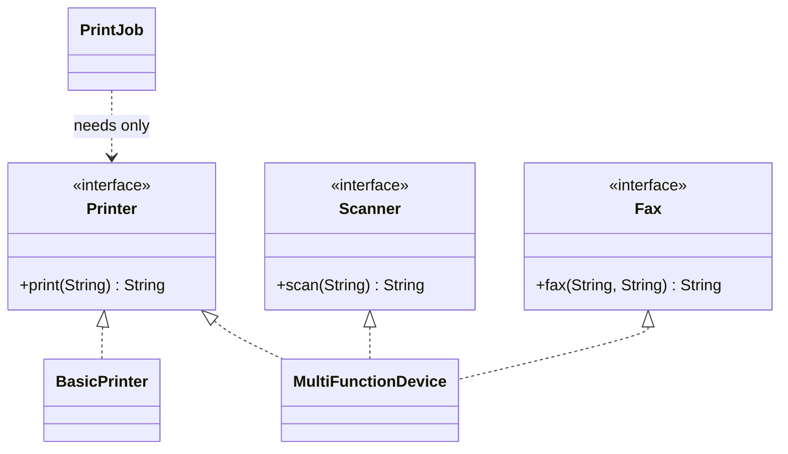

---
tags:
  - SOLID
  - Beginner
---

# I: Interface Segregation Principle (ISP)

<span class="badge badge--beginner">🟢 Beginner</span>
<span class="badge badge--category">SOLID</span>
<span class="badge badge--interview">Interview frequency ⭐⭐⭐⭐</span>

!!! abstract "TL;DR"
    **Clients should not be forced to depend on methods they do not use.** Prefer several small, role-based
    interfaces to one "fat" interface.

---

## See It in Motion

<iframe class="motion-embed" src="../../../motion/index.html?p=isp&amp;embed=1" title="Animated walkthrough of the Interface Segregation principle" loading="lazy"></iframe>

Press **Play** to see the design that follows the principle. Switch to **Breaks it** to see the "before" version that violates it. [Open the full explorer](../../motion/index.html#isp){ target=_blank }

## 1. Definition & Origin

> *"Clients should not be forced to depend upon interfaces that they do not use."* (Robert C. Martin, 1996)

Martin came up with ISP while consulting for Xerox. A single `Job` class served print, staple and fax jobs, so every
small change recompiled and redeployed everything. Splitting it into **role interfaces**, one per client
need, fixed that. ISP is SRP applied to **interfaces**: SRP is cohesion from the implementer's side, ISP is cohesion from the
client's side.

## 2. The Problem It Solves

* **Implementers forced to stub methods** with `throw new UnsupportedOperationException()`. That's also an LSP violation.
* **Unnecessary coupling.** A client that only prints still depends on `fax()` and is affected when it changes.
* **Bloated test doubles.** A mock of a 20-method interface for a test that uses one method.
* **Unclear capabilities.** The type system says "can scan" when the object can't.

## 3. Key Features & How to Spot a Violation

| Signal | Fix |
|---|---|
| Implementations full of `UnsupportedOperationException` / empty methods | Split the interface by capability |
| Each client uses a different subset of methods | One interface per client role |
| Interfaces named `*Service` with 15+ unrelated methods | Group by use case: `OrderReader`, `OrderWriter`… |
| Mocks that stub one method out of many | The client only needs a narrow role interface |

## 4. Generic Example: Office Machines

=== "❌ Before: one fat interface"

    ```java title="OfficeMachine.java"
    --8<-- "code/principles/src/main/java/com/handbook/principles/solid/isp/before/OfficeMachine.java"
    ```

    ```java title="BasicPrinter.java (forced to fake two capabilities)"
    --8<-- "code/principles/src/main/java/com/handbook/principles/solid/isp/before/BasicPrinter.java"
    ```

=== "✅ After: role interfaces"

    ```java title="Printer / Scanner / Fax"
    --8<-- "code/principles/src/main/java/com/handbook/principles/solid/isp/after/Printer.java"
    ```

    ```java
    --8<-- "code/principles/src/main/java/com/handbook/principles/solid/isp/after/Scanner.java"
    ```

    ```java
    --8<-- "code/principles/src/main/java/com/handbook/principles/solid/isp/after/Fax.java"
    ```

    ```java title="BasicPrinter.java / MultiFunctionDevice.java"
    --8<-- "code/principles/src/main/java/com/handbook/principles/solid/isp/after/BasicPrinter.java"
    ```

    ```java
    --8<-- "code/principles/src/main/java/com/handbook/principles/solid/isp/after/MultiFunctionDevice.java"
    ```

    ```java title="PrintJob.java (a client that needs only Printer)"
    --8<-- "code/principles/src/main/java/com/handbook/principles/solid/isp/after/PrintJob.java"
    ```

=== "▶ Demo"

    ```java
    --8<-- "code/principles/src/main/java/com/handbook/principles/solid/isp/IspDemo.java"
    ```



**Output:**

```text
--8<-- "code/outputs/principles/solid/isp/IspDemo.txt"
```

## 5. Pros

* **Errors move from runtime to compile time.** You can't call `scan()` on something that can't scan.
* **Less coupling.** Clients recompile and retest only when *their* role changes.
* **Simple test doubles.** A one-method interface is a lambda.
* **Clearer intent.** Method parameters say exactly what capability they need (`Printer`, not `OfficeMachine`).

## 6. Cons & Trade-offs

* **Interface proliferation.** Too many one-method interfaces fragment the model and make it harder to discover.
* **Implementations still have to be coherent.** A class implementing 8 small interfaces may be breaking SRP instead.
* **API stability.** For a public library, a broader, stable interface can be easier to evolve, using `default` methods.
* **Aggregation is sometimes handy.** You can keep `interface OfficeMachine extends Printer, Scanner, Fax {}` for clients that really need all three.

## 7. When to Apply / When Not To

Split an interface when **different clients use different subsets** or when implementers start stubbing methods.
Don't split a cohesive interface that every client uses entirely (such as `Iterator`'s `hasNext`/`next`).

## 8. Related Patterns & Frameworks

* **Adapter** can expose a narrow role over a wide class. **Facade** is the client-side aggregation of roles.
* **Proxy** and **Decorator** are easier to write over small interfaces.
* **JDK:** `Readable`/`Appendable`/`Closeable`/`AutoCloseable`, `java.util.function.*`, `Comparable`.
* **Spring Data:** `Repository` → `CrudRepository` → `ListCrudRepository`. You can extend just `Repository` and declare only the methods you need.
* **CQRS** applies ISP at the architecture level: read and write models are separate interfaces.

## 9. Interview Q&A

??? question "ISP vs SRP?"
    SRP: an *implementation* should have one reason to change. ISP: a *client* shouldn't depend on methods it doesn't use.
    They often lead to the same split, seen from opposite sides.

??? question "How do default methods affect ISP?"
    `default` methods let you add to an interface without breaking implementers, which helps library evolution. But they can
    hide fat interfaces. A default that throws `UnsupportedOperationException` is still an ISP/LSP smell.

??? question "Show ISP in a Spring codebase."
    Split a huge `UserService` into `UserQueries` (read) and `UserCommands` (write). One bean implements both. The read-only
    controller injects `UserQueries`, so it can't call a mutating method by accident, and its test needs only a read stub.

## 10. Quick Revision Card

!!! tip "Remember in 30 seconds"
    - **No client should depend on methods it doesn't use.**
    - Smell: `UnsupportedOperationException` stubs; fat `*Service` interfaces; huge mocks.
    - Fix: role interfaces, implemented together where needed.
    - Don't go too far: avoid fragmenting a cohesive interface.
