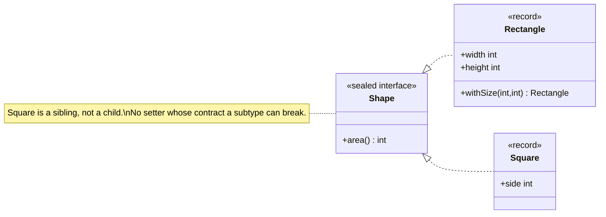

---
tags:
  - SOLID
  - Intermediate
---

# L: Liskov Substitution Principle (LSP)

<span class="badge badge--intermediate">🟡 Intermediate</span>
<span class="badge badge--category">SOLID</span>
<span class="badge badge--interview">Interview frequency ⭐⭐⭐⭐</span>

!!! abstract "TL;DR"
    **Subtypes must be usable anywhere their base type is expected, without the caller noticing.** If code written
    against `Rectangle` breaks when you pass it a `Square`, then `Square` is not a behavioural subtype of `Rectangle`.

---

## 1. Definition & Origin

> *"If for each object o1 of type S there is an object o2 of type T such that for all programs P defined in terms of T,
> the behavior of P is unchanged when o1 is substituted for o2, then S is a subtype of T."*
> (Barbara Liskov, 1987 keynote "Data Abstraction and Hierarchy"; formalised with Jeannette Wing, 1994)

In practice LSP is **design by contract** applied to inheritance (Bertrand Meyer). A subtype must:

| Rule | Meaning | Violation example |
|---|---|---|
| **Preconditions cannot be strengthened** | Accept at least everything the parent accepts | Parent accepts any `amount > 0`; child throws for `amount > 1000` |
| **Postconditions cannot be weakened** | Guarantee at least what the parent guarantees | Parent's `sort()` returns sorted data; child returns it "mostly sorted" |
| **Invariants must be preserved** | Keep every rule the parent keeps | `Square` changes height when you set width |
| **History constraint** | Don't allow state changes the parent forbids | An immutable parent with a mutable child |
| **No new checked exceptions** | Throw only what the parent declares (or subtypes of it) | Java enforces this for checked exceptions; it doesn't for `UnsupportedOperationException` |

## 2. The Problem It Solves

Polymorphism only works if you can **trust the abstraction**. When subtypes break the contract, callers
start adding `if (x instanceof Square)` checks. That destroys OCP, spreads knowledge of the subtypes everywhere, and
creates bugs that only show up for some runtime types.

## 3. Key Features & How to Spot a Violation

* An overridden method **throws `UnsupportedOperationException`** or does nothing ("refused bequest").
* Callers check `instanceof` before calling a base-class method.
* An override **ignores or changes the meaning** of its arguments.
* Tests that pass for the base class **fail for a subclass**. A good trick is to run the base class's test suite against every subtype.
* "Is-a" is true in the real world (a square *is a* rectangle) but **not in behaviour**.

## 4. Generic Example: Rectangle and Square

=== "❌ Before: Square extends Rectangle"

    ```java title="Rectangle.java"
    --8<-- "code/principles/src/main/java/com/handbook/principles/solid/lsp/before/Rectangle.java"
    ```

    ```java title="Square.java"
    --8<-- "code/principles/src/main/java/com/handbook/principles/solid/lsp/before/Square.java"
    ```

    ```java title="Resizer.java (a client that is correct for Rectangle)"
    --8<-- "code/principles/src/main/java/com/handbook/principles/solid/lsp/before/Resizer.java"
    ```

=== "✅ After: immutable siblings"

    ```java title="Shape.java"
    --8<-- "code/principles/src/main/java/com/handbook/principles/solid/lsp/after/Shape.java"
    ```

    ```java
    --8<-- "code/principles/src/main/java/com/handbook/principles/solid/lsp/after/Rectangle.java"
    ```

    ```java
    --8<-- "code/principles/src/main/java/com/handbook/principles/solid/lsp/after/Square.java"
    ```

=== "▶ Demo"

    ```java
    --8<-- "code/principles/src/main/java/com/handbook/principles/solid/lsp/LspDemo.java"
    ```



**Output:**

```text
--8<-- "code/outputs/principles/solid/lsp/LspDemo.txt"
```

## 5. Pros

* **Trustworthy polymorphism.** Callers program against the base type and never type-check.
* **OCP keeps working.** New subtypes plug in safely.
* **Reusable tests.** One contract test suite covers every implementation.
* **Better models.** LSP pushes you towards immutability and composition, which are simpler to reason about.

## 6. Cons & Trade-offs

* **It's hard to check.** The compiler checks method *signatures*, not *behaviour*, so you need contracts, docs and tests.
* **It limits reuse by inheritance.** Some "obvious" hierarchies (Square/Rectangle, Penguin/Bird.fly) have to be redesigned.
* **The JDK breaks it on purpose.** `List.of(...)` returns a `List` whose `add` throws. That's a trade-off: the
  `List` interface marks those methods as *optional operations* in its docs, so the contract is loosened on purpose.
* **More types.** Splitting hierarchies (for example `Bird` versus `FlyingBird`) adds interfaces.

## 7. When to Apply / When Not To

LSP isn't optional whenever you use subtype polymorphism. The real question is whether to use **inheritance at all**.
Prefer **composition** or **interfaces** when the child would have to remove or contradict parent behaviour. Use
`final` classes, `sealed` hierarchies and records so subtyping happens only where you intend it.

## 8. Related Patterns & Frameworks

* **Template Method**, **Strategy**, **Proxy** and **Decorator** all rely on substitutable implementations.
* **Null Object** is a well-behaved substitute that keeps the contract instead of returning `null`.
* **Composition over inheritance** ([Design Principles](../design-principles.md#4-composition-over-inheritance)) is the usual fix.
* Spring AOP proxies and JPA lazy-loading proxies only work because they are LSP-compliant subtypes or implementations.

## 9. Interview Q&A

??? question "Explain LSP with a non-shape example."
    `Bird.fly()` with a `Penguin` subclass that throws. Fix it by splitting the capability: `Bird` with a separate `FlyingBird`
    interface, so only birds that can fly promise `fly()`. Another example: `ReadOnlyAccount extends Account` whose `withdraw` throws.

??? question "Does Java enforce LSP?"
    Only partly. It enforces signature rules: covariant return types, no broader checked exceptions, and no reduced visibility.
    It can't enforce behavioural rules like preconditions, postconditions and invariants. Those come from contracts and tests.

??? question "Is Collections.unmodifiableList an LSP violation?"
    Strictly, yes: `add()` throws. The `Collection` API documents mutators as *optional operations*, so the contract allows it.
    It's a pragmatic trade-off that avoids splitting every collection interface into read and write halves.
    Kotlin and Guava split `List` and `MutableList` partly for this reason.

??? question "How do you test for LSP?"
    Write an abstract **contract test** class with the base type's expected behaviour, and subclass the test for each
    implementation. Any implementation that fails the inherited tests violates LSP.

## 10. Quick Revision Card

!!! tip "Remember in 30 seconds"
    - **A subtype must be a drop-in replacement**, behaviourally and not just in signature.
    - Contract rules: preconditions can't be stronger, postconditions can't be weaker, invariants are kept.
    - Smells: `UnsupportedOperationException` overrides, `instanceof` checks, empty overrides.
    - Fixes: immutable values, sibling types under a shared interface, composition, `sealed`.
