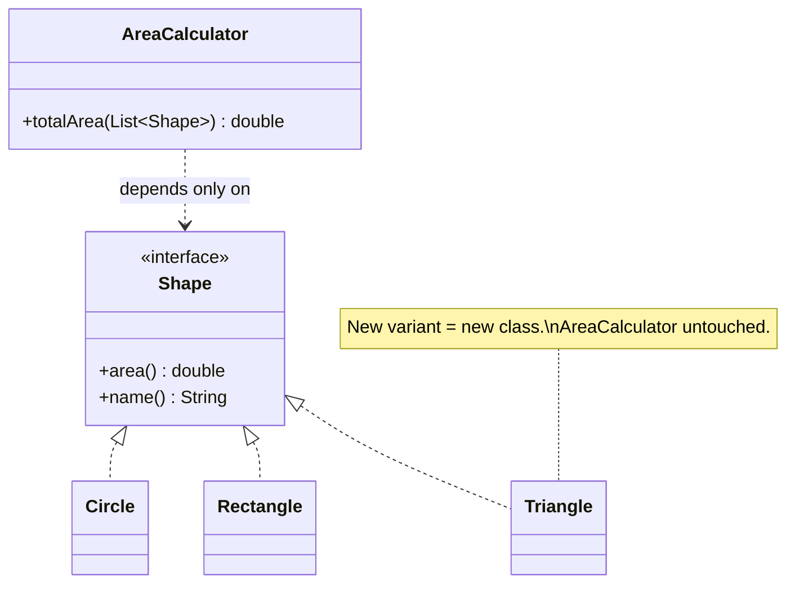

---
tags:
  - SOLID
  - Intermediate
---

# O: Open/Closed Principle (OCP)

<span class="badge badge--intermediate">🟡 Intermediate</span>
<span class="badge badge--category">SOLID</span>
<span class="badge badge--interview">Interview frequency ⭐⭐⭐⭐⭐</span>

!!! abstract "TL;DR"
    **Software entities should be open for extension but closed for modification.** You add new behaviour by
    *adding new code* (a new class) instead of *editing working, tested code*.

---

## 1. Definition & Origin

> *"Software entities (classes, modules, functions, etc.) should be open for extension, but closed for modification."*
> (Bertrand Meyer, *Object-Oriented Software Construction*, 1988)

Meyer's original version relied on **implementation inheritance**. Robert C. Martin restated it in the 1990s in its
modern form: depend on **abstractions** (interfaces), so that new implementations plug in without touching the
code that uses them. "Closed" doesn't mean the source is frozen. It means the module's **behaviour can be extended
without changing its source**.

## 2. The Problem It Solves

* **Growing `if/else` and `switch` chains** on a type code, copied into every place that needs type-specific behaviour.
* **Regression risk.** Every new variant means editing, re-testing and redeploying code that already worked.
* **Merge hotspots.** Every feature team edits the same central method.
* **No third-party extension.** A library user can't add a variant without forking the library.

## 3. Key Features & How to Spot a Violation

| Signal | What it tells you |
|---|---|
| `instanceof` / `switch (type)` chains outside one factory | The behaviour belongs to the types, not to the caller |
| The same type switch appears in several places | Every new type means *N* edits (shotgun surgery) |
| A method ends in `else throw new IllegalArgumentException("unsupported")` | The method is a closed list of options |
| Adding a feature always edits the same core file | That core file is not closed |

**Mechanisms that make code open for extension:** interfaces plus polymorphism, the Strategy pattern, plugins or
`ServiceLoader`, template methods (hooks), decorators, event listeners, and configuration-driven rules.

## 4. Generic Example: Area Calculator

=== "❌ Before: edit the calculator for every new shape"

    ```java
    --8<-- "code/principles/src/main/java/com/handbook/principles/solid/ocp/before/AreaCalculator.java"
    ```

=== "✅ After: add a class, change nothing"

    ```java title="Shape.java (the extension point)"
    --8<-- "code/principles/src/main/java/com/handbook/principles/solid/ocp/after/Shape.java"
    ```

    ```java title="Circle.java / Rectangle.java"
    --8<-- "code/principles/src/main/java/com/handbook/principles/solid/ocp/after/Circle.java"
    ```

    ```java
    --8<-- "code/principles/src/main/java/com/handbook/principles/solid/ocp/after/Rectangle.java"
    ```

    ```java title="Triangle.java (added later; nothing else was edited)"
    --8<-- "code/principles/src/main/java/com/handbook/principles/solid/ocp/after/Triangle.java"
    ```

    ```java title="AreaCalculator.java (closed for modification)"
    --8<-- "code/principles/src/main/java/com/handbook/principles/solid/ocp/after/AreaCalculator.java"
    ```

=== "▶ Demo"

    ```java
    --8<-- "code/principles/src/main/java/com/handbook/principles/solid/ocp/OcpDemo.java"
    ```



**Output:**

```text
--8<-- "code/outputs/principles/solid/ocp/OcpDemo.txt"
```

## 5. Pros

* **Lower regression risk.** Code that already works isn't touched again.
* **Independent extension.** Teams, and even third parties, can add variants in parallel.
* **Behaviour lives with the data.** Each shape knows its own area, so the code is cohesive.
* **Testability.** You test each variant in isolation, and you can test the calculator with a stub `Shape`.

## 6. Cons & Trade-offs

* **You must guess the axis of change.** An abstraction protects against *one* kind of change. If you guess wrong,
  the abstraction itself has to change. Martin calls this **strategic closure**.
* **More indirection.** Readers jump from an interface to its implementations.
* **The expression problem.** With an interface it's easy to add *new types* but hard to add *new operations* (you'd
  have to edit every class). With a **`sealed` interface + `switch`** it's the reverse: adding operations is easy, and
  the compiler lists every switch to update when you add a type. Pick the side that matches how your domain changes.
* **Over-engineering.** Adding plug-in points nobody needs violates YAGNI. Wait until you've seen the *second* variant.

## 7. When to Apply / When Not To

| Apply OCP when… | Hold off when… |
|---|---|
| You've already added the 2nd or 3rd variant of something | There's only one variant and no sign of more |
| Variants are owned by different teams or plugins | The set of cases is fixed by nature (days of the week, HTTP methods) |
| Each new variant risks breaking a central method | A closed `sealed` hierarchy with exhaustive `switch` is clearer |

## 8. Related Patterns & Frameworks

* **Strategy**, **Template Method**, **Decorator**, **Observer**, **Visitor** (the operations-side answer to the expression problem), **Factory Method**.
* **Spring:** injecting `List<SomeHandler>` beans; `HandlerInterceptor`, `BeanPostProcessor` and `@Conditional` auto-configuration are all OCP extension points.
* **JDK:** `ServiceLoader` plugins, `Comparator`, `java.util.function` interfaces.

## 9. Interview Q&A

??? question "If the code is 'closed for modification', how do you fix bugs?"
    OCP is about **adding features**, not bug fixes. You always fix bugs in place. The goal is that *new requirements*
    of the anticipated kind arrive as new code.

??? question "Is a switch statement always an OCP violation?"
    No. A single `switch` in a **factory** that maps config to objects is fine, because it's the one place that knows
    about all the types. The problem is the same switch **repeated** across the codebase. With Java 21, a `switch` over a `sealed`
    type is a deliberate choice: the compiler enforces exhaustiveness, so adding a type gives you a compile error instead of a silent bug.

??? question "How does OCP relate to Strategy and DIP?"
    Strategy is the most common *mechanism* for OCP. DIP is what makes it work: the high-level code depends on the
    abstraction, so new low-level strategies don't affect it.

??? question "Give a real framework example."
    Spring Security's filter chain: you add a custom `OncePerRequestFilter` bean without changing Spring's code. The
    same goes for JUnit 5 extensions (`@ExtendWith`) and Servlet filters.

## 10. Quick Revision Card

!!! tip "Remember in 30 seconds"
    - **Extend by adding code, not by editing working code.**
    - Smell: repeated `instanceof` or `switch` on a type, and `else throw unsupported`.
    - Tools: interface + polymorphism, Strategy, Decorator, plugins.
    - Trade-off: the expression problem. Interfaces make new types easy; `sealed` + `switch` makes new operations easy.
    - Apply after the **second** variant, not the first.
