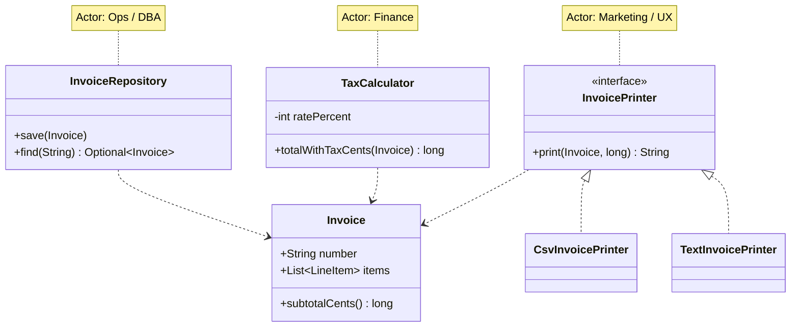

---
tags:
  - SOLID
  - Beginner
---

# S: Single Responsibility Principle (SRP)

<span class="badge badge--beginner">🟢 Beginner</span>
<span class="badge badge--category">SOLID</span>
<span class="badge badge--interview">Interview frequency ⭐⭐⭐⭐⭐</span>

!!! abstract "TL;DR"
    **A class should have one, and only one, reason to change.** Put together the things that change for the same
    reason, and keep apart the things that change for different reasons.

---

## 1. Definition & Origin

> *"A module should be responsible to one, and only one, actor."* (Robert C. Martin, *Clean Architecture*, 2017)

Robert C. Martin coined SRP in the early 2000s, building on the older ideas of **cohesion** (Tom DeMarco, Meilir
Page-Jones) and **separation of concerns** (Dijkstra). People often misread it as "a class should do one thing". The
precise version is about **reasons to change**: who asks for changes to this code? If finance asks for tax changes,
marketing asks for invoice layout changes and ops asks for storage changes, one class serving all three has
**three reasons to change**.

## 2. The Problem It Solves

* **Merge conflicts and accidental breakage.** Two teams editing one class for unrelated reasons step on each other.
* **Fragile tests.** To test the tax rule you have to set up printing and a database.
* **No reuse.** You can't reuse the printing without dragging the persistence along.
* **Shotgun redeploys.** A one-line tax change redeploys printing and storage code that didn't change.

## 3. Key Features & How to Spot a Violation

| Signal | What it tells you |
|---|---|
| The class name contains **And / Manager / Util / Processor** | The class has no single concept behind it |
| Imports from many unrelated layers (SQL + HTTP + PDF + mail) | It touches several actors' concerns |
| Methods fall into **groups that never use each other's fields** | Low cohesion: the groups want to be separate classes |
| You describe it with "**…and…and…**" | Each "and" is a candidate responsibility |
| Unrelated change requests keep landing in the same file | That's the textbook symptom |

## 4. Generic Example: an Invoice

=== "❌ Before: one class, three reasons to change"

    ```java
    --8<-- "code/principles/src/main/java/com/handbook/principles/solid/srp/before/Invoice.java"
    ```

=== "✅ After: one responsibility per class"

    ```java title="Invoice.java (data + subtotal only)"
    --8<-- "code/principles/src/main/java/com/handbook/principles/solid/srp/after/Invoice.java"
    ```

    ```java title="TaxCalculator.java (changes when finance changes the tax rule)"
    --8<-- "code/principles/src/main/java/com/handbook/principles/solid/srp/after/TaxCalculator.java"
    ```

    ```java title="InvoicePrinter.java + TextInvoicePrinter.java + CsvInvoicePrinter.java (changes when the layout changes)"
    --8<-- "code/principles/src/main/java/com/handbook/principles/solid/srp/after/InvoicePrinter.java"
    ```

    ```java
    --8<-- "code/principles/src/main/java/com/handbook/principles/solid/srp/after/CsvInvoicePrinter.java"
    ```

    ```java title="InvoiceRepository.java (changes when storage changes)"
    --8<-- "code/principles/src/main/java/com/handbook/principles/solid/srp/after/InvoiceRepository.java"
    ```

=== "▶ Demo"

    ```java
    --8<-- "code/principles/src/main/java/com/handbook/principles/solid/srp/SrpDemo.java"
    ```

**Structure after the refactor:**



**Output** (generated by `run-demos.sh`):

```text
--8<-- "code/outputs/principles/solid/srp/SrpDemo.txt"
```

Changing the tax rate to 5% touched **only** `TaxCalculator`. Adding CSV output touched **only** a new printer class.

## 5. Pros

* **High cohesion, low coupling.** Each class is small and easy to understand.
* **Cheap, focused tests.** You can test `TaxCalculator` with no printer and no database.
* **Safer change.** A change for one actor can't break another actor's feature.
* **Reuse.** `CsvInvoicePrinter` can be used anywhere an `Invoice` exists.
* **Parallel work.** Different people can own different classes without merge conflicts.

## 6. Cons & Trade-offs

* **More classes and files.** Over-applied, you get "class explosion" and have to jump through five files to follow one flow.
* **Indirection.** Someone has to wire the pieces together, usually a small service or the DI container.
* **Judgement is needed.** "Reason to change" isn't mechanical. Splitting by *technical step* (validate/save/send)
  rather than by *actor* can scatter one business concept across many classes.
* **Premature splitting** violates [YAGNI](../design-principles.md#3-yagni-you-arent-gonna-need-it). If only one actor
  ever changes this code, one class is fine.

## 7. When to Apply / When Not To

| Apply SRP when… | Hold off when… |
|---|---|
| Different stakeholders change different parts | It's a small script or prototype with one owner |
| A class has grown past a few hundred lines with method clusters | The "responsibilities" always change together |
| Tests need unrelated setup | Splitting would just move code between files with no independent reason to change |

## 8. Related Patterns & Frameworks

* **Facade** puts a single entry point over many single-responsibility classes.
* **Strategy** (`InvoicePrinter`) pulls a varying responsibility out into its own type.
* **Repository** isolates persistence. **Command** gives one action one class.
* **Spring stereotypes** (`@Controller` / `@Service` / `@Repository`) are SRP at the layer level.
* At the architecture level, SRP is the **Common Closure Principle** and the basis of **microservice boundaries**.

## 9. Interview Q&A

??? question "What does 'one reason to change' actually mean?"
    One **actor** (a person, team or stakeholder role) whose requests drive changes to the class. A class with three methods
    is fine if one actor owns all of them. A class with one method can still violate SRP if two actors fight over it.

??? question "Doesn't SRP lead to too many tiny classes?"
    It can, if you split by verb instead of by actor. Split when you see **independent change**, not in advance. A cohesive
    class with ten methods for one actor beats ten one-method classes.

??? question "How do you refactor a God class towards SRP?"
    1) Group methods by the fields they use (a cohesion analysis). 2) Write characterization tests. 3) Use **Extract Class**
    for each group and leave a delegating method behind. 4) Point callers at the new classes. 5) Delete the delegates.

??? question "How does SRP relate to microservices?"
    It's the same idea at a larger scale. A service should be owned by one team or bounded context and change for one
    business reason. Otherwise you get a distributed monolith, where every feature needs coordinated deploys.

## 10. Quick Revision Card

!!! tip "Remember in 30 seconds"
    - **One actor, one reason to change**, not "one method".
    - Smells: `*Manager`/`*Util`, mixed imports, "and" in the description, unrelated changes in the same file.
    - Fix: **Extract Class** by actor, then wire the pieces with a thin service or DI.
    - Don't over-split. Wait for real, independent change.
