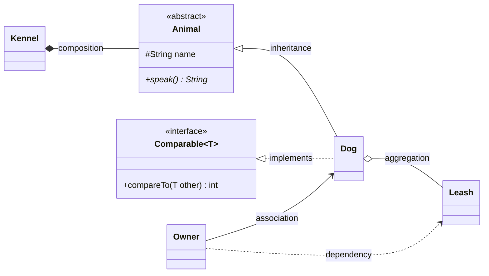
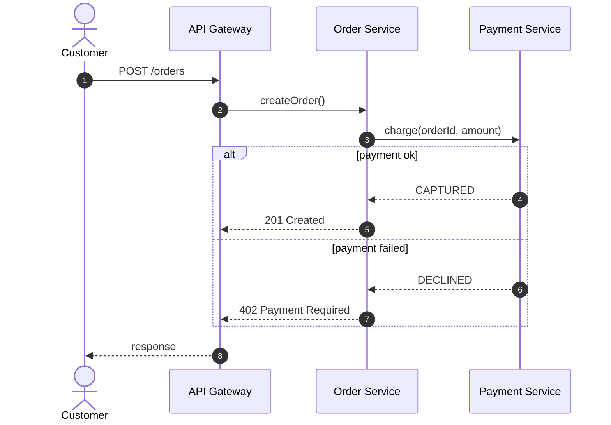
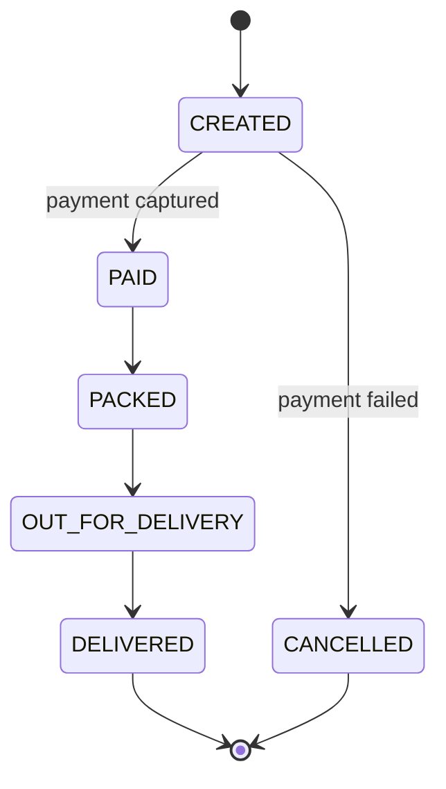

# UML Cheat Sheet

Every diagram in this handbook is written in [Mermaid](https://mermaid.js.org/), so it's plain text you can copy into your own notes, a GitHub README or Confluence.

## Class diagram relationships

| Arrow | Name | Meaning | Java |
|---|---|---|---|
| `<\|--` | Inheritance | is-a | `extends` |
| `<\|..` | Realization | implements | `implements` |
| `-->` | Association | has a reference | field |
| `o--` | Aggregation | has-a; the part can live on its own | field passed in from outside |
| `*--` | Composition | owns; the part dies with the whole | field created inside |
| `..>` | Dependency | uses temporarily | method parameter or local variable |

**Visibility:** `+` public, `-` private, `#` protected, `~` package-private.
**Members:** `*` abstract, `$` static.

## Sequence diagram

Used throughout the microservices section.

## State diagram

Used for State, Saga and order lifecycles.

!!! tip "In interviews"
    You don't need perfect UML. Interviewers want to see **classes, their responsibilities, and the relationships between them** (especially interface vs. implementation). Boxes and arrows on a whiteboard, labelled clearly, are enough.
