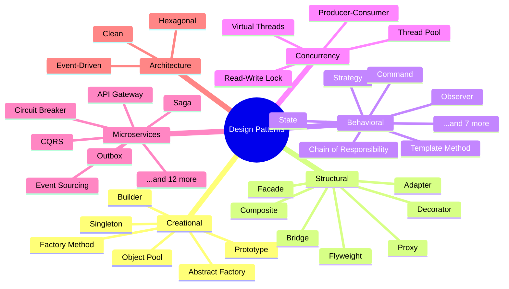

---
hide:
  - navigation
  - toc
---

# Java Design Patterns Handbook

From your first `new` keyword to defending architecture choices in a design review. GoF, concurrency, architecture and microservice patterns in **Java 21** and **Spring Boot 3**, with **3 real-world examples per pattern**, runnable code, exact output and interview prep.

[Start learning :material-arrow-right:](getting-started/how-to-use.md){ .md-button .md-button--primary }
[Jump to Singleton](creational/singleton.md){ .md-button }

## Choose your path

-   :material-sprout:{ .lg .middle } **Beginner (0–2 years)**

    ---

    Analogies, simple code and step-by-step explanations. Read sections 1–5 and 13 of every pattern page.

    [:octicons-arrow-right-24: Beginner path](getting-started/how-to-use.md#beginner-path)

-   :material-rocket-launch:{ .lg .middle } **Experienced (5–15+ years)**

    ---

    Trade-offs, concurrency, framework internals, production war stories and when **not** to use a pattern.

    [:octicons-arrow-right-24: Experienced path](getting-started/how-to-use.md#experienced-path)

-   :material-briefcase-check:{ .lg .middle } **Interview Sprint**

    ---

    Graded Q&A for service companies (Cognizant, TCS, Infosys, Accenture, Wipro) and product companies (Google, Microsoft, Amazon, SAP).

    [:octicons-arrow-right-24: Interview path](getting-started/how-to-use.md#interview-path)

-   :material-compass:{ .lg .middle } **Which pattern do I need?**

    ---

    Start from a code smell or interview problem and find the right pattern, then compare look-alikes.

    [:octicons-arrow-right-24: Selection guide](pattern-selection-guide.md)

-   :material-lightning-bolt:{ .lg .middle } **Night-before revision**

    ---

    Every pattern on one page with a real JDK/Spring example and one sentence to say in the interview.

    [:octicons-arrow-right-24: Cheat sheet](interview/revision-cheatsheet.md)

-   :material-cart:{ .lg .middle } **Capstone: Grocery Platform**

    ---

    FreshCart: one runnable grocery platform that combines 22 patterns, from Builder to Saga, Outbox and Circuit Breaker, including failure scenarios.

    [:octicons-arrow-right-24: Capstone](projects/grocery-platform.md)

## What's covered

## How each pattern page is laid out

Every page uses the same 13 sections, so you always know where to look.

| # | Section | Who it's for |
|---|---------|--------------|
| 1 | Intent & problem it solves | Everyone |
| 2 | Real-world analogy | :material-sprout: Beginner |
| 3 | Structure (diagram + participants) | Everyone |
| 4 | Naive approach (without the pattern) | :material-sprout: Beginner |
| 5 | **Three real-world examples**: scenario, design, full code, output, why, unit test | Everyone |
| 6 | Variations & modern Java | :material-rocket-launch: Experienced |
| 7 | Where it lives in JDK / Spring / frameworks | :material-rocket-launch: Experienced |
| 8 | Pros, cons & trade-offs | Everyone |
| 9 | Pitfalls & anti-patterns | :material-rocket-launch: Experienced |
| 10 | Senior / architect deep dive + war story | :material-rocket-launch: 10–15 yrs |
| 11 | Related patterns & comparisons | :material-briefcase-check: Interview |
| 12 | Interview corner (4 tabs) | :material-briefcase-check: Interview |
| 13 | Quick revision card | Everyone |

!!! success "The code always matches the docs"
    Every code block in the examples is pulled from the Maven project in `code/` when the site builds. CI compiles it and runs the unit tests, so what you read is code that actually runs.
