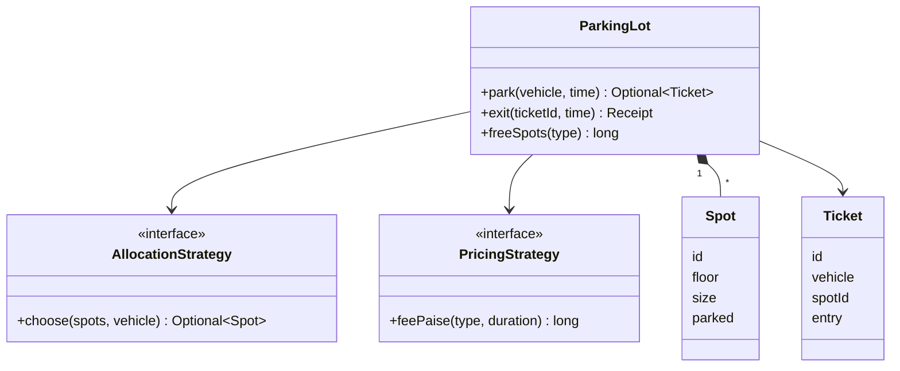
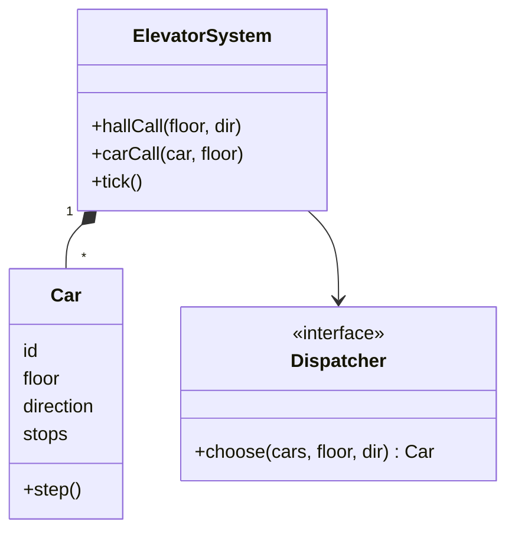
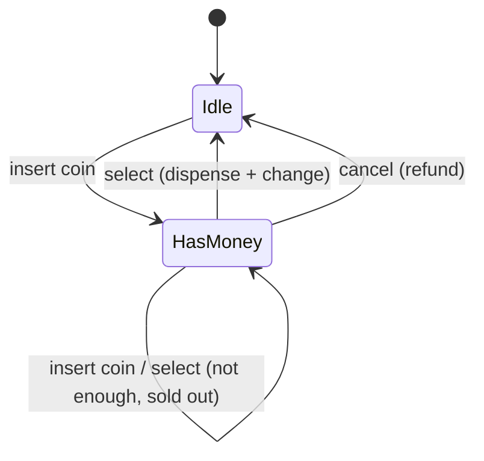
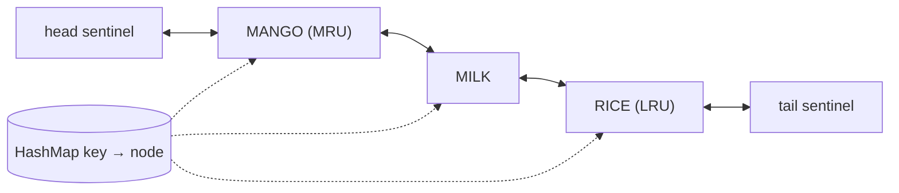
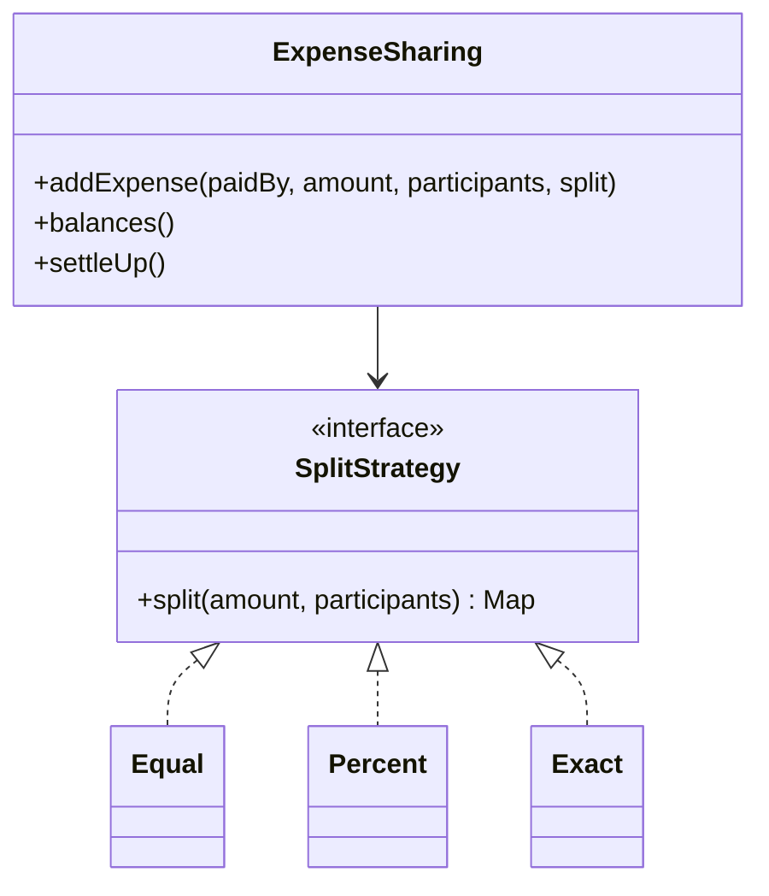
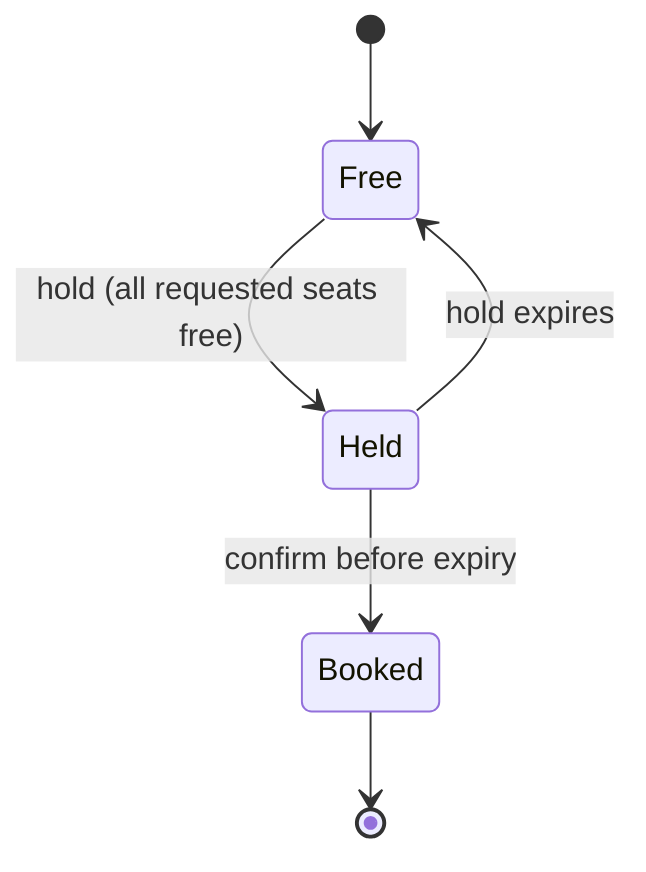
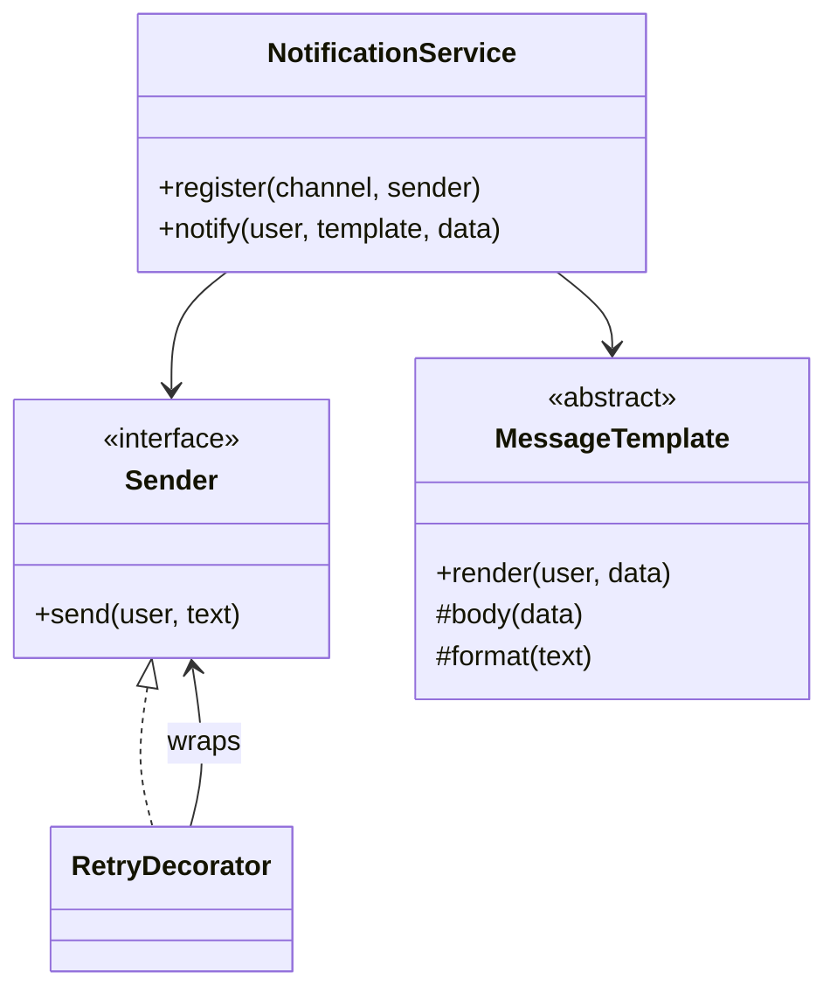

---
tags:
  - Interview
  - LLD
---

# Low-Level Design (LLD) Problems

Machine-coding and object-oriented design rounds (common at Amazon, Microsoft, Flipkart, Uber, Swiggy, and in senior rounds at service companies) ask you to design **and code** a small system in 45–90 minutes. Below are 12 classic problems, each with requirements, the patterns that fit, a class diagram, **complete runnable code**, real output, and the follow-up questions interviewers usually ask.

!!! tip "A repeatable approach for any LLD round"
    1. **Clarify requirements** (5 min): actors, use cases, what's out of scope. Write them down.
    2. **Identify entities and their responsibilities** (5 min): nouns become classes, verbs become methods.
    3. **Find what varies** and isolate it behind an interface (pricing, allocation, notifications): that's where patterns appear.
    4. **Code the core flow first**, then edge cases, then extensions. Keep it compiling and runnable.
    5. **Talk about concurrency, testing and extensibility** at the end.

| # | Problem | Key patterns | Interview frequency |
|---|---|---|---|
| 1 | [Parking Lot](#1-parking-lot) | Strategy (allocation, pricing), enums for types | ⭐⭐⭐⭐⭐ |
| 2 | [Elevator System](#2-elevator-system) | State, Strategy (dispatch), SCAN | ⭐⭐⭐⭐⭐ |
| 3 | [Vending Machine](#3-vending-machine) | State (sealed types) | ⭐⭐⭐⭐⭐ |
| 4 | [LRU Cache](#4-lru-cache) | HashMap + doubly linked list; locking | ⭐⭐⭐⭐⭐ |
| 5 | [Splitwise](#5-splitwise-expense-sharing) | Strategy (split types), greedy settlement | ⭐⭐⭐⭐ |
| 6 | [Snake and Ladder](#6-snake-and-ladder) | Builder, Strategy (dice) | ⭐⭐⭐⭐ |
| 7 | [Library Management](#7-library-management) | Strategy (fines), Observer (reservations) | ⭐⭐⭐⭐ |
| 8 | [Movie Ticket Booking](#8-movie-ticket-booking) | Seat holds with expiry, atomic all-or-nothing | ⭐⭐⭐⭐⭐ |
| 9 | [Notification System](#9-notification-system) | Strategy, Factory, Template Method, Decorator | ⭐⭐⭐⭐⭐ |
| 10 | [Logging Framework](#10-logging-framework) | Chain of Responsibility, Strategy, hierarchy | ⭐⭐⭐⭐ |
| 11 | [Grocery Discount Engine](#11-grocery-discount-engine) | Specification, Strategy, combination policy | ⭐⭐⭐⭐ |
| 12 | [Tic-Tac-Toe](#12-tic-tac-toe) | O(1) win detection | ⭐⭐⭐⭐ |

---

## 1. Parking Lot

**Requirements:** multiple floors; spot sizes small/medium/large; bikes, cars and trucks (a vehicle fits its size or larger); issue a ticket on entry; charge on exit (first 30 minutes free, then per started hour by vehicle type); show free spots; reject reused tickets. **Patterns:** [Strategy](../behavioral/strategy.md) for allocation and pricing, so rules can change per lot.



=== "ParkingLot.java"

    ```java
    --8<-- "code/lld/src/main/java/com/handbook/lld/parkinglot/ParkingLot.java"
    ```

=== "ParkingLotDemo.java"

    ```java
    --8<-- "code/lld/src/main/java/com/handbook/lld/parkinglot/ParkingLotDemo.java"
    ```

```text
--8<-- "code/outputs/lld/parkinglot/ParkingLotDemo.txt"
```

**Follow-ups:** concurrency at entry gates (`synchronized` here; per-floor locks or a DB row lock in a real system), electric-vehicle spots with chargers (a new `SpotSize` capability or a spot feature set), lost tickets, payments as a separate service, display boards ([Observer](../behavioral/observer.md)).

---

## 2. Elevator System

**Requirements:** N elevators; hall calls (floor + direction) and car calls (button inside); serve requests efficiently; don't reverse while there are stops ahead. **Patterns:** [State](../behavioral/state.md) (direction per car), [Strategy](../behavioral/strategy.md) (dispatcher), SCAN scheduling.



=== "ElevatorSystem.java"

    ```java
    --8<-- "code/lld/src/main/java/com/handbook/lld/elevator/ElevatorSystem.java"
    ```

=== "ElevatorDemo.java"

    ```java
    --8<-- "code/lld/src/main/java/com/handbook/lld/elevator/ElevatorDemo.java"
    ```

```text
--8<-- "code/outputs/lld/elevator/ElevatorDemo.txt"
```

**Follow-ups:** capacity/weight limits, express elevators serving certain floors, peak-hour strategies (up-peak in the morning), emergency mode (a state that overrides all), and making `tick()` driven by a scheduler thread.

---

## 3. Vending Machine

**Requirements:** accept ₹1/2/5/10 coins; select a product; dispense if paid enough and in stock; return change with the fewest coins; cancel and refund. **Pattern:** [State](../behavioral/state.md), with sealed types and pattern matching so each state's behaviour is explicit.



=== "VendingMachine.java"

    ```java
    --8<-- "code/lld/src/main/java/com/handbook/lld/vending/VendingMachine.java"
    ```

=== "VendingMachineDemo.java"

    ```java
    --8<-- "code/lld/src/main/java/com/handbook/lld/vending/VendingMachineDemo.java"
    ```

```text
--8<-- "code/outputs/lld/vending/VendingMachineDemo.txt"
```

**Follow-ups:** limited coin inventory for change (greedy may fail; use DP or refuse), UPI/card payments (a payment [Strategy](../behavioral/strategy.md)), maintenance mode, and audit logs per transaction.

---

## 4. LRU Cache

**Requirements:** fixed capacity; `get` and `put` in O(1); evict the least recently used entry; thread-safe. **Design:** `HashMap<K, Node>` + doubly linked list with sentinel head/tail; a lock around both.



=== "LruCache.java"

    ```java
    --8<-- "code/lld/src/main/java/com/handbook/lld/lrucache/LruCache.java"
    ```

=== "LruCacheDemo.java"

    ```java
    --8<-- "code/lld/src/main/java/com/handbook/lld/lrucache/LruCacheDemo.java"
    ```

```text
--8<-- "code/outputs/lld/lrucache/LruCacheDemo.txt"
```

**Follow-ups:** the one-liner with `LinkedHashMap(capacity, 0.75f, true)` + `removeEldestEntry`; TTL expiry; LFU; sharding by key hash to reduce lock contention; Caffeine's W-TinyLFU in production.

---

## 5. Splitwise (Expense Sharing)

**Requirements:** groups of people; expenses paid by one person and split equally, by percentage or by exact amounts; show balances; settle up with few payments; never lose a paisa to rounding. **Patterns:** [Strategy](../behavioral/strategy.md) for split types; a greedy max-creditor/max-debtor settlement.



=== "ExpenseSharing.java"

    ```java
    --8<-- "code/lld/src/main/java/com/handbook/lld/splitwise/ExpenseSharing.java"
    ```

=== "ExpenseSharingDemo.java"

    ```java
    --8<-- "code/lld/src/main/java/com/handbook/lld/splitwise/ExpenseSharingDemo.java"
    ```

```text
--8<-- "code/outputs/lld/splitwise/ExpenseSharingDemo.txt"
```

**Follow-ups:** money as `long` paise (never `double`), the remainder-paise rule, multiple currencies, groups and expense history, and that the true minimum number of transactions is NP-hard (greedy is the practical answer).

---

## 6. Snake and Ladder

**Requirements:** configurable board; snakes go down, ladders go up; players take turns; exact roll needed to finish; first to the last square wins. **Patterns:** [Builder](../creational/builder.md) with validation, [Strategy](../behavioral/strategy.md) for dice (seeded/fixed in tests).

=== "SnakeAndLadder.java"

    ```java
    --8<-- "code/lld/src/main/java/com/handbook/lld/snakeladder/SnakeAndLadder.java"
    ```

=== "SnakeAndLadderDemo.java"

    ```java
    --8<-- "code/lld/src/main/java/com/handbook/lld/snakeladder/SnakeAndLadderDemo.java"
    ```

```text
--8<-- "code/outputs/lld/snakeladder/SnakeAndLadderDemo.txt"
```

**Follow-ups:** multiple dice, "roll a 6 to start", extra turn on 6, crooked dice for testing, and preventing loops (a ladder ending on a snake head that leads back).

---

## 7. Library Management

**Requirements:** books with copies; members (students: 2 loans, 14 days; faculty: 5 loans, 30 days); reservations queue when no copy is free; fines for late returns by member type; notify the next member when a reserved book comes back. **Patterns:** [Strategy](../behavioral/strategy.md) (fine policy), [Observer](../behavioral/observer.md) (notifications).

=== "Library.java"

    ```java
    --8<-- "code/lld/src/main/java/com/handbook/lld/library/Library.java"
    ```

=== "LibraryDemo.java"

    ```java
    --8<-- "code/lld/src/main/java/com/handbook/lld/library/LibraryDemo.java"
    ```

```text
--8<-- "code/outputs/lld/library/LibraryDemo.txt"
```

**Follow-ups:** reservation expiry if not picked up in 3 days, search by title/author (an index), renewals blocked when reserved, and moving notifications to async events.

---

## 8. Movie Ticket Booking

**Requirements:** a show's seat map; users select several seats; seats are **held** for 5 minutes while paying; all-or-nothing holds; confirm only while the hold is valid; expired holds become available; **no double booking** under concurrency. This is the core of BookMyShow-style designs.



=== "ShowBooking.java"

    ```java
    --8<-- "code/lld/src/main/java/com/handbook/lld/moviebooking/ShowBooking.java"
    ```

=== "ShowBookingDemo.java"

    ```java
    --8<-- "code/lld/src/main/java/com/handbook/lld/moviebooking/ShowBookingDemo.java"
    ```

```text
--8<-- "code/outputs/lld/moviebooking/ShowBookingDemo.txt"
```

**Follow-ups:** in a distributed system, holds go into the database with `UPDATE seats SET status='HELD', held_until=? WHERE id IN (...) AND (status='FREE' OR held_until < now())` and check the affected row count (or Redis `SET NX EX` per seat); payment and booking form a small [saga](../microservices/saga.md); refunds for lost holds must be idempotent.

---

## 9. Notification System

**Requirements:** send order updates by email, SMS and push; respect user preferences; templates with per-channel formatting (SMS length limits); retry transient failures; one failing channel must not block the others. **Patterns:** [Strategy](../behavioral/strategy.md) (sender per channel), [Factory](../creational/factory-method.md)/registry, [Template Method](../behavioral/template-method.md) (message skeleton), [Decorator](../structural/decorator.md) (retry).



=== "NotificationService.java"

    ```java
    --8<-- "code/lld/src/main/java/com/handbook/lld/notification/NotificationService.java"
    ```

=== "NotificationDemo.java"

    ```java
    --8<-- "code/lld/src/main/java/com/handbook/lld/notification/NotificationDemo.java"
    ```

```text
--8<-- "code/outputs/lld/notification/NotificationDemo.txt"
```

**Follow-ups:** async delivery via a queue, dedupe keys ([Idempotent Consumer](../microservices/idempotent-consumer.md)), per-user rate limits, quiet hours, localization, delivery receipts, and provider failover.

---

## 10. Logging Framework

**Requirements:** levels DEBUG < INFO < WARN < ERROR; named loggers in a hierarchy (`com.shop.payment` inherits from `com.shop`); multiple appenders with their own thresholds and formats (console, JSON file, pager); cheap when a level is disabled. **Patterns:** [Chain of Responsibility](../behavioral/chain-of-responsibility.md), [Strategy](../behavioral/strategy.md) (formatter).

=== "MiniLogger.java"

    ```java
    --8<-- "code/lld/src/main/java/com/handbook/lld/logging/MiniLogger.java"
    ```

=== "LoggingDemo.java"

    ```java
    --8<-- "code/lld/src/main/java/com/handbook/lld/logging/LoggingDemo.java"
    ```

```text
--8<-- "code/outputs/lld/logging/LoggingDemo.txt"
```

**Follow-ups:** async appenders with a bounded queue (and what to do when it's full), MDC for trace IDs, lazy message construction (`Supplier<String>`), log rotation, and why SLF4J is a [Facade](../structural/facade.md)/[Bridge](../structural/bridge.md).

---

## 11. Grocery Discount Engine

**Requirements:** rules like "buy 2 get 1 free" on a SKU, "10% off dairy for Gold members", "₹150 off over ₹1,000", "5% off over ₹2,000"; some rules stack, while among **exclusive** coupons only the best applies; the total never goes negative; new rules without changing the engine. **Patterns:** [Specification](../behavioral/specification.md) (eligibility), [Strategy](../behavioral/strategy.md) (discount calculation).

=== "DiscountEngine.java"

    ```java
    --8<-- "code/lld/src/main/java/com/handbook/lld/discount/DiscountEngine.java"
    ```

=== "DiscountDemo.java"

    ```java
    --8<-- "code/lld/src/main/java/com/handbook/lld/discount/DiscountDemo.java"
    ```

```text
--8<-- "code/outputs/lld/discount/DiscountDemo.txt"
```

**Follow-ups:** rule priorities and ordering (percent before flat?), per-customer usage limits, rules loaded from configuration or a rules engine, explaining the discount to the user, and A/B testing promotions.

---

## 12. Tic-Tac-Toe

**Requirements:** n×n board; two players alternate; detect win or draw after each move in O(1); reject illegal moves and moves after the game ends.

=== "TicTacToe.java"

    ```java
    --8<-- "code/lld/src/main/java/com/handbook/lld/tictactoe/TicTacToe.java"
    ```

=== "TicTacToeDemo.java"

    ```java
    --8<-- "code/lld/src/main/java/com/handbook/lld/tictactoe/TicTacToeDemo.java"
    ```

```text
--8<-- "code/outputs/lld/tictactoe/TicTacToeDemo.txt"
```

**Follow-ups:** k-in-a-row on larger boards (counters don't work directly; check around the last move), an AI player (minimax as a [Strategy](../behavioral/strategy.md)), undo ([Command](../behavioral/command.md)), and online multiplayer (server-authoritative state).

---

??? example "Unit Tests: `LldProblemsTest.java`"

    ```java
    --8<-- "code/lld/src/test/java/com/handbook/lld/LldProblemsTest.java"
    ```

---

[:material-arrow-left: Service companies](service-companies.md){ .md-button }
[Next: System design patterns :material-arrow-right:](system-design-patterns.md){ .md-button .md-button--primary }
