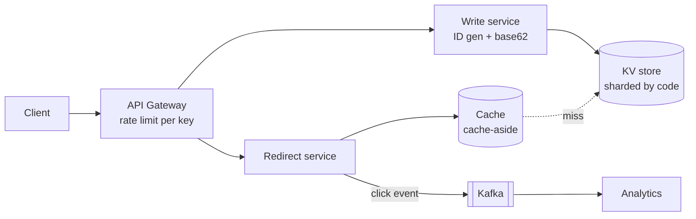
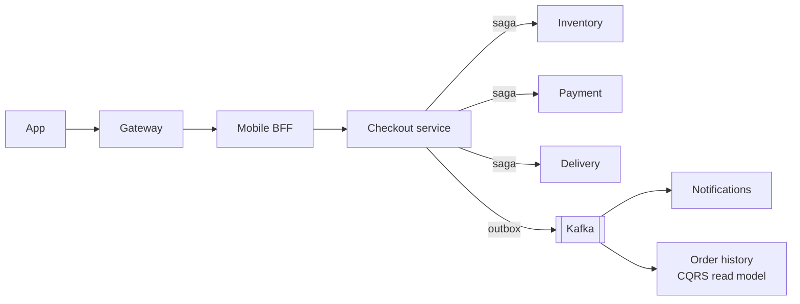
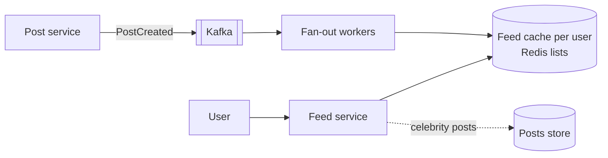
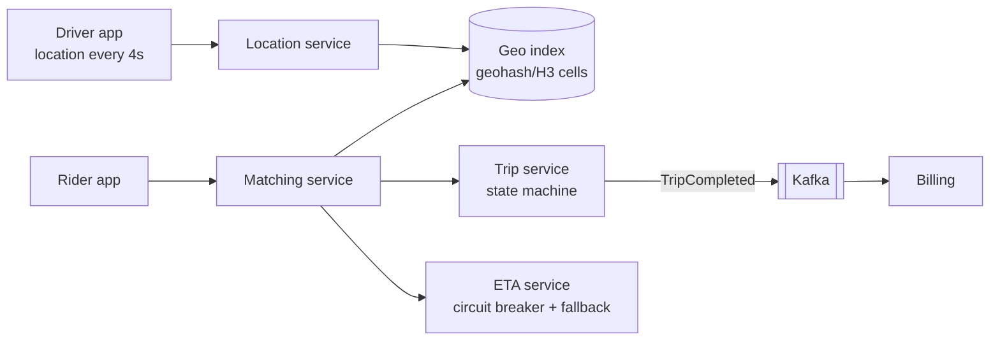
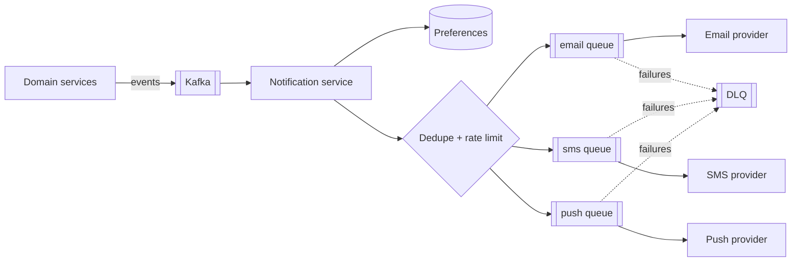

---
tags:
  - Interview
  - System Design
---

# System Design Patterns

System design rounds ask you to design a large system (a URL shortener, a feed, checkout, ride-hailing) in 45–60 minutes. Interviewers don't expect a perfect design; they look for a **structured approach**, **sound building blocks**, **numbers**, and **trade-offs**. This page collects the building blocks and shows how the [microservices](../microservices/index.md) and [architecture](../architecture/index.md) patterns from this handbook combine in classic designs.

## 1. A framework for the round

| Step | Time | What to do |
|---|---|---|
| **1. Requirements** | 5 min | Functional (core use cases only), non-functional (scale, latency, availability, consistency), out of scope |
| **2. Estimates** | 5 min | Users, requests/s (average and peak), storage per day/year, bandwidth, read:write ratio |
| **3. API** | 5 min | Key endpoints or events with request/response shapes |
| **4. Data model** | 5 min | Entities, keys, access patterns → choice of store |
| **5. High-level design** | 10 min | Clients → edge → services → data; draw the main flow |
| **6. Deep dives** | 15 min | The 2–3 hardest parts: hot keys, consistency, fan-out, failure handling |
| **7. Wrap-up** | 5 min | Bottlenecks, monitoring, what you'd do next, trade-offs you made |

!!! tip "Say the trade-off out loud"
    "I'll use cache-aside with a 60-second TTL. That means a price change can show for up to a minute on product pages, but checkout re-reads from the database, so customers are never charged a stale price."

## 2. Building blocks

| Block | What it solves | Key trade-offs | Handbook link |
|---|---|---|---|
| **Load balancer** | Spread traffic, remove unhealthy instances | L4 vs. L7; sticky sessions hurt scaling | [Service Discovery](../microservices/service-discovery.md) |
| **API gateway** | Single entry: auth, rate limits, routing | Must be HA; no business logic | [API Gateway](../microservices/api-gateway.md) |
| **Cache** | Fast reads, less DB load | Staleness, invalidation, stampedes | [LRU Cache](lld-problems.md#4-lru-cache), [Proxy](../structural/proxy.md) |
| **CDN** | Static/media content near users | Cache invalidation, cost | — |
| **Replication** | Read scaling, availability | Replication lag → stale reads | [CQRS](../microservices/cqrs.md) |
| **Sharding** | Write and storage scaling | Hot shards, cross-shard queries, resharding | [Consistent hashing](#consistent-hashing) |
| **Message queue / log** | Async work, decoupling, buffering spikes | At-least-once, ordering per partition | [Event-Driven](../architecture/event-driven.md), [Producer-Consumer](../concurrency/producer-consumer.md) |
| **Search index** | Full-text and faceted search | Eventual consistency with the source of truth | [CQRS](../microservices/cqrs.md) |
| **Object storage** | Files, images, video | Latency; use with CDN | — |
| **Rate limiter** | Protect from abuse/overload | Global vs. local counters | [Rate Limiter](../microservices/rate-limiter.md) |
| **Idempotency** | Safe retries | Storage of keys | [Idempotent Consumer](../microservices/idempotent-consumer.md) |
| **Saga / outbox** | Cross-service consistency | Eventual consistency, compensations | [Saga](../microservices/saga.md), [Outbox](../microservices/transactional-outbox.md) |
| **Circuit breaker, timeouts, bulkheads** | Contain failures | Tuning, fallbacks | [Circuit Breaker](../microservices/circuit-breaker.md) |
| **Tracing & metrics** | See what's happening | Cost, sampling | [Distributed Tracing](../microservices/distributed-tracing.md) |

### Caching strategies

| Strategy | How | Good for | Watch out for |
|---|---|---|---|
| **Cache-aside** (lazy loading) | App reads cache; on miss, reads DB and fills cache | Most read-heavy data | Stale data until TTL; **stampede** on hot key expiry (use locks or early refresh) |
| **Read-through** | Cache library loads from DB on miss | Same, less app code | Same as cache-aside |
| **Write-through** | Write to cache and DB synchronously | Read-after-write consistency | Slower writes |
| **Write-behind** | Write to cache, flush to DB asynchronously | Very write-heavy counters | Data loss on cache failure |
| **Refresh-ahead** | Refresh hot keys before expiry | Predictable hot keys | Wasted refreshes |

**Invalidation:** delete the key on writes (not update) to avoid races; use short TTLs as a safety net; version keys (`product:42:v7`) for bulk changes.

### Consistent hashing

Spreading keys across cache or database nodes with `hash(key) % N` moves almost every key when N changes. Consistent hashing places nodes and keys on a ring; adding a node moves only about 1/N of the keys. Virtual nodes even out the distribution.

=== "ConsistentHashRing.java"

    ```java
    --8<-- "code/lld/src/main/java/com/handbook/lld/systemdesign/ConsistentHashRing.java"
    ```

=== "ConsistentHashingDemo.java"

    ```java
    --8<-- "code/lld/src/main/java/com/handbook/lld/systemdesign/ConsistentHashingDemo.java"
    ```

```text
--8<-- "code/outputs/lld/systemdesign/ConsistentHashingDemo.txt"
```

Used by: Cassandra and DynamoDB-style partitioning, Memcached clients, load balancers with session affinity, CDNs.

### Other patterns worth naming

| Pattern | One-liner |
|---|---|
| **Leader election** | One instance does a job (lease in etcd/ZooKeeper/DB) with **fencing tokens** so a stale leader can't write |
| **Back-pressure** | Bounded queues; slow consumers push back instead of collapsing ([Producer-Consumer](../concurrency/producer-consumer.md)) |
| **Write-ahead log** | Append before applying; recover by replaying (databases, Kafka, [Event Sourcing](../microservices/event-sourcing.md)) |
| **Bloom filter** | Probabilistic "definitely not present" checks to skip disk/DB lookups |
| **Snowflake IDs** | 64-bit time-ordered IDs: timestamp + machine ID + sequence; no central counter |
| **Fan-out on write vs. read** | Precompute feeds for most users; compute on read for celebrities with millions of followers |
| **Hedged requests** | Send a backup request after p95 latency to cut tail latency (reads only) |
| **Geo-partitioning** | Keep users' data in their region for latency and data residency |

## 3. Classic designs and the patterns inside them

### URL shortener



- **Estimates:** 100M new URLs/month ≈ 40 writes/s; reads 100× → 4,000/s, cache hit rate > 90%.
- **Patterns:** [rate limiter](../microservices/rate-limiter.md), cache-aside, consistent hashing for the KV store, [event-driven](../architecture/event-driven.md) analytics, 302 (trackable) vs. 301 (cacheable) redirects.

### E-commerce checkout



- **Patterns:** [BFF](../microservices/backend-for-frontend.md), [Saga](../microservices/saga.md) with a pivot at payment, [Outbox](../microservices/transactional-outbox.md), [Idempotency keys](../microservices/idempotent-consumer.md), [CQRS](../microservices/cqrs.md) for order history, [Circuit Breaker](../microservices/circuit-breaker.md) on payment, flash-sale stock with atomic conditional updates.
- See the [Capstone](../projects/grocery-platform.md) for a runnable version.

### News feed / timeline



- **Patterns:** fan-out on write for normal users, on read for celebrities (hybrid), [Producer-Consumer](../concurrency/producer-consumer.md) workers, cache per user, ranking as a [Strategy](../behavioral/strategy.md), pagination with cursors.

### Ride-hailing (matching and tracking)



- **Patterns:** [State](../behavioral/state.md) for trips, geo-sharding, [Circuit Breaker](../microservices/circuit-breaker.md) with estimate fallback, [event-driven](../architecture/event-driven.md) billing, [idempotent](../microservices/idempotent-consumer.md) fare charging, tracing across async hops.

### Notification platform



- **Patterns:** [Strategy](../behavioral/strategy.md) per channel, [Template Method](../behavioral/template-method.md) for messages, [idempotent](../microservices/idempotent-consumer.md) dedupe, [rate limiting](../microservices/rate-limiter.md) per user, bulkheads per provider, DLQs. See the [Notification LLD](lld-problems.md#9-notification-system).

### Chat / messaging

- **Patterns:** WebSocket gateways with session routing (consistent hashing by user), messages persisted per conversation (partitioned by conversation ID for ordering), delivery receipts as events, offline push via the notification platform, [idempotent](../microservices/idempotent-consumer.md) client message IDs to avoid duplicates on reconnect.

### Distributed rate limiter, cache, or job scheduler

- **Rate limiter:** token buckets in Redis with Lua, local fallback ([Rate Limiter](../microservices/rate-limiter.md)).
- **Distributed cache:** consistent hashing, replication for hot keys, eviction ([LRU](lld-problems.md#4-lru-cache)), cache-aside.
- **Job scheduler:** jobs table with `SELECT ... FOR UPDATE SKIP LOCKED`, leader election for the scheduler loop, idempotent jobs, retries with backoff, DLQ.

## 4. Numbers worth remembering

| Operation | Order of magnitude |
|---|---|
| L1 cache / main memory reference | ~1 ns / ~100 ns |
| Read 1 MB sequentially from memory | ~10 µs (varies by hardware) |
| SSD random read | ~16–100 µs |
| Round trip within a data centre | ~0.5 ms |
| Redis GET over the network | ~0.5–1 ms |
| Simple indexed DB query | ~1–10 ms |
| Round trip across continents | ~100–150 ms |

| Quick math | Value |
|---|---|
| 1 day | ≈ 86,400 s ≈ 10⁵ s |
| 1M requests/day | ≈ 12 requests/s average; plan peaks at 2–10× |
| 1 KB × 1B records | ≈ 1 TB |

!!! example "Estimation example: grocery orders"
    5M orders/day → ~58 orders/s average; evening peak 5× → ~300/s. Each order ~2 KB with lines → 10 GB/day → ~3.6 TB/year (before indexes and replicas). Order-history reads 10× writes → ~3,000 reads/s at peak: a CQRS read model plus cache handles it comfortably.

---

[:material-arrow-left: LLD problems](lld-problems.md){ .md-button }
[Next: Top 100 questions :material-arrow-right:](top-100-questions.md){ .md-button .md-button--primary }
