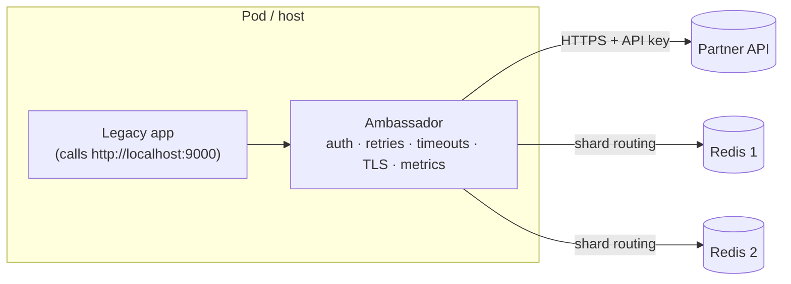
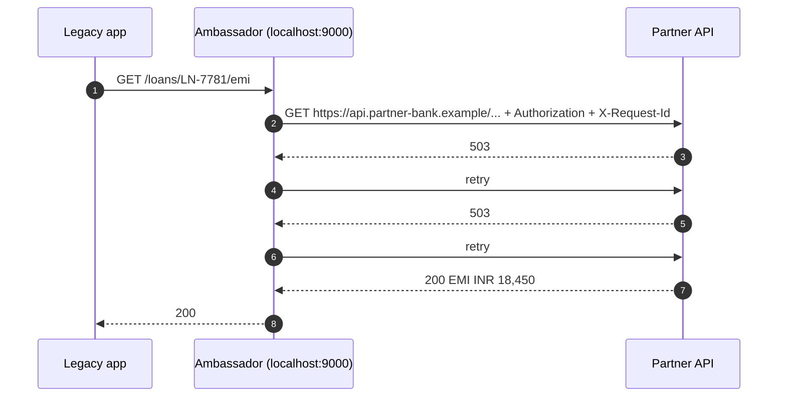
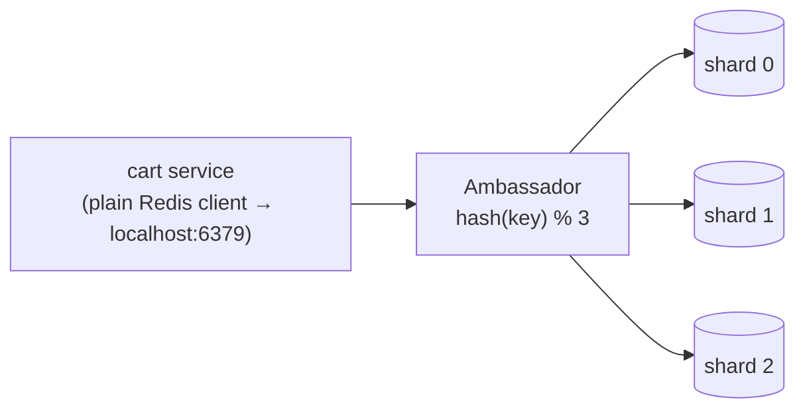
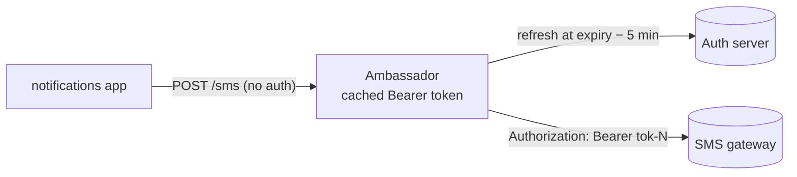

---
tags:
  - Microservices
  - Intermediate
  - Communication
---

# Ambassador

<span class="badge badge--intermediate">🟡 Intermediate</span>
<span class="badge badge--category">Microservices</span>
<span class="badge badge--interview">Interview frequency ⭐⭐⭐</span>

!!! abstract "TL;DR"
    **An Ambassador is a helper proxy deployed next to a client (same host or pod) that handles the client's *outbound* connectivity: auth, retries, timeouts, routing, sharding, TLS and metrics. The client just calls `localhost`.**
    Use it when you can't (or don't want to) change the client: legacy apps, third-party binaries, or many languages that all need the same connection logic.

---

## See It in Motion

<iframe class="motion-embed" src="../../motion/index.html?p=ambassador&amp;embed=1" title="Animated walkthrough of the Ambassador pattern" loading="lazy"></iframe>

Press **Play** to watch the calls travel between components, or step through with **Next** and **Back**. Switch to **Without it** to see what goes wrong without the pattern, or press a **Break it** button to make something fail while the pattern is in place. [Open the full explorer with all 75 patterns](../motion/index.html#ambassador){ target=_blank }

## 1. Intent & Problem It Solves

**The problem in plain English:** a 2009 loan-servicing application must call a partner bank's new API, which requires an API key, request ids and tolerance for frequent 503s. The app's HTTP client can't add headers or retry, and nobody can safely rebuild it. Separately, a Node.js, a Python and a Java service all need the same sharded-Redis logic, and three implementations drift.

**Definition (Microsoft Azure Architecture Center; Burns & Oppenheimer, *Design Patterns for Container-based Distributed Systems*):**
> Create helper services that send network requests on behalf of a consumer service or application. An ambassador service can be thought of as an out-of-process proxy co-located with the client.

**Ambassador vs sidecar vs gateway:** a [sidecar](sidecar-service-mesh.md) is the general idea of a helper container next to the app (inbound and outbound). An **ambassador** is a sidecar specialised for the app's **outbound** calls. An [API gateway](api-gateway.md) is a shared **inbound** proxy in front of many services.

## 2. Real-World Analogy

!!! example "A country's ambassador"
    A visiting minister doesn't learn the host country's protocol, language and paperwork. The ambassador handles introductions, translations and retries ("the minister is busy, come back at 3"), so the minister just says what they want.

## 3. Structure



| Participant | Responsibility |
|---|---|
| **Client application** | Business logic; calls a local, simple endpoint |
| **Ambassador** | Connectivity concerns for outbound calls; deployed and versioned with the client |
| **Remote service(s)** | The real dependency: partner API, cache cluster, database |
| **Configuration** | Endpoints, credentials, retry policy: owned by platform/ops, not the app |

## 4. Naive Approach (Without the Pattern)

```text
Legacy app: patch the 15-year-old HTTP library to add headers and retries → risky release, no tests
Each language: re-implement shard routing, token refresh, retries → five slightly different bugs
```

- :material-close-circle:{ style="color:#e53935" } Changing legacy or third-party code is risky or impossible.
- :material-close-circle:{ style="color:#e53935" } Cross-cutting connection logic is duplicated per language.
- :material-close-circle:{ style="color:#e53935" } Ops can't change retry policy or endpoints without app releases.

---

## 5. Three Real-World Examples

### Example 1: Auth and Retries for a Legacy App (Banking)

**Scenario:** The loan-servicing app checks EMIs against a partner bank's API. The partner requires an `Authorization` header and returns 503 under load. The app can only be reconfigured, not rebuilt. An ambassador on `localhost:9000` adds the key and a request id, retries 5xx up to 3 times, and logs every attempt; the app's base URL is the only change.

**Design:**



**Full Code:**

=== "PartnerAmbassador.java"

    ```java
    --8<-- "code/microservices/src/main/java/com/handbook/microservices/ambassador/legacy/PartnerAmbassador.java"
    ```

    1.  **Routing**: the app calls a local path; the ambassador knows the real host (and could switch it without the app noticing).
    2.  **Credentials** live with the ambassador, managed by ops (from a secret store), not compiled into the app.
    3.  Retries only on 5xx; client errors (4xx) are returned at once. Real ambassadors also enforce timeouts and backoff.

=== "LegacyAppDemo.java"

    ```java
    --8<-- "code/microservices/src/main/java/com/handbook/microservices/ambassador/legacy/LegacyAppDemo.java"
    ```

**Output:**

```text
--8<-- "code/outputs/microservices/ambassador/legacy/LegacyAppDemo.txt"
```

**Why an ambassador here:**

- The legacy code doesn't change at all, which removes the riskiest part of the project.
- Retry and timeout policy can be tuned by ops per environment.
- Every outbound call is logged and measured in one place.

---

### Example 2: A Sharding Proxy for Redis (Grocery)

**Scenario:** The cart service (and four other services in three languages) store carts in a Redis cluster of 3 shards. Instead of embedding a cluster-aware client everywhere, each pod runs an ambassador (Envoy's Redis proxy, twemproxy) on `localhost:6379` that hashes keys to shards. Adding a shard is a proxy config change.

**Design:**



**Full Code:**

=== "CacheShardProxy.java"

    ```java
    --8<-- "code/microservices/src/main/java/com/handbook/microservices/ambassador/shardproxy/CacheShardProxy.java"
    ```

    1.  Sharding logic lives **only** in the ambassador. Production proxies use consistent hashing so adding shards moves few keys.

=== "ShardProxyDemo.java"

    ```java
    --8<-- "code/microservices/src/main/java/com/handbook/microservices/ambassador/shardproxy/ShardProxyDemo.java"
    ```

**Output:**

```text
--8<-- "code/outputs/microservices/ambassador/shardproxy/ShardProxyDemo.txt"
```

**Why an ambassador here:**

- **One** implementation of routing for every language.
- Apps use the simplest possible client (single-node Redis protocol).
- Topology changes (new shards, failover) don't require app releases. See [Sharding](sharding.md).

---

### Example 3: Token Caching for an SMS Gateway (Telecom)

**Scenario:** A notifications service sends 50 SMS per minute through a gateway that requires OAuth2 client-credentials tokens valid for 1 hour. Requesting a new token per SMS would hammer the auth server and add 200 ms per message. The ambassador caches the token and refreshes it 5 minutes **before** expiry, so no request ever carries an expired token. (This is the coding challenge's solution.)

**Design:**



**Full Code:**

=== "TokenAmbassador.java"

    ```java
    --8<-- "code/microservices/src/main/java/com/handbook/microservices/ambassador/token/TokenAmbassador.java"
    ```

=== "TokenAmbassadorDemo.java"

    ```java
    --8<-- "code/microservices/src/main/java/com/handbook/microservices/ambassador/token/TokenAmbassadorDemo.java"
    ```

**Output:**

```text
--8<-- "code/outputs/microservices/ambassador/token/TokenAmbassadorDemo.txt"
```

**Why an ambassador here:**

- Token lifecycle (fetch, cache, refresh, rotate secrets) is infrastructure, not business logic.
- The app stays free of OAuth libraries and secrets.
- Refreshing early avoids a burst of 401s at every expiry.

---

??? example "Unit Tests: `AmbassadorTest.java`"

    ```java
    --8<-- "code/microservices/src/test/java/com/handbook/microservices/AmbassadorTest.java"
    ```

## 6. Variations & Modern Java Take

=== "Kubernetes pod (reference)"

    ```yaml
    apiVersion: v1
    kind: Pod
    metadata: { name: loan-servicing }
    spec:
      containers:
        - name: legacy-app
          image: registry.example/loan-servicing:2009.4
          env: [{ name: PARTNER_BASE_URL, value: "http://localhost:9000" }]
        - name: partner-ambassador           # Envoy, or a small Spring Cloud Gateway app
          image: envoyproxy/envoy:v1.31.2
          ports: [{ containerPort: 9000 }]
          volumeMounts: [{ name: envoy-config, mountPath: /etc/envoy }]
      volumes:
        - name: envoy-config
          configMap: { name: partner-ambassador-config }
    ```

| Variation | Notes |
|---|---|
| **Envoy as ambassador** | Retries, timeouts, circuit breaking, TLS origination, Redis/Mongo/Postgres protocol filters |
| **Database ambassadors** | PgBouncer (connection pooling), Cloud SQL Auth Proxy (IAM auth + TLS), ProxySQL |
| **Service mesh egress** | Istio `ServiceEntry` + `DestinationRule` for external calls: a mesh-managed ambassador |
| **Library instead** | For one modern Java service, Resilience4j + a Spring `RestClient` interceptor is simpler |
| **Dapr** | A sidecar exposing bindings, state and pub/sub over a local API |

## 7. Where It Lives in Real Frameworks

| Where | Ambassador |
|---|---|
| Envoy / Istio | Sidecar proxies handling egress; `ServiceEntry`, `DestinationRule`, retry policies |
| Google Cloud | Cloud SQL Auth Proxy, AlloyDB Auth Proxy |
| PgBouncer / ProxySQL | Connection pooling and routing for databases |
| Twemproxy / Envoy Redis | Sharding proxies for Redis/Memcached |
| Dapr | Sidecar APIs for state, pub/sub, secrets, bindings |
| AWS | ECS/EKS sidecars like the AWS Distro for OpenTelemetry collector (telemetry ambassador) |

## 8. Pros, Cons & Trade-offs

| ✅ Pros | ❌ Cons |
|---|---|
| No changes to legacy or third-party clients | Extra hop: added latency (small on localhost, but non-zero) |
| One implementation for many languages | Another process to deploy, monitor and upgrade |
| Ops control policies without app releases | Debugging spans two processes |
| Credentials isolated from app code | Overkill for a single modern service where a library would do |

## 9. Pitfalls & Anti-Patterns

!!! danger "Retrying non-idempotent calls"
    An ambassador retrying `POST /payments` on a timeout can pay twice. Retry only idempotent methods, or require idempotency keys.

!!! danger "Retries in both app and ambassador"
    3 app retries × 3 ambassador retries = 9 calls per request during an outage. Retry in one layer only.

!!! warning "Ambassador becomes a business-logic dumping ground"
    Transforming payloads, applying pricing rules or enriching data in the proxy hides behaviour from the team that owns it. Keep it to connectivity.

!!! warning "Startup and shutdown ordering"
    The app may start before its ambassador is ready, or the ambassador may exit first during shutdown and drop in-flight calls. Use Kubernetes native sidecars (`restartPolicy: Always` init containers) or readiness gates.

## 10. Senior / Architect Deep Dive (10–15 yrs)

**When to choose it.** Ambassador wins when the client can't change, or when the same connectivity logic must serve many runtimes. For a fleet of Spring Boot services, a shared library (or a mesh) is usually cheaper. Many organisations use ambassadors as a **migration tool**: wrap the legacy app now, replace it later ([Strangler Fig](strangler-fig.md)).

**Latency budget.** A localhost hop adds ~50–200 µs plus serialization. Fine for most calls; noticeable for chatty protocols. Use Unix domain sockets or keep-alive connections, and avoid double TLS.

**Ownership.** The ambassador's config is code: version it, review it, test it (contract tests against the partner sandbox), and roll it out with the app so a policy change can be rolled back with the release.

!!! bug "War story: the retry that paid twice"
    A team put an ambassador in front of a legacy billing app and enabled "retry on timeout" for all methods. During a partner slowdown, `POST /debits` timed out after 2 s but had succeeded on the partner side. The ambassador retried; 1,900 customers were debited twice.
    **Fix:** retries limited to `GET`/`PUT`; `POST /debits` now carries an idempotency key the ambassador generates once per app request and the partner honours.
    **Lesson:** transparent retries are only safe for idempotent operations.

## 11. Related Patterns & Comparisons

| | Ambassador | Sidecar / Mesh | API Gateway | Anti-Corruption Layer |
|---|---|---|---|---|
| Direction | Outbound from one client | Inbound + outbound | Inbound to many services | Model translation |
| Deployed | Next to the client | Next to every service | At the edge | Inside the service (or as a service) |
| Concern | Connectivity | Connectivity, security, telemetry | Routing, auth, limits for clients | Domain language |

## 12. Interview Corner

=== "🟢 Beginner / Service Companies"

    **Q1. What is the Ambassador pattern?**

    A helper proxy next to a client that handles its outbound calls (auth, retries, routing), so the client just calls localhost.

    **Q2. Ambassador vs API Gateway?**

    The ambassador sits next to one client for outbound calls; the gateway sits in front of many services for inbound calls.

    **Q3. Give a real example.**

    Cloud SQL Auth Proxy, PgBouncer, or an Envoy sidecar adding retries and TLS.

    **Q4. Why use it for legacy apps?**

    You get modern connectivity features without changing the legacy code.

    **Q5. Is the ambassador a sidecar?**

    Yes, a sidecar specialised for outbound connectivity.

=== "🟡 Mid-Level"

    **Q1. What should an ambassador not do?**

    Business logic or data transformation; keep it to connectivity.

    **Q2. Where should retries live: app or ambassador?**

    In one layer only, and only for idempotent operations.

    **Q3. How do you handle secrets?**

    The ambassador fetches them from a secret store; the app never sees them.

    **Q4. What's the cost?**

    An extra hop, an extra process to operate, and more complex debugging.

    **Q5. Ambassador vs library?**

    A library is simpler for one language you control; an ambassador is language-agnostic and works for code you can't change.

=== "🔴 Senior / FAANG / SAP"

    **Q1. "Migrate 40 legacy apps to a new partner API with OAuth2 and mTLS."**

    Standard ambassador image (Envoy + token sidecar) per app; config per partner in Git; contract tests in CI; roll out app by app; observability via the ambassador's metrics.

    **Q2. "How do you prevent retry amplification across layers?"**

    Retry budgets, one retrying layer per call path, deadlines propagated in headers, and circuit breakers at the ambassador.

    **Q3. "How do you make ambassador config changes safe?"**

    Version with the app, canary them, validate against a sandbox, and keep metrics on retries/timeouts per route.

    **Q4. "When does a mesh replace ambassadors?"**

    When most services are on Kubernetes and need the same policies: the mesh's sidecars become ambassadors managed centrally.

    **Q5. "How do you measure the ambassador's overhead?"**

    Compare client-side latency with and without it (or ambassador-reported upstream time vs app-observed time); watch CPU and connection counts.

=== "💻 Coding Challenge"

    **Problem:** Build an ambassador that adds an OAuth2 bearer token to every SMS request, fetching a new token only when needed and refreshing it 5 minutes before it expires. Show how many token requests 2 hours of traffic need.

    ??? success "Solution"

        See `TokenAmbassador.java` and `TokenAmbassadorDemo.java` in **Example 3**.

        **Key points to say:** cache the token with its expiry; refresh at `expiresAt − margin` so requests in flight never carry an expired token; make the refresh `synchronized` (or single-flight) so concurrent requests don't all fetch a token; handle a 401 by forcing one refresh and retrying once.

!!! info "Behavioural tie-in (STAR) for experienced candidates"
    - **S:** A legacy loan app couldn't call a partner's new API (auth headers, frequent 503s), and rewriting it was a 9-month estimate.
    - **T:** Integrate within one quarter without touching the legacy code.
    - **A:** Deployed an Envoy-based ambassador with API-key injection, idempotent-only retries, timeouts and metrics; changed only the app's base URL; added contract tests against the partner sandbox.
    - **R:** Live in 5 weeks; partner call success rate rose from 91% to 99.8%; the same ambassador image was reused for three other legacy apps.

## 13. Quick Revision Card

!!! tip "Remember in 30 seconds"
    - **Out-of-process helper next to the client for outbound calls.**
    - Auth, retries, timeouts, TLS, routing, sharding, metrics.
    - Great for legacy/third-party code and polyglot fleets.
    - Retry only idempotent calls; retry in one layer.
    - Connectivity only, never business logic.

    ```text
    app → http://localhost:9000 → ambassador → https://partner-api (+ auth, retries, TLS)
    ```

## Practice

- [ ] Add a per-attempt timeout and exponential backoff to `PartnerAmbassador`.
- [ ] Make `TokenAmbassador` force a refresh and retry once on a 401.
- [ ] Switch `CacheShardProxy` to consistent hashing and count keys moved when adding a shard.

---

[:material-arrow-left: Backpressure](backpressure.md){ .md-button }
[Next: Gateway Aggregation :material-arrow-right:](gateway-aggregation.md){ .md-button .md-button--primary }
