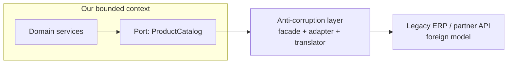

---
tags:
  - Microservices
  - Intermediate
  - Migration
---

# Anti-Corruption Layer (ACL)

<span class="badge badge--intermediate">🟡 Intermediate</span>
<span class="badge badge--category">Microservices</span>
<span class="badge badge--interview">Interview frequency ⭐⭐⭐⭐</span>

!!! abstract "TL;DR"
    **An anti-corruption layer is a translation boundary between your domain model and an external or legacy system with a different model. It converts their data, codes and protocols into your concepts (and back), so their quirks never leak into your code.**
    It's the Adapter and Facade patterns applied at the scale of whole systems (a Domain-Driven Design strategic pattern).

---

## 1. Intent & Problem It Solves

**The problem in plain English:** the new catalog service reads products from a 25-year-old ERP: fields like `MAT_NO` with 18-digit zero padding, prices as `"1.299,00"`, units `KGM`/`ST`, and `DEL_FLAG = "X"` for inactive. If those details spread through the new code, the new service becomes as hard to change as the ERP, and replacing the ERP later means touching everything. That's the "corruption".

**Definition (Eric Evans, *Domain-Driven Design*):**
> Create an isolating layer to provide clients with functionality in terms of their own domain model. The layer talks to the other system through its existing interface, requiring little or no modification to the other system.

**Typical ACL building blocks:**

| Part | Role |
|---|---|
| **Facade** | Simplifies the foreign system's API (many calls → one) |
| **Adapter** | Talks the foreign protocol (SOAP, XML, fixed-width files, RFC) |
| **Translator** | Maps foreign data and codes to domain objects, and back |

## 2. Real-World Analogy

!!! example "An interpreter and customs desk at a border"
    Travellers (data) from another country arrive with their own language, units and documents. At the border they're translated and checked: miles become kilometres, unknown items are held for inspection. Inside the country, nobody has to speak the foreign language.

## 3. Structure



| Participant | Responsibility |
|---|---|
| **Our domain** | Uses only its own types (`Product`, `Money`, `Unit`) |
| **ACL** | Calls the foreign system; translates in both directions; rejects or flags what can't be mapped |
| **Foreign system** | Unchanged; often not under our control |

## 4. Naive Approach (Without the Pattern)

```java
// Deep inside the pricing service...
if ("X".equals(row.get("DEL_FLAG")) || row.get("BASE_UOM").equals("ST")) { ... }
BigDecimal price = new BigDecimal(row.get("PRICE").replace(".", "").replace(",", "."));
// ...repeated in cart, search and recommendations. Replacing the ERP = rewriting all of them.
```

---

## 5. Three Real-World Examples

### Example 1: Products from a Legacy ERP (Grocery)

**Scenario:** The catalog service needs product data from the ERP's material master. The ACL zero-pads SKUs for the ERP, strips padding on the way back, title-cases descriptions, maps unit codes to an enum, parses European-format prices into paise, and turns `DEL_FLAG` into a boolean. Unknown materials become `Optional.empty()`.

**Full Code:**

=== "ErpProductTranslator.java"

    ```java
    --8<-- "code/microservices/src/main/java/com/handbook/microservices/acl/erp/ErpProductTranslator.java"
    ```

    1.  Our SKU format → the ERP's 18-digit, zero-padded material number. The ERP's key format never leaves the ACL.
    2.  **Explicit code mapping**; an unmapped unit fails loudly instead of silently becoming wrong data.
    3.  `"1.299,00"` (thousands dot, decimal comma) → 129900 paise, with exact decimal arithmetic.
    4.  The ERP's soft-delete flag becomes a meaningful domain property.

=== "ErpAclDemo.java"

    ```java
    --8<-- "code/microservices/src/main/java/com/handbook/microservices/acl/erp/ErpAclDemo.java"
    ```

**Output:**

```text
--8<-- "code/outputs/microservices/acl/erp/ErpAclDemo.txt"
```

**Why an ACL here:**

- The ERP's conventions are confined to **one class** with focused tests.
- Replacing the ERP later means writing a new translator, not changing the catalog domain.

---

### Example 2: Policies from Legacy XML (Insurance)

**Scenario:** The new claims service needs policy data from a legacy policy-admin system that returns XML with tags like `POL_REF`, `CVR_CD`, `EXP_DT` (`yyyyMMdd`). The ACL parses it **securely** (no external entities), maps cover codes to an enum, converts dates, and produces a `Policy` with behaviour (`coversOn(date)`). Unknown cover codes are rejected **at the boundary**.

**Full Code:**

=== "PolicyXmlTranslator.java"

    ```java
    --8<-- "code/microservices/src/main/java/com/handbook/microservices/acl/insurance/PolicyXmlTranslator.java"
    ```

    1.  **Secure XML parsing**: disallow DOCTYPE/external entities (XXE attacks). The boundary is also a security boundary.
    2.  Codes → domain enum; anything unknown is an error, not a guess.
    3.  Legacy date format converted once into `LocalDate`.

=== "PolicyAclDemo.java"

    ```java
    --8<-- "code/microservices/src/main/java/com/handbook/microservices/acl/insurance/PolicyAclDemo.java"
    ```

**Output:**

```text
--8<-- "code/outputs/microservices/acl/insurance/PolicyAclDemo.txt"
```

**Why an ACL here:**

- The claims domain talks about `Policy`, `CoverType` and coverage dates, not XML tags.
- Bad or unexpected data is stopped **at the edge**, where it's easy to log and investigate.

---

### Example 3: One Status Model for Many Carriers (Logistics)

**Scenario:** Each delivery partner reports status in its own vocabulary: QuickDrop uses `OFD`/`DL`/`NDR`; BlueKite uses `1`–`4` and `9`. A per-carrier mapping translates them into **our** `ShipmentStatus`. Inputs are normalized (`"dl "` → `DL`). An unmapped code becomes `UNKNOWN` with an alert, instead of crashing the tracking pipeline.

**Full Code:**

=== "CarrierStatusTranslator.java"

    ```java
    --8<-- "code/microservices/src/main/java/com/handbook/microservices/acl/logistics/CarrierStatusTranslator.java"
    ```

    1.  Mappings are **data**, one table per partner. Onboarding a new carrier means adding a mapping, not changing domain code.
    2.  Normalize, then map; unknown codes get a safe default plus an alert, because a tracking page showing "unknown" beats a stopped pipeline.
    3.  Our own tracking ID scheme, independent of each carrier's AWB format.

=== "CarrierAclDemo.java"

    ```java
    --8<-- "code/microservices/src/main/java/com/handbook/microservices/acl/logistics/CarrierAclDemo.java"
    ```

**Output:**

```text
--8<-- "code/outputs/microservices/acl/logistics/CarrierAclDemo.txt"
```

**Why an ACL here:**

- Many external models, **one** internal model; the rest of the system never learns about carriers' codes.
- Fail-soft vs. fail-hard is a deliberate choice per boundary (insurance codes: reject; tracking codes: flag).

---

??? example "Unit Tests: `AntiCorruptionLayerTest.java`"

    ```java
    --8<-- "code/microservices/src/test/java/com/handbook/microservices/AntiCorruptionLayerTest.java"
    ```

## 6. Variations & Modern Java Take

- **Ports and adapters**: define a port in your domain (`ProductCatalog`), and implement it in the ACL. See [Hexagonal Architecture](../architecture/hexagonal.md).
- **ACL as a separate service**: when several services need the same legacy system, an "integration service" owns the translation (and caching) once.
- **Mapping libraries**: MapStruct generates compile-time mappers for the boring field-to-field part; keep code mappings and rules explicit.
- **Event translation**: translate legacy events (CDC rows, IDocs, flat files) into clean domain events before publishing to your event bus.
- **Contract tests**: record real responses from the foreign system and test the translator against them.

## 7. Where It Lives in Real Frameworks

| Where | Anti-corruption layer |
|---|---|
| DDD context maps | "ACL" relationship between bounded contexts |
| Apache Camel / Spring Integration | Message translators, content enrichers, normalizers (EIP) |
| SAP Integration Suite, MuleSoft | Integration platforms often acting as ACLs |
| MapStruct | Generated mappers inside ACL code |
| Strangler migrations | ACL between new services and the old system |

## 8. Pros, Cons & Trade-offs

| ✅ Pros | ❌ Cons |
|---|---|
| Domain model stays **clean and independent** | Extra layer to build and maintain |
| Foreign system can be replaced behind it | Translation adds latency and possibly caching complexity |
| One place for validation, security and logging of foreign data | Can become a bottleneck if one team owns all ACLs |
| Easy to test with recorded responses | Mapping gaps discovered only with real data |

## 9. Pitfalls & Anti-Patterns

!!! danger "Leaky ACL"
    Returning the foreign DTO "for now" or adding `getRawField()` lets foreign concepts creep back into the domain. The ACL's public API must use **only your types**.

!!! warning "Silent defaults"
    Mapping unknown codes to a plausible value (`"07"` → `COMPREHENSIVE`) creates wrong data that surfaces months later. Fail loudly, or map to an explicit `UNKNOWN` plus an alert.

!!! warning "Business logic in the translator"
    The ACL translates and validates the **shape** of data. Business rules (is this claim payable?) belong in the domain.

!!! warning "No tests against real samples"
    Legacy systems have edge cases nobody documented. Build a corpus of real (anonymized) messages and run the translator against all of them in CI.

## 10. Senior / Architect Deep Dive (10–15 yrs)

**Context mapping.** In DDD terms, use an ACL when you're **downstream** of a model you can't influence (legacy, vendor, partner) and don't want to conform. If the upstream offers a well-designed **Open Host Service / Published Language**, a thinner ACL may suffice; if both teams cooperate closely, a shared kernel or partnership might be better.

**ACL in migrations.** During a [strangler](strangler-fig.md) migration, the ACL lets new services use the legacy system's data in **new terms**. When the legacy capability is replaced, only the ACL's implementation changes.

**Ownership and scaling.** Per-service ACLs keep autonomy; a shared integration service avoids duplicating complex legacy access (connection limits, licensing, caching). Choose based on how many consumers there are and how complex the access is.

### Production checklist

- [ ] ACL API exposes only domain types; foreign DTOs never escape.
- [ ] Explicit mappings for codes and units; unknowns fail or are flagged deliberately.
- [ ] Secure parsing (XXE-safe XML, size limits), input validation, logging of rejected records.
- [ ] Translator tests against a corpus of real samples; contract tests with the foreign system.
- [ ] Timeouts, retries and caching for calls to the foreign system.
- [ ] Metrics for translation failures and unknown codes.

### Explain it in 2 minutes (system design round)

> "Our new services integrate with the legacy ERP and with carrier APIs through anti-corruption layers. Each ACL exposes a port in our domain language, like `ProductCatalog.product(sku)` or `TrackingUpdate`, and inside does the protocol calls, field and code mappings, unit and currency conversion, and validation. Unknown codes are rejected or flagged depending on the risk. Translators are tested against recorded real messages. When we retire the ERP, we replace the ACL implementation; nothing in the domain changes."

!!! bug "War story: the unit that cost a fortune"
    A retailer's replenishment service read ERP order quantities directly. One supplier's materials used unit `CS` (case of 24) instead of `ST` (piece). The code assumed pieces everywhere. A store ordered "12" bottles of oil and received 12 cases (288 bottles), for weeks, across 80 stores, before anyone noticed the overstock.
    **Fix:** an ACL that converts all ERP quantities into base units with explicit conversion factors, rejecting unknown units; a report of rejected records reviewed daily.
    **Lesson:** foreign units and codes are where silent, expensive errors live. Translate them explicitly, once.

## 11. Related Patterns & Comparisons

| | Anti-Corruption Layer | Adapter | Facade | Gateway / BFF |
|---|---|---|---|---|
| Scale | System boundary (bounded contexts) | One interface | One subsystem | Edge of the system |
| Main job | **Translate models** | Convert interfaces | Simplify | Route / shape for clients |
| Protects | Our domain model | Calling code | Clients from complexity | Services from clients |

See [Adapter](../structural/adapter.md), [Facade](../structural/facade.md), [Strangler Fig](strangler-fig.md) and [Decomposition](decomposition.md).

## 12. Interview Corner

=== "🟢 Beginner / Service Companies"

    **Q1. What is an anti-corruption layer?**

    A translation layer between our system and an external/legacy system, so the external model doesn't leak into our code.

    **Q2. Which design patterns does an ACL use?**

    **Adapter** (protocol/interface), **Facade** (simplify), and translators/mappers (data and codes).

    **Q3. Give an example.**

    Converting a legacy ERP's `MAT_NO`, `KGM` and `"1.299,00"` into our `Product(sku, unit=KILOGRAM, pricePaise=129900)`.

    **Q4. Why not just use the legacy data directly?**

    Its conventions would spread everywhere, making our code hard to change and the legacy system hard to replace.

    **Q5. Where is it used in microservices migrations?**

    Between new services and the old monolith/ERP during a strangler-fig migration.

=== "🟡 Mid-Level"

    **Q1. How do you handle unknown values from the foreign system?**

    Decide per boundary: reject (with logging and alerts) for risky data, or map to an explicit `UNKNOWN` for non-critical data. Never guess silently.

    **Q2. ACL vs. adapter?**

    An adapter converts one interface; an ACL protects a whole **domain model**, combining adapters, facades and translators at a system boundary.

    **Q3. How do you test an ACL?**

    Unit tests with recorded real responses (including edge cases), contract tests against the foreign system, and property tests for conversions.

    **Q4. Should the ACL be its own service?**

    If many services need the same legacy system (or access is complex/licensed), yes; otherwise, a module in each consuming service keeps autonomy.

    **Q5. Is MapStruct enough for an ACL?**

    It helps with field mapping, but code tables, unit conversions, validation and protocol handling need explicit code.

=== "🔴 Senior / FAANG / SAP"

    **Q1. "When do you use an ACL vs. conforming to the upstream model?"**

    Conform when the upstream model is good and stable (and you're happy to depend on it); use an ACL when it's legacy, poorly fitting or likely to be replaced, or controlled by another organization.

    **Q2. "Design integration between new microservices and SAP ECC during a migration."**

    ACL/integration services exposing domain APIs and events; reads via BAPIs/OData or CDC; writes via official interfaces (IDocs/BAPIs); translation of codes and units; caching; monitoring of rejected records; ACL implementations swapped as capabilities move to S/4HANA or new services.

    **Q3. "How do you keep many ACLs consistent across teams?"**

    Shared libraries for common mappings (units, currencies), a canonical event schema for integration events, and contract tests, while keeping each team's domain model their own.

    **Q4. "What security concerns belong at the ACL?"**

    Input validation, safe parsers (XXE, deserialization), size limits, authentication to the foreign system, and data minimization (don't import fields you don't need, especially PII).

    **Q5. "An ACL adds 80 ms per call to a slow legacy API. Options?"**

    Cache reference data, batch requests, replicate via CDC into a local read model, or call asynchronously where the use case allows.

=== "💻 Coding Challenge"

    **Problem:** The ACL works in both directions. The warehouse system only accepts orders as **fixed-width records**: 10-char order number, 20-char upper-case name without accents, a 5-digit zero-padded quantity, and a `yyMMdd` date. Translate our `OrderLine`s and guarantee every record is exactly 41 characters.

    ??? success "Solution"

        === "LegacyOrderExporter.java"

            ```java
            --8<-- "code/microservices/src/main/java/com/handbook/microservices/acl/outbound/LegacyOrderExporter.java"
            ```

        === "LegacyExportDemo.java"

            ```java
            --8<-- "code/microservices/src/main/java/com/handbook/microservices/acl/outbound/LegacyExportDemo.java"
            ```

        **Output:**

        ```text
        --8<-- "code/outputs/microservices/acl/outbound/LegacyExportDemo.txt"
        ```

        **Key points to say:** `Normalizer` + removing combining marks turns "Zoë" into "ZOE"; truncate and pad to exact widths; validate values that can't fit (quantity over 99,999) instead of corrupting the record; test the exact length.

!!! info "Behavioural tie-in (STAR) for experienced candidates"
    - **S:** Three new services each parsed our ERP's material data differently; prices disagreed between the app and invoices.
    - **T:** One correct, reusable interpretation of ERP data.
    - **A:** Built an ACL integration service exposing `Product` and `Price` APIs and clean events, with explicit unit/currency conversions, a 4,000-record real-data test corpus, and alerts on unmapped codes.
    - **R:** Price mismatches dropped to zero; when we moved to a new ERP a year later, only the ACL changed.

## 13. Quick Revision Card

!!! tip "Remember in 30 seconds"
    - **Translate at the boundary**; the domain sees only its own types.
    - Facade + adapter + translator, at system scale (DDD).
    - Explicit code/unit mappings; unknowns rejected or flagged, never guessed.
    - Secure parsing and validation at the edge.
    - Makes the legacy system **replaceable**.

## Practice

- [ ] Add support for the ERP unit `CS` (case of 24) by converting quantities to pieces.
- [ ] Add a third carrier with string statuses (`"Delivered"`, `"Out for delivery"`) to the logistics ACL.
- [ ] Write the reverse translator for insurance: `Policy` → legacy XML, and test the round trip.

---

[:material-arrow-left: Config Server](config-server.md){ .md-button }
[Next: Architecture :material-arrow-right:](../architecture/index.md){ .md-button .md-button--primary }
