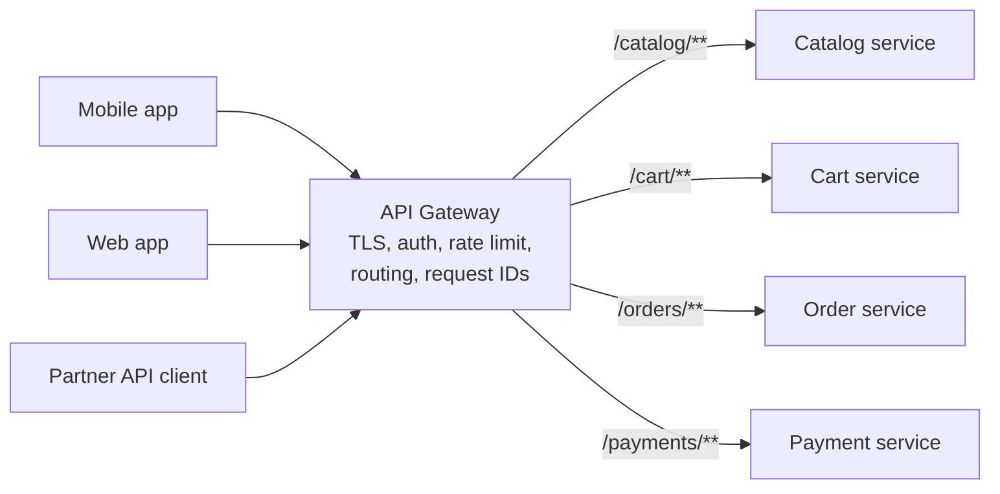
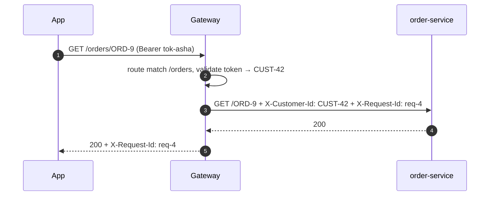
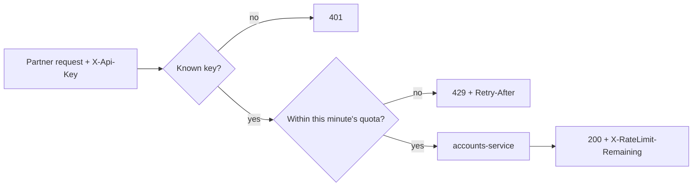
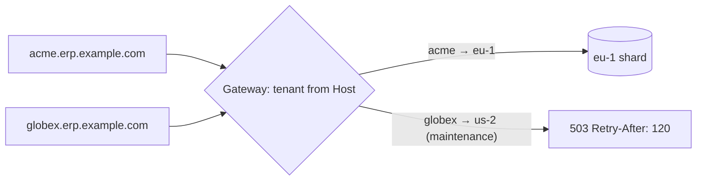

---
tags:
  - Microservices
  - Intermediate
---

# API Gateway

<span class="badge badge--intermediate">🟡 Intermediate</span>
<span class="badge badge--category">Microservices</span>
<span class="badge badge--interview">Interview frequency ⭐⭐⭐⭐⭐</span>

!!! abstract "TL;DR"
    **An API gateway is the single entry point for clients: it routes each request to the right service and handles cross-cutting edge concerns (authentication, rate limiting, TLS, request IDs, canary routing) in one place.**
    Clients see one stable API; services stay simple and can move, split or scale behind it.

---

## 1. Intent & Problem It Solves

**The problem in plain English:** a grocery mobile app talks to catalog, cart, order and payment services. Without a gateway, the app needs every service's address, each service re-implements token validation and rate limiting, and moving or splitting a service means shipping a new app version (and waiting weeks for users to update). A gateway puts **one front door** in front of all of them.

**Definition (microservices.io):**
> Implement an API gateway that is the single entry point for all clients. The gateway handles requests by routing them to the appropriate service, or by fanning out to multiple services.

**Typical gateway responsibilities:**

| Concern | Example |
|---|---|
| **Routing** | `/orders/**` → order-service; strip or rewrite paths |
| **Authentication** | Validate JWTs / API keys once; pass identity downstream (`X-Customer-Id`) |
| **Rate limiting / quotas** | Per client, per API key, per tenant |
| **Observability** | Request IDs, trace headers, access logs, metrics |
| **Traffic management** | Canary releases, A/B tests, blue-green |
| **Protocol translation** | REST ↔ gRPC, WebSocket upgrade |
| **Edge security** | TLS termination, WAF, IP allow-lists, CORS |

## 2. Real-World Analogy

!!! example "A hotel reception desk"
    Guests don't wander the corridors looking for housekeeping or the restaurant manager. Reception checks who you are (authentication), sends your request to the right department (routing), and politely says "please wait" when the kitchen is overwhelmed (rate limiting). Departments can be reorganized without guests noticing.

## 3. Structure



| Participant | Responsibility |
|---|---|
| **Clients** | Know one host and one API |
| **Gateway** | Edge concerns + routing; **no business logic** |
| **Services** | Business capabilities; trust identity headers from the gateway (inside a private network or with mTLS) |

## 4. Naive Approach (Without the Pattern)

```text
mobile app ──► catalog.internal:8081   (needs to know every host)
           ──► cart.internal:8082       (each service validates JWTs its own way)
           ──► orders.internal:8083     (each service has its own rate limiter, or none)
Split order-service in two?  → release a new app and wait for users to update.
```

- :material-close-circle:{ style="color:#e53935" } **Clients coupled** to internal topology.
- :material-close-circle:{ style="color:#e53935" } **Duplicated edge logic** (auth, rate limiting) with inconsistent behavior.
- :material-close-circle:{ style="color:#e53935" } **Internal services exposed** to the internet.

---

## 5. Three Real-World Examples

### Example 1: Mobile API Gateway (Grocery)

**Scenario:** A grocery app has public endpoints (browse the catalog) and private ones (cart, orders). The gateway routes by path prefix, strips the prefix (services don't care about their public URL), validates the session token **once**, passes the customer ID downstream, and tags every request with an ID for log correlation. Unknown paths return 404 at the edge without touching any service.

**Design:**



**Full Code:**

=== "MobileGateway.java"

    ```java
    --8<-- "code/microservices/src/main/java/com/handbook/microservices/gateway/grocery/MobileGateway.java"
    ```

    1.  **Route matching** by prefix (first match wins; order specific routes first).
    2.  **Path rewriting**: services see `/ORD-9`, not the public `/orders/ORD-9`, so the public API can change without touching services.
    3.  **Authentication at the edge**: invalid requests never reach a service.
    4.  **Identity propagation**: services trust `X-Customer-Id` from the gateway. Only safe if services aren't reachable directly (private network, mTLS); the gateway must also **strip** any client-supplied copy of that header.

=== "Http.java (support)"

    ```java
    --8<-- "code/microservices/src/main/java/com/handbook/microservices/support/Http.java"
    ```

=== "MobileGatewayDemo.java"

    ```java
    --8<-- "code/microservices/src/main/java/com/handbook/microservices/gateway/grocery/MobileGatewayDemo.java"
    ```

**Output (happy and failure paths):**

```text
--8<-- "code/outputs/microservices/gateway/grocery/MobileGatewayDemo.txt"
```

**Why a gateway here:**

- One host and API for the app; internal services can move freely.
- Authentication and request IDs **implemented once**.
- Public/private routes are a gateway configuration decision.

---

### Example 2: Open-Banking Partner Gateway (Banking)

**Scenario:** A bank exposes account APIs to licensed fintech partners. Each partner has an **API key** and a **quota** in its contract (BudgetApp: 3 requests/minute in this demo; real quotas are higher). The gateway rejects unknown keys, counts requests per partner per minute, returns `X-RateLimit-Remaining` so partners can pace themselves, and answers `429 Too Many Requests` with `Retry-After` when the quota is used up, protecting the core banking systems behind it.

**Design:**



**Full Code:**

=== "OpenBankingGateway.java"

    ```java
    --8<-- "code/microservices/src/main/java/com/handbook/microservices/gateway/openbanking/OpenBankingGateway.java"
    ```

    1.  A **fixed window** per partner per minute, using an injected `Clock` so the demo is deterministic. See [Rate Limiter](rate-limiter.md) for token buckets and sliding windows.
    2.  `429` + **`Retry-After`** tells well-behaved clients exactly when to retry.
    3.  **Rate-limit headers** let partners slow down before they hit the limit.

=== "OpenBankingDemo.java"

    ```java
    --8<-- "code/microservices/src/main/java/com/handbook/microservices/gateway/openbanking/OpenBankingDemo.java"
    ```

=== "FakeClock.java (support)"

    ```java
    --8<-- "code/microservices/src/main/java/com/handbook/microservices/support/FakeClock.java"
    ```

**Output:**

```text
--8<-- "code/outputs/microservices/gateway/openbanking/OpenBankingDemo.txt"
```

**Why a gateway here:**

- **Contractual quotas** enforced consistently for every partner and every API.
- Core banking is protected from partner traffic spikes.
- Partner identity and usage are measured at one place (billing, audit).

---

### Example 3: Tenant-Aware Routing (SaaS ERP)

**Scenario:** A SaaS ERP hosts tenants in regional **shards** for data residency (EU customers in `eu-1`, US customers in `us-2`). Each tenant has its own subdomain (`acme.erp.example.com`). The gateway resolves the tenant from the `Host` header and routes to its shard. During planned maintenance of a shard, its tenants get a clear `503` with `Retry-After`, while tenants on other shards are unaffected. Unknown subdomains get a `404` at the edge.

**Design:**



**Full Code:**

=== "TenantGateway.java"

    ```java
    --8<-- "code/microservices/src/main/java/com/handbook/microservices/gateway/tenancy/TenantGateway.java"
    ```

    1.  **Tenant resolution** at the edge. Real systems also validate that the authenticated user belongs to this tenant.
    2.  Shard-level **maintenance mode** without touching the shard.
    3.  The **tenant context** travels as a header (and in the token) so every service can enforce isolation.

=== "TenantGatewayDemo.java"

    ```java
    --8<-- "code/microservices/src/main/java/com/handbook/microservices/gateway/tenancy/TenantGatewayDemo.java"
    ```

**Output:**

```text
--8<-- "code/outputs/microservices/gateway/tenancy/TenantGatewayDemo.txt"
```

**Why a gateway here:**

- **Data residency** and sharding are invisible to clients.
- Operational controls (maintenance, migrations of a tenant between shards) are routing changes.
- Tenant context is established once, at the edge.

---

??? example "Unit Tests: `ApiGatewayTest.java`"

    ```java
    --8<-- "code/microservices/src/test/java/com/handbook/microservices/ApiGatewayTest.java"
    ```

## 6. Variations & Modern Java Take

**Spring Cloud Gateway** configuration for Example 1 (reference YAML; not executed in this repo):

```yaml
spring:
  cloud:
    gateway:
      default-filters:
        - AddRequestHeader=X-Gateway, mobile
      routes:
        - id: catalog
          uri: lb://catalog-service          # load-balanced via service discovery
          predicates: [ "Path=/catalog/**" ]
          filters: [ "StripPrefix=1" ]
        - id: orders
          uri: lb://order-service
          predicates: [ "Path=/orders/**" ]
          filters:
            - StripPrefix=1
            - name: RequestRateLimiter       # Redis token bucket
              args:
                redis-rate-limiter.replenishRate: 10
                redis-rate-limiter.burstCapacity: 20
                key-resolver: "#{@userKeyResolver}"
      # JWT validation: spring-boot-starter-oauth2-resource-server + spring.security.oauth2.resourceserver.jwt.issuer-uri
```

| Option | Notes |
|---|---|
| **Spring Cloud Gateway** | Java/Spring, reactive, rich filters; good if your team is Spring-heavy |
| **Kong, NGINX, Envoy, Traefik** | High-performance, plugin ecosystems; language-agnostic |
| **Cloud gateways** (AWS API Gateway, Azure API Management, GCP API Gateway/Apigee) | Managed, with API keys, quotas, developer portals |
| **Kubernetes Gateway API / Ingress** | Declarative routing at the cluster edge |
| **BFF** | One gateway per client type. See [Backend for Frontend](backend-for-frontend.md) |

## 7. Where It Lives in Real Frameworks

| Where | Gateway |
|---|---|
| Spring Cloud Gateway | Routes, predicates, filters (StripPrefix, RequestRateLimiter, CircuitBreaker, Retry) |
| Netflix Zuul (legacy) | The original Java microservice gateway |
| Envoy / Istio ingress gateway | Edge proxy in service meshes |
| Kong / Apigee / AWS API Gateway | API management: keys, quotas, monetization, portals |

## 8. Pros, Cons & Trade-offs

| ✅ Pros | ❌ Cons |
|---|---|
| **One entry point**; clients decoupled from topology | **Single point of failure**: needs HA, autoscaling and fast config rollback |
| Edge concerns **implemented once** | **Extra hop**: a little latency |
| Safe place for canaries, quotas, auth | Can become a **bottleneck team** if every change needs gateway edits |
| Hides internal services from the internet | Temptation to put **business logic** in it |

## 9. Pitfalls & Anti-Patterns

!!! danger "Business logic in the gateway"
    Discount rules or order validation in gateway filters create a hidden monolith that every team depends on. Keep the gateway to **edge concerns**; use a BFF or a service for aggregation and logic.

!!! danger "Trusting identity headers from clients"
    If services trust `X-Customer-Id` and the gateway doesn't **strip** client-supplied copies, anyone can impersonate anyone. Strip, then set, and keep services off the public network.

!!! warning "One giant shared gateway config"
    Hundreds of routes owned by one team slows everyone. Use per-team route ownership (GitOps), or per-client BFFs.

!!! warning "No timeouts or circuit breakers at the edge"
    A slow service ties up gateway connections and can take down **all** routes. Set per-route timeouts and circuit breakers.

## 10. Senior / Architect Deep Dive (10–15 yrs)

**Availability.** The gateway is on every request path: run it in several zones, autoscale on connections and CPU, keep it stateless (rate-limit state in Redis or local approximations), and roll configuration out gradually with instant rollback.

**Security layering.** TLS and WAF at the edge, authentication (JWT validation with cached keys), coarse authorization (scopes), then **fine-grained authorization in services**. Zero-trust networks add mTLS between gateway and services so header-based identity can't be spoofed internally.

**Gateway vs. service mesh.** The gateway handles **north-south** traffic (clients → services); a mesh handles **east-west** traffic (service ↔ service: mTLS, retries, telemetry). Many platforms use both. See [Sidecar / Service Mesh](sidecar-service-mesh.md).

### Production checklist

- [ ] Multi-zone, autoscaled, **stateless** gateway instances; health checks and fast config rollback.
- [ ] **Per-route timeouts**, retries only for idempotent requests, circuit breakers.
- [ ] Authentication at the edge; **strip and set** identity headers; mTLS to services.
- [ ] Rate limits per client/key/tenant with `429` + `Retry-After`.
- [ ] Request IDs and **trace propagation** (W3C `traceparent`); access logs with latency and status.
- [ ] Route ownership and review process; contract tests for public APIs.
- [ ] Canary/blue-green routing with automatic rollback on error-rate increase.

### Explain it in 2 minutes (system design round)

> "Clients hit a single **API gateway** (Spring Cloud Gateway or Envoy) behind a load balancer. It terminates TLS, validates JWTs, applies per-user and per-API-key rate limits, adds request and trace IDs, and routes by path to internal services discovered through the registry. It has no business logic. It's stateless and multi-zone; rate-limit counters live in Redis. For different clients I'd add thin BFFs behind it. Each route has timeouts and a circuit breaker so one slow service can't exhaust gateway resources."

!!! bug "War story: the header that granted admin"
    A marketplace's gateway validated JWTs and set `X-User-Role` for downstream services, but didn't remove that header if the **client** sent it. An internal admin endpoint was accidentally exposed through a new route. A security researcher sent `X-User-Role: ADMIN` with a normal user token, and the service trusted it.
    **Fix:** the gateway now **strips all `X-User-*` headers** from incoming requests before setting its own; services verify a signed internal token (or mTLS identity) instead of plain headers; new routes require a security review.
    **Lesson:** identity propagated in headers is only as safe as the guarantee that clients can't set them.

## 11. Related Patterns & Comparisons

| | API Gateway | BFF | Service Mesh | Facade |
|---|---|---|---|---|
| Traffic | North-south (clients → services) | North-south, per client type | East-west (service ↔ service) | In-process |
| Logic | Edge concerns only | Client-specific aggregation and shaping | Network concerns (mTLS, retries) | Simplified API over classes |
| Count | One (or a few) | One per client type | One sidecar per pod | Any |

## 12. Interview Corner

=== "🟢 Beginner / Service Companies"

    **Q1. What is an API gateway?**

    A **single entry point** for clients that **routes** requests to services and handles **cross-cutting** concerns like authentication, rate limiting and logging.

    **Q2. Why use one?**

    Clients don't need to know internal services; security and rate limiting are implemented once; internal services aren't exposed.

    **Q3. Name some gateways.**

    **Spring Cloud Gateway**, Netflix Zuul (older), Kong, NGINX, Envoy, AWS API Gateway, Apigee.

    **Q4. Gateway vs. load balancer?**

    A load balancer spreads traffic across instances of **one** service; a gateway routes to **different** services by path or headers and adds edge features.

    **Q5. Is the gateway a single point of failure?**

    Potentially. Run multiple instances across zones behind a load balancer, keep them stateless and autoscale.

=== "🟡 Mid-Level"

    **Q1. Where should authentication and authorization happen?**

    **Authentication** (and coarse scopes) at the gateway; **fine-grained authorization** in the services that own the data.

    **Q2. How does Spring Cloud Gateway route to services?**

    Routes with **predicates** (path, host, header) and **filters** (StripPrefix, rate limiter, retry, circuit breaker), with `lb://service-name` URIs resolved through service discovery.

    **Q3. How do you rate limit at the gateway?**

    Per key or user, with a token bucket (often Redis-backed for many instances), returning `429` and `Retry-After`.

    **Q4. What should never go in a gateway?**

    **Business logic** (pricing, validation of orders); it creates a hidden shared monolith.

    **Q5. Gateway vs. BFF?**

    A gateway is generic edge infrastructure; a BFF is a backend tailored to **one client type** (mobile, web) that aggregates and shapes data.

=== "🔴 Senior / FAANG / SAP"

    **Q1. "Design the edge layer for an app with 50M users and 200 services."**

    Global DNS/anycast → CDN/WAF → regional load balancers → stateless gateway fleet (Envoy) with JWT validation, Redis-backed rate limits, routing via discovery, timeouts and circuit breakers → BFFs per client → services. GitOps-managed routes with per-team ownership, canary config rollout, full tracing.

    **Q2. "How do you safely propagate user identity to internal services?"**

    Strip incoming identity headers; issue a short-lived **internal signed token** (or JWT pass-through) and use **mTLS** between hops; services validate tokens rather than trusting plain headers.

    **Q3. "How would you implement canary releases at the gateway?"**

    Weighted routes or sticky hashing by user ID (coding challenge), header overrides for testers, automated analysis of error rate and latency, and automatic rollback.

    **Q4. "Gateway latency budget is 5 ms at p99. What do you watch?"**

    Avoid synchronous calls to external stores per request (cache JWKS, local token bucket approximations), connection pooling, efficient filters, and capacity headroom. Measure per filter.

    **Q5. "Multi-tenant SaaS: what's tenant routing at the gateway responsible for?"**

    Resolving the tenant (host, token claim), routing to the right shard or region (data residency), enforcing tenant-level quotas, maintenance controls, and passing tenant context. Isolation must still be enforced in services and databases.

=== "💻 Coding Challenge"

    **Problem:** Route about 10% of users to `checkout v2`. The same user must always get the same version (sticky), and QA engineers must be able to force v2 with an `X-Canary: true` header.

    ??? success "Solution"

        === "CanaryRouter.java"

            ```java
            --8<-- "code/microservices/src/main/java/com/handbook/microservices/gateway/canary/CanaryRouter.java"
            ```

        === "CanaryDemo.java"

            ```java
            --8<-- "code/microservices/src/main/java/com/handbook/microservices/gateway/canary/CanaryDemo.java"
            ```

        **Output:**

        ```text
        --8<-- "code/outputs/microservices/gateway/canary/CanaryDemo.txt"
        ```

        **Key points to say:** hash the **user ID** (not random per request) for stickiness; `floorMod` avoids negative buckets; a header override for testing. In production, use a stable hash (Murmur3) with a salt per experiment, so the same users aren't always the canary group.

!!! info "Behavioural tie-in (STAR) for experienced candidates"
    - **S:** Each of our 14 services validated JWTs differently, and two had no rate limiting.
    - **T:** Consistent edge security without slowing teams down.
    - **A:** Introduced a gateway with centralized JWT validation, per-client rate limits, request IDs and header stripping; route config moved to GitOps with per-team ownership.
    - **R:** Removed about 2,000 lines of duplicated auth code; a later credential-stuffing attack was absorbed by rate limits without service impact.

## 13. Quick Revision Card

!!! tip "Remember in 30 seconds"
    - **Single entry point**: routing + edge concerns (auth, rate limits, TLS, IDs, canaries).
    - **No business logic** in the gateway.
    - Strip client-supplied identity headers; mTLS internally.
    - HA, stateless, timeouts and circuit breakers per route.
    - **Gateway = north-south; mesh = east-west; BFF = per client type.**

    ```yaml
    - id: orders
      uri: lb://order-service
      predicates: [ "Path=/orders/**" ]
      filters: [ "StripPrefix=1" ]
    ```

## Practice

- [ ] Make `MobileGateway` strip any client-supplied `X-Customer-Id` header and add a test for it.
- [ ] Add a per-route timeout to the gateway using `CompletableFuture.orTimeout`.
- [ ] Move a tenant from `us-2` to `eu-1` with a routing change, and design how data moves with it.

---

[:material-arrow-left: Decomposition](decomposition.md){ .md-button }
[Next: Backend for Frontend :material-arrow-right:](backend-for-frontend.md){ .md-button .md-button--primary }
