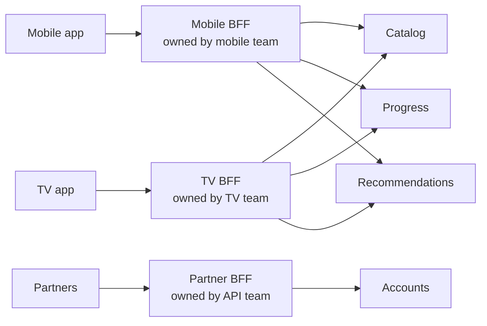
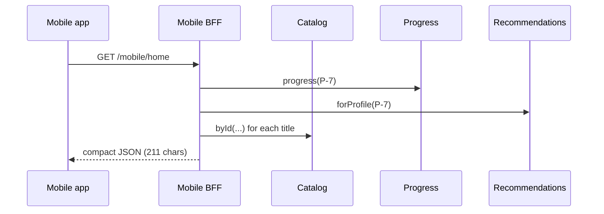
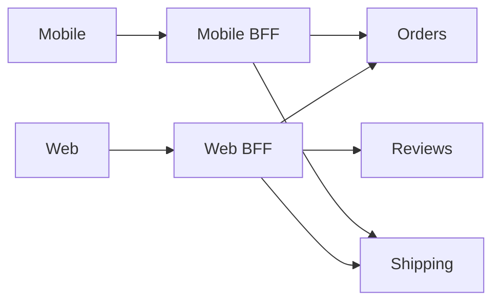
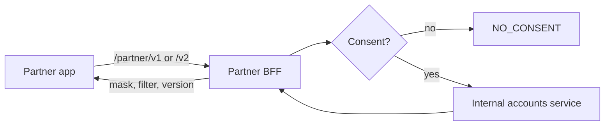

---
tags:
  - Microservices
  - Intermediate
---

# Backend for Frontend (BFF)

<span class="badge badge--intermediate">🟡 Intermediate</span>
<span class="badge badge--category">Microservices</span>
<span class="badge badge--interview">Interview frequency ⭐⭐⭐⭐</span>

!!! abstract "TL;DR"
    **A BFF is a small backend dedicated to one client experience (mobile, TV, web, partners). It calls the general-purpose services, then aggregates, trims and reshapes the data into exactly what that client renders.**
    Each client team owns its BFF, so they can change screens without waiting for the service teams.

---

## 1. Intent & Problem It Solves

**The problem in plain English:** the same `catalog`, `progress` and `recommendation` services feed a phone app on mobile data, a 4K TV app and a web site. One generic API means either the phone downloads huge payloads it throws away, or each client makes 5 round trips and stitches data together on a slow network. Adding fields "for the TV" bloats the API for everyone.

**Definition (Sam Newman, who named the pattern):**
> Rather than have a general-purpose API backend, have one backend per user experience.

**What a BFF does:**

- **Aggregates**: one client call → several service calls (often in parallel).
- **Shapes**: picks fields, image sizes, formats and copy for that UI.
- **Adapts**: handles client-specific auth flows, versions and caching.
- **Does not** own business rules or data; those stay in the services.

## 2. Real-World Analogy

!!! example "A tailor vs. ready-made clothes"
    The fabric mill (services) produces the same cloth for everyone. A tailor (BFF) cuts and stitches it for **one** customer's measurements. A child and an adult get garments from the same fabric, each fitted exactly, and the mill doesn't care about anybody's size.

## 3. Structure



| Participant | Responsibility |
|---|---|
| **Client** | Renders UI; ideally one call per screen |
| **BFF** | Aggregation, shaping, client-specific concerns; **no business rules** |
| **Downstream services** | Business capabilities and data, client-agnostic |
| **API gateway** (optional, in front) | Generic edge concerns: TLS, auth, rate limiting |

## 4. Naive Approach (Without the Pattern)

```text
One generic API for all clients:
  Phone on 3G:  GET /titles?ids=...   (full synopsis + 1920 px artwork it never shows)
                GET /progress/P-7
                GET /recommendations/P-7      → 3 round trips, ~2x the bytes
  TV team needs "hero banner": adds fields to the shared API → phone pays for them too.
  Every change to the shared API needs every client team to agree.
```

---

## 5. Three Real-World Examples

### Example 1: Mobile vs. TV Home Screens (Streaming)

**Scenario:** Same three services; two very different screens. The **mobile BFF** returns two compact rows with 320 px thumbnails and a progress percentage. The **TV BFF** returns an autoplay hero banner, genres, and 1920 px artwork for every tile. Each team changes its BFF on its own release schedule.

**Design:**



**Full Code:**

=== "MobileBff.java"

    ```java
    --8<-- "code/microservices/src/main/java/com/handbook/microservices/bff/streaming/MobileBff.java"
    ```

    1.  The BFF **computes display values** (percent watched) so the client stays dumb.
    2.  Mobile shows two cards; the TV shows the whole row. The decision lives with the team that owns the screen.
    3.  Only the **small image**: on metered mobile data, bytes matter.

=== "TvBff.java"

    ```java
    --8<-- "code/microservices/src/main/java/com/handbook/microservices/bff/streaming/TvBff.java"
    ```

    1.  A TV-only concept (autoplay hero banner) that the mobile API never has to carry.
    2.  Large artwork and genres for a 10-foot UI.

=== "StreamingBackends.java"

    ```java
    --8<-- "code/microservices/src/main/java/com/handbook/microservices/bff/streaming/StreamingBackends.java"
    ```

=== "Json.java (support)"

    ```java
    --8<-- "code/microservices/src/main/java/com/handbook/microservices/support/Json.java"
    ```

=== "StreamingBffDemo.java"

    ```java
    --8<-- "code/microservices/src/main/java/com/handbook/microservices/bff/streaming/StreamingBffDemo.java"
    ```

**Output:**

```text
--8<-- "code/outputs/microservices/bff/streaming/StreamingBffDemo.txt"
```

**Why a BFF here:**

- The phone gets **half the payload** in one round trip.
- TV-only features don't leak into the mobile contract.
- Downstream services stay generic and reusable.

---

### Example 2: Order Details for Web vs. Mobile (E-commerce)

**Scenario:** The desktop order page shows items, totals, a full tracking timeline and "review your purchase" prompts, so the web BFF calls **three** services. The mobile order card shows one summary line and the delivery time, so the mobile BFF calls **two** services and never touches the review service. Formatting money (₹1,447.00) is done once, server-side.

**Design:**



**Full Code:**

=== "WebBff.java"

    ```java
    --8<-- "code/microservices/src/main/java/com/handbook/microservices/bff/ecommerce/WebBff.java"
    ```

    1.  Only the web BFF depends on the review service. If it's down, the mobile app is unaffected.
    2.  **Presentation formatting** (currency, locale) belongs in the BFF, not in every client.

=== "MobileOrderBff.java"

    ```java
    --8<-- "code/microservices/src/main/java/com/handbook/microservices/bff/ecommerce/MobileOrderBff.java"
    ```

    1.  A **pre-rendered summary string**: the app just displays it.
    2.  UX copy can change without an app release.

=== "OrderBackends.java"

    ```java
    --8<-- "code/microservices/src/main/java/com/handbook/microservices/bff/ecommerce/OrderBackends.java"
    ```

=== "OrderBffDemo.java"

    ```java
    --8<-- "code/microservices/src/main/java/com/handbook/microservices/bff/ecommerce/OrderBffDemo.java"
    ```

**Output:**

```text
--8<-- "code/outputs/microservices/bff/ecommerce/OrderBffDemo.txt"
```

**Why a BFF here:**

- Each client's **dependency set is minimal** (fewer things that can break a screen).
- The mobile payload is about a quarter of the web one.
- Formatting and copy are server-controlled, avoiding app-store release cycles.

---

### Example 3: Partner BFF over Internal Accounts (Banking)

**Scenario:** The internal accounts service returns everything the bank knows: branch code, internal risk score, KYC status. A fintech partner may see only **masked** account numbers and balances, only for customers who **consented**, and two contract versions (v1, v2) must run side by side while partners migrate. The partner BFF owns that external contract, so the internal service can evolve freely.

**Design:**



**Full Code:**

=== "PartnerAccountBff.java"

    ```java
    --8<-- "code/microservices/src/main/java/com/handbook/microservices/bff/partner/PartnerAccountBff.java"
    ```

    1.  **Consent check** at the boundary. External access needs extra rules that internal clients don't.
    2.  **Masking**: partners never receive the full account number.
    3.  **Versioned contracts** live in the BFF; the internal model has one shape.

=== "PartnerBffDemo.java"

    ```java
    --8<-- "code/microservices/src/main/java/com/handbook/microservices/bff/partner/PartnerBffDemo.java"
    ```

**Output:**

```text
--8<-- "code/outputs/microservices/bff/partner/PartnerBffDemo.txt"
```

**Why a BFF here:**

- **Data minimization** by design: internal fields can't leak by accident.
- External **versioning** is isolated from internal refactoring.
- Partner-specific rules (consent, masking) live in one owned place.

---

??? example "Unit Tests: `BackendForFrontendTest.java`"

    ```java
    --8<-- "code/microservices/src/test/java/com/handbook/microservices/BackendForFrontendTest.java"
    ```

## 6. Variations & Modern Java Take

- **GraphQL as a BFF**: the client asks for exactly the fields it needs; resolvers fan out to services (Spring for GraphQL, Netflix DGS). One GraphQL server per experience, or a federated graph.
- **Parallel fan-out**: use `CompletableFuture` or structured concurrency with virtual threads, each call with its own timeout (see the coding challenge).
- **BFF + gateway**: gateway for generic edge concerns, BFFs behind it for shaping.
- **Server-driven UI**: the BFF returns layout components ("hero", "row") rather than raw data, so screens change without app releases.

## 7. Where It Lives in Real Frameworks

| Where | BFF |
|---|---|
| Netflix | Device-specific API adapters over shared services (historically Groovy scripts, later Node and GraphQL federation) |
| SoundCloud | Popularized the term with per-platform backends |
| Spring for GraphQL / Netflix DGS | GraphQL BFFs in Java |
| Next.js / Remix route handlers | Web BFFs colocated with the frontend |

## 8. Pros, Cons & Trade-offs

| ✅ Pros | ❌ Cons |
|---|---|
| **Optimized payloads** and fewer round trips per client | **More services to run** and monitor |
| Client teams **ship independently** | **Duplication** across BFFs (similar aggregation) |
| Generic services stay clean | Risk of **business logic creeping in** |
| Safe place for client auth flows, versioning, masking | Fan-out latency is bounded by the **slowest dependency** |

## 9. Pitfalls & Anti-Patterns

!!! danger "Business rules in the BFF"
    If the mobile BFF calculates discounts, the web BFF will eventually calculate them differently. Rules belong in services; BFFs **shape**.

!!! warning "One BFF per screen, or per developer"
    A BFF per **experience** (mobile, TV, web, partners). Dozens of micro-BFFs multiply operational cost for no gain.

!!! warning "Sequential fan-out"
    Calling five services one after another adds up their latencies. Call independent services **in parallel** with per-call timeouts and fallbacks.

!!! warning "All-or-nothing pages"
    If reviews fail, show the product without reviews. Decide which parts are **critical** and which are **optional**.

## 10. Senior / Architect Deep Dive (10–15 yrs)

**Ownership is the point.** A BFF works best when it's owned by the **same team as its client** (Conway's law used deliberately). If a central API team owns all BFFs, you've rebuilt the bottleneck you were escaping.

**Handling duplication.** Some duplication between BFFs is the price of independence. Extract shared **libraries** (clients, auth helpers) or push genuinely shared aggregation into a downstream service, but don't merge BFFs back into one.

**Latency and resilience.** The BFF's p99 is bounded below by the **slowest** required dependency. Classify each call as critical or optional, set timeouts below the client's own timeout, use circuit breakers on optional calls, and cache stable data (catalog metadata).

### Production checklist

- [ ] One BFF per **client experience**, owned by that client's team.
- [ ] **Parallel** fan-out with per-call timeouts; critical vs. optional sections.
- [ ] Circuit breakers and fallbacks for optional data; partial responses flagged (`degraded`).
- [ ] No business rules; contract tests against downstream services.
- [ ] Response caching where safe (per user/locale); compression.
- [ ] Trace propagation so a slow screen can be traced to the slow service.

### Explain it in 2 minutes (system design round)

> "Behind the gateway I'd put one **BFF per experience**: mobile, TV/web, and a partner API. Each is owned by that client's team. A BFF fans out **in parallel** to the domain services, applies timeouts and fallbacks, and returns exactly the screen's data in one round trip, which matters on mobile networks. Optional sections like recommendations degrade gracefully. BFFs hold no business rules, only aggregation and presentation, so the domain services stay reusable and teams ship independently."

!!! bug "War story: the shared API that served nobody well"
    A retailer ran one "universal" product API. Over three years every client added fields: the iOS app needed badges, the web needed SEO blocks, kiosks needed printer layouts. The response grew to 140 KB per product; Android on 3G timed out in rural areas. Changing a field needed sign-off from six teams.
    **Fix:** mobile and web BFFs, each owned by its client team, over slimmed-down domain services. Mobile responses dropped to 9 KB; release cadence went from monthly to weekly.
    **Lesson:** a single API for many very different clients ends up optimized for none of them.

## 11. Related Patterns & Comparisons

| | BFF | API Gateway | Facade | Adapter |
|---|---|---|---|---|
| Purpose | Shape data for **one** client experience | Generic edge concerns for all clients | Simplify a subsystem | Convert one interface to another |
| Aggregates calls | Yes | Rarely | Yes (in-process) | No |
| Owned by | Client team | Platform team | Any | Any |

See [API Gateway](api-gateway.md) and the in-process cousin [Facade](../structural/facade.md).

## 12. Interview Corner

=== "🟢 Beginner / Service Companies"

    **Q1. What is a BFF?**

    A backend built for **one specific frontend** (mobile, web) that aggregates data from microservices and returns exactly what that UI needs.

    **Q2. Why not one API for all clients?**

    Different clients need different data and payload sizes; a shared API gets bloated and every change needs every client team's agreement.

    **Q3. Who should own a BFF?**

    The **team that owns the client** it serves.

    **Q4. BFF vs. API gateway?**

    The gateway handles generic concerns (auth, rate limits, routing) for everyone; a BFF shapes and aggregates data for one client type. They're often used together.

    **Q5. Should a BFF contain business logic?**

    No. Only aggregation, formatting and client-specific adaptation.

=== "🟡 Mid-Level"

    **Q1. How do you keep BFF latency low?**

    Call services **in parallel** (`CompletableFuture`, virtual threads), set per-call timeouts, cache stable data, and skip optional calls when they're slow.

    **Q2. One downstream service fails. What does the BFF return?**

    For critical data, an error; for optional data, a **partial response** with a fallback and a `degraded` flag so the UI can hide that section.

    **Q3. How does GraphQL relate to BFF?**

    GraphQL lets clients choose fields, so a GraphQL server can act as a BFF; resolvers fan out to services.

    **Q4. How do you avoid code duplication across BFFs?**

    Shared client libraries, and pushing genuinely shared aggregation down into a service. Accept some duplication as the price of independence.

    **Q5. How do you test a BFF?**

    Unit tests for shaping logic, **consumer-driven contract tests** (Pact) against downstream services, and screen-level tests from the client.

=== "🔴 Senior / FAANG / SAP"

    **Q1. "Design the API layer for a streaming service with phones, TVs, consoles and the web."**

    Gateway → per-experience BFFs (or a GraphQL federation layer) → domain services. Device capability detection (image sizes, codecs), parallel fan-out with budgets, personalisation as an optional section with cached fallbacks, CDN for artwork, server-driven layouts.

    **Q2. "BFFs keep growing business logic. How do you stop it?"**

    Architecture rules (ArchUnit) forbidding domain logic packages, code review guidelines, moving any duplicated rule into the owning service, and making the BFF's purpose explicit in its README and ownership.

    **Q3. "How does a BFF help with versioning external APIs?"**

    The BFF owns the external contract and maps it to internal models, so v1 and v2 can coexist while internal services change freely (Example 3).

    **Q4. "What's the latency budget math for a BFF that calls 4 services?"**

    In parallel, roughly max(service latencies) + BFF overhead; the p99 of the max of N calls is worse than each service's p99. Use hedged requests or timeouts for tail latency, and make non-critical calls optional.

    **Q5. "When would you NOT use BFFs?"**

    One client type, a small team, or clients with nearly identical needs. A single well-designed API (or GraphQL) is simpler.

=== "💻 Coding Challenge"

    **Problem:** Build a product page BFF that calls product, price and reviews **in parallel** with a 200 ms deadline each. Reviews are optional (empty list fallback), price may be missing, and the page fails only if the product itself is unavailable. Report degraded sections.

    ??? success "Solution"

        === "ProductPageBff.java"

            ```java
            --8<-- "code/microservices/src/main/java/com/handbook/microservices/bff/resilient/ProductPageBff.java"
            ```

        === "ProductPageDemo.java"

            ```java
            --8<-- "code/microservices/src/main/java/com/handbook/microservices/bff/resilient/ProductPageDemo.java"
            ```

        **Output:**

        ```text
        --8<-- "code/outputs/microservices/bff/resilient/ProductPageDemo.txt"
        ```

        **Key points to say:** calls start **at the same time**, so latency is roughly the slowest one (capped by the timeout); `orTimeout` makes the future fail but doesn't stop the underlying work, so also set timeouts on the HTTP client itself; classify sections as critical vs. optional.

!!! info "Behavioural tie-in (STAR) for experienced candidates"
    - **S:** Our Android app made 7 API calls to render the home screen; on slow networks it took 6 s.
    - **T:** Cut home-screen time without changing the domain services.
    - **A:** Built a mobile BFF owned by the Android/iOS team: one call, parallel fan-out, optional sections with fallbacks, 320 px images.
    - **R:** Home screen p75 went from 6.1 s to 1.8 s; the mobile team shipped home-screen changes weekly without backend tickets.

## 13. Quick Revision Card

!!! tip "Remember in 30 seconds"
    - **One backend per client experience**, owned by the client team.
    - Aggregate (in parallel), trim, format. **No business rules.**
    - Critical vs. optional data; partial responses with fallbacks.
    - Gateway = generic edge; BFF = client-specific shaping. Use both.
    - GraphQL is a popular way to build a BFF.

## Practice

- [ ] Add a `ConsoleBff` to Example 1 that returns 3 rows with 1280 px artwork.
- [ ] Make the web BFF return the order page without `reviewSkus` when the review service throws.
- [ ] Add a `v3` partner contract that includes the IFSC code, without changing `InternalAccount`.

---

[:material-arrow-left: API Gateway](api-gateway.md){ .md-button }
[Next: Service Discovery :material-arrow-right:](service-discovery.md){ .md-button .md-button--primary }
