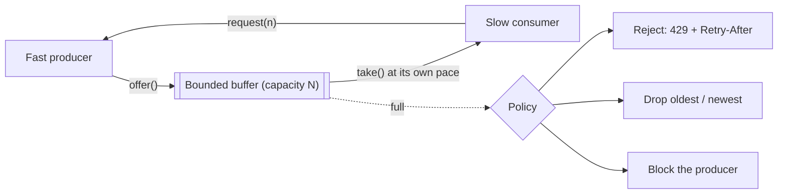
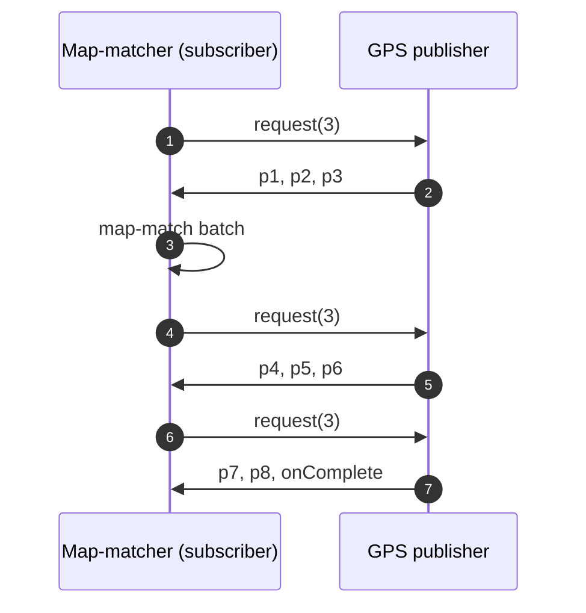
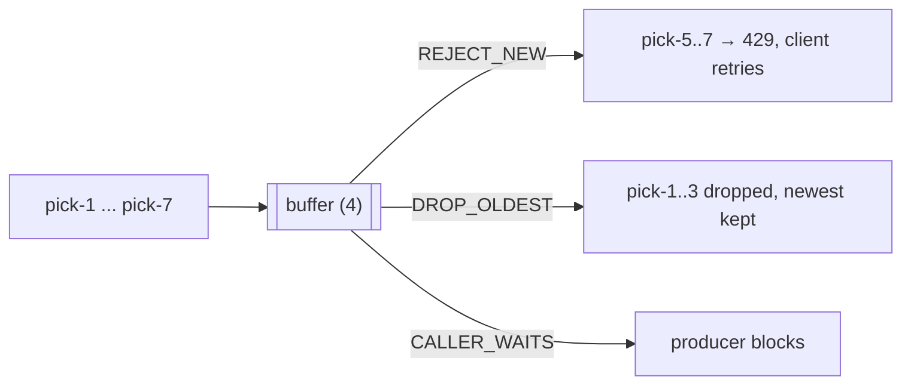
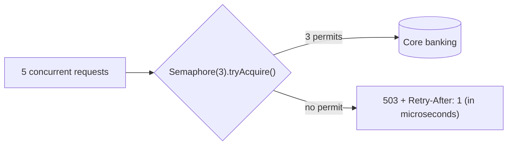

---
tags:
  - Microservices
  - Advanced
  - Resilience
---

# Backpressure & Load Shedding

<span class="badge badge--advanced">🔴 Advanced</span>
<span class="badge badge--category">Microservices</span>
<span class="badge badge--interview">Interview frequency ⭐⭐⭐⭐</span>

!!! abstract "TL;DR"
    **Backpressure is how a slow consumer tells a fast producer to slow down, by pulling only what it can handle or by refusing work when its bounded buffer is full. Load shedding is the server-side version: reject excess requests fast so the accepted ones stay fast.**
    Use it everywhere work crosses a speed boundary: reactive streams, queues between services, thread pools, and the front door of an overloaded API. The rule: **every buffer is bounded, and you decide what happens when it's full.**

---

## See It in Motion

<iframe class="motion-embed" src="../../motion/index.html?p=backpressure&amp;embed=1" title="Animated walkthrough of the Backpressure &amp; Load Shedding pattern" loading="lazy"></iframe>

Press **Play** to watch the calls travel between components, or step through with **Next** and **Back**. [Open the full explorer with all 66 patterns](../motion/index.html#backpressure){ target=_blank }

## 1. Intent & Problem It Solves

**The problem in plain English:** during a sale, orders arrive at 1,000/s but the warehouse picking API handles 600/s. If the service queues everything in memory, the queue grows by 400 items every second: after a minute, new requests wait 40 seconds (most clients have already timed out and retried, adding even more load), and then the JVM runs out of memory. Accepting work you can't finish is worse than refusing it.

**Definitions:**
> **Backpressure** (Reactive Streams): a subscriber signals demand (`request(n)`) and a publisher must never send more than was requested.
>
> **Load shedding** (Google SRE book): when a server is overloaded, it rejects some requests quickly and cheaply, so it can serve the rest within their deadlines.

| Mechanism | Who slows down | Example |
|---|---|---|
| **Pull / demand signalling** | The producer emits only on request | Reactive Streams `request(n)`, Kafka `poll()` |
| **Bounded buffer + block** | The producer thread waits | `ArrayBlockingQueue.put`, `CallerRunsPolicy` |
| **Bounded buffer + drop** | Old or new items are discarded | Live GPS, metrics, video frames |
| **Bounded buffer + reject** | The caller is told "not now" | HTTP 429/503 with `Retry-After` |
| **Concurrency limits** | Excess requests shed at the door | Semaphores, Envoy/Istio limits, adaptive limits |

## 2. Real-World Analogy

!!! example "A restaurant that stops seating"
    When the kitchen is full, a good restaurant stops seating new guests and gives them a waiting time at the door, instead of seating 200 people who'll all wait 90 minutes and leave angry. The kitchen asks the waiters for the next orders only when a cook is free (pull). The host refusing walk-ins is load shedding.

## 3. Structure



| Element | Responsibility |
|---|---|
| **Demand signal** | Consumer tells producer how much it can take (`request(n)`, credits, window size) |
| **Bounded buffer** | Absorbs short bursts; its size caps memory and waiting time |
| **Overflow policy** | Block, drop or reject: a business decision per data type |
| **Concurrency limiter** | Caps in-flight work at the service entrance |
| **Retry-After / client backoff** | Turns rejection into a slower, spread-out retry instead of a storm |

## 4. Naive Approach (Without the Pattern)

```java
ExecutorService pool = Executors.newFixedThreadPool(50);   // unbounded LinkedBlockingQueue inside
@PostMapping("/pick") void pick(Req r) { pool.submit(() -> pickingApi.call(r)); }   // always "accepted"

Flux.interval(Duration.ofMillis(1)).subscribe(this::slowWrite);   // no demand control → overflow
```

- :material-close-circle:{ style="color:#e53935" } **Unbounded queues** turn overload into latency, then memory exhaustion.
- :material-close-circle:{ style="color:#e53935" } Callers time out and retry, multiplying the load (a retry storm).
- :material-close-circle:{ style="color:#e53935" } Everyone gets slow service instead of most people getting good service.

---

## 5. Three Real-World Examples

### Example 1: Pull-Based GPS Processing (Ride-hailing)

**Scenario:** Every driver's phone sends a GPS ping every 2 seconds. A map-matching stage snaps pings to roads in batches of 3 and is CPU-heavy. Using the JDK's `java.util.concurrent.Flow` (the Reactive Streams interfaces), the matcher **requests** 3 pings, processes them, then requests 3 more. The publisher never pushes more than requested.

**Design:**



**Full Code:**

=== "GpsPublisher.java"

    ```java
    --8<-- "code/microservices/src/main/java/com/handbook/microservices/backpressure/flow/GpsPublisher.java"
    ```

    1.  The publisher emits **at most `n`** items per `request(n)`. This is Reactive Streams rule 1.1, the heart of backpressure. (Production publishers also avoid unbounded recursion when `request` is called from `onNext`; Reactor and RxJava handle that for you.)

=== "BatchingSubscriber.java"

    ```java
    --8<-- "code/microservices/src/main/java/com/handbook/microservices/backpressure/flow/BatchingSubscriber.java"
    ```

    1.  Initial demand: "I can take 3".
    2.  Only after finishing a batch does the subscriber ask for more. Demand, not the producer's speed, sets the pace.

=== "FlowDemo.java"

    ```java
    --8<-- "code/microservices/src/main/java/com/handbook/microservices/backpressure/flow/FlowDemo.java"
    ```

**Output:**

```text
--8<-- "code/outputs/microservices/backpressure/flow/FlowDemo.txt"
```

**Why pull-based backpressure here:**

- The consumer's capacity is the true limit, so it should set the rate.
- Memory stays bounded no matter how fast pings arrive upstream.
- WebFlux, Reactor, R2DBC and Kafka consumers all work this way.

---

### Example 2: Overflow Policies for a Bounded Buffer (Grocery)

**Scenario:** An order service hands pick requests to the warehouse's picking API through an in-memory buffer of 4. During a spike, 7 requests arrive before any are consumed. What should happen to the extra 3? The answer depends on the data: orders must not be silently dropped (reject so the client retries); live rider locations can drop stale points; inside one process, the producer thread can simply wait.

**Design:**



**Full Code:**

=== "IntakeBuffer.java"

    ```java
    --8<-- "code/microservices/src/main/java/com/handbook/microservices/backpressure/overflow/IntakeBuffer.java"
    ```

    1.  The **overflow policy** is explicit. Java gives you each one: `offer()` (reject), `put()` (block), `ThreadPoolExecutor.DiscardOldestPolicy` (drop oldest), `CallerRunsPolicy` (the caller does the work, slowing itself down).

=== "OverflowDemo.java"

    ```java
    --8<-- "code/microservices/src/main/java/com/handbook/microservices/backpressure/overflow/OverflowDemo.java"
    ```

**Output:**

```text
--8<-- "code/outputs/microservices/backpressure/overflow/OverflowDemo.txt"
```

**Why explicit policies here:**

- "What happens when full?" is a **business** decision; make it visible in code.
- Rejection pushes pressure back to the client, who can back off.
- Dropping is correct only for data that is superseded by newer data.

---

### Example 3: Load Shedding at the Front Door (Banking)

**Scenario:** A bank's statement API queries the core-banking database, which can only serve 3 statement queries at a time before latency explodes for payments too. At month-end, customers open statements in bursts. The API holds at most 3 requests in flight and answers the rest **immediately** with 503 and `Retry-After: 1`, rather than queueing them until they time out.

**Design:**



**Full Code:**

=== "ConcurrencyLimiter.java"

    ```java
    --8<-- "code/microservices/src/main/java/com/handbook/microservices/backpressure/shedding/ConcurrencyLimiter.java"
    ```

    1.  `tryAcquire()` never waits: if all permits are taken, the request is shed **at once**, costing almost nothing. A blocking `acquire()` would just move the queue somewhere invisible.

=== "SheddingDemo.java"

    ```java
    --8<-- "code/microservices/src/main/java/com/handbook/microservices/backpressure/shedding/SheddingDemo.java"
    ```

**Output:**

```text
--8<-- "code/outputs/microservices/backpressure/shedding/SheddingDemo.txt"
```

**Why load shedding here:**

- Protects a shared, fragile dependency (and every other feature that uses it).
- Accepted requests stay fast; rejected ones fail fast and retry later.
- Adaptive limiters (Netflix `concurrency-limits`, Envoy adaptive concurrency) tune the limit automatically from latency.

---

??? example "Unit Tests: `BackpressureTest.java`"

    ```java
    --8<-- "code/microservices/src/test/java/com/handbook/microservices/BackpressureTest.java"
    ```

## 6. Variations & Modern Java Take

=== "Project Reactor (reference)"

    ```java
    gpsPings()                                   // Flux<Ping>, a hot source
        .onBackpressureBuffer(10_000, dropped -> metrics.increment("gps.dropped"),
                              BufferOverflowStrategy.DROP_OLDEST)
        .limitRate(256)                          // request in chunks of 256
        .flatMap(this::mapMatch, 8)              // at most 8 concurrent map-matching calls
        .subscribe();
    ```

=== "Bounded executor (reference)"

    ```java
    new ThreadPoolExecutor(16, 16, 0, TimeUnit.MILLISECONDS,
            new ArrayBlockingQueue<>(200),                 // bounded: ~200 queued jobs
            new ThreadPoolExecutor.CallerRunsPolicy());    // caller slows itself down when full
    ```

| Variation | Notes |
|---|---|
| `java.util.concurrent.Flow` / `SubmissionPublisher` | JDK Reactive Streams interfaces; `SubmissionPublisher.offer` with a drop handler |
| Reactor / RxJava | `limitRate`, `onBackpressureBuffer/Drop/Latest`, `flatMap(concurrency)` |
| Kafka | Consumers pull (`max.poll.records`); pausing partitions (`consumer.pause`) when downstream is slow |
| gRPC / HTTP/2 | Flow-control windows per stream |
| Virtual threads | Blocking calls give natural backpressure; still bound concurrency with semaphores |
| Adaptive concurrency | Limit derived from measured latency (TCP Vegas/gradient algorithms) |

## 7. Where It Lives in Real Frameworks

| Where | Backpressure / shedding |
|---|---|
| JDK | `Flow`, `SubmissionPublisher`, `BlockingQueue`, `ThreadPoolExecutor` rejection policies, `Semaphore` |
| Spring WebFlux / Reactor Netty | End-to-end demand from the socket to R2DBC |
| Resilience4j | `Bulkhead` (semaphore/thread-pool), `RateLimiter` |
| Envoy / Istio | Circuit-breaker thresholds (`maxPendingRequests`), adaptive concurrency filter |
| Kubernetes | Readiness probes failing under overload remove a pod from load balancing |
| Kafka Streams / Flink | Credit-based flow control between operators |

## 8. Pros, Cons & Trade-offs

| ✅ Pros | ❌ Cons |
|---|---|
| Memory and latency stay bounded under overload | Some requests are rejected or dropped |
| Overload degrades gracefully instead of collapsing | Clients must handle 429/503 and retry with backoff |
| Prevents retry storms and cascading failures | Choosing limits and buffer sizes needs measurement |
| Makes capacity limits explicit | End-to-end backpressure requires every stage to cooperate |

## 9. Pitfalls & Anti-Patterns

!!! danger "Unbounded queues"
    `Executors.newFixedThreadPool`, `LinkedBlockingQueue()` with no capacity, `onBackpressureBuffer()` with no size: all accept work forever. Under sustained overload they become latency bombs and then OOMs (coding challenge).

!!! danger "Shedding after doing the work"
    Rejecting a request after parsing, authenticating and querying the DB saves nothing. Shed as early (and cheaply) as possible.

!!! warning "Retries without backoff or jitter"
    Rejected clients retrying immediately just recreate the spike. Honour `Retry-After`, use exponential backoff with jitter, and cap retries.

!!! warning "Blocking a reactive pipeline"
    A `.block()` or blocking JDBC call inside a WebFlux handler stalls the event loop, which disables backpressure for everyone on that thread.

## 10. Senior / Architect Deep Dive (10–15 yrs)

**Size buffers in time, not items.** A buffer is "how much waiting is acceptable": 2 seconds of work at 600/s = 1,200 items. If clients time out after 3 seconds, a queue holding 40 seconds of work is pure waste: everything in it will be served too late.

**Prioritize what you keep.** Under overload, shed by priority: health checks and payments first, recommendations last. Tag requests with criticality (Google's "criticality" propagation) and shed the cheapest-to-lose classes first.

**Propagate deadlines.** Pass the remaining time budget downstream (`grpc-timeout`, a deadline header). A service should drop work whose caller has already given up. That's backpressure by deadline.

!!! bug "War story: the queue that ate the sale"
    A grocery order service submitted picking calls to `Executors.newFixedThreadPool(50)`. When the picking API slowed during a mango sale, the hidden unbounded queue grew to 1.8 million tasks over 20 minutes. Customers' apps timed out and retried, tripling arrivals. The pods ran out of heap and restarted, losing every queued task.
    **Fix:** a bounded queue of 2 seconds' work with `AbortPolicy` → 429 + `Retry-After`; client retries with jittered backoff; a semaphore in front of the picking client; dashboards on queue age.
    **Lesson:** an unbounded queue doesn't absorb overload, it postpones the crash and makes it bigger.

## 11. Related Patterns & Comparisons

| | Backpressure | Rate Limiter | Bulkhead | Circuit Breaker |
|---|---|---|---|---|
| Trigger | Consumer can't keep up | Caller exceeds a quota | Pool/permits exhausted | Dependency failing |
| Signal | Demand / full buffer | Fixed quota per time | Concurrency cap | Error rate |
| Response | Slow, drop or reject | Reject over quota | Reject or queue (bounded) | Fail fast, fallback |

See [Rate Limiter](rate-limiter.md), [Retry / Timeout / Bulkhead](retry-timeout-bulkhead.md), [Circuit Breaker](circuit-breaker.md), and [Producer-Consumer](../concurrency/producer-consumer.md) for the in-process foundations.

## 12. Interview Corner

=== "🟢 Beginner / Service Companies"

    **Q1. What is backpressure?**

    A way for a slow consumer to make a fast producer slow down, so it isn't overwhelmed.

    **Q2. Why are unbounded queues dangerous?**

    They grow without limit under overload, increasing latency until memory runs out.

    **Q3. What does HTTP 429 mean?**

    Too Many Requests: the client should slow down, often guided by `Retry-After`.

    **Q4. How does `request(n)` work in Reactive Streams?**

    The subscriber asks for n items; the publisher sends at most n until asked again.

    **Q5. Name three overflow strategies.**

    Block the producer, drop items, or reject with an error.

=== "🟡 Mid-Level"

    **Q1. What is load shedding?**

    Rejecting excess requests quickly so the accepted ones are served within their deadlines.

    **Q2. `CallerRunsPolicy` vs `AbortPolicy`?**

    `CallerRunsPolicy` makes the submitting thread run the task (natural slowdown); `AbortPolicy` throws `RejectedExecutionException` (explicit rejection).

    **Q3. How do you size a bounded queue?**

    By acceptable waiting time × throughput, and below the caller's timeout.

    **Q4. How does Kafka provide backpressure?**

    Consumers pull at their own pace; slow consumers build lag rather than being pushed data.

    **Q5. Why add jitter to retries?**

    So rejected clients don't retry in sync and recreate the spike.

=== "🔴 Senior / FAANG / SAP"

    **Q1. "Design overload protection for a checkout API."**

    Edge rate limits per user; adaptive concurrency limits per instance; priority classes (checkout > browsing); bounded queues sized under client timeouts; deadline propagation; client retry budgets; autoscaling on concurrency.

    **Q2. "How do you get end-to-end backpressure across services?"**

    Pull-based consumers (Kafka), HTTP/2/gRPC flow control, concurrency limits and 429s at each hop, and deadlines so downstream drops abandoned work.

    **Q3. "What's a retry storm and how do you stop it?"**

    Failures trigger retries that add load, causing more failures. Retry budgets (e.g. max 10% extra), exponential backoff + jitter, circuit breakers, honour `Retry-After`.

    **Q4. "Static vs adaptive concurrency limits?"**

    Static limits go stale as code and hardware change; adaptive limits adjust from latency (gradient/Vegas) and track real capacity.

    **Q5. "Where do virtual threads change the picture?"**

    Threads stop being the bottleneck, so you must cap **downstream** concurrency explicitly (semaphores per dependency) instead of relying on pool size.

=== "💻 Coding Challenge"

    **Problem:** For 60 seconds, 1,000 requests/s arrive and the service handles 600/s. Compare an unbounded queue with a queue bounded at 1,200 that rejects the excess.

    ??? success "Solution"

        === "UnboundedQueueDemo.java"

            ```java
            --8<-- "code/microservices/src/main/java/com/handbook/microservices/backpressure/unbounded/UnboundedQueueDemo.java"
            ```

        **Output:**

        ```text
        --8<-- "code/outputs/microservices/backpressure/unbounded/UnboundedQueueDemo.txt"
        ```

        **Key points to say:** the unbounded backlog grows by 400/s, so waits climb to 40 s (Little's law: wait = backlog / throughput). The bounded queue caps waiting at 2 s and rejects 400/s, which clients can retry later. Throughput is the same in both cases; only the bounded version delivers it usefully.

!!! info "Behavioural tie-in (STAR) for experienced candidates"
    - **S:** A hidden unbounded executor queue grew to 1.8M tasks during a sale, crashing pods and losing orders.
    - **T:** Keep the order service responsive under 3× overload.
    - **A:** Bounded queues sized to 2 s of work with 429 + `Retry-After`, a semaphore per downstream dependency, jittered client retries, and alerts on queue age.
    - **R:** The next sale peaked at 3.2× normal traffic with p99 under 800 ms and no restarts; 4% of requests were shed and succeeded on retry.

## 13. Quick Revision Card

!!! tip "Remember in 30 seconds"
    - **Every buffer is bounded; decide what happens when it's full.**
    - Pull (`request(n)`), block, drop, or reject (429/503 + `Retry-After`).
    - Shed early and cheaply; keep accepted work fast.
    - Size queues in seconds of work, below client timeouts.
    - Clients: backoff + jitter + retry budgets.

    ```java
    if (!permits.tryAcquire()) return ResponseEntity.status(503).header("Retry-After", "1").build();
    ```

## Practice

- [ ] Replace `GpsPublisher` with `SubmissionPublisher` and a drop handler; count dropped pings.
- [ ] Add a priority parameter to `ConcurrencyLimiter` that reserves one permit for payments.
- [ ] Add deadline propagation: skip work whose deadline has already passed.

---

[:material-arrow-left: Leader Election](leader-election.md){ .md-button }
[Next: Ambassador :material-arrow-right:](ambassador.md){ .md-button .md-button--primary }
