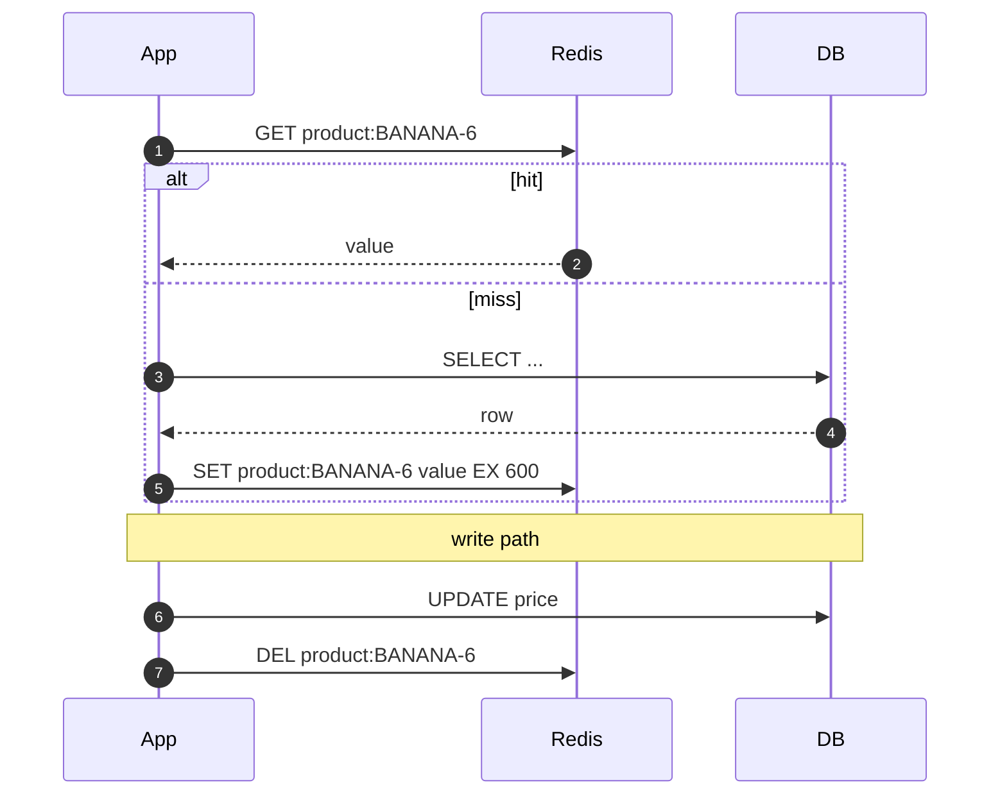
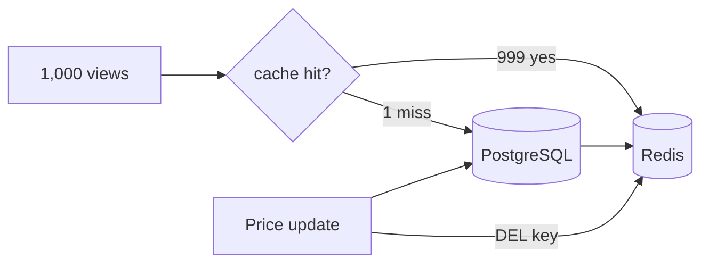
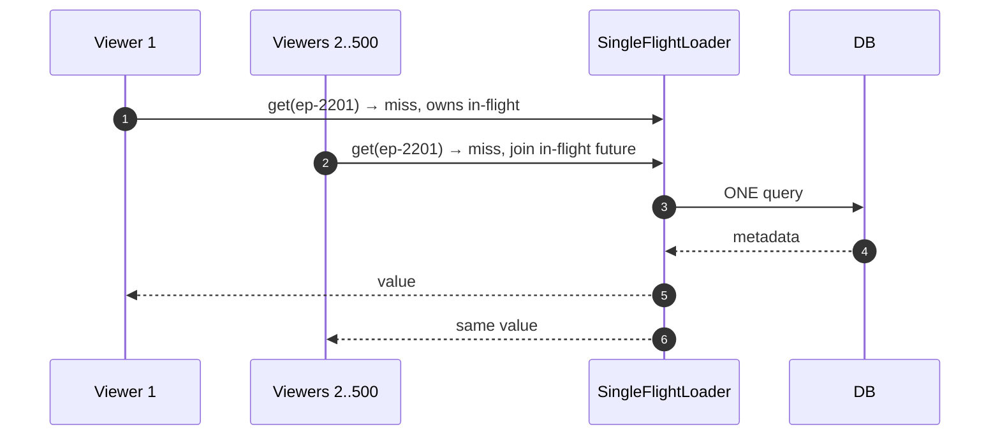
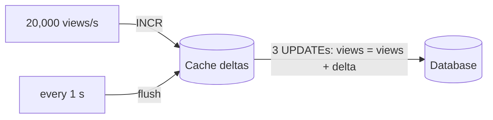

---
tags:
  - Microservices
  - Intermediate
  - Data
---

# Cache-Aside (and Other Caching Patterns)

<span class="badge badge--intermediate">🟡 Intermediate</span>
<span class="badge badge--category">Microservices</span>
<span class="badge badge--interview">Interview frequency ⭐⭐⭐⭐⭐</span>

!!! abstract "TL;DR"
    **Cache-aside: the application checks the cache first; on a miss it reads the database and puts the result in the cache with a TTL; on a write it updates the database and *deletes* the cache entry.**
    Use it for read-heavy data that tolerates being a few seconds stale (catalogs, profiles, configuration). Add request coalescing for hot keys, and know when write-through or write-behind fit better.

---

## See It in Motion

<iframe class="motion-embed" src="../../motion/index.html?p=cache-aside&amp;embed=1" title="Animated walkthrough of the Cache-Aside pattern" loading="lazy"></iframe>

Press **Play** to watch the calls travel between components, or step through with **Next** and **Back**. Switch to **Without it** to see what goes wrong without the pattern, or press a **Break it** button to make something fail while the pattern is in place. [Open the full explorer with all 75 patterns](../motion/index.html#cache-aside){ target=_blank }

## 1. Intent & Problem It Solves

**The problem in plain English:** the product page for bananas is viewed 1,000 times a minute during the evening rush, and every view runs the same `SELECT`. The database's CPU climbs, latency rises for everything else, and you're paying for a bigger database just to answer the same question again and again.

**Definition (Microsoft Azure Architecture Center, *Cache-Aside*):**
> Load data on demand into a cache from a data store. The application is responsible for reading from and writing to the store and keeping the cache consistent.

**The family of caching patterns:**

| Pattern | Read path | Write path | Typical use |
|---|---|---|---|
| **Cache-aside** (lazy loading) | App: cache → miss → DB → fill cache | App: write DB, delete cache key | Most microservices with Redis |
| **Read-through** | Cache library loads from DB on a miss | (Usually with write-through) | Caffeine `LoadingCache`, Hazelcast `MapLoader` |
| **Write-through** | From cache | Write cache **and** DB synchronously | Data read right after write |
| **Write-behind** (write-back) | From cache | Write cache; flush to DB asynchronously in batches | Counters, metrics, likes |
| **Refresh-ahead** | From cache | Reload hot keys before they expire | Hot keys with expensive loads |

## 2. Real-World Analogy

!!! example "The stock of popular items at the billing counter"
    A supermarket keeps chewing gum and batteries **at the counter** (the cache) instead of sending someone to the aisles (the database) each time. When the counter runs out, the cashier fetches more from the aisle (miss → load). When the price changes, the counter stock is relabelled by removing the old tags (invalidate), not by guessing the new price.

## 3. Structure



| Participant | Responsibility |
|---|---|
| **Application** | Owns the logic: look up, load on miss, fill, invalidate on write |
| **Cache** (Redis, Memcached, Caffeine) | Fast key-value store with TTLs and eviction |
| **Database** | Source of truth |
| **TTL** | Upper bound on staleness and a safety net for missed invalidations |

## 4. Naive Approach (Without the Pattern)

```java
public Product get(String sku) {
    return jdbc.queryForObject("SELECT * FROM product WHERE sku = ?", mapper, sku);  // every view hits the DB
}
// or, the opposite mistake:
static final Map<String, Product> CACHE = new HashMap<>();   // per-instance, never expires, never invalidated
```

- :material-close-circle:{ style="color:#e53935" } The database carries load that a cache could absorb 1000×.
- :material-close-circle:{ style="color:#e53935" } Home-made per-instance maps: inconsistent between pods, unbounded memory, stale forever.
- :material-close-circle:{ style="color:#e53935" } No TTL means one missed invalidation is permanent.

---

## 5. Three Real-World Examples

### Example 1: Product Pages (Grocery)

**Scenario:** A grocery app's product pages are viewed tens of thousands of times an hour, but prices change only a few times a day. A 10-minute TTL is acceptable, **except** that a price drop must show up immediately (marketing has pushed a notification). The write path updates PostgreSQL, then deletes the Redis key.

**Design:**



**Full Code:**

=== "ProductCatalog.java"

    ```java
    --8<-- "code/microservices/src/main/java/com/handbook/microservices/caching/catalog/ProductCatalog.java"
    ```

    1.  Look in the cache first; only on a miss go to the database.
    2.  Fill the cache with a **TTL**. The TTL bounds staleness even if an invalidation is lost.
    3.  **Delete, don't set**, on writes. Setting the new value from the writer races with concurrent readers and can't handle complex derived values; a delete just forces the next reader to load fresh data.

=== "TtlCache.java"

    ```java
    --8<-- "code/microservices/src/main/java/com/handbook/microservices/caching/catalog/TtlCache.java"
    ```

=== "CatalogCacheDemo.java"

    ```java
    --8<-- "code/microservices/src/main/java/com/handbook/microservices/caching/catalog/CatalogCacheDemo.java"
    ```

**Output:**

```text
--8<-- "code/outputs/microservices/caching/catalog/CatalogCacheDemo.txt"
```

**Why cache-aside here:**

- **Read-heavy**, rarely written data: a near-perfect hit rate.
- The application controls what is cached and for how long.
- If Redis is down, the app can still read the database (degraded, not broken).

---

### Example 2: Stampede Protection for a New Release (Streaming)

**Scenario:** When a new episode drops at 12:00, 500 viewers open it in the same second. The metadata isn't cached yet, so all 500 miss and query the database at once: a **cache stampede** (thundering herd). The fix is **request coalescing** (single-flight): the first miss loads; everyone else waits for that same load.

**Design:**



**Full Code:**

=== "SingleFlightLoader.java"

    ```java
    --8<-- "code/microservices/src/main/java/com/handbook/microservices/caching/singleflight/SingleFlightLoader.java"
    ```

    1.  `putIfAbsent` elects exactly **one** loader per key; everyone else gets the in-flight future.
    2.  Waiters share the result (or the failure) of that single load.

=== "StampedeDemo.java"

    ```java
    --8<-- "code/microservices/src/main/java/com/handbook/microservices/caching/singleflight/StampedeDemo.java"
    ```

**Output:**

```text
--8<-- "code/outputs/microservices/caching/singleflight/StampedeDemo.txt"
```

**Why coalescing here:**

- Hot keys + cold cache = synchronized misses; this turns N database queries into 1.
- Caffeine's `AsyncLoadingCache` does this per JVM; across pods, add a short Redis lock or jittered TTLs.
- The same idea protects downstream APIs, not just databases.

---

### Example 3: Write-Behind View Counters (Travel)

**Scenario:** A travel site shows "1,234 people viewed this hotel today". That's 20,000 increments per second at peak across three hotels in this demo. Writing each to the database is wasteful; counters can tolerate losing a second of data on a crash. Increments go to the cache and are flushed as **aggregated deltas** once per second.

**Design:**



**Full Code:**

=== "WriteBehindCounter.java"

    ```java
    --8<-- "code/microservices/src/main/java/com/handbook/microservices/caching/writebehind/WriteBehindCounter.java"
    ```

    1.  Writes only touch the in-memory side: microseconds, no DB round trip.
    2.  A periodic flush writes **one row per key** with the aggregated delta.

=== "WriteBehindDemo.java"

    ```java
    --8<-- "code/microservices/src/main/java/com/handbook/microservices/caching/writebehind/WriteBehindDemo.java"
    ```

**Output:**

```text
--8<-- "code/outputs/microservices/caching/writebehind/WriteBehindDemo.txt"
```

**Why write-behind here:**

- 60,000 increments became 9 database writes.
- The data is **approximate by nature**, so a small loss window is acceptable.
- Never use write-behind for money, orders or anything you can't afford to lose.

---

??? example "Unit Tests: `CacheAsideTest.java`"

    ```java
    --8<-- "code/microservices/src/test/java/com/handbook/microservices/CacheAsideTest.java"
    ```

## 6. Variations & Modern Java Take

=== "Spring Cache (reference)"

    ```java
    @Cacheable(cacheNames = "product", key = "#sku", sync = true)    // sync = coalesce concurrent misses per instance
    public Product get(String sku) { return repository.findBySku(sku).orElseThrow(); }

    @CacheEvict(cacheNames = "product", key = "#sku")               // delete on write
    @Transactional
    public void updatePrice(String sku, long paise) { ... }
    ```

=== "application.yml (reference)"

    ```yaml
    spring:
      cache:
        type: redis
        redis:
          time-to-live: 10m
          cache-null-values: false
      data:
        redis:
          host: redis.internal
    ```

| Variation | Notes |
|---|---|
| **Two-level cache** | Caffeine in-process (L1, ~1 s TTL) + Redis (L2): removes network hops for the hottest keys |
| **Negative caching** | Cache "not found" briefly to stop repeated misses for nonexistent keys (and enumeration attacks) |
| **Jittered TTLs** | `ttl ± random(10%)` so keys loaded together don't expire together |
| **Event-driven invalidation** | Consume `product.price.changed` events (or Debezium CDC) to delete keys in every service that caches them |
| **Versioned keys** | `product:BANANA-6:v42`: a new version is a new key; old ones just expire |

## 7. Where It Lives in Real Frameworks

| Where | Caching |
|---|---|
| Spring | `@Cacheable`, `@CachePut`, `@CacheEvict`, `CacheManager` (Redis, Caffeine, JCache) |
| Caffeine | `LoadingCache`, `AsyncLoadingCache` (coalescing), `refreshAfterWrite` (refresh-ahead), W-TinyLFU eviction |
| Redis | `SET key value EX ttl NX`, `DEL`, `INCRBY`, keyspace notifications |
| Hibernate | Second-level cache (read-through for entities) |
| CDNs / HTTP | `Cache-Control: max-age`, `stale-while-revalidate`: cache-aside at the edge |

## 8. Pros, Cons & Trade-offs

| ✅ Pros | ❌ Cons |
|---|---|
| Huge read offload; sub-millisecond reads | Data can be stale (bounded by TTL and invalidation) |
| Cache failure degrades gracefully (fall back to DB) | First request after expiry is slow; stampedes on hot keys |
| Only requested data is cached | Invalidation logic in every writer, in every service |
| Simple to add to an existing service | Cache and DB can't be updated atomically; races exist |

## 9. Pitfalls & Anti-Patterns

!!! danger "Updating the cache instead of deleting"
    "Write DB, then SET the new value" races with concurrent writers and readers and can leave the older value in the cache. Delete, and let the next read load.

!!! danger "Caching without a TTL"
    One lost `DEL` (network blip, a bug in another service) makes stale data permanent. Always set a TTL.

!!! warning "Cache stampede on hot keys"
    Popular keys expiring at once flatten the database. Use coalescing, jittered TTLs, refresh-ahead or a short lock.

!!! warning "Caching per-user or rarely reused data"
    A low hit rate means you pay for Redis and serialization for nothing. Measure hit ratio per cache.

## 10. Senior / Architect Deep Dive (10–15 yrs)

**The stale-set race.** Reader misses and loads v1; writer updates the DB to v2 and deletes the key; the slow reader then sets v1. Now the cache is stale until the TTL. Mitigations: short TTLs; versioned sets (only write if the version is newer, coding challenge); "delayed double delete" (delete again after a few hundred ms); or invalidation driven by CDC events, which are ordered per key.

**Sizing and eviction.** Measure working-set size and hit ratio; choose `maxmemory-policy allkeys-lfu` (or Caffeine's W-TinyLFU) for skewed traffic. Watch big keys (a 5 MB JSON blob) and hot keys (one key at 100k ops/s); split or replicate them.

**Consistency budget.** Decide per data type how stale is acceptable: product price on a listing page (seconds to minutes), price at checkout (never: read from the source of truth), stock count (show "few left" from cache, but reserve against the database).

!!! bug "War story: the price that wouldn't go down"
    A grocery app set new prices into Redis right after updating the database. During a festival sale, two price updates for the same product raced: the older one's `SET` landed last. The listing showed INR 120 while checkout (reading the database) charged INR 99, and 6,000 customers abandoned carts thinking the sale was fake.
    **Fix:** writers only `DEL`; reads fill the cache; TTL cut from 24 h to 10 min; checkout always reads the database.
    **Lesson:** the cache is a copy. Invalidate it; don't try to keep it in sync by writing to it.

## 11. Related Patterns & Comparisons

| | Cache-Aside | Read-Through | Write-Through | Write-Behind |
|---|---|---|---|---|
| Who loads on miss | Application | Cache library | (Combined with read-through) | (Combined with read-through) |
| Write latency | DB write + DEL | — | DB + cache, synchronous | Cache only (fast) |
| Data-loss risk | None | None | None | Yes, until flush |
| Staleness | Up to TTL / race window | Up to TTL | Low | Low in cache, DB lags |

Related: [CQRS](cqrs.md) read models are a durable, purpose-built form of cache; [Materialized View](materialized-view.md) precomputes query results; [Identity Map](../enterprise/unit-of-work.md) is per-transaction, not a cache.

## 12. Interview Corner

=== "🟢 Beginner / Service Companies"

    **Q1. What is cache-aside?**

    The app checks the cache; on a miss it reads the DB and stores the result in the cache; on writes it updates the DB and removes the cache entry.

    **Q2. Why use a TTL?**

    To bound how stale data can get and to recover from missed invalidations.

    **Q3. What does `@Cacheable` do?**

    Returns the cached value if present; otherwise runs the method and caches the result.

    **Q4. Redis vs local cache?**

    Redis is shared across instances (consistent, network hop); local caches are faster but per-instance and harder to invalidate.

    **Q5. What is a cache hit ratio?**

    Hits / total lookups. Low ratios mean the cache isn't helping.

=== "🟡 Mid-Level"

    **Q1. Why delete instead of update on write?**

    Avoids races where an older value overwrites a newer one, and avoids computing cache values in writers.

    **Q2. What's a cache stampede and how do you prevent it?**

    Many concurrent misses for the same key hitting the DB. Coalescing, locks, jittered TTLs, refresh-ahead.

    **Q3. Write-through vs write-behind?**

    Write-through writes DB and cache synchronously (safe, slower writes); write-behind writes the cache and flushes later (fast, can lose data).

    **Q4. How do you invalidate a cache in another service?**

    Publish an event (or use CDC); the owning service's consumer deletes the keys.

    **Q5. What is negative caching?**

    Caching "not found" for a short time to avoid repeated misses.

=== "🔴 Senior / FAANG / SAP"

    **Q1. "Design caching for a product catalog with 50M SKUs and flash sales."**

    CDN for images/static data; Redis cache-aside for product details with jittered TTLs; Caffeine L1 for the top 10k hot SKUs; CDC-driven invalidation; checkout bypasses caches for price and stock.

    **Q2. "Explain the stale-set race and fixes."**

    Reader loads old value, writer deletes, reader sets old value. Fixes: versioned writes, delayed double delete, short TTL, CDC-ordered invalidation.

    **Q3. "Redis is down. What happens?"**

    Circuit-break the cache client, serve from the DB with a concurrency limit/bulkhead to protect it, and shed non-critical traffic.

    **Q4. "Hot key at 200k reads/s on one Redis shard."**

    Local L1 cache with a very short TTL, key replication (`key#1..N` read randomly), or Redis client-side caching.

    **Q5. "When would you not cache?"**

    Strongly consistent data (balances, stock reservations), low reuse, or data cheaper to compute than to fetch.

=== "💻 Coding Challenge"

    **Problem:** Reproduce the cache-aside stale-set race step by step, then prevent it with a version check.

    ??? success "Solution"

        === "StaleSetRaceDemo.java"

            ```java
            --8<-- "code/microservices/src/main/java/com/handbook/microservices/caching/race/StaleSetRaceDemo.java"
            ```

        **Output:**

        ```text
        --8<-- "code/outputs/microservices/caching/race/StaleSetRaceDemo.txt"
        ```

        **Key points to say:** the race needs a slow reader between load and set; the invalidation records the newest version so a late set with an older version is ignored. In Redis, implement the check atomically with a Lua script or `WATCH`/`MULTI`.

!!! info "Behavioural tie-in (STAR) for experienced candidates"
    - **S:** Festival sale listings showed old prices because racing `SET`s left stale values in Redis.
    - **T:** Make listing prices correct within seconds without losing the cache's benefit.
    - **A:** Switched writers to `DEL`-only, added versioned sets and jittered 10-minute TTLs, moved invalidation to CDC events, and made checkout read prices from the database.
    - **R:** Zero price-mismatch tickets in the next sale; database load stayed below 30% with a 97% hit ratio.

## 13. Quick Revision Card

!!! tip "Remember in 30 seconds"
    - **Read:** cache → miss → DB → SET with TTL.
    - **Write:** update DB → **DEL** key.
    - Always a TTL; jitter it; coalesce hot misses.
    - Write-through = safe & synchronous; write-behind = fast & lossy.
    - Never trust the cache for money or stock decisions.

    ```java
    return cache.get(key).orElseGet(() -> { var v = db.load(key); cache.set(key, v, TTL); return v; });
    ```

## Practice

- [ ] Add negative caching to `ProductCatalog` for unknown SKUs (30-second TTL).
- [ ] Add jitter to the TTL and show expiry times spread out.
- [ ] Add a "flush on shutdown" hook to `WriteBehindCounter`.

---

[:material-arrow-left: Anti-Corruption Layer](anti-corruption-layer.md){ .md-button }
[Next: Sharding :material-arrow-right:](sharding.md){ .md-button .md-button--primary }
