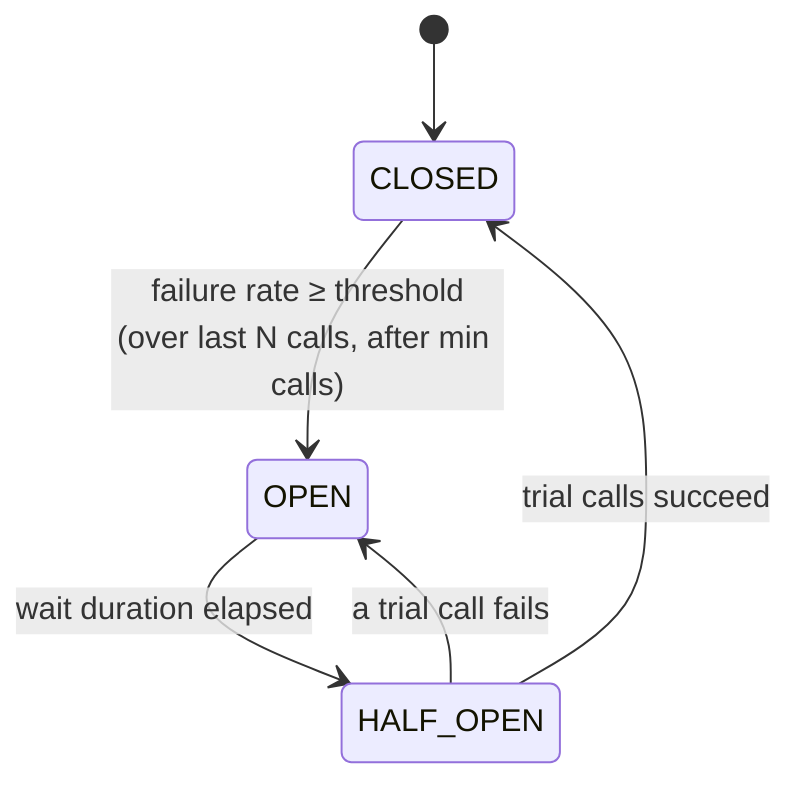
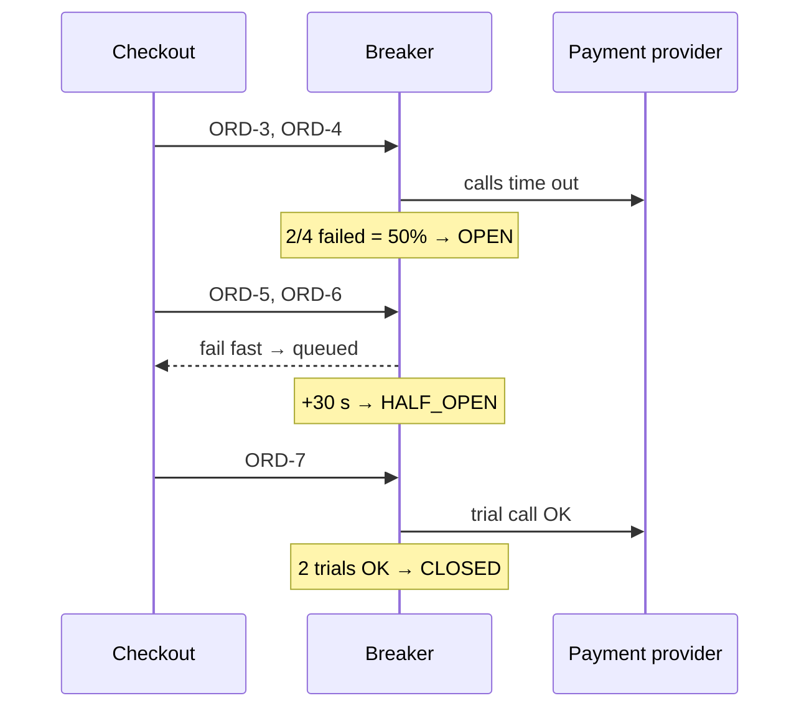

---
tags:
  - Microservices
  - Intermediate
  - Resilience
---

# Circuit Breaker

<span class="badge badge--intermediate">🟡 Intermediate</span>
<span class="badge badge--category">Microservices</span>
<span class="badge badge--interview">Interview frequency ⭐⭐⭐⭐⭐</span>

!!! abstract "TL;DR"
    **A circuit breaker wraps calls to a dependency and watches the failures. When they cross a threshold it "opens" and fails fast (or serves a fallback) without calling the dependency. After a cool-down it lets a few trial calls through ("half-open") and closes again if they succeed.**
    It stops one sick service from tying up threads everywhere and gives it room to recover.

---

## 1. Intent & Problem It Solves

**The problem in plain English:** the payment provider starts timing out after 10 seconds. Every checkout thread now waits 10 s, the thread pool fills up, and **checkout stops working for everyone**, including requests that never touch payments. Meanwhile, the struggling provider is hammered with retries and can't recover. That's a **cascading failure**.

**Definition (Michael Nygard, *Release It!*; popularized by Martin Fowler):**
> Wrap a protected function call in a circuit breaker object, which monitors for failures. Once the failures reach a certain threshold, the circuit breaker trips, and all further calls return with an error, without the protected call being made at all.

**The state machine:**



## 2. Real-World Analogy

!!! example "The electrical breaker in your home"
    When a faulty heater draws too much current, the breaker trips and cuts power **to that circuit** before the wiring catches fire. The rest of the house keeps working. After fixing the heater, you flip the breaker back and see whether it holds.

## 3. Structure

| Participant | Responsibility |
|---|---|
| **Caller** | Calls through the breaker; supplies a **fallback** |
| **Circuit breaker** | Records outcomes in a sliding window, manages state, fails fast when OPEN |
| **Protected dependency** | Remote service, database, third-party API |
| **Fallback** | Cached data, a default, a queued request, or a clear error |

Key configuration (Resilience4j names): `slidingWindowSize`, `minimumNumberOfCalls`, `failureRateThreshold`, `waitDurationInOpenState`, `permittedNumberOfCallsInHalfOpenState`, plus `slowCallDurationThreshold` / `slowCallRateThreshold`.

## 4. Naive Approach (Without the Pattern)

```java
public String pay(String orderId) {
    return paymentHttp.post(orderId); // 10 s read timeout
}
// Provider degrades → 200 checkout threads all blocked for 10 s
// → the thread pool is exhausted → browsing and cart APIs on the same service time out too
// → clients retry → even more blocked threads → total outage
```

---

## 5. Three Real-World Examples

All three examples use the same small breaker, modelled on Resilience4j's count-based state machine:

=== "CircuitBreaker.java"

    ```java
    --8<-- "code/microservices/src/main/java/com/handbook/microservices/circuitbreaker/core/CircuitBreaker.java"
    ```

    1.  OPEN → HALF_OPEN happens **lazily** when someone asks for the state after the wait duration.
    2.  The **fallback** receives the exception, so it can tell "circuit open" from "real failure".
    3.  **Fail fast**: no network call, no waiting, so threads are freed immediately.
    4.  In HALF_OPEN, one failure re-opens; enough successes close the circuit with a **fresh window**.
    5.  `minimumCalls` prevents opening on 1 failure out of 1 call (100%) at startup.

### Example 1: Checkout → Payment Provider (Grocery)

**Scenario:** A window of 4 calls, at least 4 calls before deciding, and a 50% failure threshold. When the provider starts timing out, the breaker opens and orders are **queued for retry** instead of failing (the customer sees "payment processing"). While OPEN, the provider receives **zero** calls. After 30 s, a trial call succeeds and the circuit closes.

**Design:**



**Full Code:**

=== "PaymentClient.java"

    ```java
    --8<-- "code/microservices/src/main/java/com/handbook/microservices/circuitbreaker/grocery/PaymentClient.java"
    ```

    1.  The fallback **queues** the payment for a background retry. This is a business decision: the order isn't lost, and the customer is told payment is pending.

=== "PaymentBreakerDemo.java"

    ```java
    --8<-- "code/microservices/src/main/java/com/handbook/microservices/circuitbreaker/grocery/PaymentBreakerDemo.java"
    ```

**Output:**

```text
--8<-- "code/outputs/microservices/circuitbreaker/grocery/PaymentBreakerDemo.txt"
```

**Why a circuit breaker here:**

- Checkout threads aren't held hostage by a slow provider.
- The provider gets **breathing room** to recover.
- Automatic recovery: no human has to "turn payments back on".

---

### Example 2: ETA with a Degraded Fallback (Ride-hailing)

**Scenario:** The traffic-aware routing engine gives accurate ETAs. During its deploy it returns 503s. Riders still need **some** ETA, so the fallback estimates from straight-line distance. The example also shows a **failed trial**: HALF_OPEN → OPEN when the engine is still down, then a successful trial 10 s later.

**Full Code:**

=== "EtaService.java"

    ```java
    --8<-- "code/microservices/src/main/java/com/handbook/microservices/circuitbreaker/ridehailing/EtaService.java"
    ```

    1.  A **degraded but useful** answer, labelled as an estimate so the UI can show "~25 min".

=== "EtaBreakerDemo.java"

    ```java
    --8<-- "code/microservices/src/main/java/com/handbook/microservices/circuitbreaker/ridehailing/EtaBreakerDemo.java"
    ```

**Output:**

```text
--8<-- "code/outputs/microservices/circuitbreaker/ridehailing/EtaBreakerDemo.txt"
```

**Why a circuit breaker here:**

- The app keeps working with **lower quality** instead of failing.
- A failed trial re-opens immediately, so the engine isn't flooded the moment the wait ends.

---

### Example 3: Personalised Rows with Layered Fallbacks (Streaming)

**Scenario:** At Friday 9 pm the recommender is overloaded. The home screen must never fail, so the client falls back to the profile's **last good** recommendations, then to a global **"Popular now"** row for profiles with no cache. The open breaker also **sheds load** from the recommender during its worst moment.

**Full Code:**

=== "RecommendationsClient.java"

    ```java
    --8<-- "code/microservices/src/main/java/com/handbook/microservices/circuitbreaker/streaming/RecommendationsClient.java"
    ```

    1.  Every success refreshes the **last-good cache**.
    2.  **Layered fallback**: personal cache → global default. Each layer is cheaper and less personal.

=== "RecommendationsBreakerDemo.java"

    ```java
    --8<-- "code/microservices/src/main/java/com/handbook/microservices/circuitbreaker/streaming/RecommendationsBreakerDemo.java"
    ```

**Output:**

```text
--8<-- "code/outputs/microservices/circuitbreaker/streaming/RecommendationsBreakerDemo.txt"
```

**Why a circuit breaker here:**

- Optional features **degrade invisibly**; viewers still get a full home screen.
- Load shedding during peaks helps the recommender recover faster.

---

??? example "Unit Tests: `CircuitBreakerTest.java`"

    ```java
    --8<-- "code/microservices/src/test/java/com/handbook/microservices/CircuitBreakerTest.java"
    ```

## 6. Variations & Modern Java Take

**Resilience4j with Spring Boot** (the standard choice; Hystrix is in maintenance mode). This class is compiled in the repo's `spring-reference` module:

=== "PaymentProviderClient.java"

    ```java
    --8<-- "code/spring-reference/src/main/java/com/handbook/springref/resilience/PaymentProviderClient.java"
    ```

=== "application.yml (reference)"

    ```yaml
    resilience4j:
      circuitbreaker:
        instances:
          payment:
            sliding-window-type: COUNT_BASED      # or TIME_BASED (last N seconds)
            sliding-window-size: 20
            minimum-number-of-calls: 10
            failure-rate-threshold: 50            # %
            slow-call-duration-threshold: 2s      # slow calls count as failures...
            slow-call-rate-threshold: 80          # ...when 80% are slow
            wait-duration-in-open-state: 30s
            permitted-number-of-calls-in-half-open-state: 3
            record-exceptions: [java.io.IOException, org.springframework.web.client.HttpServerErrorException]
            ignore-exceptions: [com.shop.InvalidCardException]   # business errors aren't outages
      retry:
        instances:
          payment: { max-attempts: 3, wait-duration: 200ms, enable-exponential-backoff: true }
      bulkhead:
        instances:
          payment: { max-concurrent-calls: 25 }
      ratelimiter:
        instances:
          payment: { limit-for-period: 50, limit-refresh-period: 1s, timeout-duration: 0 }
    ```

| Variation | Notes |
|---|---|
| **Count-based** vs. **time-based** window | Last N calls vs. last N seconds |
| **Slow-call** detection | Slow responses also trip the breaker (latency, not just errors) |
| **Per-host breakers** | One breaker per downstream instance or region, so one bad host doesn't open the whole service |
| **Mesh-level** | Envoy/Istio outlier detection and connection-pool limits do this without code |

## 7. Where It Lives in Real Frameworks

| Where | Circuit breaker |
|---|---|
| Resilience4j | `CircuitBreaker`, with Spring Boot annotations and Micrometer metrics |
| Spring Cloud Circuit Breaker | Abstraction over Resilience4j (`CircuitBreakerFactory`) |
| Spring Cloud Gateway | `CircuitBreaker` filter with fallback URI |
| Netflix Hystrix (legacy) | The original Java implementation, now in maintenance mode |
| Istio / Envoy | Outlier detection + connection pool limits |

## 8. Pros, Cons & Trade-offs

| ✅ Pros | ❌ Cons |
|---|---|
| Prevents **cascading failures** and thread exhaustion | Tuning thresholds is hard; bad settings flap or never open |
| Fast failure gives a better UX than long waits | Fallbacks must be designed per use case |
| Gives the dependency room to **recover** | Per-instance breakers see only local traffic |
| Built-in metrics show dependency health | Can hide problems if nobody watches the metrics |

## 9. Pitfalls & Anti-Patterns

!!! danger "Counting business errors as failures"
    "Card declined" (HTTP 402/422) is a correct answer, not an outage. Counting it opens the breaker on a busy shopping day. Use `ignoreExceptions` / `recordExceptions`.

!!! danger "Breaker without timeouts"
    A breaker records a failure only when a call **ends**. Without a timeout, a hung call never ends, so it never counts. Always pair breakers with timeouts.

!!! warning "Retry outside the breaker hammering an open circuit"
    Retrying `CallNotPermittedException` is pointless. Configure retries to ignore it, and keep retry counts small.

!!! warning "One breaker for many endpoints"
    If `/search` is down but `/orders` is fine, a shared breaker blocks both. Use breakers per dependency **and** per operation where behaviour differs.

## 10. Senior / Architect Deep Dive (10–15 yrs)

**Composition order.** Resilience4j's default aspect order is `Retry ( CircuitBreaker ( RateLimiter ( TimeLimiter ( Bulkhead ( call )))))`. Retry wraps the breaker, so each retry attempt is counted and an open circuit stops retries quickly. Think about whether that's what you want, and document it.

**Fallback design is product design.** Options: cached/stale data, default values, degraded computation, queue for later, or a clear error. Payments → queue; recommendations → popular list; balances → **error** (stale balances are dangerous). Discuss with product owners.

**Observability.** Export state transitions and failure rates (Micrometer → Prometheus). Alert on OPEN for critical dependencies; dashboards show which dependency is sick across all callers.

### Production checklist

- [ ] Timeouts on every remote call, **inside** the breaker.
- [ ] Record only infrastructure failures (5xx, timeouts, connection errors); ignore business errors.
- [ ] Slow-call thresholds for latency-driven failures.
- [ ] A meaningful fallback per use case, agreed with product.
- [ ] Metrics + alerts on state transitions; dashboards per dependency.
- [ ] Chaos tests (inject latency/failures) to verify breakers actually open.

### Explain it in 2 minutes (system design round)

> "Every synchronous dependency call goes through Resilience4j: a **timeout**, a **circuit breaker** (e.g. 50% failures or 80% slow calls over the last 20 calls, open for 30 s, 3 trial calls), a **bulkhead** to cap concurrency, and limited **retries** with jitter for idempotent calls only. Each has a fallback that makes business sense: recommendations fall back to popular items, payments get queued and confirmed asynchronously. Breaker state is exported as metrics with alerts, so a sick dependency is visible in one dashboard."

!!! bug "War story: the breaker that tripped on success"
    A food-delivery checkout counted **all exceptions** as failures, including `PromoCodeExpiredException`. During a marketing campaign, thousands of users entered an expired promo code. The breaker around the pricing service opened, and **all** checkouts for 30 s got the fallback "pricing unavailable" error. It kept re-opening for an hour.
    **Fix:** `ignoreExceptions` for business errors; record only timeouts, connection failures and 5xx.
    **Lesson:** a circuit breaker should measure the **health of the dependency**, not the validity of user input.

## 11. Related Patterns & Comparisons

| | Circuit Breaker | Retry | Timeout | Bulkhead | Rate Limiter |
|---|---|---|---|---|---|
| Question it answers | Is the dependency healthy enough to call? | Was this failure transient? | How long will I wait? | How many concurrent calls? | How many calls per period? |
| Protects | Caller and dependency | UX against blips | Caller's threads | Other features from one dependency | The service from overload |

See [Retry / Timeout / Bulkhead](retry-timeout-bulkhead.md), [Rate Limiter](rate-limiter.md) and the in-process [State](../behavioral/state.md) pattern that the breaker is built on.

## 12. Interview Corner

=== "🟢 Beginner / Service Companies"

    **Q1. What is a circuit breaker?**

    A wrapper around remote calls that **stops calling** a failing service for a while (fails fast or uses a fallback), then tests whether it has recovered.

    **Q2. Name its three states.**

    **CLOSED** (normal), **OPEN** (fail fast), **HALF_OPEN** (a few trial calls).

    **Q3. Which library do you use in Spring Boot?**

    **Resilience4j** with `@CircuitBreaker(name = "...", fallbackMethod = "...")`. Hystrix is legacy.

    **Q4. What is a fallback method?**

    An alternative response when the call fails or the circuit is open: cached data, a default, or a friendly error. It has the same parameters plus a `Throwable`.

    **Q5. Why is it important in microservices?**

    It prevents **cascading failures**: one slow service can't exhaust threads in all its callers.

=== "🟡 Mid-Level"

    **Q1. Count-based vs. time-based sliding window?**

    Count-based: the last N calls. Time-based: calls in the last N seconds. Time-based behaves better under very variable traffic.

    **Q2. Why `minimumNumberOfCalls`?**

    So 1 failure out of 1 call (100%) after a restart doesn't open the circuit.

    **Q3. How do slow calls trip a breaker?**

    Calls longer than `slowCallDurationThreshold` are counted as slow; if the slow-call rate exceeds its threshold, the circuit opens even without errors.

    **Q4. Retry + circuit breaker: which wraps which?**

    By default in Resilience4j, Retry wraps the CircuitBreaker: each attempt is recorded, and once OPEN, retries fail fast. Don't retry `CallNotPermittedException`.

    **Q5. What should not count as a failure?**

    Business/validation errors (4xx), like "insufficient funds". Only infrastructure failures should count.

=== "🔴 Senior / FAANG / SAP"

    **Q1. "Design resilience for checkout calling 5 dependencies."**

    Classify dependencies (critical: inventory, payment; optional: recommendations, loyalty), a timeout + breaker + bulkhead per dependency, fallbacks per business rules (queue payment, skip loyalty), a deadline for the whole request, and metrics/alerts per breaker.

    **Q2. "100 instances each have their own breaker. Problems?"**

    Each sees only its own traffic, so they open at different times and low-traffic instances may never reach the minimum. Usually acceptable; alternatives are mesh-level outlier detection or shared state (rarely worth it).

    **Q3. "How do you pick thresholds?"**

    From SLOs and real traffic: window large enough for statistical meaning, wait duration near typical recovery time, slow-call threshold from the dependency's p99. Validate with chaos experiments and tune from metrics.

    **Q4. "When is a fallback dangerous?"**

    When stale or default data causes wrong decisions: account balances, stock levels for overselling, prices. Then fail clearly instead.

    **Q5. "Circuit breaker vs. outlier detection in a service mesh?"**

    App breakers protect per **dependency/operation** with business-aware fallbacks; mesh outlier detection ejects individual **bad hosts** from load balancing. They complement each other.

=== "💻 Coding Challenge"

    **Problem:** Implement a minimal, thread-safe circuit breaker in about 40 lines: it opens after N **consecutive** failures, stays open for T ms, then lets one trial call through.

    ??? success "Solution"

        === "MiniCircuitBreaker.java"

            ```java
            --8<-- "code/microservices/src/main/java/com/handbook/microservices/circuitbreaker/mini/MiniCircuitBreaker.java"
            ```

        === "MiniBreakerDemo.java"

            ```java
            --8<-- "code/microservices/src/main/java/com/handbook/microservices/circuitbreaker/mini/MiniBreakerDemo.java"
            ```

        **Output:**

        ```text
        --8<-- "code/outputs/microservices/circuitbreaker/mini/MiniBreakerDemo.txt"
        ```

        **Key points to say:** inject time (`LongSupplier`) for testability; `synchronized` keeps it simple (fine for a whiteboard; Resilience4j uses lock-free atomics); a failed trial re-opens immediately; follow-ups: failure **rate** windows, slow calls, letting only **one** trial call through concurrently.

!!! info "Behavioural tie-in (STAR) for experienced candidates"
    - **S:** A third-party address-validation API slowed to 20 s responses during a sale; our checkout thread pools filled and checkout went down for 25 minutes.
    - **T:** Make checkout survive any single optional dependency failing.
    - **A:** Added timeouts, Resilience4j breakers and bulkheads per dependency; address validation fell back to "validate later"; added breaker dashboards and chaos tests in staging.
    - **R:** At the next incident the breaker opened in 4 s; checkout stayed up with a 0.3% error rate.

## 13. Quick Revision Card

!!! tip "Remember in 30 seconds"
    - **CLOSED → OPEN** (failure/slow rate over window) **→ HALF_OPEN** (after wait) **→ CLOSED/OPEN**.
    - Fail fast + fallback = no cascading failures.
    - Always with **timeouts**; ignore business errors.
    - Resilience4j: `@CircuitBreaker(name, fallbackMethod)`.
    - Fallbacks are a **product decision**.

    ```java
    @CircuitBreaker(name = "payment", fallbackMethod = "queueForLater")
    public String charge(String orderId, long amount) { ... }
    ```

## Practice

- [ ] Add slow-call detection to `CircuitBreaker`: calls longer than a threshold count as failures.
- [ ] Add a listener API so state transitions can be exported as metrics.
- [ ] Make HALF_OPEN allow only N concurrent trial calls (others fail fast).

---

[:material-arrow-left: Service Discovery](service-discovery.md){ .md-button }
[Next: Retry / Timeout / Bulkhead :material-arrow-right:](retry-timeout-bulkhead.md){ .md-button .md-button--primary }
