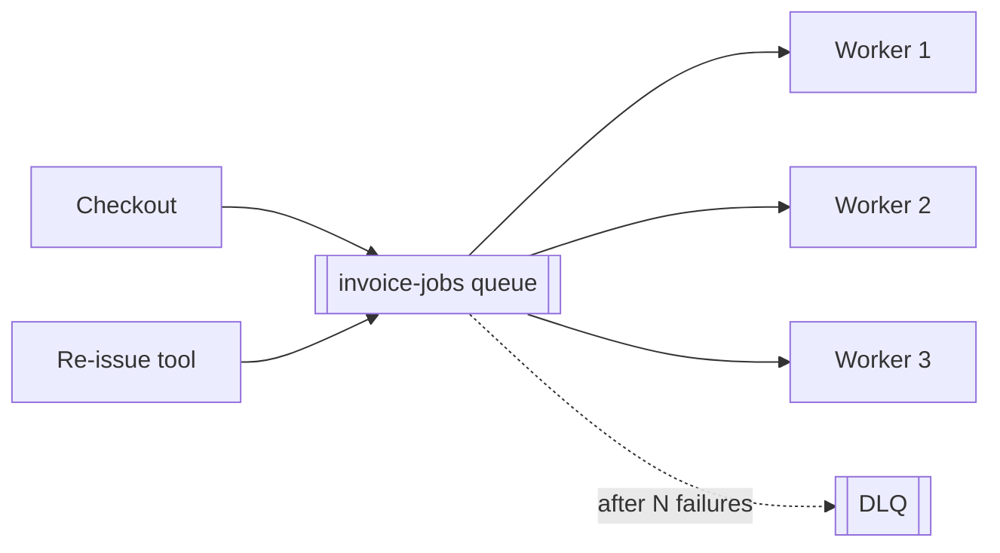
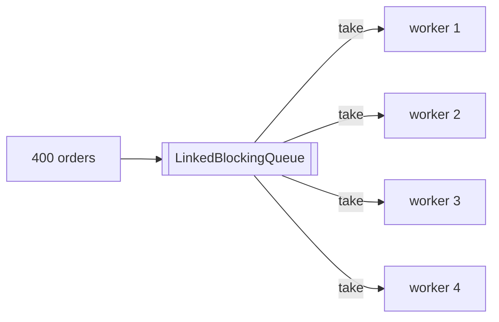
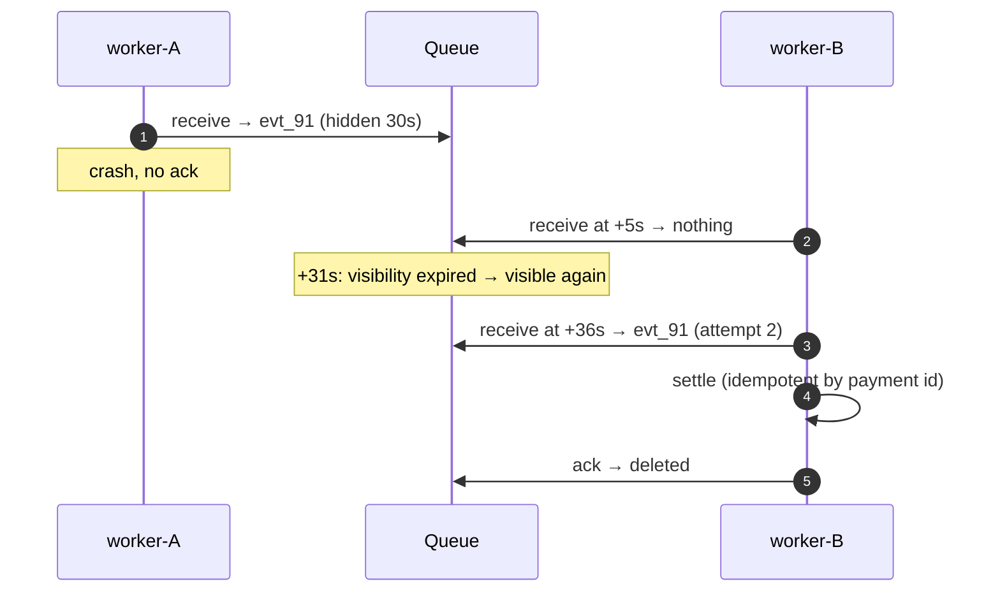
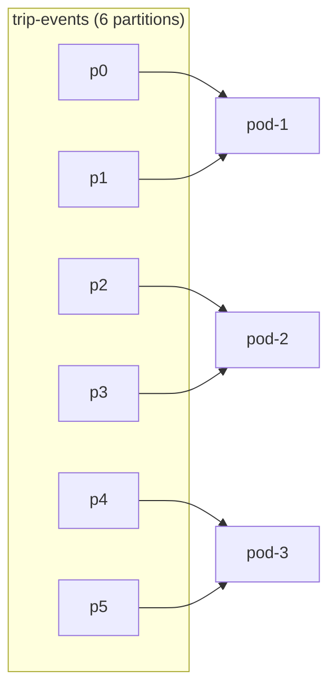

---
tags:
  - Microservices
  - Intermediate
  - Messaging
---

# Competing Consumers

<span class="badge badge--intermediate">🟡 Intermediate</span>
<span class="badge badge--category">Microservices</span>
<span class="badge badge--interview">Interview frequency ⭐⭐⭐⭐</span>

!!! abstract "TL;DR"
    **Several identical consumers read from the same queue; each message is delivered to only one of them. Add consumers to add throughput.**
    Use it for background work that arrives faster than one worker can handle (PDFs, emails, webhooks, image processing). Pair it with acknowledgements, visibility timeouts, idempotency and a dead-letter queue.

---

## See It in Motion

<iframe class="motion-embed" src="../../motion/index.html?p=competing-consumers&amp;embed=1" title="Animated walkthrough of the Competing Consumers pattern" loading="lazy"></iframe>

Press **Play** to watch the calls travel between components, or step through with **Next** and **Back**. Switch to **Without it** to see what goes wrong without the pattern. [Open the full explorer](../motion/index.html#competing-consumers){ target=_blank }

## 1. Intent & Problem It Solves

**The problem in plain English:** every order needs an invoice PDF. At 5 pm a single worker can render 50 per second, but orders arrive at 200 per second; the backlog grows all evening. Running the renderer inside the checkout request makes checkout slow. You want to put the work on a queue and add workers until the queue keeps up, and you want a crashed worker's job to be picked up by someone else.

**Definition (Hohpe & Woolf, *Enterprise Integration Patterns*):**
> Create multiple Competing Consumers on a single channel so that the consumers can process multiple messages concurrently. The messaging system ensures each message is delivered to only **one** consumer.

**Two broker models:**

| | Queue (SQS, RabbitMQ, JMS) | Log with consumer groups (Kafka, Kinesis) |
|---|---|---|
| Unit of competition | Each **message** | Each **partition** (one owner at a time) |
| Ordering | None across consumers (FIFO queues: per group id) | Per partition (per key) |
| Max parallelism | Number of consumers | Number of partitions |
| Redelivery | Visibility timeout / nack | Uncommitted offsets re-read after rebalance |

## 2. Real-World Analogy

!!! example "Bank counters with a token display"
    Customers take a token and wait in one shared queue. Whichever counter is free calls the next token. Opening more counters serves more customers; if a clerk leaves mid-transaction, the customer is called again by another counter.

## 3. Structure



| Participant | Responsibility |
|---|---|
| **Producers** | Put messages on the queue; don't know who processes them |
| **Queue / topic** | Stores messages; hands each to one consumer; redelivers unacked ones |
| **Consumers** | Identical, stateless workers; ack on success; idempotent |
| **Dead-letter queue** | Holds messages that keep failing, for inspection and replay |
| **Autoscaler** | Adds/removes consumers based on queue depth or lag (KEDA, HPA on lag) |

## 4. Naive Approach (Without the Pattern)

```java
@PostMapping("/orders")
public Order place(...) {
    Order o = orders.save(...);
    pdfRenderer.render(o);      // 400 ms inside the request
    emailClient.send(o);        // another 300 ms, and a failure fails the order
    return o;
}
```

- :material-close-circle:{ style="color:#e53935" } Request latency includes slow background work.
- :material-close-circle:{ style="color:#e53935" } Spikes overload the service instead of building a queue.
- :material-close-circle:{ style="color:#e53935" } A crash loses the work; there's no retry.

---

## 5. Three Real-World Examples

### Example 1: Invoice PDFs with a Worker Pool (Grocery)

**Scenario:** A grocery platform renders 400 invoice PDFs for a batch of evening orders. Four identical workers pull from one queue. Each invoice must be rendered exactly once, and adding a fifth worker should need no code changes, just another instance. Workers stop gracefully when the queue drains (poison-pill shutdown).

**Design:**



**Full Code:**

=== "InvoiceWorkers.java"

    ```java
    --8<-- "code/microservices/src/main/java/com/handbook/microservices/competingconsumers/invoices/InvoiceWorkers.java"
    ```

    1.  `take()` removes the message atomically, so two workers can never get the same one. A broker gives the same guarantee across machines.

=== "InvoiceDemo.java"

    ```java
    --8<-- "code/microservices/src/main/java/com/handbook/microservices/competingconsumers/invoices/InvoiceDemo.java"
    ```

**Output:**

```text
--8<-- "code/outputs/microservices/competingconsumers/invoices/InvoiceDemo.txt"
```

**Why competing consumers here:**

- Work items are **independent**, so any worker can take any job.
- Throughput scales linearly with workers until the bottleneck moves (CPU, the PDF service).
- Checkout just enqueues and returns.

---

### Example 2: Visibility Timeout and Redelivery (Payments)

**Scenario:** A payment gateway sends `payment.captured` webhooks. A worker receives one, starts settling, and its pod is killed by a deploy before it acknowledges. With an SQS-style queue, the message is **hidden** for 30 seconds rather than deleted; when the timeout passes without an ack, it becomes visible again and another worker processes it. Because the first attempt might have partly run, settlement is idempotent.

**Design:**



**Full Code:**

=== "VisibilityQueue.java"

    ```java
    --8<-- "code/microservices/src/main/java/com/handbook/microservices/competingconsumers/visibility/VisibilityQueue.java"
    ```

    1.  Receiving **hides** the message for the visibility timeout instead of deleting it.
    2.  Only an explicit **ack** deletes it: no ack, no loss.
    3.  Expired in-flight messages go back to the front for another consumer.

=== "WebhookDemo.java"

    ```java
    --8<-- "code/microservices/src/main/java/com/handbook/microservices/competingconsumers/visibility/WebhookDemo.java"
    ```

**Output:**

```text
--8<-- "code/outputs/microservices/competingconsumers/visibility/WebhookDemo.txt"
```

**Why this matters:**

- Delivery is **at-least-once**: crashes cause redelivery, never silent loss.
- So consumers must be [idempotent](idempotent-consumer.md) (here: a set of settled payment ids).
- The visibility timeout must exceed the normal processing time, or healthy jobs get processed twice.

---

### Example 3: Kafka Consumer Groups and Rebalancing (Ride-hailing)

**Scenario:** Trip events are on a Kafka topic with 6 partitions, keyed by trip id so each trip's events stay in order. The trip-processing service autoscales from 1 to 7 pods. Kafka divides partitions among group members; when a pod joins or dies, partitions are **rebalanced**. With more pods than partitions, the extra pod has nothing to do.

**Design:**



**Full Code:**

=== "ConsumerGroup.java"

    ```java
    --8<-- "code/microservices/src/main/java/com/handbook/microservices/competingconsumers/groups/ConsumerGroup.java"
    ```

    1.  Every membership change triggers a **rebalance**: partitions are reassigned so each has exactly one owner in the group.
    2.  Range assignment: the first `partitions % members` consumers get one extra partition.

=== "ConsumerGroupDemo.java"

    ```java
    --8<-- "code/microservices/src/main/java/com/handbook/microservices/competingconsumers/groups/ConsumerGroupDemo.java"
    ```

**Output:**

```text
--8<-- "code/outputs/microservices/competingconsumers/groups/ConsumerGroupDemo.txt"
```

**Why consumer groups here:**

- Competition happens per **partition**, which preserves per-trip ordering.
- Parallelism is capped by the partition count: choose it for peak load up front.
- Failover is automatic: a dead pod's partitions move to survivors.

---

??? example "Unit Tests: `CompetingConsumersTest.java`"

    ```java
    --8<-- "code/microservices/src/test/java/com/handbook/microservices/CompetingConsumersTest.java"
    ```

## 6. Variations & Modern Java Take

=== "Spring Kafka (reference)"

    ```java
    @KafkaListener(topics = "invoice-jobs", groupId = "invoice-renderer", concurrency = "4")  // 4 consumers in this pod
    public void render(InvoiceJob job) {
        if (!processed.markIfNew(job.orderId())) return;   // idempotent
        renderer.render(job);
    }   // offset committed after success (AckMode.RECORD/BATCH)
    ```

=== "application.yml (reference)"

    ```yaml
    spring:
      kafka:
        consumer:
          enable-auto-commit: false
          max-poll-records: 50
        listener:
          ack-mode: record
    # DLQ: DefaultErrorHandler + DeadLetterPublishingRecoverer, e.g. 3 attempts with backoff
    ```

| Variation | Notes |
|---|---|
| **Prefetch / max-poll** | How many messages a consumer takes at once; high values hurt fairness and increase redelivery on crash |
| **Priority queues** | Separate queues per priority with more consumers on the urgent one |
| **Autoscaling on lag** | KEDA scales pods by queue depth or consumer lag |
| **Parallel consumer (Confluent)** | Per-key parallelism inside one partition when partitions are too few |
| **Virtual-thread workers** | Cheap blocking workers for I/O-bound jobs |

## 7. Where It Lives in Real Frameworks

| Where | Competing consumers |
|---|---|
| Kafka | Consumer groups, cooperative-sticky rebalancing, `max.poll.interval.ms` |
| RabbitMQ | Multiple consumers on a queue, `basic.qos` prefetch, manual acks, DLX |
| AWS SQS | Visibility timeout, `maxReceiveCount` → redrive to DLQ, FIFO message groups |
| JMS / ActiveMQ | Queue receivers, `CLIENT_ACKNOWLEDGE` |
| Spring | `@KafkaListener(concurrency)`, `@RabbitListener`, `@SqsListener`, `DefaultErrorHandler` |
| Kubernetes | KEDA `ScaledObject` on Kafka lag / SQS depth |

## 8. Pros, Cons & Trade-offs

| ✅ Pros | ❌ Cons |
|---|---|
| Horizontal scaling by adding consumers | No global ordering across consumers |
| Load levelling: spikes become queue depth, not outages | At-least-once delivery: duplicates must be handled |
| Fault tolerance: unacked work is redelivered | Poison messages can loop without a DLQ |
| Producers and consumers deploy independently | Kafka parallelism capped by partitions; rebalances pause processing |

## 9. Pitfalls & Anti-Patterns

!!! danger "Non-idempotent consumers"
    Redelivery after a crash, a rebalance or a visibility timeout is normal. Without idempotency, customers get two emails, or two refunds.

!!! danger "No dead-letter queue"
    A message that always fails is retried forever, burning capacity and (in Kafka) blocking its partition. Retry a bounded number of times, then dead-letter (coding challenge).

!!! warning "Visibility timeout shorter than processing time"
    A 30 s job with a 20 s timeout gets processed twice, every time. Size the timeout from p99 processing time, or extend it while working.

!!! warning "Expecting order from a plain queue"
    Ten consumers process messages in parallel; message 2 may finish before message 1. Use a key-partitioned log or FIFO groups for per-entity order.

## 10. Senior / Architect Deep Dive (10–15 yrs)

**Capacity planning.** Consumers needed ≈ arrival rate × processing time (Little's law). 200 msg/s × 0.4 s = 80 concurrent jobs. For Kafka, provision partitions for the **peak** consumer count you'll ever need; increasing partitions later changes key → partition mapping and breaks per-key ordering for in-flight keys.

**Rebalance storms.** In Kafka, slow processing beyond `max.poll.interval.ms` makes the broker think the consumer died, triggering rebalances, redelivery and more slowness. Use smaller `max.poll.records`, cooperative-sticky assignment, static membership (`group.instance.id`) and offload slow work.

**Back-pressure to producers.** A queue absorbs spikes, not sustained overload. Alert on age of the oldest message (not just depth), and shed or degrade at the producer when the backlog SLO is breached.

!!! bug "War story: every webhook processed twice"
    A team moved webhook handling to SQS with the default 30 s visibility timeout. The handler called a slow bank API (p99 45 s). Every slow message became visible again mid-processing and a second worker settled it too: 2,300 merchants were credited twice in one day.
    **Fix:** visibility timeout raised to 5 minutes with periodic extension (`ChangeMessageVisibility`) for long jobs, an idempotency table keyed by payment id, and a DLQ after 5 receives.
    **Lesson:** at-least-once is a promise of duplicates. Size timeouts and make consumers idempotent.

## 11. Related Patterns & Comparisons

| | Competing Consumers | Publish-Subscribe | Producer-Consumer | Thread Pool |
|---|---|---|---|---|
| Each message goes to | **One** consumer | **Every** subscriber (group) | One consumer thread | One worker thread |
| Scope | Across processes/machines | Across services | In one process | In one process |
| Purpose | Scale processing | Broadcast events | Decouple rates | Reuse threads |

Kafka does both: consumers in the **same** group compete; **different** groups each get every message (pub-sub). See also [Producer-Consumer](../concurrency/producer-consumer.md), [Idempotent Consumer](idempotent-consumer.md) and [Backpressure](backpressure.md).

## 12. Interview Corner

=== "🟢 Beginner / Service Companies"

    **Q1. What is the competing consumers pattern?**

    Multiple consumers read from one queue; each message goes to only one of them, so work is shared.

    **Q2. How do you increase throughput?**

    Add more consumer instances.

    **Q3. What is an acknowledgement?**

    The consumer telling the broker the message was processed, so it can be deleted or its offset committed.

    **Q4. What is a dead-letter queue?**

    A queue for messages that failed processing too many times.

    **Q5. Queue vs topic?**

    A queue delivers each message to one consumer; a topic delivers it to every subscriber (group).

=== "🟡 Mid-Level"

    **Q1. Why must consumers be idempotent?**

    Brokers redeliver after crashes, timeouts and rebalances: at-least-once delivery.

    **Q2. What's a visibility timeout?**

    The time a received SQS message stays hidden; if not deleted by then, it becomes visible again.

    **Q3. Why can't you have more Kafka consumers than partitions?**

    You can, but each partition has one owner per group, so extra consumers sit idle.

    **Q4. How do you keep order per customer?**

    Partition by customer id (Kafka) or use FIFO queues with a message group id.

    **Q5. What happens during a Kafka rebalance?**

    Partitions are reassigned; uncommitted messages may be re-read by the new owner.

=== "🔴 Senior / FAANG / SAP"

    **Q1. "Design an email-sending system for 10M emails/hour with retries."**

    Producer → queue partitioned by tenant; autoscaled consumers with provider rate limits (token bucket per provider); idempotency by message id; exponential backoff retries; DLQ; metrics on oldest-message age.

    **Q2. "How many partitions would you create?"**

    Enough for peak parallelism with headroom (peak rate × processing time), considering broker limits; avoid repartitioning live topics with key ordering needs.

    **Q3. "Consumer lag keeps growing. Diagnose."**

    Check processing time (slow downstream?), rebalances, partition skew (hot keys), consumer CPU/GC, and whether you're at max parallelism (partitions).

    **Q4. "Exactly-once processing?"**

    Effectively-once: at-least-once delivery + idempotent effects, or Kafka transactions for read-process-write within Kafka.

    **Q5. "Poison message in an ordered partition?"**

    Retry a bounded number of times, then dead-letter **and** decide whether later events for that key can proceed (park the key) to avoid inconsistent state.

=== "💻 Coding Challenge"

    **Problem:** A queue contains an SMS job with an invalid phone number that always fails. Show how bounded retries plus a dead-letter queue keep good messages flowing.

    ??? success "Solution"

        === "PoisonMessageDemo.java"

            ```java
            --8<-- "code/microservices/src/main/java/com/handbook/microservices/competingconsumers/poison/PoisonMessageDemo.java"
            ```

        **Output:**

        ```text
        --8<-- "code/outputs/microservices/competingconsumers/poison/PoisonMessageDemo.txt"
        ```

        **Key points to say:** count receives per message (`ApproximateReceiveCount`, delivery attempts); retry behind other work rather than immediately; dead-letter after N; alert on DLQ depth and provide a replay tool once the bug or data is fixed.

!!! info "Behavioural tie-in (STAR) for experienced candidates"
    - **S:** Merchants were credited twice because webhook processing outlived SQS's visibility timeout.
    - **T:** Stop duplicate credits without slowing webhook handling.
    - **A:** Sized and extended visibility timeouts from p99 processing time, added an idempotency table keyed by payment id, a DLQ after 5 receives, and autoscaling on oldest-message age.
    - **R:** Duplicate credits went to zero; backlog during sales stayed under 2 minutes with 3× the traffic.

## 13. Quick Revision Card

!!! tip "Remember in 30 seconds"
    - **One queue, many identical consumers; each message to one.**
    - Ack after success; unacked = redelivered (**at-least-once**).
    - Consumers **idempotent**; bounded retries → **DLQ**.
    - Kafka: one owner per partition; parallelism ≤ partitions; key = order.
    - Scale on lag / oldest-message age.

    ```java
    @KafkaListener(topics = "invoice-jobs", groupId = "invoice-renderer", concurrency = "4") void on(Job j) { ... }
    ```

## Practice

- [ ] Add exponential backoff (1 s, 2 s, 4 s) to `PoisonMessageDemo` using a `FakeClock`.
- [ ] Add `extendVisibility(id, duration)` to `VisibilityQueue`.
- [ ] Implement round-robin assignment in `ConsumerGroup` and compare with range.

---

[:material-arrow-left: Materialized View](materialized-view.md){ .md-button }
[Next: Leader Election :material-arrow-right:](leader-election.md){ .md-button .md-button--primary }
