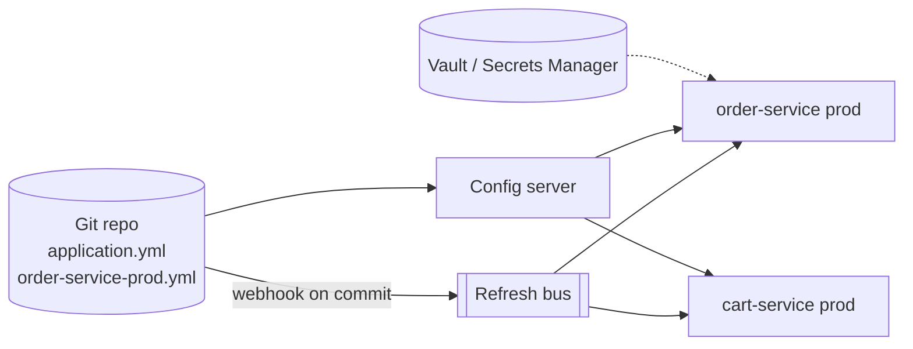

---
tags:
  - Microservices
  - Beginner
  - Platform
---

# Externalized Configuration & Config Server

<span class="badge badge--beginner">🟢 Beginner</span>
<span class="badge badge--category">Microservices</span>
<span class="badge badge--interview">Interview frequency ⭐⭐⭐⭐</span>

!!! abstract "TL;DR"
    **Keep configuration outside the deployable artifact, so the same build runs in dev, test and prod with different settings. A config server (or Kubernetes ConfigMaps) serves versioned configuration per service and environment, supports refresh without redeploys, and secrets come from a dedicated secret store.**
    Build once, configure per environment, never commit secrets.

---

## 1. Intent & Problem It Solves

**The problem in plain English:** 40 services × 4 environments. Database URLs, timeouts, feature flags and partner endpoints are baked into each JAR's `application.properties`. Changing a timeout means rebuilding and redeploying. Someone committed the production DB password to Git. Nobody knows which timeout is actually running in prod.

**Definition (The Twelve-Factor App, factor III):**
> Store config in the environment. An app's config is everything that is likely to vary between deploys (staging, production, developer environments, etc.).

| Kind of setting | Where it belongs |
|---|---|
| Per-environment values (URLs, pool sizes, timeouts) | Config server / ConfigMaps, versioned in Git |
| Feature flags and kill switches | Config with refresh, or a feature-flag service |
| **Secrets** (passwords, API keys, certificates) | **Secret store** (Vault, AWS/GCP/Azure secret managers), never Git |
| Code-level constants that never vary | In code |

## 2. Real-World Analogy

!!! example "A restaurant chain's recipe book and daily specials board"
    Every branch uses the same kitchen equipment (the build). Head office publishes the menu and prices for each city (config per environment) and can change today's specials on the board without retraining cooks (refresh). The safe's combination (secrets) is never written on the board; managers get it from the security office.

## 3. Structure



| Participant | Responsibility |
|---|---|
| **Config repository** | Versioned, reviewed configuration files per app and profile |
| **Config server** | Merges files by precedence; serves them over HTTP |
| **Service** | Loads config at startup; rebinds on refresh; fails fast on invalid config |
| **Secret store** | Holds secrets with access policies, audit and rotation |

## 4. Naive Approach (Without the Pattern)

```properties
# src/main/resources/application.properties: built into the JAR
payment.url=https://payments.prod.internal
payment.timeout.ms=5000
db.password=Sup3rS3cret!        # in Git history forever
```

---

## 5. Three Real-World Examples

### Example 1: Profiles and Precedence (Grocery)

**Scenario:** One config repo holds `application` (global defaults), `application-prod`, `order-service` and `order-service-prod`. The server merges them from least to most specific. The demo prints each resolved property **with the file it came from**, which is exactly what you need when debugging "why is the timeout 800 in prod?".

**Full Code:**

=== "ConfigServer.java"

    ```java
    --8<-- "code/microservices/src/main/java/com/handbook/microservices/config/profiles/ConfigServer.java"
    ```

    1.  **Precedence order**, the same as Spring Cloud Config: global → global-profile → app → app-profile.
    2.  Later files override earlier ones; we remember the **source** of each value for debugging.

=== "ConfigProfilesDemo.java"

    ```java
    --8<-- "code/microservices/src/main/java/com/handbook/microservices/config/profiles/ConfigProfilesDemo.java"
    ```

**Output:**

```text
--8<-- "code/outputs/microservices/config/profiles/ConfigProfilesDemo.txt"
```

**Why a config server here:**

- Shared defaults in one place; overrides only where needed.
- Every change is a **reviewed Git commit**: who changed the prod timeout and why.

---

### Example 2: Refresh Without Restart (Fintech)

**Scenario:** The UPI partner has an outage. Ops sets `upi.enabled=false` in Git; the refresh event reaches every instance and the flag flips **without a deploy**. Later UPI is re-enabled with a temporarily lower limit. Listeners log what changed.

**Full Code:**

=== "RefreshableConfig.java"

    ```java
    --8<-- "code/microservices/src/main/java/com/handbook/microservices/config/refresh/RefreshableConfig.java"
    ```

    1.  Triggered by the config server / Spring Cloud Bus (or a Kubernetes ConfigMap watch).
    2.  Only **changed** keys notify listeners, like `EnvironmentChangeEvent` in Spring.

=== "FeatureFlagRefreshDemo.java"

    ```java
    --8<-- "code/microservices/src/main/java/com/handbook/microservices/config/refresh/FeatureFlagRefreshDemo.java"
    ```

**Output:**

```text
--8<-- "code/outputs/microservices/config/refresh/FeatureFlagRefreshDemo.txt"
```

**Why refresh here:**

- **Kill switches** and limits need to change in seconds, not after a 20-minute pipeline.
- Caution: not every setting is safe to change live (pool sizes, ports). Refresh only what's designed for it.

---

### Example 3: Secret References (Healthcare)

**Scenario:** The medical-records service's Git config contains only **references** (`vault:secret/records/db#password`). At startup, the service resolves them from Vault (an audited read with a short-lived token), keeps the values only in memory, and **masks** them in every log.

**Full Code:**

=== "SecretResolver.java"

    ```java
    --8<-- "code/microservices/src/main/java/com/handbook/microservices/config/secrets/SecretResolver.java"
    ```

    1.  Only values with the `vault:` prefix are resolved; everything else passes through.
    2.  **Mask** secrets in anything printable: logs, actuator endpoints, error messages.

=== "SecretsDemo.java"

    ```java
    --8<-- "code/microservices/src/main/java/com/handbook/microservices/config/secrets/SecretsDemo.java"
    ```

**Output:**

```text
--8<-- "code/outputs/microservices/config/secrets/SecretsDemo.txt"
```

**Why a secret store here:**

- Health data regulations require **access control and audit** for credentials.
- Rotation happens in Vault; services pick up new values without code changes.
- A leaked Git repo leaks no passwords.

---

??? example "Unit Tests: `ConfigServerTest.java`"

    ```java
    --8<-- "code/microservices/src/test/java/com/handbook/microservices/ConfigServerTest.java"
    ```

## 6. Variations & Modern Java Take

**Typed configuration in Spring Boot** (compiled in the `spring-reference` module):

```java
--8<-- "code/spring-reference/src/main/java/com/handbook/springref/config/CheckoutProperties.java"
```

```yaml
# order-service: bootstrap from a config server and Vault (reference)
spring:
  application.name: order-service
  profiles.active: prod
  config.import:
    - "configserver:http://config-server:8888"
    - "vault://"                     # spring-cloud-vault: resolves secret/order-service
checkout:
  max-items: 100
  payment-timeout: 2s
  payment-url: https://payments.internal
```

| Option | Notes |
|---|---|
| **Spring Cloud Config** | Git/Vault-backed server, profiles, `/actuator/refresh`, Spring Cloud Bus |
| **Kubernetes ConfigMaps + Secrets** | Native; mounted as files or env vars; Spring Cloud Kubernetes can reload |
| **Consul KV / etcd** | Key-value config with watches |
| **AWS AppConfig / Azure App Configuration** | Managed config with validation and gradual rollout |
| **Feature-flag services** (OpenFeature, Unleash, LaunchDarkly) | Per-user targeting, experiments, audit |
| **External Secrets Operator** | Syncs cloud secret managers into Kubernetes Secrets |

## 7. Where It Lives in Real Frameworks

| Where | Externalized configuration |
|---|---|
| Spring Boot | `@ConfigurationProperties`, profiles, `spring.config.import`, relaxed binding from env vars |
| Spring Cloud Config | Config server + `@RefreshScope` |
| MicroProfile Config (Quarkus, Helidon) | `@ConfigProperty`, config sources by ordinal |
| HashiCorp Vault | Dynamic database credentials, leases, rotation |
| Kubernetes | ConfigMaps, Secrets, projected volumes |

## 8. Pros, Cons & Trade-offs

| ✅ Pros | ❌ Cons |
|---|---|
| **Build once, deploy anywhere** | Config server is a dependency at startup (cache it, make it HA) |
| Versioned, reviewed config changes | Bad config can break all instances at once |
| Live changes for flags and limits | Refresh semantics can be surprising |
| Secrets managed and audited properly | More moving parts (server, bus, vault) |

## 9. Pitfalls & Anti-Patterns

!!! danger "Secrets in Git (even encrypted, even in a private repo)"
    History is forever, and repos get cloned to laptops and CI logs. Use references to a secret store; scan repositories for secrets (gitleaks, GitHub secret scanning).

!!! danger "Config changes without validation or rollout"
    A typo in a shared `application.yml` reaches every service at once. Validate on startup (fail fast), and roll out config changes gradually like code.

!!! warning "Everything refreshable"
    Changing a connection-pool size or a port on a running instance can half-apply. Mark which properties support refresh; restart for the rest.

!!! warning "Environment-specific code paths"
    `if (env.equals("prod"))` in code defeats externalized config. Express differences as configuration values.

## 10. Senior / Architect Deep Dive (10–15 yrs)

**Config is code.** Changes go through pull requests, reviews, CI validation (schema checks, policy-as-code) and gradual rollout (one region or canary instances first). Many outages are config changes, not code changes.

**Startup resilience.** If the config server is down, can services start? Use `fail-fast` deliberately: fail for critical config, or start with a cached last-known-good copy. Run the config server HA; consider baking defaults into images.

**Secrets lifecycle.** Prefer **dynamic secrets** (Vault issues a database user per service instance with a lease) over long-lived passwords; rotate automatically; use workload identity (Kubernetes service accounts, cloud IAM) to authenticate to the secret store, so there's no "secret zero" in config.

### Production checklist

- [ ] No environment-specific values or secrets in artifacts; one build for all environments.
- [ ] Config in Git with reviews; history and owners clear.
- [ ] Typed, validated config; **fail fast** at startup with all errors listed.
- [ ] Refresh only for properties designed for it (flags, limits); others need a restart.
- [ ] Secrets from a secret store via workload identity; rotation; masked in logs and actuator.
- [ ] Config server/ConfigMap changes rolled out gradually and monitored.

### Explain it in 2 minutes (system design round)

> "Each service is built once and configured per environment. Non-secret config lives in Git and is served by Spring Cloud Config (or ConfigMaps on Kubernetes), with defaults in `application.yml` and overrides per service and profile. Services bind it into validated `@ConfigurationProperties` records and fail fast on invalid values. Kill switches and limits are refreshable via the bus; anything else needs a rolling restart. Secrets come from Vault using the pod's service account, with dynamic, rotated database credentials, and they're masked in logs. Config changes go through PRs and canary rollout like code."

!!! bug "War story: the timeout that took down every service"
    A platform team changed the shared `application.yml` to reduce `http.client.timeout` from `5000` to `500` (meaning 500 ms) for one service, but the property was read by all 60 services. Within a minute of the refresh event, every service started timing out calls to slower dependencies; error rates hit 30% across the company.
    **Fix:** rolled back the commit; moved the override to the service's own file; added CI checks that flag changes to global config, a staged refresh (one service group at a time), and typed properties with units (`500ms`).
    **Lesson:** a shared configuration file is shared code. Review it, test it, and roll it out gradually.

## 11. Related Patterns & Comparisons

| | Config Server | ConfigMaps | Feature-flag service | Secret store |
|---|---|---|---|---|
| Content | Any config, per app/profile | Any config, per namespace | Flags, targeting rules | Credentials, keys, certs |
| Live change | Refresh via bus | File watch / restart | Real-time | Leases, rotation |
| Audit | Git history | K8s audit | Built-in | Built-in, detailed |

See [Service Discovery](service-discovery.md) (often the same platform, e.g. Consul) and [Strangler Fig](strangler-fig.md) (feature flags for rollout).

## 12. Interview Corner

=== "🟢 Beginner / Service Companies"

    **Q1. What is externalized configuration?**

    Keeping environment-specific settings outside the application build, so the same artifact runs anywhere with different config.

    **Q2. What is Spring Cloud Config Server?**

    A server that serves configuration (often from a Git repo) to Spring applications, per application name and profile.

    **Q3. What are Spring profiles?**

    Named sets of configuration (`dev`, `prod`) activated with `spring.profiles.active`, overriding defaults.

    **Q4. Where should passwords be stored?**

    In a secret store (Vault, AWS Secrets Manager, Kubernetes Secrets via external secret managers), not in Git or the JAR.

    **Q5. How do you change config without restarting?**

    Spring Cloud's `@RefreshScope` beans with `/actuator/refresh` (or Spring Cloud Bus to refresh all instances).

=== "🟡 Mid-Level"

    **Q1. Explain property precedence in Spring Boot.**

    Command-line args > environment variables > profile-specific files > application files > defaults (simplified). With a config server, imported sources slot into this order.

    **Q2. `@Value` vs. `@ConfigurationProperties`?**

    `@ConfigurationProperties` binds a typed group of properties (validated, refactor-friendly, IDE metadata); `@Value` injects single values.

    **Q3. What happens if the config server is down at startup?**

    Depends on `fail-fast`: either startup fails (with retries), or it continues with local defaults. Choose deliberately and run the server HA.

    **Q4. How does Spring Cloud Bus help?**

    It broadcasts a refresh event (via Kafka/RabbitMQ) to all instances, so one call refreshes the whole fleet.

    **Q5. ConfigMaps vs. config server?**

    ConfigMaps are Kubernetes-native and simple; a config server adds Git versioning, profiles and merging across apps, and works outside Kubernetes.

=== "🔴 Senior / FAANG / SAP"

    **Q1. "Config changes cause more outages than code at our company. What do you do?"**

    Treat config as code: PRs, schema validation, policy checks, staged rollout with automatic rollback on error-rate increase, ownership per file, and fewer global settings.

    **Q2. "Explain dynamic secrets."**

    The secret store creates short-lived credentials per consumer on demand (e.g. a DB user with a 1-hour lease) and revokes them on expiry; a leak is short-lived and attributable.

    **Q3. "How do services authenticate to Vault without a stored secret?"**

    Workload identity: Kubernetes service account tokens, cloud IAM roles; Vault verifies them and issues a token.

    **Q4. "Feature flags vs. config: where's the line?"**

    Flags are evaluated per request/user with targeting and are short-lived (release toggles) or operational (kill switches); config is per deployment. Use a flag service for user targeting and experiments.

    **Q5. "How do you test configuration?"**

    Bind and validate config for every environment in CI (load each profile and start the context with `@SpringBootTest` or a binder test), lint YAML, and diff effective config between environments.

=== "💻 Coding Challenge"

    **Problem:** Bind raw string properties into a typed `CheckoutConfig` record. Validate ranges and formats, and fail at startup with **all** problems listed at once, so engineers don't fix them one restart at a time.

    ??? success "Solution"

        === "CheckoutConfig.java"

            ```java
            --8<-- "code/microservices/src/main/java/com/handbook/microservices/config/validation/CheckoutConfig.java"
            ```

        === "ConfigValidationDemo.java"

            ```java
            --8<-- "code/microservices/src/main/java/com/handbook/microservices/config/validation/ConfigValidationDemo.java"
            ```

        **Output:**

        ```text
        --8<-- "code/outputs/microservices/config/validation/ConfigValidationDemo.txt"
        ```

        **Key points to say:** collect errors instead of throwing on the first; skip range checks when parsing already failed (no noise); typed values (`Duration`, `URI`) remove unit confusion; Spring Boot gives you this with `@ConfigurationProperties` + `@Validated`.

!!! info "Behavioural tie-in (STAR) for experienced candidates"
    - **S:** A production database password was found in a public fork of an internal repository.
    - **T:** Rotate credentials and make sure secrets could never live in Git again.
    - **A:** Moved all secrets to Vault with Kubernetes auth and dynamic DB credentials, replaced values with references, added secret scanning to CI, and purged history.
    - **R:** Zero secrets in repos (enforced by CI); credential rotation went from a quarterly manual task to automatic hourly leases.

## 13. Quick Revision Card

!!! tip "Remember in 30 seconds"
    - **Build once**, configure per environment (12-factor).
    - Precedence: global → global-profile → app → app-profile.
    - Typed + validated config, **fail fast**.
    - Refresh only flags/limits; restart for structural settings.
    - **Secrets** in a secret store, referenced, masked, rotated.

## Practice

- [ ] Add a `region` dimension to `ConfigServer` (`order-service-prod-eu`) with the right precedence.
- [ ] Make `RefreshableConfig` reject a refresh that fails validation and keep the old values.
- [ ] Add masking for any key containing `password`, `secret` or `token`, even without a `vault:` reference.

---

[:material-arrow-left: Distributed Tracing](distributed-tracing.md){ .md-button }
[Next: Anti-Corruption Layer :material-arrow-right:](anti-corruption-layer.md){ .md-button .md-button--primary }
