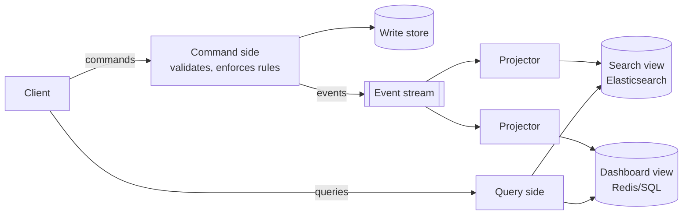
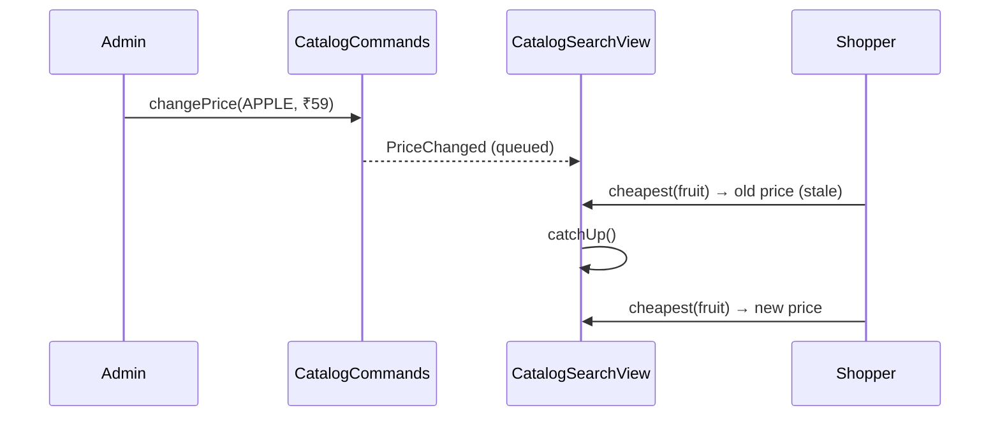

---
tags:
  - Microservices
  - Advanced
  - Data
---

# CQRS (Command Query Responsibility Segregation)

<span class="badge badge--advanced">🔴 Advanced</span>
<span class="badge badge--category">Microservices</span>
<span class="badge badge--interview">Interview frequency ⭐⭐⭐⭐</span>

!!! abstract "TL;DR"
    **CQRS splits a system into a write side (commands that enforce business rules) and one or more read sides (query models shaped for specific screens). The read models are updated from the write side's events, often asynchronously.**
    Each side can use its own model, schema, database and scaling. The price is **eventual consistency** and more moving parts.

---

## 1. Intent & Problem It Solves

**The problem in plain English:** a single normalized `products` table must enforce pricing rules on writes **and** answer "cheapest organic fruit in Bengaluru, sorted by discount, with ratings" in 20 ms for millions of shoppers. The write model wants normalization and invariants; the read side wants denormalized, pre-joined, indexed data. One model serves both badly. In microservices it's worse: the data for one screen lives in **several services**.

**Definition (Greg Young, building on Bertrand Meyer's CQS):**
> CQRS is simply the creation of two objects where there was previously only one. The separation occurs based upon whether the methods are a command or a query.

**Levels of CQRS:**

1. Separate command and query **classes** in one service (same DB).
2. Separate **read tables/views** in the same DB (materialized views).
3. Separate **read databases** (Elasticsearch, Redis, Cassandra) fed by events, which is the microservices form.

## 2. Real-World Analogy

!!! example "A restaurant's kitchen and menu board"
    Orders go into the kitchen (write side), which enforces the rules: no dish without ingredients. The **menu board** (read side) is a separate, simplified display, updated when the kitchen runs out of something. For a few seconds the board may still show "Mango lassi" after the last mango is used (eventual consistency), and that's acceptable.

## 3. Structure



| Participant | Responsibility |
|---|---|
| **Command handler / write model** | Validates commands, enforces invariants, emits events |
| **Event stream** | Carries changes (outbox + Kafka, or an event store) |
| **Projector** | Updates read models from events; idempotent; tracks a checkpoint |
| **Read model** | Denormalized, query-shaped, disposable (rebuildable from events) |

## 4. Naive Approach (Without the Pattern)

```sql
-- Every page view runs this against the transactional database
SELECT p.*, AVG(r.stars), MIN(o.price), s.qty FROM products p
JOIN reviews r ON ... JOIN offers o ON ... JOIN stock s ON ...
WHERE p.category = 'fruit' GROUP BY ... ORDER BY MIN(o.price) LIMIT 20;
-- Reads slow down writes (locks, CPU); indexes for reads slow inserts;
-- and in microservices, reviews/offers/stock aren't even in this database.
```

---

## 5. Three Real-World Examples

### Example 1: Catalog Writes vs. Search Reads (Grocery)

**Scenario:** The write side validates product commands (no duplicates; price cuts over 50% need approval). The search view keeps denormalized rows answering "cheapest in a category". A price change is visible in search only **after the projector catches up**, a stale read that the demo shows on purpose.

**Design:**



**Full Code:**

=== "CatalogCommands.java"

    ```java
    --8<-- "code/microservices/src/main/java/com/handbook/microservices/cqrs/catalog/CatalogCommands.java"
    ```

    1.  **Invariants live on the write side only.** The read side never needs to know about approval rules.

=== "CatalogSearchView.java"

    ```java
    --8<-- "code/microservices/src/main/java/com/handbook/microservices/cqrs/catalog/CatalogSearchView.java"
    ```

    1.  Events arrive **asynchronously** (here, an inbox queue; in production, a Kafka consumer).
    2.  A **sealed event hierarchy** + pattern-matching `switch`: the compiler checks every event type is handled.
    3.  The query is shaped for one screen; a real implementation would use a sorted index.

=== "CatalogCqrsDemo.java"

    ```java
    --8<-- "code/microservices/src/main/java/com/handbook/microservices/cqrs/catalog/CatalogCqrsDemo.java"
    ```

**Output:**

```text
--8<-- "code/outputs/microservices/cqrs/catalog/CatalogCqrsDemo.txt"
```

**Why CQRS here:**

- Reads outnumber writes about 1000:1 in catalogs; the read side scales independently (search cluster, caches).
- Write rules stay simple and consistent; search shape changes don't touch them.
- The stale-read window is acceptable for browsing; checkout re-validates price on the write side.

---

### Example 2: One Write Model, Two Read Models (Banking)

**Scenario:** The account write model enforces "no overdraft". Two projections serve two screens: a **balance tile** (one key lookup) and a **mini statement** (last 3 transactions, pre-formatted). Here they're updated synchronously in the same process, which shows CQRS doesn't *require* separate databases or async messaging.

**Full Code:**

=== "AccountCqrs.java"

    ```java
    --8<-- "code/microservices/src/main/java/com/handbook/microservices/cqrs/banking/AccountCqrs.java"
    ```

    1.  The **rule** is checked on the write side against authoritative state.
    2.  The read model stores data **already formatted** for its screen.

=== "AccountCqrsDemo.java"

    ```java
    --8<-- "code/microservices/src/main/java/com/handbook/microservices/cqrs/banking/AccountCqrsDemo.java"
    ```

**Output:**

```text
--8<-- "code/outputs/microservices/cqrs/banking/AccountCqrsDemo.txt"
```

**Why CQRS here:**

- The most frequent queries (balance, mini statement) become **O(1) lookups**.
- New screens = new projections, without changing the write model.
- Synchronous projections give **read-your-writes** where the UX needs it.

---

### Example 3: Patient Dashboard from Three Services (Healthcare)

**Scenario:** Appointments, lab results and prescriptions are owned by three services. The doctor's dashboard needs all three, instantly, during a consultation. A projection subscribes to events from all three and maintains one denormalized row per patient: next appointment, **abnormal** labs only, and active medications.

**Full Code:**

=== "PatientDashboardView.java"

    ```java
    --8<-- "code/microservices/src/main/java/com/handbook/microservices/cqrs/healthcare/PatientDashboardView.java"
    ```

    1.  The projection does work **once, at write time** (filtering abnormal results), not on every dashboard load.
    2.  The query is a single lookup, with no calls to three services during the consultation.

=== "PatientDashboardDemo.java"

    ```java
    --8<-- "code/microservices/src/main/java/com/handbook/microservices/cqrs/healthcare/PatientDashboardDemo.java"
    ```

**Output:**

```text
--8<-- "code/outputs/microservices/cqrs/healthcare/PatientDashboardDemo.txt"
```

**Why CQRS here:**

- Cross-service queries without API composition at request time (faster and more available).
- The dashboard keeps working if the lab service is down (it shows the last known data).
- In a clinical setting, show "last updated" timestamps so staleness is visible.

---

??? example "Unit Tests: `CqrsTest.java`"

    ```java
    --8<-- "code/microservices/src/test/java/com/handbook/microservices/CqrsTest.java"
    ```

## 6. Variations & Modern Java Take

```java
// Spring: a projector as a Kafka listener (reference)
@KafkaListener(topics = "catalog.events", groupId = "search-projection")
public void on(ProductEvent event, @Header(KafkaHeaders.OFFSET) long offset) {
    searchRepository.apply(event);          // idempotent upsert into Elasticsearch
}
```

| Variation | Notes |
|---|---|
| **Same DB, separate models** | Command and query services/classes over the same tables; simplest |
| **Materialized views** | DB-maintained read models (PostgreSQL materialized views, Oracle MVs) |
| **Separate read stores** | Elasticsearch for search, Redis for counters, Cassandra for timelines |
| **CQRS + Event Sourcing** | Write side stores events; projections build every read model (Axon) |
| **GraphQL on read models** | Query side exposed through GraphQL |

**Handling eventual consistency in the UI:** return the new version from the command and poll the read model until it catches up; use optimistic UI updates; or route the user's own reads to the write side for a few seconds ("read-your-writes").

## 7. Where It Lives in Real Frameworks

| Where | CQRS |
|---|---|
| Axon Framework | `@CommandHandler`, `@EventHandler` projections, `@QueryHandler` |
| Spring Data | Separate repositories / read-only replicas for queries |
| Kafka Streams / ksqlDB | Materialized views from event streams |
| Elasticsearch + CDC | Common read model for search |

## 8. Pros, Cons & Trade-offs

| ✅ Pros | ❌ Cons |
|---|---|
| Read and write sides **scale and evolve independently** | **Eventual consistency** visible to users |
| Fast, screen-shaped queries | More infrastructure: event pipeline, projectors, read stores |
| Cross-service queries without runtime joins | Projection bugs require replays/rebuilds |
| New read models added by replaying events | Overkill for simple CRUD |

## 9. Pitfalls & Anti-Patterns

!!! danger "CQRS everywhere"
    Most screens in most services are fine with simple CRUD. Apply CQRS to the parts with real read/write asymmetry or cross-service queries.

!!! warning "Validating commands against the read model"
    The read model is stale. "Is this username taken?" checked against a projection lets duplicates through. Enforce invariants on the write side (unique constraints).

!!! warning "Non-idempotent projectors"
    Events are redelivered. `count = count + 1` on redelivery double counts. Track checkpoints or event IDs (see the coding challenge).

!!! warning "Ignoring rebuild time"
    If rebuilding a projection from 2 billion events takes 3 days, schema changes become impossible. Plan snapshots, parallel replays and blue/green projections.

## 10. Senior / Architect Deep Dive (10–15 yrs)

**Read models are caches with a contract.** They're derived and disposable. Version them (`search_v2`), build the new one alongside the old by replaying, switch reads, then drop the old one: **blue/green projections**.

**Consistency budgets.** Agree on acceptable staleness per screen (search: seconds; balance after transfer: read-your-writes; analytics: minutes). Monitor **projection lag** (event time vs. applied time) and alert on it.

**Ordering and partitioning.** Projectors usually need per-aggregate ordering: key events by aggregate ID, process partitions independently, and handle cross-aggregate projections (e.g. totals) carefully.

### Production checklist

- [ ] Clear reason for CQRS (read/write asymmetry, cross-service views), not fashion.
- [ ] Events published reliably (outbox) and keyed by aggregate.
- [ ] Projectors idempotent, with checkpoints; dead-letter handling.
- [ ] Projection lag metrics + alerts; "last updated" in sensitive UIs.
- [ ] Rebuild procedure tested (blue/green projections).
- [ ] Commands validated only against the write model.

### Explain it in 2 minutes (system design round)

> "Product writes go through the catalog service, which enforces pricing and stock rules in PostgreSQL and publishes events via the outbox. A projector consumes them and updates an Elasticsearch index shaped for search and listing pages, which take 99% of traffic and scale separately. Read models are rebuildable from Kafka (with compaction) or a full export. Staleness is a few hundred milliseconds; checkout re-validates price and stock against the write side, so stale reads can't cause wrong charges. We monitor projection lag."

!!! bug "War story: the leaderboard that counted twice"
    A fantasy-sports app built its leaderboard projection with `points += event.points`. After a Kafka consumer-group rebalance, a batch of events was reprocessed, and during the final minutes of a big match, thousands of users saw inflated scores. Prizes were almost paid on wrong rankings.
    **Fix:** the projection stores the last applied offset per partition in the same transaction as the score update and skips already-applied events; a nightly job recomputes scores from the event log and compares.
    **Lesson:** a projector must be **idempotent** before it's fast.

## 11. Related Patterns & Comparisons

| | CQRS | Event Sourcing | Cache-aside | API Composition |
|---|---|---|---|---|
| Purpose | Separate write and read models | Store state as events | Speed up reads | Join data at query time |
| Consistency | Eventual (usually) | Strong in the stream | Possibly stale | Fresh, but depends on all services |
| Good for | Read-heavy, cross-service views | Audit, temporal queries | Hot keys | Simple, low-volume joins |

CQRS is often combined with [Event Sourcing](event-sourcing.md) but doesn't require it. See [Database per Service](database-per-service.md) for API composition.

## 12. Interview Corner

=== "🟢 Beginner / Service Companies"

    **Q1. What is CQRS?**

    Separating the model that **changes** data (commands) from the model that **reads** data (queries).

    **Q2. What's the difference between a command and a query?**

    A command changes state and returns little or nothing; a query returns data and changes nothing.

    **Q3. Does CQRS require two databases?**

    No. It can be separate classes on one database; separate read stores are an option for scale.

    **Q4. What is eventual consistency?**

    After a write, read models are updated shortly afterwards, so reads may briefly return old data.

    **Q5. Is CQRS the same as event sourcing?**

    No. They're often used together, but CQRS works with a normal database on the write side.

=== "🟡 Mid-Level"

    **Q1. How are read models kept up to date?**

    A projector consumes events (from Kafka, via the outbox or CDC) and updates the read store idempotently.

    **Q2. How do you handle a user who doesn't see their own change?**

    Read-your-writes techniques: return the new data from the command, poll until the read model's version catches up, optimistic UI, or read from the write side briefly.

    **Q3. How do you add a new read model later?**

    Create a new projector and replay historical events (event store, compacted topic, or a bootstrap from the write DB), then switch reads to it.

    **Q4. Where are business rules validated?**

    Only on the **write side**, against authoritative state.

    **Q5. When is CQRS a bad idea?**

    Simple CRUD domains, small teams, or when users can't tolerate any staleness and there's no read/write asymmetry.

=== "🔴 Senior / FAANG / SAP"

    **Q1. "Design the product listing for an e-commerce site with 50M products and 100k QPS reads."**

    Write side per domain (catalog, pricing, inventory) → outbox → Kafka → projector into a search cluster with denormalized documents; CDN/edge caching for hot listings; projection lag SLO; checkout re-validates against the write side.

    **Q2. "How do you rebuild a projection without downtime?"**

    Blue/green: build `v2` from the start of the log while `v1` serves; when `v2` catches up to live, switch the query side; then retire `v1`.

    **Q3. "Projections need data from multiple aggregates. Ordering issues?"**

    Events for different aggregates may arrive out of order across partitions. Design projections to tolerate it (upserts with versions, buffering, or reprocessing on missing references).

    **Q4. "How does SAP S/4HANA's approach relate to CQRS?"**

    S/4HANA moved many aggregates and indexes into in-memory columnar tables and computes analytics on the fly, which *reduces* the need for separate read models. CQRS remains useful across service boundaries.

    **Q5. "What metrics prove CQRS is working?"**

    Read p99 latency, write throughput unaffected by read load, projection lag distribution, rebuild duration, and error/dead-letter rates in projectors.

=== "💻 Coding Challenge"

    **Problem:** Months after launch, product asks for a "top sellers" screen. Build a new projection by **replaying** stored `OrderPlaced` events, then keep it live. It must ignore redelivered events.

    ??? success "Solution"

        === "TopSellersProjection.java"

            ```java
            --8<-- "code/microservices/src/main/java/com/handbook/microservices/cqrs/rebuild/TopSellersProjection.java"
            ```

        === "RebuildDemo.java"

            ```java
            --8<-- "code/microservices/src/main/java/com/handbook/microservices/cqrs/rebuild/RebuildDemo.java"
            ```

        **Output:**

        ```text
        --8<-- "code/outputs/microservices/cqrs/rebuild/RebuildDemo.txt"
        ```

        **Key points to say:** the **checkpoint** (last applied sequence) makes replays and redeliveries safe, and lets a restarted projector resume. Persist it atomically with the view's data. With Kafka, use offsets per partition.

!!! info "Behavioural tie-in (STAR) for experienced candidates"
    - **S:** Our order database spent 70% of its CPU on reporting queries from the customer "My orders" page and the support tool.
    - **T:** Reduce load on the transactional database without degrading the pages.
    - **A:** Introduced CQRS for order history: events from the outbox into a denormalized read table in a separate PostgreSQL instance, with idempotent projectors and lag monitoring; checkout stayed on the write side.
    - **R:** Primary DB CPU dropped from 85% to 35% at peak; "My orders" p99 went from 1.2 s to 90 ms.

## 13. Quick Revision Card

!!! tip "Remember in 30 seconds"
    - **Commands** (write, rules) vs. **queries** (read, shaped views).
    - Read models updated from **events** by idempotent projectors.
    - **Eventual consistency**; validate commands only on the write side.
    - Read models are disposable: **replay to rebuild**.
    - Use where reads and writes differ a lot, not everywhere.

## Practice

- [ ] Add a "products under ₹100" projection to Example 1 and rebuild it from the stored events.
- [ ] Make `CatalogSearchView` report its lag (number of queued events) and print it in the demo.
- [ ] Add "last updated" timestamps to the patient dashboard rows.

---

[:material-arrow-left: Transactional Outbox](transactional-outbox.md){ .md-button }
[Next: Event Sourcing :material-arrow-right:](event-sourcing.md){ .md-button .md-button--primary }
