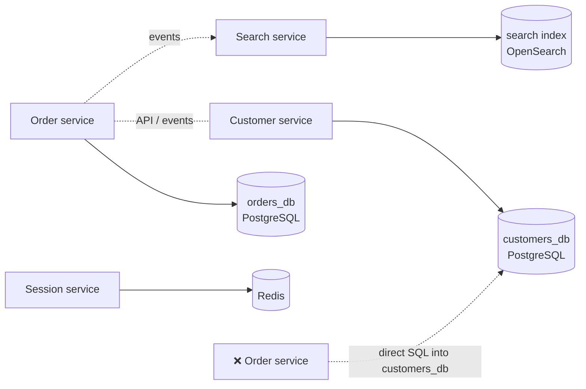
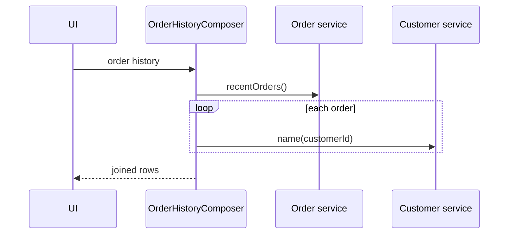

---
tags:
  - Microservices
  - Intermediate
  - Data
---

# Database per Service

<span class="badge badge--intermediate">🟡 Intermediate</span>
<span class="badge badge--category">Microservices</span>
<span class="badge badge--interview">Interview frequency ⭐⭐⭐⭐⭐</span>

!!! abstract "TL;DR"
    **Each service owns its data, and no other service reads or writes it directly. Others go through the owner's API or its events.**
    That makes services independently deployable and scalable, and lets each pick the right store. Cross-service queries then need **API composition** or **CQRS** read models, and cross-service consistency needs **sagas**.

---

## 1. Intent & Problem It Solves

**The problem in plain English:** five "microservices" share one big database. The order team renames a column and the reporting service breaks. The catalog team can't move to a search engine because three other services join its tables. A long-running analytics query locks rows that checkout needs. You have a **distributed monolith**: all the costs of microservices, and none of the independence.

**Definition (microservices.io):**
> Keep each microservice's persistent data private to that service and accessible only via its API. A service's transactions only involve its database.

**What "private" can mean:**

| Level | Isolation | Notes |
|---|---|---|
| Private **tables** in a shared server | Weak | Enforce with per-service DB users and grants |
| Private **schema** per service | Medium | A common starting point; cheap |
| Private **database server** per service | Strong | Independent scaling, tech choice, failure isolation |

## 2. Real-World Analogy

!!! example "Departments with their own filing cabinets"
    HR keeps personnel files; Finance keeps invoices. If Finance needs an employee's bank details, it **asks HR** (an API) or receives HR's "bank details changed" memo (an event). Finance never walks into HR's office and edits a file. HR can reorganize its cabinets any time without telling anyone.

## 3. Structure



| Need | Solution |
|---|---|
| Read another service's data now | **API composition** (call the owner's API) |
| Query across services fast | **CQRS** read model fed by events |
| Use another service's data offline | **Local replica** updated by events |
| Update across services consistently | **Saga** |
| Publish changes reliably | **Transactional outbox** |

## 4. Naive Approach (Without the Pattern)

```sql
-- order-service, running against the shared database:
SELECT o.id, c.name, c.phone FROM orders o JOIN customers c ON c.id = o.customer_id;
-- Customer team splits "name" into first_name/last_name → order-service breaks in production.
-- Nobody knows which services read which tables; every schema change is a coordination meeting.
```

---

## 5. Three Real-World Examples

### Example 1: Separate Databases + API Composition (Grocery)

**Scenario:** `orders_db` and `customers_db` are two separate H2 databases. The SQL join that worked in the monolith now **fails**: the `customers` table simply isn't there. The order-history page uses **API composition**: get orders from the order service, ask the customer service for names, join in memory. The demo counts the API calls: one per order.

**Design:**



**Full Code:**

=== "OrderService.java"

    ```java
    --8<-- "code/microservices/src/main/java/com/handbook/microservices/dbperservice/grocery/OrderService.java"
    ```

    1.  Orders store only the **customer ID**, a reference into another service's data.
    2.  The monolith habit: a JOIN that can't work when data lives in another database.

=== "CustomerService.java"

    ```java
    --8<-- "code/microservices/src/main/java/com/handbook/microservices/dbperservice/grocery/CustomerService.java"
    ```

=== "OrderHistoryComposer.java"

    ```java
    --8<-- "code/microservices/src/main/java/com/handbook/microservices/dbperservice/grocery/OrderHistoryComposer.java"
    ```

    1.  **One remote call per order**: the N+1 problem across the network. The coding challenge fixes it.

=== "DatabasePerServiceDemo.java"

    ```java
    --8<-- "code/microservices/src/main/java/com/handbook/microservices/dbperservice/grocery/DatabasePerServiceDemo.java"
    ```

**Output:**

```text
--8<-- "code/outputs/microservices/dbperservice/grocery/DatabasePerServiceDemo.txt"
```

**Why separate databases here:**

- The customer team can change its schema freely; only its **API** is a contract.
- Each database scales, fails and is backed up independently.
- The cost is visible: joins become application code.

---

### Example 2: Polyglot Persistence (E-commerce)

**Scenario:** Because each service owns its store, each can choose what fits its access pattern: sessions in a **key-value store with TTL** (Redis), product search in an **inverted index** (OpenSearch), payments in a **relational database with ACID transactions** (double-entry ledger that must always sum to zero).

**Full Code:**

=== "PolyglotStores.java"

    ```java
    --8<-- "code/microservices/src/main/java/com/handbook/microservices/dbperservice/polyglot/PolyglotStores.java"
    ```

=== "PolyglotDemo.java"

    ```java
    --8<-- "code/microservices/src/main/java/com/handbook/microservices/dbperservice/polyglot/PolyglotDemo.java"
    ```

**Output:**

```text
--8<-- "code/outputs/microservices/dbperservice/polyglot/PolyglotDemo.txt"
```

**Why polyglot here:**

- Each workload gets the right **data model**: expiry, full-text search, transactions.
- Caution: every new store type is something to operate, back up, secure and hire for. Choose deliberately.

---

### Example 3: Local Replica via Events (Food delivery)

**Scenario:** The shipping service needs customer addresses for every label. Calling the customer service each time couples their availability. Instead, shipping keeps a **read-only replica** of just the fields it needs, updated from `CustomerAddressChanged` events. A late-arriving older event (v2 after v3) is ignored thanks to a **version check**, and labels keep printing while the customer service is down.

**Full Code:**

=== "ShippingService.java"

    ```java
    --8<-- "code/microservices/src/main/java/com/handbook/microservices/dbperservice/replication/ShippingService.java"
    ```

    1.  The replica lives in **shipping's own database** and holds only the fields shipping needs.
    2.  **Version guard**: out-of-order or duplicate events can't overwrite newer data.

=== "ReplicationDemo.java"

    ```java
    --8<-- "code/microservices/src/main/java/com/handbook/microservices/dbperservice/replication/ReplicationDemo.java"
    ```

**Output:**

```text
--8<-- "code/outputs/microservices/dbperservice/replication/ReplicationDemo.txt"
```

**Why a replica here:**

- **Runtime independence**: shipping works when customer-service doesn't.
- Lower latency (local query) and less load on the owner.
- The owner is still the single writer; the replica is read-only and eventually consistent.

---

??? example "Unit Tests: `DatabasePerServiceTest.java`"

    ```java
    --8<-- "code/microservices/src/test/java/com/handbook/microservices/DatabasePerServiceTest.java"
    ```

## 6. Variations & Modern Java Take

```yaml
# Each Spring Boot service has its own datasource and migrations (reference)
# order-service/application.yml
spring:
  datasource:
    url: jdbc:postgresql://orders-db:5432/orders
    username: order_service          # this user has grants on the orders schema only
  flyway:
    locations: classpath:db/migration   # order-service owns its schema migrations
```

| Variation | Notes |
|---|---|
| **Schema per service** on a shared cluster | Cheaper; enforce isolation with DB users and grants |
| **Database per service** | Strongest isolation; higher cost |
| **Data mesh / analytics** | Services publish data products (events, CDC) to a lake/warehouse for cross-domain reporting |
| **Reference data** | Small, rarely changing data (countries, currencies) may be replicated to everyone via events |

## 7. Where It Lives in Real Frameworks

| Where | Database per service |
|---|---|
| Spring Boot + Flyway/Liquibase | One datasource and migration set per service |
| Kubernetes operators | Per-service PostgreSQL clusters (CloudNativePG, Zalando operator) |
| Cloud | Managed DB instance per service (RDS, Cloud SQL, Azure SQL) |
| Debezium | CDC from each service's DB into Kafka for replicas and analytics |

## 8. Pros, Cons & Trade-offs

| ✅ Pros | ❌ Cons |
|---|---|
| **Loose coupling**: schema changes are local | **No cross-service joins or transactions** |
| Independent scaling, tuning and failure isolation | Data duplication and eventual consistency |
| Right store per workload | More databases to operate, back up and secure |
| Clear data ownership | Reporting across services needs a pipeline |

## 9. Pitfalls & Anti-Patterns

!!! danger "The shared database"
    Two services writing the same tables is the most common reason microservices aren't independent. If you can't deploy one without the other, they share too much.

!!! danger "Reading another service's database 'just for reports'"
    A read-only connection still couples you to the schema. Use the owner's API, events, or a reporting pipeline (CDC → warehouse).

!!! warning "N+1 API calls"
    API composition with one call per row melts under load. Use batch endpoints, caching, or a CQRS read model (see the coding challenge).

!!! warning "Replicas that become a second source of truth"
    If shipping starts *editing* its address copy, the copies diverge forever. Replicas are read-only; changes go to the owner.

## 10. Senior / Architect Deep Dive (10–15 yrs)

**Migration path.** Moving from a shared DB: (1) map which service reads and writes which tables; (2) assign an owner per table; (3) replace foreign readers with APIs or events; (4) separate schemas with per-service DB users; (5) move schemas to separate instances when needed. Each step is deployable on its own.

**Reporting.** Operational services shouldn't answer analytics queries. Stream changes (CDC/outbox) into a warehouse or lakehouse where cross-domain joins are cheap; that's the analytical side of the data mesh idea.

**Uniqueness across services.** Constraints like "username unique across tenants" belong to **one** owner. Cross-service invariants need a single owner, a reservation step in a saga, or a redesign of boundaries.

### Production checklist

- [ ] Every table has exactly **one owning service**; DB credentials grant access only to it.
- [ ] Schema migrations owned and run by that service (Flyway/Liquibase).
- [ ] Cross-service reads via APIs (batched) or event-fed replicas/read models.
- [ ] Cross-service writes via sagas; events via outbox.
- [ ] Analytics via CDC/events into a warehouse, not direct reads.
- [ ] Backups, restores and DR tested **per database**.

### Explain it in 2 minutes (system design round)

> "Each service owns its data: orders in its own PostgreSQL, catalog search in OpenSearch, sessions in Redis. No service touches another's database. For the order-history screen I'd use API composition with a batch customer endpoint, or a CQRS read model if it's hot. Shipping keeps a read-only replica of addresses fed by events, so it works when the customer service is down. Cross-service updates use sagas with an outbox, and analytics come from CDC into the warehouse, not from production databases."

!!! bug "War story: the column rename that took down checkout"
    At a retailer, the loyalty service quietly read the `customers` table owned by the account team "because it was faster than the API". The account team renamed `mobile` to `phone_number` in a routine migration. Loyalty's nightly job failed, and so did its real-time points lookup during checkout, which had no fallback. Checkout errors spiked for 45 minutes.
    **Fix:** revoked cross-service DB grants, added a batch customer API and `CustomerChanged` events, and loyalty built its own replica. A schema-access audit found 11 more hidden readers.
    **Lesson:** if someone else can read your tables, your schema is their API, whether you meant it or not.

## 11. Related Patterns & Comparisons

| | Database per Service | Shared Database | API Composition | CQRS |
|---|---|---|---|---|
| Coupling | Low | High | Runtime coupling to owners | Low (async) |
| Cross-service query | Via APIs/events | SQL joins | Join in memory | Pre-built read model |
| Consistency | Per service + sagas | ACID | Fresh | Eventual |

See [Decomposition](decomposition.md), [Saga](saga.md), [CQRS](cqrs.md) and [Transactional Outbox](transactional-outbox.md).

## 12. Interview Corner

=== "🟢 Beginner / Service Companies"

    **Q1. What is the database-per-service pattern?**

    Each microservice has its own private database; other services access that data only through its API or events.

    **Q2. Why not share one database?**

    Shared schemas couple services: one team's change can break others, and services can't be deployed or scaled independently.

    **Q3. How do you get data from another service?**

    Call its API, or subscribe to its events and keep the needed data locally.

    **Q4. How do you do transactions across services?**

    With a **saga** (local transactions + compensations), not a distributed transaction.

    **Q5. What is polyglot persistence?**

    Using different database types for different services, each chosen for its workload.

=== "🟡 Mid-Level"

    **Q1. How do you build a page that needs data from 3 services?**

    API composition (parallel, batched calls) for low volume; a CQRS read model fed by events for high volume or strict latency.

    **Q2. What's the N+1 problem in API composition and how do you fix it?**

    One call per item; fix with batch endpoints (`GET /customers?ids=...`), caching, or a read model.

    **Q3. Is schema-per-service on one database server acceptable?**

    Often, as a pragmatic step: enforce with separate DB users/grants. You lose independent scaling and failure isolation.

    **Q4. How do you keep a local replica correct?**

    Consume the owner's events idempotently, apply them with version checks, and never write to the replica except from events.

    **Q5. How is reporting done?**

    Stream data (CDC/events) into a data warehouse; don't query production service databases.

=== "🔴 Senior / FAANG / SAP"

    **Q1. "Plan the split of a 2 TB shared Oracle database used by 8 services."**

    Table-access inventory, assign owners, introduce APIs/events for foreign access, enforce with grants, split schemas, CDC to sync during transition, move one bounded context at a time, with reconciliation and rollback at each step.

    **Q2. "How do you enforce a cross-service invariant like a global credit limit?"**

    Give one service ownership of the invariant (credit service) and route all reservations through it, often as a saga step; or redesign boundaries so the invariant lives in one service.

    **Q3. "Two services need the same customer data. Replicate or call?"**

    Call when freshness is critical and volume is low; replicate (events) when availability, latency or volume matter and slight staleness is fine.

    **Q4. "What are the operational costs, and how do you contain them?"**

    More databases to patch, back up, monitor and secure. Use managed services, platform templates/operators, standard backup policies, and limit the number of store types.

    **Q5. "How does this relate to SAP's or a large ERP's single database?"**

    ERPs favor one consistent database for tightly integrated processes (strong consistency, easy reporting). Microservices trade that for team autonomy; extensions around an ERP (side-by-side) typically own their data and integrate via APIs/events.

=== "💻 Coding Challenge"

    **Problem:** Rewrite the order-history composition so it makes **one** call to the customer service no matter how many orders there are, and degrades gracefully if a customer is missing.

    ??? success "Solution"

        === "BatchedComposer.java"

            ```java
            --8<-- "code/microservices/src/main/java/com/handbook/microservices/dbperservice/batching/BatchedComposer.java"
            ```

        === "BatchedComposerDemo.java"

            ```java
            --8<-- "code/microservices/src/main/java/com/handbook/microservices/dbperservice/batching/BatchedComposerDemo.java"
            ```

        **Output:**

        ```text
        --8<-- "code/outputs/microservices/dbperservice/batching/BatchedComposerDemo.txt"
        ```

        **Key points to say:** collect **distinct** IDs, call a batch endpoint once (cap the batch size, e.g. 100 IDs), map results in memory; missing entries get a placeholder instead of failing the page. The same idea is GraphQL's DataLoader.

!!! info "Behavioural tie-in (STAR) for experienced candidates"
    - **S:** Six services shared one PostgreSQL database; every release needed a cross-team schema review and two incidents were caused by "harmless" migrations.
    - **T:** Let teams release independently without breaking each other.
    - **A:** Mapped table access, assigned owners, replaced 23 cross-service queries with batch APIs and events, then moved to schema-per-service with locked-down grants, and finally separate instances for the two busiest services.
    - **R:** Release frequency went from fortnightly to daily; schema-related incidents went to zero over the next two quarters.

## 13. Quick Revision Card

!!! tip "Remember in 30 seconds"
    - Each service **owns** its data; others use **APIs or events**.
    - Cross-service queries: **API composition** (batched) or **CQRS** read models.
    - Cross-service writes: **sagas** + **outbox**.
    - Replicas are read-only and version-checked.
    - Reporting via CDC → warehouse.

## Practice

- [ ] Add a cache with a 60 s TTL (FakeClock) to `CustomerService.namesBatch` callers.
- [ ] Make `BatchedComposer` split IDs into batches of at most 2 and call the service in parallel.
- [ ] Add a `CustomerDeleted` event to the replica and decide what labels should show.

---

[:material-arrow-left: Event Sourcing](event-sourcing.md){ .md-button }
[Next: Strangler Fig :material-arrow-right:](strangler-fig.md){ .md-button .md-button--primary }
