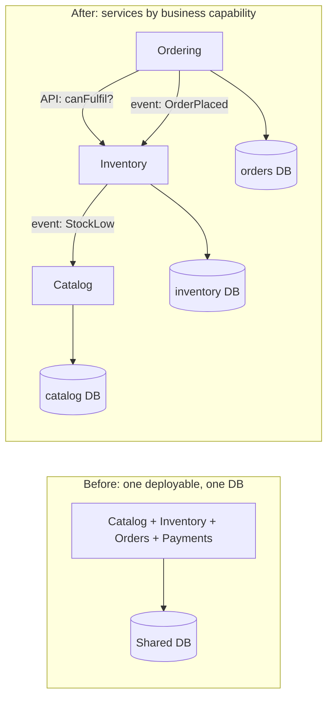
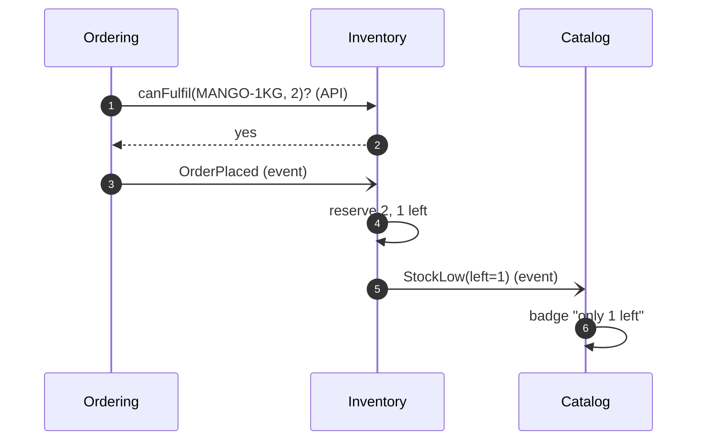
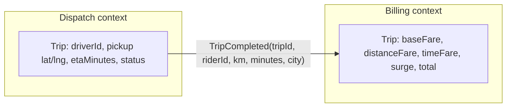
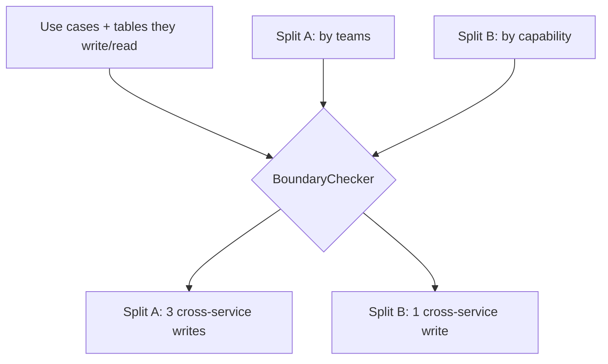

---
tags:
  - Microservices
  - Advanced
---

# Decomposition (by Business Capability / Subdomain)

<span class="badge badge--advanced">🔴 Advanced</span>
<span class="badge badge--category">Microservices</span>
<span class="badge badge--interview">Interview frequency ⭐⭐⭐⭐⭐</span>

!!! abstract "TL;DR"
    **Split a system into services along business capabilities (what the business does) or DDD subdomains, so each service owns its data and can change and deploy independently.**
    The test of a good boundary: most use cases **write inside one service**. If a common use case must update data in two services at once, the boundary is probably wrong.

---

## 1. Intent & Problem It Solves

**The problem in plain English:** a grocery monolith has catalog, inventory, orders, payments and delivery in one codebase and one database. Every team deploys together, a bad inventory query slows checkout, and a change to the `products` table breaks four teams. Microservices promise independent teams and deployments, but only if the **boundaries are right**. Split badly (by technical layer, or by today's org chart) and you get a **distributed monolith**: all the network problems, none of the independence.

**Definitions (microservices.io / DDD):**

- **Decompose by business capability:** a service per thing the business does (catalog, inventory, ordering, billing), stable over time even as technology and org charts change.
- **Decompose by subdomain (DDD):** model the domain, find **bounded contexts** where a term has one meaning ("Trip" in dispatch vs. billing), and align services with them.

| Subdomain type | Meaning | Strategy |
|---|---|---|
| **Core** | Where you compete (pricing, matching, recommendations) | Build in-house, best engineers |
| **Supporting** | Necessary, specific to you (catalog admin) | Build simply, or customize |
| **Generic** | Same for everyone (auth, email, payments gateway) | **Buy** or use a SaaS |

## 2. Real-World Analogy

!!! example "A hospital's departments"
    A hospital isn't organized by "people who use computers" and "people who use phones". It's organized by **capability**: emergency, radiology, pharmacy, billing. Each department has its own records and staff, and they coordinate through well-defined requests (a lab order, a discharge summary). A reorganization of managers doesn't move the pharmacy.

## 3. Structure



| Rule | Why |
|---|---|
| Each service **owns its data** | No shared tables, so services can change their schema independently |
| Integrate via **APIs and events** | Explicit contracts instead of hidden coupling |
| Most use cases **write in one service** | Avoids distributed transactions |
| A **team** owns each service end to end | Conway's Law: the architecture mirrors communication paths |

## 4. Naive Approach (Without the Pattern)

```text
Split by technical layer:      web-service, business-service, data-service    <- every feature touches all three
Split by current teams:        Registration, Doctors, Scheduling, Billing, Payments  <- org chart changes yearly
Split by entities (nouns):     CustomerService, ProductService, OrderService   <- "entity services": chatty, anemic
Shared database:               everyone reads/writes the same tables           <- distributed monolith
```

- :material-close-circle:{ style="color:#e53935" } **Every feature spans several services**: coordinated deployments.
- :material-close-circle:{ style="color:#e53935" } **Distributed transactions** for common use cases.
- :material-close-circle:{ style="color:#e53935" } **Chatty calls** between services that should have been one.

---

## 5. Three Real-World Examples

### Example 1: Grocery Monolith Split by Business Capability (Grocery)

**Scenario:** A quick-commerce company splits its monolith into **Catalog** (what we sell and how it's shown), **Inventory** (units in each dark store) and **Ordering** (the order lifecycle). Ordering checks stock through Inventory's **API**, never its tables; Inventory announces **events** (`StockLow`) that Catalog uses to update the "only 1 left" badge. Each service could now be deployed, scaled and changed by its own team.

**Design:**



**Full Code:**

=== "GroceryServices.java"

    ```java
    --8<-- "code/microservices/src/main/java/com/handbook/microservices/decomposition/grocery/GroceryServices.java"
    ```

    1.  Catalog **reacts to Inventory's events** instead of reading Inventory's tables. It keeps its own copy of what it needs (the badge).
    2.  A **synchronous API call** for a question that needs a fresh answer before accepting the order.
    3.  An **event** for something that already happened. Inventory decides what reservation means.

=== "EventBus.java (support)"

    ```java
    --8<-- "code/microservices/src/main/java/com/handbook/microservices/support/EventBus.java"
    ```

=== "GroceryDecompositionDemo.java"

    ```java
    --8<-- "code/microservices/src/main/java/com/handbook/microservices/decomposition/grocery/GroceryDecompositionDemo.java"
    ```

**Output (happy path and failure path):**

```text
--8<-- "code/outputs/microservices/decomposition/grocery/GroceryDecompositionDemo.txt"
```

**Why this boundary:**

- Each capability has **its own data and rules** (reservation logic stays in Inventory).
- Catalog stays fast and available even if Inventory is slow: it uses its own copy of the badge.
- Teams map one-to-one to services.

---

### Example 2: One Word, Two Bounded Contexts (Ride-hailing)

**Scenario:** In a ride-hailing company, **Dispatch** thinks of a trip as a driver, a pickup location, an ETA and a status. **Billing** thinks of a trip as base fare, distance fare, time fare and surge. A single shared `Trip` class (and table) would grow 60 columns, couple both teams, and make every change risky. Instead, each **bounded context** has its own `Trip` model, and Dispatch publishes a small, stable `TripCompleted` event that Billing **translates** into its model.

**Design:**



**Full Code:**

=== "TripContexts.java"

    ```java
    --8<-- "code/microservices/src/main/java/com/handbook/microservices/decomposition/ridehailing/TripContexts.java"
    ```

    1.  Dispatch's model: what matters for **moving cars**.
    2.  The **published contract** between contexts: small, explicit, versioned. It's not either side's internal model.
    3.  Billing's model: what matters for **charging money**. Same word, different concept.

=== "TripContextsDemo.java"

    ```java
    --8<-- "code/microservices/src/main/java/com/handbook/microservices/decomposition/ridehailing/TripContextsDemo.java"
    ```

**Output:**

```text
--8<-- "code/outputs/microservices/decomposition/ridehailing/TripContextsDemo.txt"
```

**Why bounded contexts here:**

- The **ubiquitous language differs** between teams; forcing one model makes both worse.
- The **event is the boundary**: each side can evolve its internals freely.
- Billing can add surge rules without touching Dispatch, and vice versa.

---

### Example 3: Checking Candidate Splits Against Use Cases (Healthcare)

**Scenario:** A hospital IT department wants to break up its patient-management system. One architect proposes splitting by **current teams** (Registration, Doctors, Scheduling, Billing, Payments); another by **business capability** (PatientRecords, Scheduling, Billing). Before writing code, they check each split against the real use cases: which ones would have to **write** data owned by two services in one transaction?

**Design:**



**Full Code:**

=== "BoundaryChecker.java"

    ```java
    --8<-- "code/microservices/src/main/java/com/handbook/microservices/decomposition/healthcare/BoundaryChecker.java"
    ```

    1.  The heuristic: **writes across services** in one use case mean a saga (complex) or a wrong boundary. Reads across services are normal (API calls or a local read model).

=== "BoundaryDemo.java"

    ```java
    --8<-- "code/microservices/src/main/java/com/handbook/microservices/decomposition/healthcare/BoundaryDemo.java"
    ```

**Output:**

```text
--8<-- "code/outputs/microservices/decomposition/healthcare/BoundaryDemo.txt"
```

The capability-based split leaves one warning, "Close consultation + bill". That's acceptable if Scheduling publishes `ConsultationClosed` and Billing creates the invoice **asynchronously**: the invoice doesn't need to exist in the same transaction. Making that decision explicitly is the point of the exercise.

**Why this check:**

- Turns "where should the boundary be?" from opinion into **evidence** from use cases.
- Splitting by **org chart** produced three cross-service writes: a distributed monolith in the making.
- Cheap to run **before** writing any service code.

---

??? example "Unit Tests: `DecompositionTest.java`"

    ```java
    --8<-- "code/microservices/src/test/java/com/handbook/microservices/DecompositionTest.java"
    ```

## 6. Variations & Modern Java Take

- **Modular monolith first.** Many teams start with one deployable split into strict modules (Java modules, Spring Modulith, ArchUnit rules), then extract services when a module needs independent scaling or deployment. See [Modular Monolith](../architecture/modular-monolith.md).
- **Event storming** workshops to discover domain events, aggregates and bounded contexts with domain experts.
- **Context mapping** between bounded contexts: customer/supplier, conformist, **anti-corruption layer**, open-host service, published language.
- **Strangler fig** to extract services from an existing monolith incrementally. See [Strangler Fig](strangler-fig.md).

## 7. Where It Lives in Real Frameworks

| Tool | Helps with |
|---|---|
| **Spring Modulith** | Module boundaries inside one Spring Boot app, module events, verification tests |
| **ArchUnit** | Tests that fail when packages/modules depend on each other illegally |
| Java Platform Module System | `module-info.java` with `exports`/`requires` |
| Spring Cloud / Kubernetes | Running the resulting services (discovery, config, gateways) |
| Kafka / RabbitMQ | Integration events between services |

## 8. Pros, Cons & Trade-offs

| ✅ Pros | ❌ Cons |
|---|---|
| **Independent deployment** and scaling per capability | **Distributed system costs**: network failures, latency, eventual consistency |
| **Team autonomy**: one team, one service, one database | Cross-service queries need API composition or read models |
| Failures isolated to one capability | Operational overhead: CI/CD, monitoring, on-call per service |
| Each service can use the right technology | Wrong boundaries are **expensive to fix** later |

## 9. Pitfalls & Anti-Patterns

!!! danger "Splitting by technical layer or by entity"
    `ProductService`, `CustomerService`, `OrderService` as CRUD wrappers ("entity services") create chatty, anemic services where every feature changes three of them.

!!! danger "Shared database"
    Services that share tables are one system with extra network hops. Each service must own its data; others get it through APIs or events.

!!! warning "Too many, too small"
    50 services for 8 engineers means more time on infrastructure than features. Size services to **teams** and **capabilities**, not to lines of code.

!!! warning "Splitting before understanding the domain"
    Boundaries are hardest to get right early. Start with a modular monolith and extract when the seams are clear.

## 10. Senior / Architect Deep Dive (10–15 yrs)

**Conway's Law and the Inverse Conway Maneuver.** Systems mirror the communication structure of the organizations that build them. Design team boundaries **deliberately** to get the architecture you want (Team Topologies: stream-aligned teams owning services end to end, platform teams providing paved roads).

**Data ownership decides boundaries.** Ask "who is allowed to change this data, and what invariants protect it?" An invariant that spans data in two services ("an appointment can't be booked unless the slot is free") belongs **inside one** service, or it needs a saga and accepts eventual consistency.

**Migration path.** Strangler fig: put a routing layer in front of the monolith, extract one capability at a time (start with one that has clear data and low coupling), replicate data with CDC during the transition, and delete the monolith code once traffic has moved.

### Production checklist

- [ ] Each service has **one owning team** and an on-call rotation.
- [ ] Each service has **its own database** (or schema with enforced access control).
- [ ] Integration contracts (APIs, events) are **versioned** and covered by **contract tests**.
- [ ] The most common use cases **write in a single service**.
- [ ] Cross-service flows have explicit consistency strategies (sagas, events, read models).
- [ ] Observability: distributed tracing, per-service SLOs and dashboards.
- [ ] Independent CI/CD pipelines; a service can deploy without others.

### Explain it in 2 minutes (system design round)

> "I'd split by **business capability**: catalog, inventory, ordering, payments, delivery. Each owns its data; no shared tables. Ordering checks stock through Inventory's API for decisions that must be fresh, and publishes events like `OrderPlaced` that Inventory and Notifications consume. I'd validate the boundaries against core use cases: placing an order should write mostly within Ordering, with reservation and payment handled by a saga. I'd start as a modular monolith if the team is small, and extract services as scaling or team boundaries require."

!!! bug "War story: the twelve services that always deployed together"
    A fintech split its monolith into 12 services along its database **tables** (Customer, Account, Card, Transaction...). Every feature needed changes in 4–6 services, deployed in a strict order. Releases took a full day, and a failed deploy of one service broke the others. They had built a distributed monolith.
    **Fix:** re-drew boundaries around **capabilities** (Onboarding, Cards, Payments, Lending), merged services that always changed together, and introduced events for cross-capability flows. Deploys became independent and went from weekly to 30 per day.
    **Lesson:** services that change together belong together. Draw boundaries around **change** and **data ownership**, not nouns.

## 11. Related Patterns & Comparisons

| | Decomposition by capability | Decomposition by subdomain (DDD) | Modular monolith |
|---|---|---|---|
| Unit | Business capability | Bounded context | Module inside one deployable |
| Driver | What the business does | The domain model and language | Code organization first, deployment later |
| Deployable units | Many | Many | One |

**Related patterns:** [Database per Service](database-per-service.md), [Saga](saga.md), [API Gateway](api-gateway.md), [Anti-Corruption Layer](anti-corruption-layer.md), [Strangler Fig](strangler-fig.md).

## 12. Interview Corner

=== "🟢 Beginner / Service Companies"

    **Q1. What are microservices?**

    An architecture where an application is built as a set of **small, independently deployable services**, each owning a business capability and its data, communicating over the network (HTTP/gRPC, messaging).

    **Q2. How do you decide service boundaries?**

    By **business capability** or **DDD subdomain/bounded context**, not by technical layer. Each service should own its data and handle most of its use cases on its own.

    **Q3. Monolith vs. microservices?**

    Monolith: one deployable, simple to develop and test, harder to scale teams. Microservices: independent deployment and scaling, at the cost of distributed-system complexity.

    **Q4. What is a bounded context?**

    A boundary within which a domain model and its terms have **one consistent meaning** ("Trip" in Dispatch vs. Billing).

    **Q5. Should microservices share a database?**

    **No.** Each service owns its data; others access it through APIs or events.

=== "🟡 Mid-Level"

    **Q1. What's a distributed monolith?**

    Services that must be **deployed together** or share a database: all the costs of microservices, none of the independence.

    **Q2. How do services get data they don't own?**

    Synchronous **API calls** for fresh decisions; **events** to keep local read copies for display and queries.

    **Q3. What's wrong with "entity services"?**

    CRUD services per noun make features span many services, causing chatty calls and coordinated deployments.

    **Q4. How do you handle a use case that writes to two services?**

    Reconsider the boundary first; otherwise use a **saga** with compensations or make one part asynchronous via events.

    **Q5. Core vs. supporting vs. generic subdomains?**

    Core: competitive advantage, build it well. Supporting: needed, build simply. Generic: buy or use SaaS (auth, email).

=== "🔴 Senior / FAANG / SAP"

    **Q1. "Decompose a food-delivery platform." (classic)**

    Capabilities: Customer, Restaurant/Menu, Ordering, Payments, Delivery (rider assignment, tracking), Notifications, Pricing/Promotions, Search. Each owns its data; order placement runs a saga (reserve → pay → assign rider); events feed search and analytics. Discuss team ownership, scaling hotspots (tracking, search), and starting as a modular monolith.

    **Q2. "How do you validate boundaries before building?"**

    Event storming, mapping use cases to data writes (like Example 3), checking change history (files that change together), and team topology. Prototype as modules and enforce boundaries with ArchUnit or Spring Modulith before splitting deployables.

    **Q3. "When should you NOT use microservices?"**

    Small teams, unclear domains, early-stage products, no mature CI/CD and observability. Start with a well-structured monolith.

    **Q4. "How do you migrate a large monolith?"**

    Strangler fig, extracting capabilities with clear seams first, an anti-corruption layer around legacy models, CDC for data during transition, and decommissioning milestones. Measure deploy frequency and lead time to show progress.

    **Q5. "How does Conway's Law affect your design?"**

    The architecture mirrors team communication. Align services with teams (inverse Conway maneuver); avoid services that need several teams to change together.

=== "💻 Coding Challenge"

    **Problem:** Propose a service split for a food-delivery app (restaurants, menus, dishes, customers, orders, riders, assignments, rider locations, payments) such that **no use case writes across services**. Verify it with the `BoundaryChecker`.

    ??? success "Solution"

        === "FoodDeliverySplitDemo.java"

            ```java
            --8<-- "code/microservices/src/main/java/com/handbook/microservices/decomposition/fooddelivery/FoodDeliverySplitDemo.java"
            ```

        **Output:**

        ```text
        --8<-- "code/outputs/microservices/decomposition/fooddelivery/FoodDeliverySplitDemo.txt"
        ```

        **Key points to say:** every write stays inside one capability; cross-service **reads** are fine (Ordering reads menus through an API or a cached read model; Delivery and Payments learn about orders through `OrderPlaced` events). Placing an order *end to end* (reserve, pay, assign) still spans services, so it becomes a [Saga](saga.md).

!!! info "Behavioural tie-in (STAR) for experienced candidates"
    - **S:** Our 12 entity-based services always deployed together; releases took a day.
    - **T:** Restore independent delivery without a rewrite.
    - **A:** Mapped use cases to data writes, redrew boundaries around four capabilities, merged services that always changed together, and replaced synchronous chains with events.
    - **R:** Deploy frequency went from weekly to about 30 per day; cross-team deployment coordination dropped to near zero.

## 13. Quick Revision Card

!!! tip "Remember in 30 seconds"
    - Split by **business capability / bounded context**, not by layer, entity or org chart.
    - **Each service owns its data**; integrate with **APIs (fresh decisions)** and **events (facts)**.
    - Test: common use cases **write inside one service**.
    - Same word, different models across contexts; integrate with **published events**.
    - Small team or unclear domain? Start with a **modular monolith**.

    ```text
    Catalog | Inventory | Ordering | Payments | Delivery   — each with its own DB, team and pipeline
    ```

## Practice

- [ ] Add a Payments service to Example 1 and decide what Ordering needs from it (API or event?).
- [ ] Add a `TripCancelled` event and teach Billing to charge a cancellation fee.
- [ ] Run the `BoundaryChecker` on a system you know and share the warnings with your team.

---

[:material-arrow-left: Microservices overview](index.md){ .md-button }
[Next: API Gateway :material-arrow-right:](api-gateway.md){ .md-button .md-button--primary }
