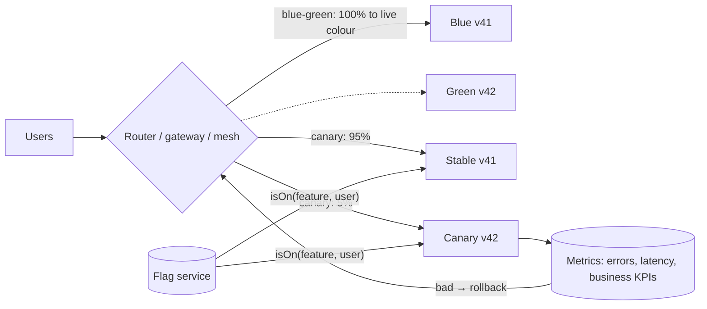
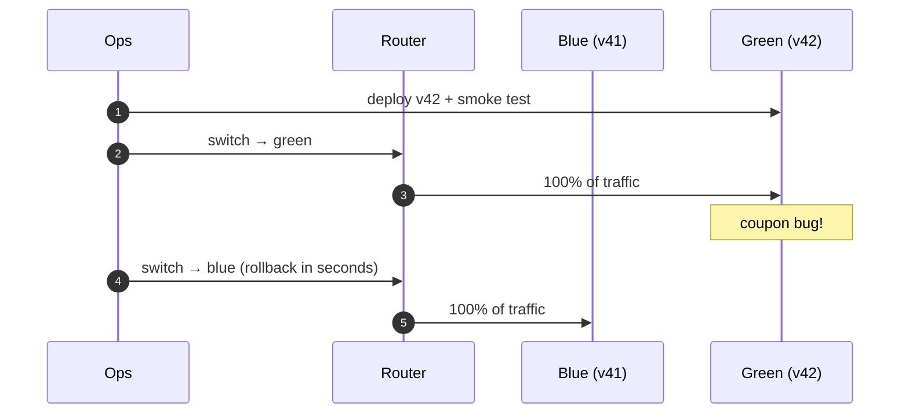
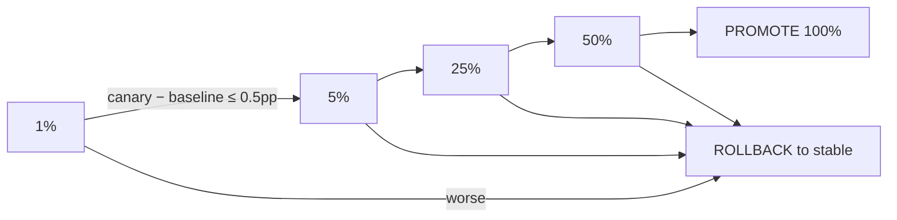
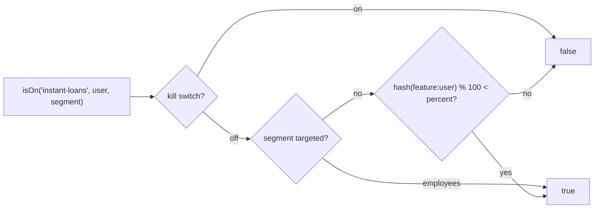

---
tags:
  - Microservices
  - Intermediate
  - Operations
---

# Deployment Strategies: Blue-Green, Canary & Feature Toggles

<span class="badge badge--intermediate">🟡 Intermediate</span>
<span class="badge badge--category">Microservices</span>
<span class="badge badge--interview">Interview frequency ⭐⭐⭐⭐⭐</span>

!!! abstract "TL;DR"
    **Separate *deploying* code from *releasing* it, and make every release reversible. Blue-green switches all traffic between two full environments; canary shifts traffic gradually and rolls back automatically on bad metrics; feature toggles turn features on per user, percentage or segment without redeploying.**
    Use all three: canary or blue-green for every deploy, toggles for risky features, and expand/contract migrations so old and new versions can run side by side.

---

## See It in Motion

<iframe class="motion-embed" src="../../motion/index.html?p=deployment-strategies&amp;embed=1" title="Animated walkthrough of the Deployment Strategies pattern" loading="lazy"></iframe>

Press **Play** to watch the calls travel between components, or step through with **Next** and **Back**. [Open the full explorer with all 66 patterns](../motion/index.html#deployment-strategies){ target=_blank }

## 1. Intent & Problem It Solves

**The problem in plain English:** the team deploys checkout v42 on Friday evening by replacing v41 on every server. A bug for coupon users appears at once, for everyone. Rolling back means another full deploy (15 minutes) while orders fail. Next time, people deploy less often, batches get bigger, and each release gets riskier.

**The strategies:**

| Strategy | How | Blast radius | Rollback | Cost |
|---|---|---|---|---|
| **Recreate / big bang** | Stop old, start new | 100% | Redeploy | Low, but has downtime |
| **Rolling** | Replace instances a few at a time | Grows over time | Roll forward/back gradually | Low (Kubernetes default) |
| **Blue-green** | Two full environments; switch the router | 100% at switch | **Instant** (switch back) | 2× capacity during release |
| **Canary** | Small % of traffic to the new version, then increase | 1% → 100% | Instant (route back) | Needs good metrics |
| **Feature toggles** | Code deployed dark; enabled by configuration | Any segment / % | Instant (flip flag) | Flag debt to clean up |

## 2. Real-World Analogy

!!! example "Opening a new restaurant menu"
    **Blue-green:** a second, fully staffed kitchen prepares the new menu; at 7 pm all orders switch to it, and if something's wrong, orders switch back. **Canary:** the new dish is offered to one table in a hundred first, and the manager watches whether plates come back. **Feature toggle:** the dish is on the menu card but hidden for most guests, shown to staff and regulars first, and can be removed instantly if a supplier fails.

## 3. Structure



| Element | Responsibility |
|---|---|
| **Router** | Load balancer, gateway, ingress or service mesh that controls traffic split |
| **Environments / versions** | Blue + green, or stable + canary |
| **Analysis** | Compares canary vs baseline metrics and decides continue / rollback |
| **Flag service** | Evaluates toggles per request (LaunchDarkly, Unleash, OpenFeature providers) |
| **Compatible data** | Schemas and messages that both versions can read and write (expand/contract) |

## 4. Naive Approach (Without the Pattern)

```text
1. Stop all v41 instances
2. Run DB migration (rename column)
3. Start v42 everywhere
4. Bug? → revert code, but the column was renamed → v41 can't start either
```

- :material-close-circle:{ style="color:#e53935" } Every user hits every bug immediately.
- :material-close-circle:{ style="color:#e53935" } Rollback is a new deploy, and may be impossible after a breaking migration.
- :material-close-circle:{ style="color:#e53935" } Releases become rare, big and scary.

---

## 5. Three Real-World Examples

### Example 1: Blue-Green Checkout Release (E-commerce)

**Scenario:** The checkout service runs as two identical environments behind the load balancer. v42 is deployed to the idle (green) environment and smoke-tested with no customer traffic. The router then switches all traffic to green. A coupon bug appears; switching back to blue (still running v41, warm and unchanged) is one step.

**Design:**



**Full Code:**

=== "BlueGreenRouter.java"

    ```java
    --8<-- "code/microservices/src/main/java/com/handbook/microservices/deployment/bluegreen/BlueGreenRouter.java"
    ```

    1.  Deploy to the **idle** colour: customers are unaffected while it starts and warms up.
    2.  Smoke-test the idle environment with synthetic requests before any customer sees it.
    3.  The release (and the rollback) is a single router change: a DNS weight, a load-balancer target group, a Kubernetes Service selector.

=== "BlueGreenDemo.java"

    ```java
    --8<-- "code/microservices/src/main/java/com/handbook/microservices/deployment/bluegreen/BlueGreenDemo.java"
    ```

**Output:**

```text
--8<-- "code/outputs/microservices/deployment/bluegreen/BlueGreenDemo.txt"
```

**Why blue-green here:**

- **Instant rollback** to a warm, known-good environment.
- The new version is fully started and verified before taking traffic.
- Simple mental model; good for stateful edge services and big-bang changes that can't be split.

---

### Example 2: Canary with Automated Analysis (Ride-hailing)

**Scenario:** A new fare engine is rolled out in steps: 1% → 5% → 25% → 50% of rides, then promoted. At each step, the canary's error rate is compared with the stable baseline (10,000 rides per step); if the canary is worse by more than 0.5 percentage points, the rollout stops and traffic returns to stable. Release 7.3 is healthy; release 7.4 breaks fares for airport pickups.

**Design:**



**Full Code:**

=== "CanaryAnalysis.java"

    ```java
    --8<-- "code/microservices/src/main/java/com/handbook/microservices/deployment/canary/CanaryAnalysis.java"
    ```

    1.  Compare canary to the **baseline at the same time**, not to last week: both see the same traffic mix and incidents.
    2.  Stop at the first bad step. Argo Rollouts / Flagger do this with Prometheus queries as "analysis templates".

=== "CanaryDemo.java"

    ```java
    --8<-- "code/microservices/src/main/java/com/handbook/microservices/deployment/canary/CanaryDemo.java"
    ```

**Output:**

```text
--8<-- "code/outputs/microservices/deployment/canary/CanaryDemo.txt"
```

**Why canary here:**

- A bad release reaches **1%** of rides, not 100%.
- The decision is automatic and metric-driven, not "someone was watching the dashboard".
- Real traffic finds bugs that tests and staging don't (airport pickups!).

---

### Example 3: Feature Toggles for Instant Loans (Banking)

**Scenario:** A bank ships "instant loan offers" code to production weeks before launch, switched off. Employees see it first (dogfooding), then 10% of customers, then 50%. Each customer's experience must be **sticky** (the same answer on every visit). When the credit-risk team spots a scoring issue, a **kill switch** turns it off for everyone in seconds, with no deploy.

**Design:**



**Full Code:**

=== "FeatureToggles.java"

    ```java
    --8<-- "code/microservices/src/main/java/com/handbook/microservices/deployment/toggles/FeatureToggles.java"
    ```

    1.  The **kill switch** is checked first and overrides everything.
    2.  **Segment targeting**: employees, beta testers, one city, one tenant.
    3.  **Sticky percentage rollout**: a stable hash puts each user in a bucket 0–99, so raising 10% → 50% keeps everyone who already had it.

=== "TogglesDemo.java"

    ```java
    --8<-- "code/microservices/src/main/java/com/handbook/microservices/deployment/toggles/TogglesDemo.java"
    ```

**Output:**

```text
--8<-- "code/outputs/microservices/deployment/toggles/TogglesDemo.txt"
```

**Why feature toggles here:**

- **Deploy ≠ release**: code ships continuously; business decides when users see it.
- Gradual exposure by segment and percentage, with consistent experiences.
- Fastest possible rollback for a feature (seconds), independent of the deploy pipeline.

---

??? example "Unit Tests: `DeploymentStrategiesTest.java`"

    ```java
    --8<-- "code/microservices/src/test/java/com/handbook/microservices/DeploymentStrategiesTest.java"
    ```

## 6. Variations & Modern Java Take

=== "Argo Rollouts canary (reference)"

    ```yaml
    apiVersion: argoproj.io/v1alpha1
    kind: Rollout
    metadata: { name: fare-engine }
    spec:
      strategy:
        canary:
          steps:
            - setWeight: 1
            - analysis: { templates: [{ templateName: error-rate-vs-stable }] }
            - setWeight: 5
            - pause: { duration: 10m }
            - setWeight: 25
            - analysis: { templates: [{ templateName: error-rate-vs-stable }] }
            - setWeight: 50
    ```

=== "OpenFeature in Java (reference)"

    ```java
    Client flags = OpenFeatureAPI.getInstance().getClient();
    EvaluationContext ctx = new ImmutableContext(userId, Map.of("segment", new Value("retail")));
    if (flags.getBooleanValue("instant-loans", false, ctx)) {   // default OFF if the flag service is unreachable
        offers.add(instantLoanOffer(userId));
    }
    ```

| Variation | Notes |
|---|---|
| **Rolling update** | Kubernetes `maxSurge`/`maxUnavailable`; relies on readiness probes ([Health Check](health-check.md)) |
| **Shadow / dark launch** | Mirror real traffic to the new version and discard its responses; compare outputs |
| **A/B testing** | Toggles + experiment analysis on business metrics (conversion), not just errors |
| **Ring deployments** | Internal users → one region → all regions |
| **Toggle types** | Release (short-lived), ops/kill switches (long-lived), experiments, permissions |

## 7. Where It Lives in Real Frameworks

| Where | Deployment strategies |
|---|---|
| Kubernetes | Rolling updates, readiness-gated rollout, `kubectl rollout undo` |
| Argo Rollouts / Flagger | Canary and blue-green with automated analysis (Prometheus, Datadog) |
| Istio / Linkerd / Envoy | Weighted routing, header-based routing, traffic mirroring |
| Spring Cloud Gateway | Weight route predicates for canaries (see [API Gateway](api-gateway.md)) |
| Feature flags | OpenFeature SDK, Unleash, LaunchDarkly, FF4J, Togglz |
| Databases | Flyway / Liquibase migrations written in expand/contract style |

## 8. Pros, Cons & Trade-offs

| ✅ Pros | ❌ Cons |
|---|---|
| Small blast radius and fast rollback | Both versions must be compatible (APIs, schemas, messages) |
| Release decisions driven by metrics, not hope | Canary needs reliable, low-noise metrics and enough traffic |
| Frequent, small, low-stress releases | Blue-green doubles capacity during releases |
| Toggles let business control exposure | Toggle sprawl and untested flag combinations |

## 9. Pitfalls & Anti-Patterns

!!! danger "Breaking schema changes in the same release"
    Renaming or dropping a column while old instances still run (or might be rolled back to) causes outages and blocks rollback. Use expand → migrate → contract across several releases (coding challenge).

!!! danger "Canary metrics that can't see the bug"
    Error rate alone won't catch "fares are 10% too low". Include business metrics (average fare, conversion) and compare against the baseline, not a fixed threshold.

!!! warning "Toggles that never die"
    Every release toggle doubles test paths. Give each an owner and an expiry date; delete the flag and the dead branch after full rollout.

!!! warning "Sticky sessions and caches across versions"
    Users bouncing between v41 and v42 (non-sticky routing) can see inconsistent behaviour; caches written by v42 in a new format can break v41 after rollback. Version cache keys and message formats.

## 10. Senior / Architect Deep Dive (10–15 yrs)

**Compatibility is the real constraint.** Any strategy that runs two versions at once (all of them except recreate) requires N and N−1 to coexist: backward-compatible APIs, tolerant readers for messages, additive schema changes, and dual-reading caches. Make "can we roll back?" a release checklist item.

**Statistics matter.** At 1% of 10,000 requests you only see 100 requests: a 0.4% error rate is noise. Use enough traffic per step, longer bake times for low-volume services, and statistical tests (Kayenta's Mann-Whitney) rather than eyeballing.

**Data migrations are releases too.** Backfills run as throttled jobs; dual-writes are verified with reconciliation queries before cutting reads over; the contract step is delayed until rollback past it is no longer needed.

!!! bug "War story: the rollback that couldn't roll back"
    A grocery team released v42 with a Flyway migration that renamed `mobile` to `phone_e164`. v42 had a checkout bug; they rolled back to v41, which crashed on startup because its queries referenced `mobile`. Checkout was down for 34 minutes while engineers wrote and deployed a reverse migration under pressure.
    **Fix:** migrations reviewed for expand/contract; CI runs the previous app version's integration tests against the new schema; renames take three releases.
    **Lesson:** a deployment strategy is only as reversible as your database changes.

## 11. Related Patterns & Comparisons

| | Blue-Green | Canary | Feature Toggle | Strangler Fig |
|---|---|---|---|---|
| Unit switched | Whole environment | Traffic percentage | A feature, per user | A route/capability, permanently |
| Rollback | Switch back | Route back | Flip flag | Route back to legacy |
| Needs | 2× capacity | Good metrics | Flag service + discipline | Facade/router |

See [Strangler Fig](strangler-fig.md), [Config Server](config-server.md) (where flags often live), and [Health Check](health-check.md) (rollouts depend on readiness).

## 12. Interview Corner

=== "🟢 Beginner / Service Companies"

    **Q1. What is blue-green deployment?**

    Two identical environments; deploy to the idle one, then switch all traffic; switch back to roll back.

    **Q2. What is a canary release?**

    Send a small percentage of traffic to the new version, watch metrics, then increase gradually or roll back.

    **Q3. What is a feature toggle?**

    A configuration switch that turns a feature on or off at runtime without redeploying.

    **Q4. Rolling update vs blue-green?**

    Rolling replaces instances gradually in one environment; blue-green switches between two complete environments at once.

    **Q5. Why separate deploy from release?**

    So code can ship often and safely, while exposure to users is controlled independently.

=== "🟡 Mid-Level"

    **Q1. How do you make a percentage rollout sticky?**

    Hash a stable key (user id + feature name) into buckets; enable buckets below the percentage.

    **Q2. What metrics would you watch during a canary?**

    Error rate, latency percentiles, saturation, and business KPIs, compared with the baseline.

    **Q3. How do you rename a column with zero downtime?**

    Expand (add new), deploy dual-write, backfill, switch reads, deploy new-only, then contract (drop old).

    **Q4. What's the downside of blue-green?**

    Double capacity, and the switch exposes everyone at once (use a canary-style gradual switch if possible).

    **Q5. What happens if the flag service is down?**

    Use cached values and safe defaults (usually off); never block requests on the flag service.

=== "🔴 Senior / FAANG / SAP"

    **Q1. "Design the release process for 300 microservices."**

    GitOps + Argo Rollouts canaries with automated analysis on standard SLIs; compatibility checks (contract tests, schema linting); OpenFeature for risky features with flag expiry; region rings; one-click rollback.

    **Q2. "Canary looked fine but the release broke something. Why?"**

    Low-traffic paths not exercised, metrics not covering the failure mode, bake time too short, or the bug only appears at scale (cache/DB load).

    **Q3. "How do you canary a Kafka consumer?"**

    Run the new version as a separate consumer group on mirrored data (shadow), or split partitions between versions; compare outputs before cutting over.

    **Q4. "How do you manage toggle debt?"**

    Typed toggles with owners and expiry, lint rules failing builds on expired flags, dashboards of flag age, and deletion as part of the feature's definition of done.

    **Q5. "Blue-green with a database?"**

    Usually one shared database with expand/contract migrations; separate databases per colour require data sync and are rarely worth it.

=== "💻 Coding Challenge"

    **Problem:** Rename `customers.mobile` to `customers.phone_e164` while rolling deploys run old and new app versions side by side. Show why a single `RENAME` causes an outage and which sequence keeps every running version working.

    ??? success "Solution"

        === "ExpandContractDemo.java"

            ```java
            --8<-- "code/microservices/src/main/java/com/handbook/microservices/deployment/migration/ExpandContractDemo.java"
            ```

        **Output:**

        ```text
        --8<-- "code/outputs/microservices/deployment/migration/ExpandContractDemo.txt"
        ```

        **Key points to say:** at every step, check the schema against **all versions that might be running** (including the rollback target). Expand first, dual-write and backfill, switch reads, and only contract once nobody can roll back to a version that needs the old column.

!!! info "Behavioural tie-in (STAR) for experienced candidates"
    - **S:** A rollback failed because the release had renamed a column; checkout was down 34 minutes.
    - **T:** Make every release reversible and reduce release risk.
    - **A:** Introduced Argo Rollouts canaries with error-rate and fare-amount analysis, expand/contract migration reviews, CI testing of N−1 against the new schema, and kill switches for risky features.
    - **R:** Deploys went from weekly to 15 per day; two bad releases in the next quarter were auto-rolled back at 1% traffic with no customer-visible incident.

## 13. Quick Revision Card

!!! tip "Remember in 30 seconds"
    - **Deploy ≠ release.** Make every release reversible.
    - **Blue-green:** two environments, one switch, instant rollback.
    - **Canary:** 1% → 5% → 25% → 50% → 100%, compare to baseline, auto-rollback.
    - **Toggles:** kill switch, segments, sticky % buckets; delete when done.
    - **Expand → migrate → contract** so N and N−1 always coexist.

    ```java
    if (flags.getBooleanValue("instant-loans", false, ctx)) { ... }   // default off
    ```

## Practice

- [ ] Add a latency check (p95) to `CanaryAnalysis` alongside the error rate.
- [ ] Add a `rolloutUntil` expiry date to `FeatureToggles.Rule` and warn on expired flags.
- [ ] Extend `ExpandContractDemo` with a rollback from v3 to v2 at each step.

---

[:material-arrow-left: Health Check](health-check.md){ .md-button }
[Next: Architecture :material-arrow-right:](../architecture/index.md){ .md-button .md-button--primary }
