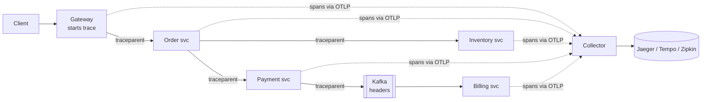

---
tags:
  - Microservices
  - Intermediate
  - Observability
---

# Distributed Tracing

<span class="badge badge--intermediate">🟡 Intermediate</span>
<span class="badge badge--category">Microservices</span>
<span class="badge badge--interview">Interview frequency ⭐⭐⭐⭐</span>

!!! abstract "TL;DR"
    **Give each request a trace ID at the edge, propagate it (with the current span ID) to every service it touches via headers such as W3C `traceparent`, and record a span per unit of work. A tracing backend assembles the spans into a tree showing where the time went and where it failed.**
    Logs tell you *what* happened in one service; traces tell you *where* in the call chain it happened.

---

## 1. Intent & Problem It Solves

**The problem in plain English:** checkout takes 1.5 s sometimes. The request touches the gateway, order, inventory, payment and an external bank. Each service's logs say "OK" and its average latency looks fine. Which hop is slow, for **this** request? Without a shared ID, correlating logs across five services by timestamp is guesswork.

**Definition (OpenTelemetry):**
> Traces give us the big picture of what happens when a request is made to an application. A trace is made of one or more spans; each span represents a unit of work.

| Concept | Meaning |
|---|---|
| **Trace** | The whole journey of one request (one trace ID) |
| **Span** | One operation: name, start, duration, attributes, status, parent span ID |
| **Context propagation** | Passing trace ID + parent span ID across process boundaries (HTTP headers, message headers) |
| **`traceparent`** | W3C header: `00-<trace-id 32 hex>-<parent-id 16 hex>-<flags>` |
| **Sampling** | Recording only a share of traces to control cost |

## 2. Real-World Analogy

!!! example "A parcel's tracking number"
    The parcel gets one tracking number at pickup. Every hub scans it on arrival and departure, so you can see it spent 14 hours stuck at the Pune sort centre. The tracking number is the trace ID; each scan pair is a span.

## 3. Structure



| Participant | Responsibility |
|---|---|
| **Instrumentation** (OTel agent, Micrometer) | Creates spans for HTTP, DB, messaging; injects/extracts headers |
| **Propagator** | Serializes context into headers (W3C, B3) |
| **Collector** | Receives, batches, samples and exports spans |
| **Backend** | Stores and visualizes traces; links to logs and metrics |

## 4. Naive Approach (Without the Pattern)

```text
order-service    19:00:00.112 INFO placing order ORD-1
payment-service  19:00:00.140 INFO charging...
payment-service  19:00:01.561 INFO charged
(800 other requests logged in the same second; which "charging..." belongs to ORD-1?)
```

---

## 5. Three Real-World Examples

All examples use a small tracer and the W3C header format:

=== "TraceContext.java"

    ```java
    --8<-- "code/microservices/src/main/java/com/handbook/microservices/tracing/core/TraceContext.java"
    ```

    1.  Strict parsing: a malformed header should start a **new** trace rather than corrupt one.
    2.  A child keeps the **trace ID** and gets a new **span ID**; the old span ID becomes its parent.

=== "Tracer.java"

    ```java
    --8<-- "code/microservices/src/main/java/com/handbook/microservices/tracing/core/Tracer.java"
    ```

### Example 1: Finding the Slow Hop in Checkout (Grocery)

**Scenario:** One checkout request crosses the gateway, order, inventory and payment services. Each service parses the incoming `traceparent`, creates a child span and passes its own span ID downstream. The trace tree (with a timeline bar per span) makes the answer obvious: **1.4 s** of the 1.5 s is the bank authorization call inside payment-service.

**Full Code:**

=== "CheckoutTraceDemo.java"

    ```java
    --8<-- "code/microservices/src/main/java/com/handbook/microservices/tracing/grocery/CheckoutTraceDemo.java"
    ```

    1.  **Inject**: the gateway sends its context downstream in the `traceparent` header.
    2.  **Extract**: each service continues the trace from the incoming header.

**Output:**

```text
--8<-- "code/outputs/microservices/tracing/grocery/CheckoutTraceDemo.txt"
```

**Why tracing here:**

- Latency is attributed to a **specific hop** for a **specific request**.
- The tree also shows structure: inventory and payment run sequentially, so parallelizing them is a possible optimization.

---

### Example 2: Across Kafka (Ride-hailing)

**Scenario:** Completing a trip publishes `TripCompleted`; billing consumes it 2 seconds later on another machine. The producer puts `traceparent` into the **message headers**; the consumer extracts it and continues the same trace, so the invoice insert appears under the original HTTP request.

**Full Code:**

=== "KafkaTracePropagationDemo.java"

    ```java
    --8<-- "code/microservices/src/main/java/com/handbook/microservices/tracing/async/KafkaTracePropagationDemo.java"
    ```

    1.  Message headers carry the context just like HTTP headers do.
    2.  The consumer **extracts** it; OpenTelemetry may model this as a child or as a **span link** for batch consumers.

**Output:**

```text
--8<-- "code/outputs/microservices/tracing/async/KafkaTracePropagationDemo.txt"
```

**Why propagate through messages:**

- Async flows (sagas, outbox relays) are where "where did it get stuck?" is hardest to answer.
- Consumer lag becomes visible as a gap in the trace.

---

### Example 3: Keeping Context Across Threads (Streaming)

**Scenario:** The home-screen service fetches three rows in parallel. The current trace lives in a `ThreadLocal`, so work on a plain executor loses it, and those spans become orphan traces. A context-propagating executor **captures** the context at submit time and **restores** it in the worker.

**Full Code:**

=== "ContextPropagatingExecutor.java"

    ```java
    --8<-- "code/microservices/src/main/java/com/handbook/microservices/tracing/threads/ContextPropagatingExecutor.java"
    ```

    1.  Capture on the **submitting** thread.
    2.  Restore on the **worker** thread for the task's duration.
    3.  Always restore the previous value. Pooled threads are reused, and leaking context into the next task corrupts traces.

=== "ThreadContextDemo.java"

    ```java
    --8<-- "code/microservices/src/main/java/com/handbook/microservices/tracing/threads/ThreadContextDemo.java"
    ```

**Output:**

```text
--8<-- "code/outputs/microservices/tracing/threads/ThreadContextDemo.txt"
```

**Why this matters:**

- Async code (`CompletableFuture`, `@Async`, reactive) is the most common place traces break.
- OpenTelemetry's `Context.taskWrapping(executor)` and Micrometer's `ContextExecutorService` do exactly this.

---

??? example "Unit Tests: `DistributedTracingTest.java`"

    ```java
    --8<-- "code/microservices/src/test/java/com/handbook/microservices/DistributedTracingTest.java"
    ```

## 6. Variations & Modern Java Take

**Spring Boot 3 with Micrometer Tracing** (compiled in the `spring-reference` module):

```java
--8<-- "code/spring-reference/src/main/java/com/handbook/springref/tracing/TracedCheckoutService.java"
```

```yaml
# application.yml (reference)
management:
  tracing:
    sampling.probability: 0.1          # 10% head sampling
  otlp:
    tracing.endpoint: http://otel-collector:4318/v1/traces
logging.pattern.level: "%5p [${spring.application.name},%X{traceId:-},%X{spanId:-}]"  # IDs in every log line
```

| Option | Notes |
|---|---|
| **OpenTelemetry Java agent** | Zero-code instrumentation (`-javaagent:opentelemetry-javaagent.jar`) for HTTP, JDBC, Kafka and more |
| **Micrometer Tracing** (Spring Boot 3) | Observation API; bridges to OTel or Brave |
| **Head sampling** | Decide at the root (cheap; may miss rare errors) |
| **Tail sampling** | The collector decides after seeing the whole trace (keep errors and slow traces) |
| **Exemplars** | Link a metric spike to example trace IDs |

## 7. Where It Lives in Real Frameworks

| Where | Tracing |
|---|---|
| OpenTelemetry | The standard API/SDK, OTLP protocol and collector |
| Jaeger, Grafana Tempo, Zipkin | Open-source backends |
| Spring Boot 3 | Micrometer Tracing + `ObservationRegistry` auto-instrumentation |
| Service meshes | Proxies emit spans per hop (apps still forward headers) |
| W3C Trace Context | `traceparent`/`tracestate` header standard |

## 8. Pros, Cons & Trade-offs

| ✅ Pros | ❌ Cons |
|---|---|
| Pinpoints slow or failing hops per request | Instrumentation gaps break traces |
| Shows real dependency graphs | Storage cost; requires sampling at scale |
| Correlates logs, metrics and traces by ID | Context propagation across async code needs care |
| Standardized (W3C, OTel) | Sensitive data can leak into span attributes |

## 9. Pitfalls & Anti-Patterns

!!! danger "Broken propagation"
    One service that doesn't forward `traceparent` (a hand-built HTTP client, a thread pool, a message without headers) splits every trace in two. Test propagation end to end.

!!! warning "High-cardinality or sensitive attributes"
    Putting card numbers, emails or full request bodies into span attributes leaks PII into the tracing backend. Use allow-lists for attributes.

!!! warning "Sampling inconsistently"
    If each service samples independently at 10%, only 1% of traces are complete. Use parent-based sampling (see the coding challenge).

!!! warning "Tracing without logs correlation"
    Put trace and span IDs in every log line (MDC), so you can jump from a trace to the exact logs.

## 10. Senior / Architect Deep Dive (10–15 yrs)

**Three pillars, one ID.** Metrics tell you **that** something is wrong (error rate up), traces tell you **where** (which hop), logs tell you **why** (the exception). Wire them together: exemplars on metrics, trace IDs in logs, and service graphs from traces.

**Sampling strategy.** Head sampling at 1–10% for volume; tail sampling in the collector to **always keep** errors and slow traces; higher rates for low-traffic critical paths. Budget storage per day.

**Baggage.** W3C Baggage can carry business context (tenant ID, experiment) across services. It's sent on every hop and visible to every service, so keep it small and non-sensitive.

### Production checklist

- [ ] OpenTelemetry agent or Micrometer Tracing in every service; W3C propagation everywhere (HTTP, gRPC, Kafka).
- [ ] Context propagation through executors, `@Async`, reactive and virtual threads verified.
- [ ] Trace/span IDs in logs (MDC); exemplars on latency metrics.
- [ ] Parent-based head sampling + tail sampling for errors/slow requests.
- [ ] Attribute allow-list; no PII in spans.
- [ ] Collector deployed with batching and back-pressure; backend retention set.

### Explain it in 2 minutes (system design round)

> "Every service runs the OpenTelemetry agent. The gateway starts a trace and propagates W3C `traceparent` over HTTP, gRPC and Kafka headers, so a checkout produces one trace across all services and async consumers. Spans go via OTLP to a collector that does tail sampling (keep all errors and requests over 1 s, plus 5% of the rest) and exports to Tempo. Trace IDs are in every log line and metrics have exemplars, so from a latency spike we can click straight to a slow trace and then to its logs."

!!! bug "War story: the trace that ended at the thread pool"
    A payments team adopted tracing, but traces for refunds always stopped at `refund-service`. The refund flow used a custom `ExecutorService` for parallel ledger updates; the context stayed on the request thread. For months, slow refunds were blamed on the ledger database, which looked fine.
    **Fix:** wrapped the executor with context propagation; the now-complete traces showed the real culprit: a synchronous call to a fraud-scoring API inside the parallel tasks, with no timeout.
    **Lesson:** a trace that stops early hides the actual problem. Verify propagation across every async boundary.

## 11. Related Patterns & Comparisons

| | Distributed Tracing | Correlation ID in logs | Metrics | Log aggregation |
|---|---|---|---|---|
| Answers | Where in the chain, for one request | Which log lines belong together | How much / how often | What exactly happened |
| Structure | Tree of timed spans | Flat ID | Aggregates | Text/events |
| Cost | Medium (sampling) | Low | Low | High |

See [Sidecar / Service Mesh](sidecar-service-mesh.md), [API Gateway](api-gateway.md) (where traces start), and [Saga](saga.md) (where async tracing matters most).

## 12. Interview Corner

=== "🟢 Beginner / Service Companies"

    **Q1. What is distributed tracing?**

    Following a single request across multiple services using a shared **trace ID**, recording a **span** for each operation.

    **Q2. What is a span?**

    A timed unit of work (e.g. an HTTP call or DB query) with a name, start time, duration, attributes and a parent span.

    **Q3. How is the trace ID passed between services?**

    In headers, typically the W3C `traceparent` header (or older B3 headers).

    **Q4. Name some tracing tools.**

    OpenTelemetry (standard), Jaeger, Zipkin, Grafana Tempo; Spring Boot uses Micrometer Tracing.

    **Q5. Trace ID vs. correlation ID?**

    A correlation ID only groups logs; a trace ID plus span IDs builds a timed tree of operations.

=== "🟡 Mid-Level"

    **Q1. Explain the `traceparent` header.**

    `version-traceid-parentid-flags`: 00, a 32-hex trace ID, the 16-hex span ID of the caller, and flags (01 = sampled).

    **Q2. How do traces cross Kafka?**

    The producer injects context into message headers; the consumer extracts it and creates a child span or a span link.

    **Q3. Why do traces break in async code?**

    Context is stored in thread-locals; work on other threads loses it unless executors propagate it.

    **Q4. What is sampling and why is it needed?**

    Recording only a fraction of traces to control overhead and storage; head-based (at the start) or tail-based (after completion).

    **Q5. How do you connect logs to traces?**

    Put trace/span IDs into the logging MDC and log pattern; backends link from a trace to its logs.

=== "🔴 Senior / FAANG / SAP"

    **Q1. "Design observability for 300 microservices."**

    OTel everywhere (agents + SDK for custom spans), W3C propagation, collectors per cluster with tail sampling, a trace backend with 7–14 days retention, metrics with exemplars, structured logs with trace IDs, service maps and SLOs per service.

    **Q2. "Head vs. tail sampling trade-offs?"**

    Head: cheap and simple, but may drop the rare error traces. Tail: keeps interesting traces, but the collector must buffer whole traces (memory, routing by trace ID).

    **Q3. "How do you measure the overhead of tracing?"**

    Load-test with and without instrumentation; watch CPU, allocation and p99; tune sampling, batch export and attribute counts.

    **Q4. "A trace shows a gap of 300 ms between two spans. What could it be?"**

    Uninstrumented work (local computation, a library call), queueing in a thread pool or connection pool, GC pauses, network/proxy time, or consumer lag for async hops.

    **Q5. "How would you trace a request through a legacy system that can't be instrumented?"**

    Use a sidecar or proxy to create spans around it, or log the incoming trace ID and correlate; propagate the trace ID through its message fields if possible.

=== "💻 Coding Challenge"

    **Problem:** Sample about 10% of traces, but every service must make the **same** decision for a given trace, so sampled traces are complete. Downstream services should honour the caller's decision.

    ??? success "Solution"

        === "RatioSampler.java"

            ```java
            --8<-- "code/microservices/src/main/java/com/handbook/microservices/tracing/sampling/RatioSampler.java"
            ```

        === "SamplingDemo.java"

            ```java
            --8<-- "code/microservices/src/main/java/com/handbook/microservices/tracing/sampling/SamplingDemo.java"
            ```

        **Output:**

        ```text
        --8<-- "code/outputs/microservices/tracing/sampling/SamplingDemo.txt"
        ```

        **Key points to say:** the decision is a **pure function of the trace ID** (random bits), so any service computes the same answer; downstream services just follow the `sampled` flag (parent-based). This mirrors OpenTelemetry's `ParentBased(TraceIdRatioBased(0.1))`.

!!! info "Behavioural tie-in (STAR) for experienced candidates"
    - **S:** Our p99 checkout latency doubled after a release, and each team's dashboard showed their service as healthy.
    - **T:** Find the cause within the incident window.
    - **A:** We had just rolled out OpenTelemetry; filtering traces over 2 s showed every slow trace contained a new synchronous call from pricing to a promotions service with no cache.
    - **R:** Root cause in 20 minutes instead of a day; we added caching and a timeout, and made tracing part of our definition of done for new services.

## 13. Quick Revision Card

!!! tip "Remember in 30 seconds"
    - **Trace** = request journey; **span** = timed operation with a parent.
    - Propagate `traceparent` over HTTP, gRPC **and message headers**.
    - Watch async boundaries (executors, `@Async`, reactive).
    - Parent-based + tail sampling; IDs in logs; no PII in spans.
    - OpenTelemetry + Jaeger/Tempo; Spring Boot 3 = Micrometer Tracing.

## Practice

- [ ] Add a `status` (OK/ERROR) to `Tracer.Span` and mark the span as an error when the work throws.
- [ ] Run inventory and payment in parallel in `CheckoutTraceDemo` and see how the tree changes.
- [ ] Implement a "keep all error traces" tail-sampling rule on top of `RatioSampler`.

---

[:material-arrow-left: Idempotent Consumer](idempotent-consumer.md){ .md-button }
[Next: Config Server :material-arrow-right:](config-server.md){ .md-button .md-button--primary }
