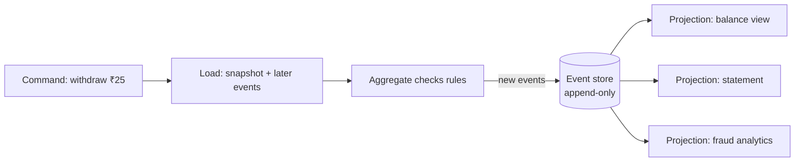
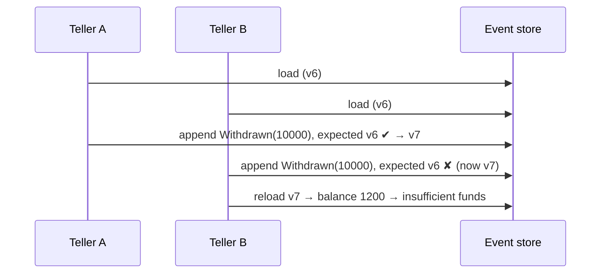

---
tags:
  - Microservices
  - Advanced
  - Data
---

# Event Sourcing

<span class="badge badge--advanced">🔴 Advanced</span>
<span class="badge badge--category">Microservices</span>
<span class="badge badge--interview">Interview frequency ⭐⭐⭐⭐</span>

!!! abstract "TL;DR"
    **Instead of storing the current state and overwriting it, store every change as an immutable event in an append-only log. The current state is derived by replaying the events (sped up with snapshots).**
    You get a complete audit trail, time travel ("what was the state on 1 March?"), and the ability to build new views from history, at the cost of more complexity (schema evolution, replays, eventual consistency of read models).

---

## 1. Intent & Problem It Solves

**The problem in plain English:** a CRUD `accounts` table says the balance is ₹11,200. *How* did it get there? Which deposit was reversed? What was the balance at month-end for the regulator? The `UPDATE` destroyed that information. Bolting on audit tables later is error-prone (they drift from reality).

**Definition (Martin Fowler):**
> Event Sourcing ensures that all changes to application state are stored as a sequence of events. Not just can we query these events, we can also use the event log to reconstruct past states.

**Core mechanics:**

| Concept | Meaning |
|---|---|
| **Event** | An immutable fact in the past tense: `Deposited(₹100)` |
| **Stream** | All events of one aggregate, in order (`account-ACC-1`) |
| **Rehydration** | Rebuilding state by applying events in order |
| **Snapshot** | Saved state at version N, so replay starts there |
| **Optimistic concurrency** | Append only if the stream is still at the expected version |
| **Projection** | A read model built from events (see [CQRS](cqrs.md)) |

## 2. Real-World Analogy

!!! example "Your bank passbook vs. a whiteboard"
    A whiteboard shows only today's balance; erase and rewrite. A **passbook** lists every deposit and withdrawal; the balance is the sum. You can check any past balance, find a wrong entry, and correct it with a **new** entry (a reversal), never by tearing out a page. Accountants have worked this way for centuries.

## 3. Structure



| Participant | Responsibility |
|---|---|
| **Aggregate** | Rebuilds state from events; decides which **new** events a command produces |
| **Event store** | Appends events per stream with version checks; reads streams |
| **Snapshot store** | Optional; periodic state copies to bound replay time |
| **Projections** | Read models, rebuildable from the log |

## 4. Naive Approach (Without the Pattern)

```sql
UPDATE accounts SET balance = balance - 2500 WHERE id = 'ACC-1';
-- History lost. Audit table added later:
INSERT INTO account_audit ...   -- forgotten in one code path → audit no longer matches reality
```

---

## 5. Three Real-World Examples

### Example 1: Event-Sourced Bank Account (Banking)

**Scenario:** An account stream with `Opened`, `Deposited` and `Withdrawn` events. The repository loads the latest **snapshot** (taken every 4 events) and replays only later events. Two tellers load version 6 at the same time; teller A withdraws first; teller B's append is rejected by **optimistic concurrency**, reloads, and the rule check now correctly refuses the withdrawal: no double spend.

**Design:**



**Full Code:**

=== "Account.java"

    ```java
    --8<-- "code/microservices/src/main/java/com/handbook/microservices/eventsourcing/account/Account.java"
    ```

    1.  State = fold of events, starting from a snapshot if there is one.
    2.  `apply` only **changes state**; it never validates (past events are facts, even if today's rules differ).
    3.  Commands **validate** and return new events; they don't mutate state directly.

=== "EventStore.java"

    ```java
    --8<-- "code/microservices/src/main/java/com/handbook/microservices/eventsourcing/account/EventStore.java"
    ```

    1.  **Optimistic concurrency**: the append fails if someone else appended since we loaded.

=== "AccountRepository.java"

    ```java
    --8<-- "code/microservices/src/main/java/com/handbook/microservices/eventsourcing/account/AccountRepository.java"
    ```

    1.  Take a snapshot when the version crosses a multiple of `snapshotEvery`.

=== "AccountEventSourcingDemo.java"

    ```java
    --8<-- "code/microservices/src/main/java/com/handbook/microservices/eventsourcing/account/AccountEventSourcingDemo.java"
    ```

**Output:**

```text
--8<-- "code/outputs/microservices/eventsourcing/account/AccountEventSourcingDemo.txt"
```

**Why event sourcing here:**

- The ledger **is** the history; audits and disputes read it directly.
- Concurrency is handled per stream without row locks.
- Snapshots keep loading fast as streams grow.

---

### Example 2: What the Cart Table Forgets (E-commerce)

**Scenario:** A CRUD cart table shows only what's in each cart *now*. The event log also knows what was **added and removed**. Replaying it reveals that avocados are removed right before checkout in carts that still get bought, a signal about price or stock reliability that CRUD would have deleted.

**Full Code:**

=== "CartEvents.java"

    ```java
    --8<-- "code/microservices/src/main/java/com/handbook/microservices/eventsourcing/cart/CartEvents.java"
    ```

    1.  A **new question asked of old data**: no schema change, just a new fold over the events.

=== "CartHistoryDemo.java"

    ```java
    --8<-- "code/microservices/src/main/java/com/handbook/microservices/eventsourcing/cart/CartHistoryDemo.java"
    ```

**Output:**

```text
--8<-- "code/outputs/microservices/eventsourcing/cart/CartHistoryDemo.txt"
```

**Why event sourcing here:**

- Business questions nobody thought of at design time can be answered **retroactively**.
- Analytics and ML features come from the same source of truth as the app.

---

### Example 3: Temporal Queries on a Shipment (Logistics)

**Scenario:** A customer disputes a late delivery and blames the courier. Replaying the shipment's scans **up to a point in time** shows exactly what the system knew then: at 14:00 the parcel was in transit at Pune; by midnight it was flagged with a weather delay.

**Full Code:**

=== "ShipmentHistory.java"

    ```java
    --8<-- "code/microservices/src/main/java/com/handbook/microservices/eventsourcing/shipment/ShipmentHistory.java"
    ```

    1.  **Time travel**: replay only events up to `when`.

=== "ShipmentTemporalDemo.java"

    ```java
    --8<-- "code/microservices/src/main/java/com/handbook/microservices/eventsourcing/shipment/ShipmentTemporalDemo.java"
    ```

**Output:**

```text
--8<-- "code/outputs/microservices/eventsourcing/shipment/ShipmentTemporalDemo.txt"
```

**Why event sourcing here:**

- "As of" queries are natural; with CRUD they need bitemporal tables.
- Dispute resolution and SLA penalties rely on exact history.

---

??? example "Unit Tests: `EventSourcingTest.java`"

    ```java
    --8<-- "code/microservices/src/test/java/com/handbook/microservices/EventSourcingTest.java"
    ```

## 6. Variations & Modern Java Take

```java
// Axon Framework (reference): an event-sourced aggregate
@Aggregate
class AccountAggregate {
    @AggregateIdentifier String id;
    long balance;

    @CommandHandler
    void handle(WithdrawCommand cmd) {
        if (cmd.amount() > balance) throw new IllegalStateException("insufficient funds");
        AggregateLifecycle.apply(new Withdrawn(cmd.accountId(), cmd.amount())); // stored + applied
    }

    @EventSourcingHandler
    void on(Withdrawn e) { balance -= e.amount(); }  // used for rehydration
}
```

| Option | Notes |
|---|---|
| **EventStoreDB (Kurrent)** | Purpose-built event store: streams, subscriptions, optimistic concurrency |
| **Axon Framework + Axon Server** | Java CQRS/ES framework with snapshots and sagas |
| **PostgreSQL table** | `events(stream_id, version, type, payload, PRIMARY KEY(stream_id, version))`: the unique key enforces concurrency |
| **Kafka** | Great for distributing events, but weak as the store for per-aggregate loads and optimistic concurrency |
| **Java records + sealed interfaces** | Ideal for events: immutable, exhaustive `switch` in `apply` |

## 7. Where It Lives in Real Frameworks

| Where | Event sourcing |
|---|---|
| Axon Framework | `@EventSourcingHandler`, snapshots, upcasters |
| EventStoreDB | Streams with expected-version appends |
| Git | Commits are events; a checkout is a replay |
| Database WAL / Kafka log compaction | Log-first storage underneath many systems |
| Accounting ledgers | Double-entry bookkeeping is event sourcing on paper |

## 8. Pros, Cons & Trade-offs

| ✅ Pros | ❌ Cons |
|---|---|
| Complete **audit trail** by design | **Steep learning curve**; unfamiliar to most teams |
| **Temporal queries** and debugging by replay | **Event schema evolution** is hard (events are forever) |
| New read models from old data | Queries need projections (CQRS) |
| Natural fit with event-driven integration | GDPR "right to be forgotten" in an immutable log needs crypto-shredding |
| No lost updates (optimistic concurrency per stream) | Replays can be slow without snapshots |

## 9. Pitfalls & Anti-Patterns

!!! danger "Event sourcing the whole system"
    Use it for aggregates where history matters (ledgers, orders, workflows), not for user profiles or reference data. Mixing styles per service is normal.

!!! danger "Using events as a message bus between services without contracts"
    Internal domain events (fine-grained, private) are different from integration events (public, stable). Publishing internal events couples other services to your internals.

!!! warning "Validating in `apply`"
    If rules change, old events would fail to replay. `apply` must accept every historical event; validate in command handlers.

!!! warning "Changing or deleting stored events"
    Fix mistakes with **compensating events** (`DepositReversed`). For schema changes, use upcasting (see the coding challenge) or copy-and-transform migrations.

## 10. Senior / Architect Deep Dive (10–15 yrs)

**Schema evolution strategies.** Weak schemas (tolerant readers ignoring unknown fields), **upcasters** that convert old versions on read, versioned event types, or copy-transform migrations of whole streams. Keep events small and business-focused to limit change.

**GDPR and immutability.** Encrypt personal data in events with a per-subject key and delete the key on erasure (**crypto-shredding**), or keep PII out of events and reference it.

**Snapshot policy.** Snapshot every N events or when load time exceeds a threshold; snapshots are a cache, so they can be discarded and rebuilt after model changes.

**When it pays off.** Domains with inherent history (finance, logistics, compliance), complex workflows, or heavy analytics needs. When it doesn't: CRUD-heavy domains, small teams, tight deadlines.

### Production checklist

- [ ] Clear reason (audit, temporal queries, complex domain), scoped to specific aggregates.
- [ ] Event store with per-stream optimistic concurrency (unique `(stream, version)`).
- [ ] Snapshot policy; replay performance measured.
- [ ] Versioned events + upcasters; tolerant readers.
- [ ] Separate internal domain events from published integration events.
- [ ] PII strategy (crypto-shredding); retention and archival plan.
- [ ] Projections idempotent with checkpoints; rebuild procedure tested.

### Explain it in 2 minutes (system design round)

> "For the wallet ledger I'd use event sourcing: each wallet is a stream of `Credited`/`Debited`/`Reversed` events in a PostgreSQL events table with a unique `(wallet_id, version)` constraint for optimistic concurrency. Commands load a snapshot plus recent events, check the balance rule and append. Events go to Kafka via the outbox and feed projections: balance, statements and fraud features. Corrections are new events, never updates. Snapshots every 100 events keep loads fast, upcasters handle schema changes, and personal data is encrypted per user for erasure."

!!! bug "War story: the event nobody could replay"
    A logistics company renamed a field in `ParcelScanned` and deployed. Old events still had the old field name; the next projection rebuild failed halfway through 400 million events, and the tracking page served stale data for 9 hours while engineers wrote an emergency upcaster.
    **Fix:** schema-compatibility checks in CI (every historical event version must deserialize), upcasters registered for every change, and a nightly replay of a sample of old streams.
    **Lesson:** in event sourcing, **old events are part of your API forever**. Test them like an API.

## 11. Related Patterns & Comparisons

| | Event Sourcing | CRUD + audit table | Transactional Outbox | Memento |
|---|---|---|---|---|
| Source of truth | Events | Current state | Current state | Current state |
| History | Complete, by design | Partial, can drift | Published events only | Explicit snapshots |
| Temporal queries | Natural | Hard | No | Snapshots only |

See [CQRS](cqrs.md) (projections), [Transactional Outbox](transactional-outbox.md), and the in-process [Memento](../behavioral/memento.md) and [Command](../behavioral/command.md) patterns.

## 12. Interview Corner

=== "🟢 Beginner / Service Companies"

    **Q1. What is event sourcing?**

    Storing every change as an immutable **event** and deriving current state by replaying events, instead of storing and overwriting the current state.

    **Q2. Give a real-life example.**

    A bank passbook or accounting ledger; Git commits.

    **Q3. What is a snapshot?**

    A saved copy of state at a version, so you don't have to replay all events from the beginning.

    **Q4. Can you delete or edit an event?**

    No. You append a **corrective** event (e.g. `PaymentReversed`).

    **Q5. What's the relation to CQRS?**

    Event sourcing gives you events; CQRS projections turn them into query-friendly read models. They're often used together.

=== "🟡 Mid-Level"

    **Q1. How is concurrency handled?**

    **Optimistic concurrency**: append with the expected stream version; if another writer appended first, reload and retry.

    **Q2. How do you query "all accounts with balance > X"?**

    Not from the event store; build a **projection** (read model) and query it.

    **Q3. How do you change an event's schema?**

    Version the event and add an **upcaster** that converts old versions when reading, or use tolerant readers for additive changes.

    **Q4. Domain events vs. integration events?**

    Domain events are internal and fine-grained; integration events are stable, public contracts published to other services.

    **Q5. What makes replay slow, and how do you fix it?**

    Long streams; fix with snapshots, and for projections, parallel replay per partition.

=== "🔴 Senior / FAANG / SAP"

    **Q1. "How do you handle GDPR erasure with an immutable log?"**

    **Crypto-shredding**: encrypt PII per subject and delete the key; or keep PII out of events (reference IDs) and store it in a deletable store.

    **Q2. "Would you use Kafka as the event store?"**

    Usually not as the **only** store: no efficient per-aggregate reads or expected-version appends. Use a DB/EventStoreDB as the store and Kafka for distribution.

    **Q3. "Design a ledger for a wallet with 10M users and audit requirements."**

    Per-wallet streams, a unique `(wallet, version)` constraint, commands with balance checks, snapshots, outbox to Kafka, projections for balances and statements, reversals as events, crypto-shredding, nightly reconciliation of projections against streams.

    **Q4. "A bug produced wrong events last week. What do you do?"**

    Never edit history: append compensating events per affected stream (a scripted migration), fix the code, and rebuild affected projections. Document it for audit.

    **Q5. "When would you advise against event sourcing?"**

    CRUD-dominant domains, teams new to DDD, no audit/temporal needs, or tight deadlines. Consider an outbox + audit log instead.

=== "💻 Coding Challenge"

    **Problem:** Version 1 of `PriceSet` stored the price as a rupee string (`"399.00"`). Version 2 stores integer paise and a currency. Old events can't be changed. Write an **upcaster** so the application only ever sees v2.

    ??? success "Solution"

        === "Upcaster.java"

            ```java
            --8<-- "code/microservices/src/main/java/com/handbook/microservices/eventsourcing/upcasting/Upcaster.java"
            ```

        === "UpcastingDemo.java"

            ```java
            --8<-- "code/microservices/src/main/java/com/handbook/microservices/eventsourcing/upcasting/UpcastingDemo.java"
            ```

        **Output:**

        ```text
        --8<-- "code/outputs/microservices/eventsourcing/upcasting/UpcastingDemo.txt"
        ```

        **Key points to say:** `BigDecimal.movePointRight(2).longValueExact()` avoids floating-point errors and fails loudly on unexpected precision; upcasters chain (v1→v2→v3); test every historical version in CI.

!!! info "Behavioural tie-in (STAR) for experienced candidates"
    - **S:** Auditors asked us to explain every balance change on 30,000 merchant accounts over 18 months; our CRUD system only had partial audit logs.
    - **T:** Make balances fully explainable going forward.
    - **A:** Moved the merchant ledger to event sourcing (PostgreSQL event table, snapshots, outbox to Kafka) and built statement and balance projections; ran both systems in parallel for two months with nightly reconciliation.
    - **R:** The next audit was answered from the event log in two days instead of six weeks; reconciliation found and fixed 3 long-standing balance bugs.

## 13. Quick Revision Card

!!! tip "Remember in 30 seconds"
    - State = **replay of immutable events**; snapshots for speed.
    - Commands validate → new events; `apply` never validates.
    - **Optimistic concurrency** per stream (expected version).
    - Corrections are new events; **upcasters** for schema changes.
    - Pair with **CQRS** projections for queries.

## Practice

- [ ] Add a `DepositReversed` event and make the account handle it.
- [ ] Add `stateAt(version)` to `Account` (replay only the first N events).
- [ ] Write an upcaster chain v1 → v2 → v3 where v3 adds a `region` field defaulting to `"IN"`.

---

[:material-arrow-left: CQRS](cqrs.md){ .md-button }
[Next: Database per Service :material-arrow-right:](database-per-service.md){ .md-button .md-button--primary }
