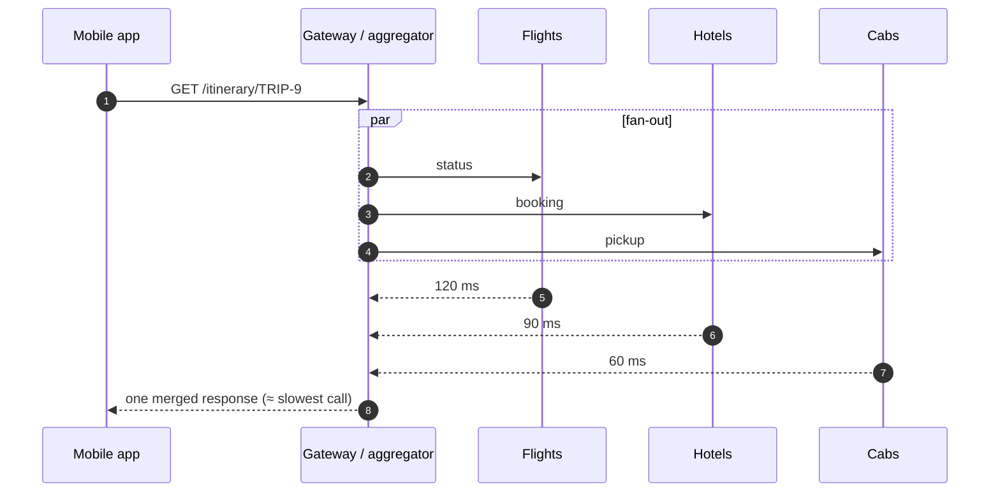
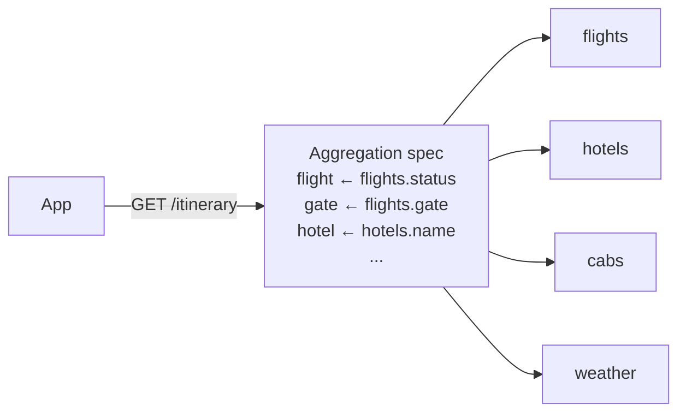
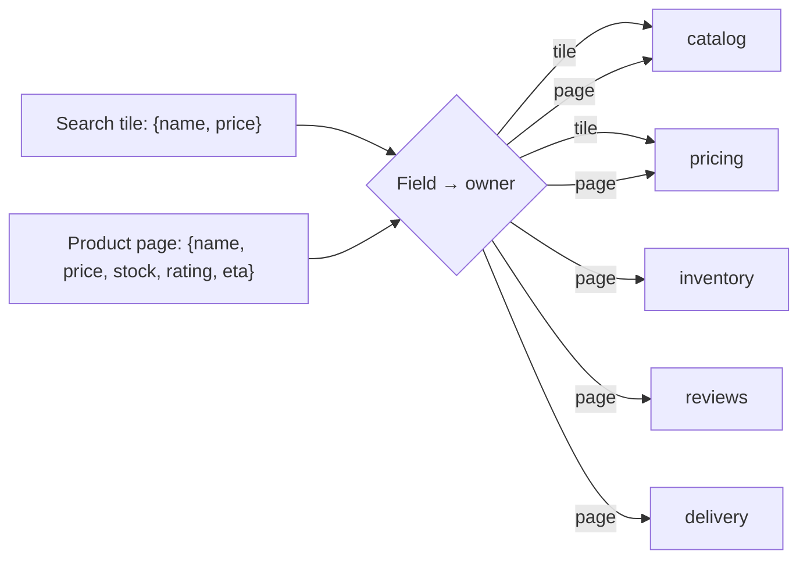

```mermaid
gantt
    dateFormat  x
    axisFormat  %L ms
    title Fan-out with an 800 ms budget
    section Insurers
    Suraksha General (220)   :0, 220
    Bharat Shield (640)      :0, 640
    Raksha Direct (410)      :0, 410
    Kavach Insure (1900, cut) :crit, 0, 800
    Monsoon Mutual (error)   :crit, 0, 150
```

---
tags:
  - Microservices
  - Intermediate
  - Communication
---

# Gateway Aggregation

<span class="badge badge--intermediate">🟡 Intermediate</span>
<span class="badge badge--category">Microservices</span>
<span class="badge badge--interview">Interview frequency ⭐⭐⭐⭐</span>

!!! abstract "TL;DR"
    **Gateway Aggregation combines several backend calls into one client request: the client asks once, the gateway fans out (in parallel where possible), merges the results and returns a single response, within a latency budget and with partial results when a backend is slow or down.**
    Use it when clients (especially mobile) would otherwise make many round trips. Keep it to composition: no business rules.

---

## See It in Motion

<iframe class="motion-embed" src="../../motion/index.html?p=gateway-aggregation&amp;embed=1" title="Animated walkthrough of the Gateway Aggregation pattern" loading="lazy"></iframe>

Press **Play** to watch the calls travel between components, or step through with **Next** and **Back**. Switch to **Without it** to see what goes wrong without the pattern, or press a **Break it** button to make something fail while the pattern is in place. [Open the full explorer with all 75 patterns](../motion/index.html#gateway-aggregation){ target=_blank }

## 1. Intent & Problem It Solves

**The problem in plain English:** a travel app's trip screen needs flight status, the hotel, the cab and the weather, from four services. On a 4G connection each round trip costs ~300 ms, so the screen takes over a second, drains the battery and breaks when any one call fails. Every client (iOS, Android, web) re-implements the same fan-out.

**Definition (Azure Architecture Center, *Gateway Aggregation pattern*):**
> Use a gateway to aggregate multiple individual requests into a single request. The gateway receives one request from the client, dispatches requests to the various backend systems, aggregates the results and sends them back to the requesting client.

**Where this page fits:** the [BFF](backend-for-frontend.md) page shows *who* owns aggregation (one backend per client experience). This page is about *how* to aggregate well: declarative composition, field-driven fan-out, latency budgets with partial results, and dependency-ordered calls.

## 2. Real-World Analogy

!!! example "A travel agent"
    Instead of calling the airline, the hotel, the cab company and checking the weather yourself, you call one travel agent who makes those calls in parallel and gives you one itinerary. If the cab company doesn't answer in time, the agent still sends the itinerary with "cab: to be confirmed", rather than making you wait all day.

## 3. Structure



| Participant | Responsibility |
|---|---|
| **Client** | One request per screen/use case |
| **Aggregator** (gateway, BFF, GraphQL server) | Fan-out, per-call timeouts, overall budget, merge, partial-result handling |
| **Backend services** | Own their data; unaware of aggregation |
| **Composition spec** | Which backends and fields make up the response (code or configuration) |

## 4. Naive Approach (Without the Pattern)

```kotlin
// Android client
val flight = api.flight(tripId)      // 300 ms
val hotel  = api.hotel(tripId)       // 300 ms
val cab    = api.cab(tripId)         // 300 ms
val wx     = api.weather(city)       // 300 ms  → 1.2 s, four failure points, repeated on iOS and web
```

- :material-close-circle:{ style="color:#e53935" } Latency adds up over slow networks.
- :material-close-circle:{ style="color:#e53935" } Each client duplicates orchestration and error handling.
- :material-close-circle:{ style="color:#e53935" } Internal service boundaries leak into public APIs.

---

## 5. Three Real-World Examples

### Example 1: Declarative Itinerary Composition (Travel)

**Scenario:** A travel app's trip screen combines four services. The API team keeps the composition in configuration ("`gate` comes from `flights.gate`"), so adding a field is a config change reviewed like code, and the gateway calls all four backends in parallel. Latency becomes the slowest backend (120 ms) instead of four mobile round trips.

**Design:**



**Full Code:**

=== "AggregationSpec.java"

    ```java
    --8<-- "code/microservices/src/main/java/com/handbook/microservices/aggregation/declarative/AggregationSpec.java"
    ```

    1.  Each backend is called **once**, in parallel: total latency is the **maximum**, not the sum.
    2.  The response shape is driven by **mappings**, not hand-written merging code.

=== "ItineraryDemo.java"

    ```java
    --8<-- "code/microservices/src/main/java/com/handbook/microservices/aggregation/declarative/ItineraryDemo.java"
    ```

=== "SimCall.java"

    ```java
    --8<-- "code/microservices/src/main/java/com/handbook/microservices/aggregation/core/SimCall.java"
    ```

**Output:**

```text
--8<-- "code/outputs/microservices/aggregation/declarative/ItineraryDemo.txt"
```

**Why aggregation here:**

- One round trip over the slow network; the fan-out happens on the fast data-centre network.
- Composition is visible, reviewable configuration.
- Backends stay unaware of the screen they serve.

---

### Example 2: Field-Driven Fan-Out (E-commerce)

**Scenario:** The search-results tile shows only name and price; the product page shows name, price, stock, rating and delivery ETA. The reviews service is slow (180 ms). With a fixed "product" endpoint, every search tile would wait for reviews it never displays. With GraphQL-style field selection, the aggregator calls only the backends that own the requested fields.

**Design:**



**Full Code:**

=== "FieldDrivenAggregator.java"

    ```java
    --8<-- "code/microservices/src/main/java/com/handbook/microservices/aggregation/fields/FieldDrivenAggregator.java"
    ```

    1.  Resolve each requested field to its **owning backend**; the set of backends to call is derived from the query. This is how GraphQL resolvers and Netflix's federated graph avoid over-fetching.

=== "ProductFieldsDemo.java"

    ```java
    --8<-- "code/microservices/src/main/java/com/handbook/microservices/aggregation/fields/ProductFieldsDemo.java"
    ```

**Output:**

```text
--8<-- "code/outputs/microservices/aggregation/fields/ProductFieldsDemo.txt"
```

**Why field-driven aggregation here:**

- Each screen pays only for the data it shows (30 ms vs 180 ms for search tiles).
- Fewer backend calls under load: search pages are 10× more common than product pages.
- One endpoint serves many screens without bespoke versions.

---

### Example 3: Latency Budget with Partial Results (Insurance)

**Scenario:** An insurance marketplace shows car-insurance quotes from 5 insurers. Most answer in under 700 ms; one partner API often takes 2 seconds; another sometimes errors. Product's rule: show the page within **800 ms** with whatever quotes are available, sorted by price, and list who's missing, rather than fail or make everyone wait for the slowest insurer.

**Design:**



**Full Code:**

=== "QuoteAggregator.java"

    ```java
    --8<-- "code/microservices/src/main/java/com/handbook/microservices/aggregation/budget/QuoteAggregator.java"
    ```

    1.  A failing backend becomes a **missing section**, not a failed page.
    2.  A backend slower than the budget is **cut off** (`completeOnTimeout` / `orTimeout` in real code).
    3.  The response time is bounded by the budget whenever anything is missing.

=== "QuotesDemo.java"

    ```java
    --8<-- "code/microservices/src/main/java/com/handbook/microservices/aggregation/budget/QuotesDemo.java"
    ```

**Output:**

```text
--8<-- "code/outputs/microservices/aggregation/budget/QuotesDemo.txt"
```

**Why a budget here:**

- The page's latency is decided by product, not by the slowest partner.
- Partial results are better than no results for comparison shopping.
- The "missing" list can drive a "more quotes loading" refresh or partner SLAs.

---

??? example "Unit Tests: `GatewayAggregationTest.java`"

    ```java
    --8<-- "code/microservices/src/test/java/com/handbook/microservices/GatewayAggregationTest.java"
    ```

## 6. Variations & Modern Java Take

=== "CompletableFuture with a budget (reference)"

    ```java
    var flights = supplyAsync(() -> flightsClient.status(tripId), vthreads).completeOnTimeout(Flight.UNKNOWN, 300, MILLISECONDS);
    var hotels  = supplyAsync(() -> hotelsClient.booking(tripId), vthreads).completeOnTimeout(Hotel.UNKNOWN, 300, MILLISECONDS);
    var cabs    = supplyAsync(() -> cabsClient.pickup(tripId), vthreads).exceptionally(e -> Cab.TO_BE_CONFIRMED);
    return CompletableFuture.allOf(flights, hotels, cabs)
            .thenApply(v -> new Itinerary(flights.join(), hotels.join(), cabs.join()));
    ```

=== "Spring for GraphQL (reference)"

    ```java
    @QueryMapping Product product(@Argument String id) { return catalog.product(id); }
    @SchemaMapping Rating rating(Product p) { return reviews.rating(p.id()); }   // called only if the query asks for rating
    @BatchMapping Map<Product, Stock> stock(List<Product> ps) { return inventory.stockFor(ps); }   // avoids N+1
    ```

| Variation | Notes |
|---|---|
| **Hand-written aggregator** | A BFF or gateway endpoint with `CompletableFuture`/virtual threads; full control |
| **GraphQL / federation** | Clients choose fields; resolvers fan out; `@BatchMapping`/DataLoader batch per request |
| **Declarative gateways** | KrakenD, Kong/Apigee policies, Spring Cloud Gateway with custom filters |
| **Structured concurrency** | `StructuredTaskScope` (preview in Java 21–25) gives clean cancellation of sibling calls |
| **Hedged requests** | Send a duplicate request to another replica if the first exceeds p95, to cut tail latency (idempotent reads only) |

## 7. Where It Lives in Real Frameworks

| Where | Aggregation |
|---|---|
| Spring | Spring for GraphQL (`@SchemaMapping`, `@BatchMapping`), Spring Cloud Gateway custom filters, WebFlux `Mono.zip` |
| GraphQL ecosystem | Apollo Federation, Netflix DGS, DataLoader |
| API gateways | KrakenD (merging backends), Kong and Apigee policies, AWS AppSync |
| JDK | `CompletableFuture.allOf`, `completeOnTimeout`, `orTimeout`; virtual threads |

## 8. Pros, Cons & Trade-offs

| ✅ Pros | ❌ Cons |
|---|---|
| One round trip for the client: lower latency, less battery | The aggregator is a new hop and a potential bottleneck |
| Centralised fan-out, timeouts and fallbacks | Couples the aggregator to many backends' APIs |
| Partial results instead of all-or-nothing | Risk of business logic creeping into the gateway |
| Hides internal service boundaries from public APIs | Harder to cache than single-resource endpoints |

## 9. Pitfalls & Anti-Patterns

!!! danger "Sequential calls in the aggregator"
    Calling backends one after another just moves the latency problem to the server. Parallelize everything that doesn't depend on something else (coding challenge).

!!! danger "No per-call timeouts"
    Without timeouts, the slowest backend sets the page's latency, and a hung backend exhausts the aggregator's threads.

!!! warning "Business rules in the gateway"
    Discount calculation or eligibility checks in aggregation code create a hidden monolith. Push rules into the owning service.

!!! warning "N+1 fan-out"
    Fetching ratings for 50 products with 50 calls. Use batch endpoints (`@BatchMapping`, DataLoader).

## 10. Senior / Architect Deep Dive (10–15 yrs)

**Latency math.** Parallel latency ≈ max(calls); with dependencies it's the **critical path**. Tail latency compounds: if each of 5 backends has a 1% chance of a 1-second response, the aggregate is slow ~5% of the time. Budgets, hedging and optional sections keep the tail under control.

**Failure semantics are a product decision.** For each section: required (fail the page), optional (omit with a marker), or stale-acceptable (serve cached). Write it down per endpoint and test each degraded mode.

**Ownership.** If one team owns a generic aggregation gateway for everyone, it becomes a bottleneck for every client change. Prefer BFFs owned by client teams, or GraphQL federation where each domain team owns its part of the schema.

!!! bug "War story: the home screen that waited for recommendations"
    A grocery app's home endpoint aggregated banners, orders, offers and recommendations, with no per-call timeouts. When the recommendations service degraded to 4-second responses, the whole home screen took 4 seconds; app-open conversion dropped 22% in an hour.
    **Fix:** 250 ms timeouts per optional section, recommendations made optional with a cached fallback, and a 600 ms overall budget.
    **Lesson:** an aggregator is only as fast as its slowest *required* dependency, so make most dependencies optional.

## 11. Related Patterns & Comparisons

| | Gateway Aggregation | BFF | API Composition | CQRS Read Model |
|---|---|---|---|---|
| Combines data | At request time | At request time, per client | At request time, inside a service | Ahead of time |
| Latency | Slowest call / critical path | Same | Same | One lookup |
| Freshness | Live | Live | Live | Event lag |

See [Backend for Frontend](backend-for-frontend.md), [API Gateway](api-gateway.md), [Database per Service](database-per-service.md) (API composition) and [Materialized View](materialized-view.md).

## 12. Interview Corner

=== "🟢 Beginner / Service Companies"

    **Q1. What is gateway aggregation?**

    The gateway combines several backend calls into one client request and returns a merged response.

    **Q2. Why is it useful for mobile apps?**

    Fewer round trips over slow networks: faster screens and less battery use.

    **Q3. Should calls be sequential or parallel?**

    Parallel, unless one call needs another's result.

    **Q4. What happens if one backend fails?**

    Return the rest with that section missing or defaulted, if it's optional.

    **Q5. Gateway aggregation vs BFF?**

    The BFF is one way to implement it: an aggregating backend owned by and tailored to one client type.

=== "🟡 Mid-Level"

    **Q1. How do you implement timeouts per call in Java?**

    `CompletableFuture.orTimeout` or `completeOnTimeout` with a fallback value; or client-level timeouts.

    **Q2. How does GraphQL relate?**

    Clients choose fields; resolvers fetch only what's needed, which is field-driven aggregation.

    **Q3. How do you avoid N+1 calls?**

    Batch endpoints and DataLoader/`@BatchMapping`.

    **Q4. How do you cache aggregated responses?**

    Cache per section (each backend's piece) rather than the whole response, or cache only optional sections.

    **Q5. How do you test degraded modes?**

    Contract tests per backend and tests that inject timeouts/errors for each section.

=== "🔴 Senior / FAANG / SAP"

    **Q1. "Design the home-screen API for 20M daily users."**

    BFF per platform; parallel fan-out with per-section timeouts; optional sections with cached fallbacks; overall budget; per-section metrics; CDN for static banners.

    **Q2. "How do you reduce tail latency?"**

    Budgets, hedged requests for idempotent reads, optional sections, caching, and removing the slowest dependency from the critical path.

    **Q3. "Aggregation vs precomputed read models?"**

    Aggregate live for freshness and low volume; precompute (materialized views) when the same composition is read very often or must survive backend outages.

    **Q4. "Who owns aggregation code?"**

    Client-facing teams (BFF) or domain teams via federated GraphQL subgraphs; avoid a central team bottleneck.

    **Q5. "How do you stop the aggregator becoming a monolith?"**

    No business rules, thin mapping only, contract tests, ownership per client, and moving shared logic into domain services.

=== "💻 Coding Challenge"

    **Problem:** The order-details page needs `order`, `customer`, `shipment` (needs order), `products` (needs order), `driver` (needs shipment) and `refundRules` (needs products and customer). Compute the fastest possible completion time if independent calls run in parallel.

    ??? success "Solution"

        === "DependencyAggregator.java"

            ```java
            --8<-- "code/microservices/src/main/java/com/handbook/microservices/aggregation/dag/DependencyAggregator.java"
            ```

        === "OrderPageDagDemo.java"

            ```java
            --8<-- "code/microservices/src/main/java/com/handbook/microservices/aggregation/dag/OrderPageDagDemo.java"
            ```

        **Output:**

        ```text
        --8<-- "code/outputs/microservices/aggregation/dag/OrderPageDagDemo.txt"
        ```

        **Key points to say:** each call starts when its last dependency finishes; total latency is the **critical path** (order → shipment → driver = 160 ms), not the sum (280 ms). In code: `thenCompose` for dependent calls, `allOf`/`thenCombine` for independent ones.

!!! info "Behavioural tie-in (STAR) for experienced candidates"
    - **S:** The app home screen took 4 s whenever recommendations degraded, and conversion dropped 22%.
    - **T:** Keep the home screen fast regardless of any single dependency.
    - **A:** Rebuilt the aggregator with parallel calls, 250 ms per-section timeouts, optional sections with cached fallbacks and a 600 ms overall budget; added per-section latency dashboards.
    - **R:** Home p99 fell from 4.1 s to 640 ms during the next recommendations incident; conversion was unaffected.

## 13. Quick Revision Card

!!! tip "Remember in 30 seconds"
    - **One client request → parallel fan-out → merged response.**
    - Latency = slowest call (or critical path), so parallelize and add timeouts.
    - Overall budget + optional sections = partial results, not failures.
    - Field-driven fan-out avoids over-fetching; batch to avoid N+1.
    - Composition only: no business rules.

    ```java
    allOf(a, b, c).thenApply(v -> merge(a.join(), b.join(), c.join()));
    ```

## Practice

- [ ] Add a cache fallback for the weather section in `ItineraryDemo`.
- [ ] Add hedging to `QuoteAggregator`: if an insurer exceeds 500 ms, count a second request to its backup endpoint at 300 ms.
- [ ] Rewrite `OrderPageDagDemo` with real `CompletableFuture`s on virtual threads.

---

[:material-arrow-left: Ambassador](ambassador.md){ .md-button }
[Next: Health Check :material-arrow-right:](health-check.md){ .md-button .md-button--primary }
