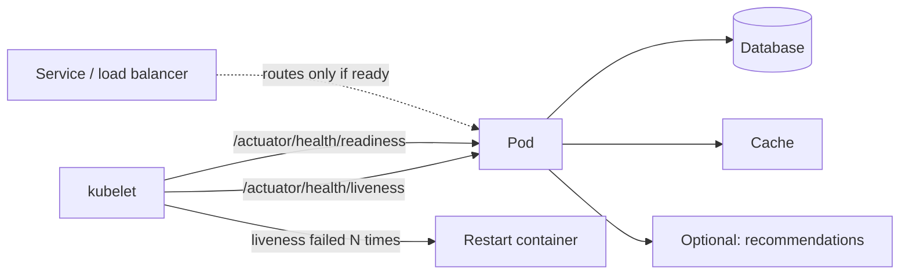
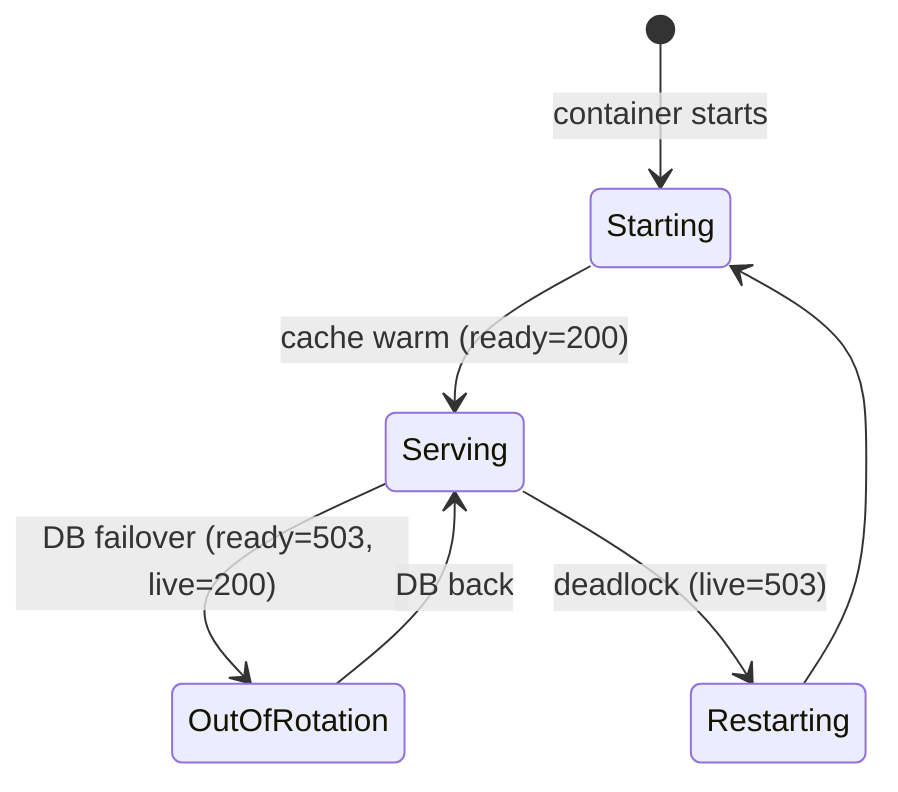
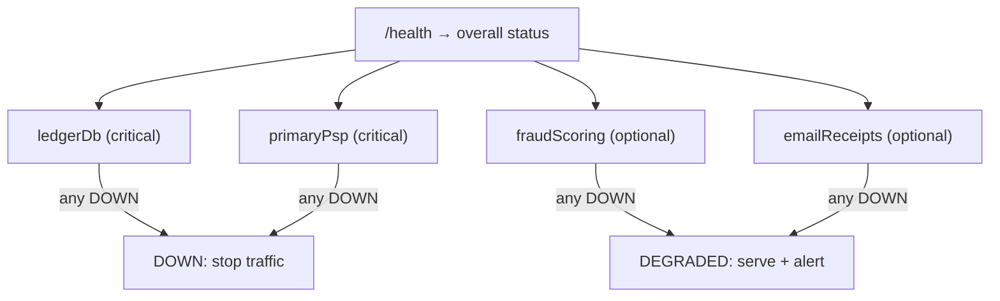
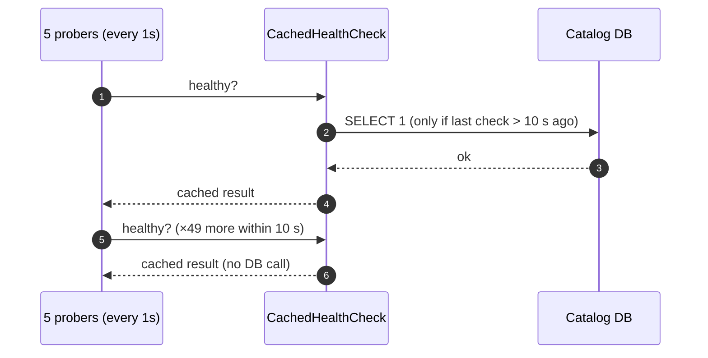

---
tags:
  - Microservices
  - Beginner
  - Operations
---

# Health Check (Liveness & Readiness)

<span class="badge badge--beginner">🟢 Beginner → 🟡 Intermediate</span>
<span class="badge badge--category">Microservices</span>
<span class="badge badge--interview">Interview frequency ⭐⭐⭐⭐⭐</span>

!!! abstract "TL;DR"
    **A service exposes health endpoints that the platform polls: *liveness* ("is this process broken and needs a restart?") and *readiness* ("can it take traffic right now?"). Load balancers route only to ready instances; orchestrators restart only non-live ones.**
    Every service needs both, and they must check **different** things: dependencies belong in readiness, never in liveness.

---

## See It in Motion

<iframe class="motion-embed" src="../../motion/index.html?p=health-check&amp;embed=1" title="Animated walkthrough of the Health Check pattern" loading="lazy"></iframe>

Press **Play** to watch the calls travel between components, or step through with **Next** and **Back**. [Open the full explorer with all 66 patterns](../motion/index.html#health-check){ target=_blank }

## 1. Intent & Problem It Solves

**The problem in plain English:** a pod is "running" but its thread pool is deadlocked, so it returns nothing and the load balancer keeps sending it customers. Another pod is still warming its cache and gets traffic too early, timing out the first thousand requests. And when the database blips, a naïve health check makes Kubernetes restart every pod at once, turning a 1-minute blip into a 5-minute outage.

**Definition (microservices.io, *Health Check API*):**
> A service has a health check API endpoint (e.g. `/health`) that returns the health of the service. A monitoring service, service registry or load balancer periodically invokes the endpoint to check the instance and route requests accordingly.

| Probe | Question | Failure means | Typical checks |
|---|---|---|---|
| **Liveness** | Is the process alive and making progress? | Restart the container | Event loop / thread pool responsive, no deadlock |
| **Readiness** | Should this instance receive traffic now? | Stop routing to it (no restart) | Started, caches warm, critical dependencies reachable, not overloaded |
| **Startup** | Has it finished starting? | Keep waiting (don't run liveness yet) | Initialization done |

## 2. Real-World Analogy

!!! example "A shop's lights and its OPEN sign"
    The lights being on tells you someone's inside (liveness). The OPEN sign tells you they're ready to serve (readiness). During stock-taking, the lights stay on but the sign is flipped to CLOSED; nobody calls an ambulance just because the shop is closed for an hour. If the shopkeeper collapses (deadlock), that's when you call for help (restart).

## 3. Structure



| Participant | Responsibility |
|---|---|
| **Health indicators** | One per component (DB, cache, broker, disk), each UP/DOWN with details |
| **Health groups** | Liveness and readiness are different groups of indicators |
| **Prober** | kubelet, load balancer, service registry, monitoring |
| **Policy** | Thresholds, periods, timeouts; what to do on failure (restart vs remove from rotation) |

## 4. Naive Approach (Without the Pattern)

```java
@GetMapping("/health")
public String health() {
    jdbcTemplate.queryForObject("SELECT 1", Integer.class);   // used for BOTH liveness and readiness
    restTemplate.getForObject("http://recommendations/health", String.class);  // optional dependency
    return "OK";
}
```

- :material-close-circle:{ style="color:#e53935" } A database blip fails liveness → every pod restarts → cold caches → longer outage.
- :material-close-circle:{ style="color:#e53935" } An optional dependency makes the whole service "unhealthy".
- :material-close-circle:{ style="color:#e53935" } Every probe from every prober hits the database.

---

## 5. Three Real-World Examples

### Example 1: Liveness vs Readiness Through a Pod's Life (Grocery)

**Scenario:** The grocery catalog service warms an in-memory cache of 200,000 SKUs for 40 seconds at startup. Later, the database fails over for 30 seconds. Later still, a bug deadlocks its worker pool. The probes must keep the cold pod out of rotation, keep pods alive (but out of rotation) during the failover, and restart only the deadlocked pod.

**Design:**



**Full Code:**

=== "GroceryProbes.java"

    ```java
    --8<-- "code/microservices/src/main/java/com/handbook/microservices/healthcheck/probes/GroceryProbes.java"
    ```

    1.  **Liveness** checks only the process itself. A restart can fix a deadlock; it can't fix the database.
    2.  **Readiness** includes dependencies and warm-up, because those decide whether *this instance should get requests now*.

=== "ProbesDemo.java"

    ```java
    --8<-- "code/microservices/src/main/java/com/handbook/microservices/healthcheck/probes/ProbesDemo.java"
    ```

**Output:**

```text
--8<-- "code/outputs/microservices/healthcheck/probes/ProbesDemo.txt"
```

**Why two probes here:**

- Cold pods never get traffic; they join only when ready.
- Dependency problems remove pods from rotation without restarting them.
- Genuine process failures still get the restart they need.

---

### Example 2: Composite Health by Criticality (Payments)

**Scenario:** A payment service depends on its ledger database and primary PSP (critical), plus a fraud-scoring service and an email-receipt service (optional, with fallbacks: rule-based fraud checks, receipts queued for later). The health endpoint must report **DEGRADED** when an optional dependency fails (still serving, but page the on-call) and **DOWN** only when a critical one fails.

**Design:**



**Full Code:**

=== "CompositeHealth.java"

    ```java
    --8<-- "code/microservices/src/main/java/com/handbook/microservices/healthcheck/composite/CompositeHealth.java"
    ```

    1.  Any **critical** component down makes the service DOWN (not ready).
    2.  An **optional** component down only degrades it: the service keeps serving with a fallback.

=== "PaymentsHealthDemo.java"

    ```java
    --8<-- "code/microservices/src/main/java/com/handbook/microservices/healthcheck/composite/PaymentsHealthDemo.java"
    ```

**Output:**

```text
--8<-- "code/outputs/microservices/healthcheck/composite/PaymentsHealthDemo.txt"
```

**Why composite health here:**

- Health reflects **business impact**, not just "is everything green".
- Optional failures don't take payments offline.
- Details per component speed up diagnosis (but restrict them to internal callers).

---

### Example 3: Cached Deep Checks (Streaming)

**Scenario:** A streaming catalog service runs 200 pods. Five probers (kubelet, load balancer, mesh, two monitors) hit each pod every second. If every probe ran `SELECT 1` against the catalog database, that's 60,000 extra queries a minute just for health. The deep check runs at most once every 10 seconds per pod; probes read the cached result.

**Design:**



**Full Code:**

=== "CachedHealthCheck.java"

    ```java
    --8<-- "code/microservices/src/main/java/com/handbook/microservices/healthcheck/cached/CachedHealthCheck.java"
    ```

    1.  The expensive check runs only when the cached result is older than the interval; probes always get an instant answer.

=== "CachedHealthDemo.java"

    ```java
    --8<-- "code/microservices/src/main/java/com/handbook/microservices/healthcheck/cached/CachedHealthDemo.java"
    ```

**Output:**

```text
--8<-- "code/outputs/microservices/healthcheck/cached/CachedHealthDemo.txt"
```

**Why caching here:**

- Health checks must never become a load problem for the dependencies they check.
- Probe responses stay fast (well under the probe timeout).
- In production, run the check on a background schedule and have probes only read the result.

---

??? example "Unit Tests: `HealthCheckTest.java`"

    ```java
    --8<-- "code/microservices/src/test/java/com/handbook/microservices/HealthCheckTest.java"
    ```

## 6. Variations & Modern Java Take

=== "application.yml (reference)"

    ```yaml
    management:
      endpoint:
        health:
          probes.enabled: true            # /actuator/health/liveness and /readiness
          show-details: when-authorized
          group:
            readiness:
              include: readinessState, db, redis, kafka   # dependencies go here
            liveness:
              include: livenessState                      # NOT db
      health:
        circuitbreakers.enabled: true
    ```

=== "Kubernetes probes (reference)"

    ```yaml
    startupProbe:   { httpGet: { path: /actuator/health/liveness,  port: 8080 }, periodSeconds: 5,  failureThreshold: 24 }  # up to 2 min to start
    livenessProbe:  { httpGet: { path: /actuator/health/liveness,  port: 8080 }, periodSeconds: 10, failureThreshold: 3 }
    readinessProbe: { httpGet: { path: /actuator/health/readiness, port: 8080 }, periodSeconds: 5,  failureThreshold: 2 }
    ```

| Variation | Notes |
|---|---|
| **Custom `HealthIndicator`** | `@Component class PspHealth implements HealthIndicator { Health health() { ... } }` |
| **Availability state** | `AvailabilityChangeEvent.publish(ctx, ReadinessState.REFUSING_TRAFFIC)` during shutdown or maintenance |
| **Graceful shutdown** | `server.shutdown=graceful`: readiness goes down first, in-flight requests finish |
| **gRPC health protocol** | `grpc.health.v1.Health/Check`, supported by Kubernetes `grpc` probes |
| **Synthetic checks** | External probes that run a real user journey (search → add to cart) |

## 7. Where It Lives in Real Frameworks

| Where | Health checks |
|---|---|
| Spring Boot Actuator | `/actuator/health`, health groups, `HealthIndicator`, `ApplicationAvailability`, probe endpoints on Kubernetes |
| Kubernetes | `livenessProbe`, `readinessProbe`, `startupProbe`; readiness gates |
| Load balancers | AWS ALB target-group health checks, Envoy active/passive health checking (outlier detection) |
| Service registries | Consul checks, Eureka heartbeats |
| MicroProfile | `@Liveness`, `@Readiness`, `@Startup` health checks |

## 8. Pros, Cons & Trade-offs

| ✅ Pros | ❌ Cons |
|---|---|
| Automatic recovery from stuck processes | Wrong probe design causes restart storms |
| Traffic only reaches instances that can serve it | Probes add load if they do deep checks |
| Zero-downtime deploys and graceful shutdown | Health "green" doesn't guarantee correct behaviour |
| Clear operational signal per component | Details endpoints can leak internals if exposed publicly |

## 9. Pitfalls & Anti-Patterns

!!! danger "Dependencies in liveness"
    If the database is down, restarting every pod can't fix it; it just adds cold starts, connection storms and longer recovery (coding challenge). Put dependencies in readiness.

!!! danger "Shared dependency failing every pod's readiness"
    If *all* pods depend on the same database, readiness also drops *all* of them, and the service returns load-balancer errors instead of graceful ones. For a shared hard dependency, consider staying ready and serving a degraded response or fast 503s with a clear message.

!!! warning "No startup probe for slow starters"
    Without one, liveness kills slow-starting JVMs before they finish booting: crash loop.

!!! warning "Exposing health details publicly"
    `show-details: always` on a public endpoint reveals versions, hosts and dependency names. Restrict details to authenticated or internal callers.

## 10. Senior / Architect Deep Dive (10–15 yrs)

**Readiness is a load-shedding tool.** Failing readiness under overload (queue too deep, latency too high) moves traffic to healthier pods. But if every pod reaches the same state, readiness empties the pool: combine it with [backpressure](backpressure.md) and autoscaling instead of relying on it alone.

**Liveness should be boring.** The most useful liveness checks detect conditions only a restart fixes: deadlocked worker pools, a stuck event loop, an exhausted heap that GC can't recover. If you can't name such a condition, a basic "process responds" check is enough.

**Health ≠ correctness.** A service can be green and serving wrong prices. Pair probes with SLO-based alerting on real traffic (error rate, latency, business KPIs) and synthetic journeys.

!!! bug "War story: the database blip that became a 12-minute outage"
    A payments platform's liveness probe ran `SELECT 1`. A 70-second database failover failed liveness on all 60 pods; Kubernetes restarted them together. Each JVM took 50 seconds to start and then opened 40 connections at once, overloading the freshly promoted database. Pods failed liveness again. The cycle lasted 12 minutes.
    **Fix:** liveness = process only; readiness = DB + PSP; a startup probe for the JVM boot; connection-pool warm-up with jitter.
    **Lesson:** restarts fix processes, not dependencies.

## 11. Related Patterns & Comparisons

| | Health Check | Circuit Breaker | Service Discovery | Distributed Tracing |
|---|---|---|---|---|
| Who decides | Platform (prober) | Caller | Registry / LB | Humans / tools |
| Signal | Endpoint status | Observed call failures | Registration + health | Request spans |
| Action | Restart / remove from rotation | Fail fast, fallback | Route to healthy instances | Diagnose |

See [Service Discovery](service-discovery.md), [Circuit Breaker](circuit-breaker.md), [Deployment Strategies](deployment-strategies.md) (rollouts rely on readiness).

## 12. Interview Corner

=== "🟢 Beginner / Service Companies"

    **Q1. What is a health check?**

    An endpoint that reports whether a service instance is healthy, polled by load balancers and orchestrators.

    **Q2. Liveness vs readiness?**

    Liveness: should the process be restarted? Readiness: should it receive traffic now?

    **Q3. What does Spring Boot provide?**

    Actuator's `/actuator/health` with `liveness` and `readiness` groups and built-in indicators (DB, Redis, Kafka, disk).

    **Q4. What happens when readiness fails in Kubernetes?**

    The pod is removed from the Service's endpoints; it is not restarted.

    **Q5. What is a startup probe?**

    A probe that gives slow-starting apps time to boot before liveness checks begin.

=== "🟡 Mid-Level"

    **Q1. Why not check the database in liveness?**

    A DB outage would restart every pod, which can't fix the DB and slows recovery.

    **Q2. How do you write a custom health indicator?**

    Implement `HealthIndicator` (or `ReactiveHealthIndicator`) and return `Health.up()/down().withDetail(...)`.

    **Q3. How does readiness support graceful shutdown?**

    On SIGTERM, readiness flips to refusing traffic, the load balancer drains the pod, then in-flight requests finish.

    **Q4. How do you avoid probes overloading dependencies?**

    Cache deep checks, run them on a schedule, and keep probes cheap.

    **Q5. What's DEGRADED?**

    A status meaning the service works but with reduced functionality (an optional dependency is down).

=== "🔴 Senior / FAANG / SAP"

    **Q1. "Design health checks for a service with one critical shared database."**

    Liveness = process only; readiness = warm-up + DB with a short cached check; on DB outage, consider staying ready and failing fast with explicit errors so the platform doesn't empty the pool; alert on SLOs.

    **Q2. "Probes passed but customers saw errors. Why?"**

    Health checks test the wrong thing (shallow), or a dependency path not covered; add SLO alerts and synthetic journeys.

    **Q3. "How do health checks interact with autoscaling and rollouts?"**

    Rollouts wait for readiness before shifting traffic; autoscaling should use load metrics, not health.

    **Q4. "Passive vs active health checking?"**

    Active = probes; passive = observing real traffic (Envoy outlier detection ejecting hosts with 5xx bursts). Use both.

    **Q5. "What should never be in a health endpoint?"**

    Expensive queries, calls to optional services in liveness, secrets or sensitive details on public routes.

=== "💻 Coding Challenge"

    **Problem:** Simulate 20 pods, a 45-second startup and a liveness probe (every 10 s, 3 failures to restart) during a 100-second database outage. Compare putting the database check in liveness vs readiness.

    ??? success "Solution"

        === "RestartStormDemo.java"

            ```java
            --8<-- "code/microservices/src/main/java/com/handbook/microservices/healthcheck/storm/RestartStormDemo.java"
            ```

        **Output:**

        ```text
        --8<-- "code/outputs/microservices/healthcheck/storm/RestartStormDemo.txt"
        ```

        **Key points to say:** with the DB in liveness, every pod restarts, twice, and when the database comes back no pod can serve because they're all still booting. With the DB only in readiness, pods stay warm and serve as soon as the database returns.

!!! info "Behavioural tie-in (STAR) for experienced candidates"
    - **S:** A 70-second DB failover turned into a 12-minute outage because liveness checked the database.
    - **T:** Make dependency failures recover as fast as the dependency.
    - **A:** Split probes (liveness = process, readiness = DB/PSP with cached checks), added startup probes and graceful shutdown, and jittered connection-pool warm-up.
    - **R:** The next failover caused 75 seconds of degraded service and zero restarts.

## 13. Quick Revision Card

!!! tip "Remember in 30 seconds"
    - **Liveness → restart; readiness → stop traffic; startup → wait.**
    - Dependencies in **readiness**, never liveness.
    - Critical vs optional: DOWN vs DEGRADED.
    - Cache deep checks; keep probes cheap and fast.
    - Green health ≠ correct: also alert on SLOs.

    ```yaml
    management.endpoint.health.group.readiness.include: readinessState, db, redis
    ```

## Practice

- [ ] Add a "queue too deep" condition to readiness in `GroceryProbes`.
- [ ] Make `CachedHealthCheck` run on a background scheduler instead of on probe calls.
- [ ] Add `startupProbe` behaviour to `RestartStormDemo` and show liveness no longer kills booting pods.

---

[:material-arrow-left: Gateway Aggregation](gateway-aggregation.md){ .md-button }
[Next: Deployment Strategies :material-arrow-right:](deployment-strategies.md){ .md-button .md-button--primary }
