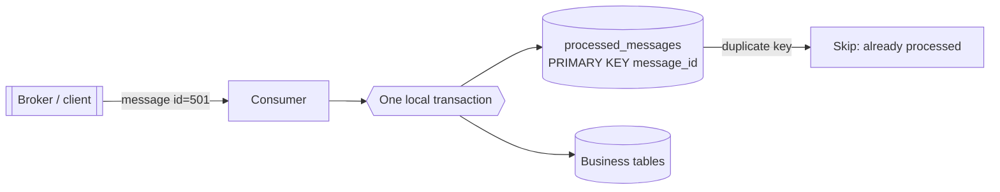
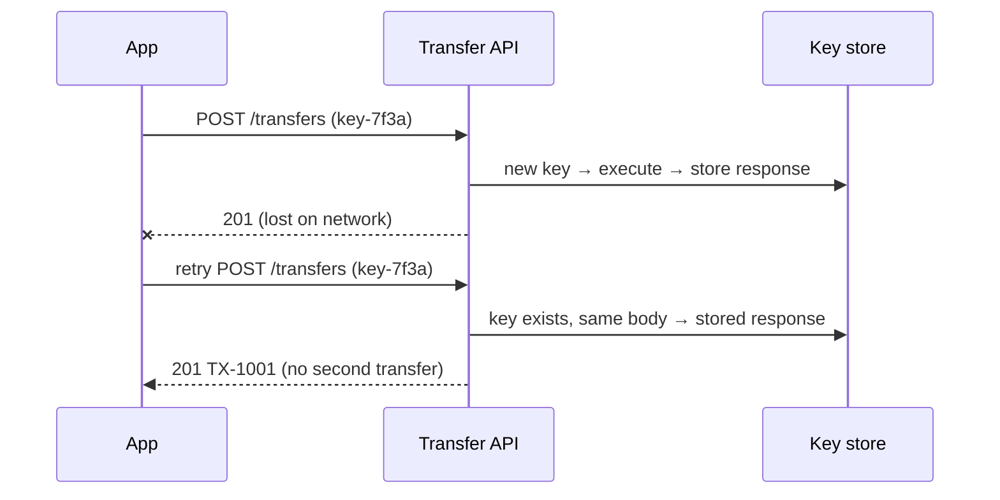

---
tags:
  - Microservices
  - Intermediate
  - Data
---

# Idempotent Consumer

<span class="badge badge--intermediate">🟡 Intermediate</span>
<span class="badge badge--category">Microservices</span>
<span class="badge badge--interview">Interview frequency ⭐⭐⭐⭐⭐</span>

!!! abstract "TL;DR"
    **Message brokers and clients deliver at-least-once, so the same message or request will arrive more than once. An idempotent consumer makes processing a duplicate harmless, typically by recording processed message IDs (or idempotency keys) in the same transaction as the side effect.**
    At-least-once delivery plus idempotent processing gives an **exactly-once effect**.

---

## 1. Intent & Problem It Solves

**The problem in plain English:** a Kafka consumer credits ₹199 to a wallet and crashes before committing its offset; on restart it gets the message again and credits again. A mobile app's "Pay" request times out on a bad network; the app retries; the customer is charged twice. A courier app sends "out for delivery" twice; the customer gets two SMS. Duplicates are **normal** in distributed systems:

| Source of duplicates | Example |
|---|---|
| Consumer crash/rebalance before offset commit | Kafka redelivers the batch |
| Producer retries | Outbox relay republishes after a crash |
| Client retries after a timeout | The first request actually succeeded |
| Upstream bugs | Partner sends the same webhook twice |

**Definition (microservices.io):**
> Implement an idempotent consumer, which is a message consumer that can handle duplicate messages correctly.

## 2. Real-World Analogy

!!! example "A doorman with a guest list"
    Each guest's invitation has a number. When a guest arrives, the doorman ticks the number off. If someone arrives again with the same invitation (they stepped out and came back), the doorman sees the tick and doesn't hand them a second welcome gift.

## 3. Structure



| Technique | How |
|---|---|
| **Processed-message table** | Insert message ID with a unique constraint in the same transaction as the effect |
| **Idempotency key** (APIs) | Client sends a unique key; server stores the response and replays it for retries |
| **Natural idempotency** | Design operations to be idempotent: "set status = SHIPPED" vs. "add 1" |
| **Version / sequence checks** | Apply only if the event's version is newer than the stored one |
| **TTL dedupe cache** | Remember keys for a window (Redis `SET NX EX`) when occasional duplicates are tolerable |

## 4. Naive Approach (Without the Pattern)

```java
@KafkaListener(topics = "refunds")
void on(RefundIssued e) {
    if (!processedIds.contains(e.id())) {   // check...
        wallet.credit(e.customer(), e.amount());
        processedIds.add(e.id());           // ...then act, in memory, outside the DB transaction
    }
}
// Crash between credit and add → duplicate credit after restart.
// Two instances processing concurrently → both pass the check.
```

---

## 5. Three Real-World Examples

### Example 1: Wallet Credits with a Processed-Messages Table (Grocery)

**Scenario:** Refund messages credit a customer's wallet. Each message's ID is inserted into `processed_messages` (primary key) **in the same JDBC transaction** as the credit (real H2 database). A redelivered message violates the key, the transaction rolls back, and the duplicate is acknowledged without effect.

**Full Code:**

=== "WalletCreditConsumer.java"

    ```java
    --8<-- "code/microservices/src/main/java/com/handbook/microservices/idempotency/wallet/WalletCreditConsumer.java"
    ```

    1.  The **unique constraint** is the guard: the database enforces it even across instances and threads.
    2.  Inserting the ID **first** means a duplicate fails before any business change.
    3.  ID and effect **commit together**. A crash before commit means neither happened, so the redelivery is processed normally.

=== "WalletDedupeDemo.java"

    ```java
    --8<-- "code/microservices/src/main/java/com/handbook/microservices/idempotency/wallet/WalletDedupeDemo.java"
    ```

**Output:**

```text
--8<-- "code/outputs/microservices/idempotency/wallet/WalletDedupeDemo.txt"
```

**Why this design:**

- Correct under crashes, rebalances and multiple instances.
- Cheap: one extra insert per message; old IDs can be purged after the broker's redelivery window.

---

### Example 2: Idempotency-Key for a Transfer API (Banking)

**Scenario:** The mobile app sends `POST /transfers` with an `Idempotency-Key`. The response is lost on a flaky network; the app retries with the **same key** and gets the **same response** (TX-1001), so only one transfer is executed. Reusing the key with a different amount is a client bug and returns `422`.

**Design:**



**Full Code:**

=== "IdempotencyKeyStore.java"

    ```java
    --8<-- "code/microservices/src/main/java/com/handbook/microservices/idempotency/apikey/IdempotencyKeyStore.java"
    ```

    1.  A **fingerprint** of the request detects key reuse with a different body. Production code uses SHA-256 of the canonical body.
    2.  Same key, different request: reject (`422`) rather than guessing.
    3.  A retry gets the **original** response, including the original transfer ID.

=== "TransferApiDemo.java"

    ```java
    --8<-- "code/microservices/src/main/java/com/handbook/microservices/idempotency/apikey/TransferApiDemo.java"
    ```

**Output:**

```text
--8<-- "code/outputs/microservices/idempotency/apikey/TransferApiDemo.txt"
```

**Why idempotency keys here:**

- Clients can **safely retry** POSTs, which is essential on mobile networks.
- Payment providers (Stripe, Adyen and others) expose exactly this contract.

---

### Example 3: Time-Window Dedupe for SMS (Food delivery)

**Scenario:** Status updates arrive from courier apps, sometimes twice within seconds. The notification service remembers `orderId:status` keys for **24 hours** (Redis `SET key 1 NX EX 86400`), so customers get one SMS per status. Memory stays bounded because keys expire.

**Full Code:**

=== "SmsDeduplicator.java"

    ```java
    --8<-- "code/microservices/src/main/java/com/handbook/microservices/idempotency/notifications/SmsDeduplicator.java"
    ```

    1.  **Expire** old keys, so memory is bounded by traffic within the window.
    2.  **Set-if-absent** is atomic, so concurrent duplicates can't both pass.

=== "SmsDedupeDemo.java"

    ```java
    --8<-- "code/microservices/src/main/java/com/handbook/microservices/idempotency/notifications/SmsDedupeDemo.java"
    ```

**Output:**

```text
--8<-- "code/outputs/microservices/idempotency/notifications/SmsDedupeDemo.txt"
```

**Why a TTL window here:**

- A duplicate SMS a day later is unlikely and harmless; a permanent table of every notification key isn't worth it.
- Choose the window from how late duplicates can realistically arrive.

---

??? example "Unit Tests: `IdempotentConsumerTest.java`"

    ```java
    --8<-- "code/microservices/src/test/java/com/handbook/microservices/IdempotentConsumerTest.java"
    ```

## 6. Variations & Modern Java Take

```java
// Spring Kafka + JDBC (reference): the dedupe insert and the effect share @Transactional
@KafkaListener(topics = "payments.refunds", groupId = "wallet")
@Transactional
public void on(ConsumerRecord<String, String> record) {
    String messageId = new String(record.headers().lastHeader("message-id").value(), UTF_8);
    try {
        jdbc.update("INSERT INTO processed_messages (message_id) VALUES (?)", messageId);
    } catch (DuplicateKeyException duplicate) {
        return;                                     // already processed: ack and move on
    }
    jdbc.update("UPDATE wallets SET balance = balance + ? WHERE customer = ?", amount, customer);
}
```

| Variation | Notes |
|---|---|
| **Kafka exactly-once (EOS)** | Transactions across consume → produce within Kafka; doesn't cover external DB side effects |
| **Upsert by business key** | `INSERT ... ON CONFLICT DO NOTHING` on `(order_id, event_type)` |
| **Version check** | `UPDATE ... WHERE version < :eventVersion` (see the replica in [Database per Service](database-per-service.md)) |
| **Transactional inbox** | Store incoming messages first, process from the inbox table |

## 7. Where It Lives in Real Frameworks

| Where | Idempotency |
|---|---|
| Stripe, Adyen, PayPal APIs | `Idempotency-Key` headers on POST |
| Spring Integration | `IdempotentReceiverInterceptor` with a `MetadataStore` |
| Apache Camel | Idempotent Consumer EIP with JDBC/Redis repositories |
| Kafka | Idempotent producer (`enable.idempotence=true`) prevents producer-side duplicates |
| AWS Lambda Powertools | Idempotency utility backed by DynamoDB |

## 8. Pros, Cons & Trade-offs

| ✅ Pros | ❌ Cons |
|---|---|
| **Exactly-once effect** on at-least-once infrastructure | Extra storage and write per message |
| Safe retries everywhere (clients, relays, consumers) | Requires a stable message ID / key from producers |
| Simple, database-enforced correctness | Dedupe tables need retention/purging |
| Enables aggressive retry policies | TTL-based dedupe can miss very late duplicates |

## 9. Pitfalls & Anti-Patterns

!!! danger "Dedupe outside the transaction"
    Recording the ID in Redis and the effect in Postgres (or in memory) creates a crash window between them. Store the ID **in the same database transaction** as the effect, or make the effect itself idempotent.

!!! danger "Using the payload hash as the ID"
    Two legitimate refunds of ₹199 to the same customer have identical payloads. Use a producer-assigned unique ID.

!!! warning "Check-then-act in application code"
    `if (!exists(id)) process()` races between concurrent consumers. Let a unique constraint or atomic `SET NX` decide (see the coding challenge).

!!! warning "Idempotent handler, non-idempotent side calls"
    The handler dedupes, but it also calls an email API before the commit. On retry after a crash, the email is sent again. Move side effects to the outbox or make them idempotent too.

## 10. Senior / Architect Deep Dive (10–15 yrs)

**Exactly-once is a property of the whole pipeline.** Producer: idempotent producer or outbox with stable IDs. Broker: at-least-once. Consumer: dedupe in the same transaction as effects; external calls with idempotency keys. Any non-idempotent link breaks the chain.

**Retention.** Keep processed IDs at least as long as duplicates can arrive: broker retention plus your maximum replay window. For replays of months of history, use version checks instead of ID tables.

**API idempotency at scale.** Store keys with status (`IN_PROGRESS`, `COMPLETED` + response), scope them per client, expire after 24–72 h, and return `409` for concurrent in-progress requests with the same key.

### Production checklist

- [ ] Every message has a **unique, stable ID** assigned by the producer.
- [ ] Consumers insert the ID with a unique constraint **in the same transaction** as the effect.
- [ ] POST APIs that create money movements accept `Idempotency-Key`; responses are stored and replayed.
- [ ] Side effects (emails, partner calls) go through the outbox or carry idempotency keys.
- [ ] Retention/purge policy for dedupe tables; metrics on duplicate rate.
- [ ] Tests that deliver every message twice, and concurrently.

### Explain it in 2 minutes (system design round)

> "I assume at-least-once delivery everywhere. Producers give every event a unique ID through the outbox. Each consumer, in the same database transaction as its side effect, inserts that ID into a `processed_messages` table with a primary key, so duplicates fail the insert and are skipped, even across instances. Client-facing POST endpoints that move money accept an `Idempotency-Key`; we store the response and replay it on retries, and reject reuse with a different body. Where possible, operations are naturally idempotent: set-state and versioned upserts instead of increments."

!!! bug "War story: the double payout"
    A gig-economy platform paid drivers via a Kafka consumer that called the bank's payout API and then committed offsets. A deploy restarted consumers mid-batch; 2,300 payouts were sent again. Drivers were happy; finance spent three weeks recovering the money.
    **Fix:** payouts recorded in a `payouts` table with a unique `(driver_id, period)` key **before** calling the bank; the bank call uses the payout ID as its idempotency key; the consumer skips periods already recorded.
    **Lesson:** "we'll commit the offset right after" is not a strategy. Make the effect idempotent.

## 11. Related Patterns & Comparisons

| | Idempotent Consumer | Transactional Outbox | Kafka EOS | Saga |
|---|---|---|---|---|
| Side | Consumer | Producer | Kafka-to-Kafka | Workflow |
| Solves | Duplicate processing | Lost/phantom events | Duplicates within Kafka | Cross-service consistency |
| Combined as | Outbox + idempotent consumer = exactly-once effect | | | Saga steps must be idempotent |

See [Transactional Outbox](transactional-outbox.md), [Saga](saga.md) and [Retry / Timeout / Bulkhead](retry-timeout-bulkhead.md).

## 12. Interview Corner

=== "🟢 Beginner / Service Companies"

    **Q1. What does idempotent mean?**

    Doing an operation once or many times has the **same effect**. `GET`, `PUT` and `DELETE` are idempotent in HTTP; `POST` usually isn't.

    **Q2. Why do duplicate messages happen?**

    Brokers deliver at-least-once: consumer crashes, rebalances, producer retries and network timeouts all cause redelivery.

    **Q3. How do you make a consumer idempotent?**

    Store processed message IDs (unique constraint) in the same transaction as the business change, and skip IDs already seen.

    **Q4. What is an idempotency key?**

    A unique value the client sends with a request (e.g. `Idempotency-Key` header) so the server can recognise retries and return the original result.

    **Q5. Is `balance = balance + 100` idempotent?**

    No. Applying it twice adds 200. `status = 'SHIPPED'` is idempotent.

=== "🟡 Mid-Level"

    **Q1. Why must the dedupe record be in the same transaction?**

    Otherwise a crash between recording and applying (or vice versa) loses the effect or applies it twice.

    **Q2. What does Kafka's exactly-once semantics cover?**

    Atomic consume-transform-produce **within Kafka** (transactions + idempotent producer). It doesn't make external side effects (DB writes outside Kafka, HTTP calls) exactly-once.

    **Q3. How long do you keep processed IDs?**

    At least as long as duplicates can arrive: broker retention plus any replay window. Purge older ones.

    **Q4. How do you handle concurrent duplicates?**

    Rely on an atomic database constraint or `SET NX`, not on check-then-act code.

    **Q5. How do you test idempotency?**

    Deliver each message twice (and concurrently) in tests, and assert the state is the same as with one delivery.

=== "🔴 Senior / FAANG / SAP"

    **Q1. "Design idempotency for a payments API used by mobile apps."**

    Client-generated UUID keys; server table `(client_id, key)` unique with status and stored response; `IN_PROGRESS` row inserted first (concurrent retry → 409); request fingerprint check (422 on mismatch); 24–72 h expiry; downstream bank calls use the payment ID as their idempotency key.

    **Q2. "Exactly-once end to end: is it possible?"**

    Not as delivery; yes as **effect**: idempotent producers/outbox + at-least-once broker + idempotent consumers + idempotent external calls.

    **Q3. "Your dedupe table has 5 billion rows. Options?"**

    Partition by time and drop old partitions; shorter retention with version checks for older replays; key by business key instead of message ID; or move to a TTL store for low-risk effects.

    **Q4. "Events can arrive out of order and duplicated. How do you design the consumer?"**

    Version per aggregate, apply only newer versions (stale ones are skipped, duplicates are naturally ignored), buffer or reprocess on gaps if order matters.

    **Q5. "Which operations would you make naturally idempotent?"**

    State transitions with guards (`UPDATE ... SET status='SHIPPED' WHERE status='PACKED'`), upserts by business key, set-membership operations, and absolute values instead of deltas where the domain allows.

=== "💻 Coding Challenge"

    **Problem:** The same refund message is processed by **8 threads at the same moment**. Show that exactly one applies it, and explain why an in-memory "processed?" check wouldn't be enough.

    ??? success "Solution"

        === "ConcurrentDuplicatesDemo.java"

            ```java
            --8<-- "code/microservices/src/main/java/com/handbook/microservices/idempotency/concurrent/ConcurrentDuplicatesDemo.java"
            ```

        **Output:**

        ```text
        --8<-- "code/outputs/microservices/idempotency/concurrent/ConcurrentDuplicatesDemo.txt"
        ```

        **Key points to say:** the unique key makes the database the arbiter: the first insert wins, and the others block on the row lock, then fail with SQLState `23505` and roll back. A check-then-act in Java would let several threads see "not processed" before any of them records it.

!!! info "Behavioural tie-in (STAR) for experienced candidates"
    - **S:** Customers occasionally received two loyalty-point credits after our Kafka consumers rebalanced during deploys.
    - **T:** Eliminate duplicate effects without changing the broker setup.
    - **A:** Added producer-assigned event IDs via the outbox, a `processed_messages` table written in the same transaction as point credits, and a test harness that redelivers every message twice in CI.
    - **R:** Duplicate credits went to zero; we then safely enabled more aggressive retries, cutting failed-credit tickets by 70%.

## 13. Quick Revision Card

!!! tip "Remember in 30 seconds"
    - Delivery is **at-least-once**; make effects **idempotent**.
    - Message ID + **unique constraint** in the **same transaction** as the effect.
    - APIs: `Idempotency-Key`, stored response, 422 on mismatch, 409 while in progress.
    - Prefer naturally idempotent operations (set state, versioned upserts).
    - Outbox (producer) + idempotent consumer = exactly-once effect.

## Practice

- [ ] Add an `IN_PROGRESS` state to `IdempotencyKeyStore` and return 409 for concurrent requests with the same key.
- [ ] Purge `processed_messages` rows older than 7 days in `WalletCreditConsumer`.
- [ ] Rewrite the wallet credit as a naturally idempotent operation keyed by refund ID (a `wallet_entries` table).

---

[:material-arrow-left: Sidecar / Service Mesh](sidecar-service-mesh.md){ .md-button }
[Next: Distributed Tracing :material-arrow-right:](distributed-tracing.md){ .md-button .md-button--primary }
