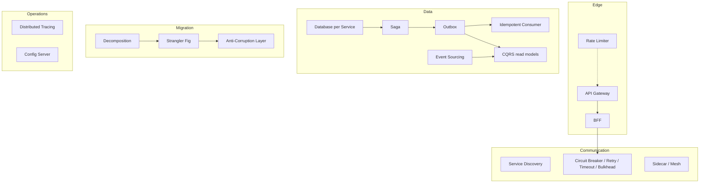

# Microservices Patterns

Microservices patterns solve the problems that appear when one application becomes **many independently deployed services**: how to split it, how clients reach it, how services find and call each other safely, how data stays consistent without shared transactions, how to migrate from a monolith, and how to see what's going on.

Every page has **three real-world examples from different industries** (grocery, banking, travel, healthcare, streaming, ride-hailing, insurance, logistics), full code, real output, a coding challenge, and a "system design round" answer.

!!! info "How the code runs"
    The examples are **plain Java 21 simulations** of distributed systems, so you can run every one in milliseconds with `./run-demos.sh`, with no Docker, Kafka or Kubernetes needed. Time is controlled with a `FakeClock`, randomness is seeded, and databases are real **H2** in-memory databases with real JDBC transactions.
    Where the production version uses Spring Boot (Resilience4j, Spring Kafka, JdbcTemplate, Micrometer Tracing, `@ConfigurationProperties`), the page shows a class from the `spring-reference` module. **CI compiles that module, but it isn't run**, because it needs real infrastructure. YAML snippets for Spring Cloud Gateway, Istio and similar tools are references and are labelled as such.

## Patterns in this section

| Pattern | Problem it solves | Interview frequency | Status |
|---|---|---|---|
| [Decomposition (DDD)](decomposition.md) | Where to draw service boundaries | ⭐⭐⭐⭐⭐ | ✅ |
| [API Gateway](api-gateway.md) | One entry point; auth, rate limits, routing at the edge | ⭐⭐⭐⭐⭐ | ✅ |
| [Backend for Frontend](backend-for-frontend.md) | One backend per client experience | ⭐⭐⭐⭐ | ✅ |
| [Service Discovery](service-discovery.md) | Finding healthy instances that come and go | ⭐⭐⭐⭐ | ✅ |
| [Circuit Breaker](circuit-breaker.md) | Stop calling a failing dependency; fail fast with fallbacks | ⭐⭐⭐⭐⭐ | ✅ |
| [Retry / Timeout / Bulkhead](retry-timeout-bulkhead.md) | Survive blips, bound waiting, isolate failures | ⭐⭐⭐⭐⭐ | ✅ |
| [Rate Limiter](rate-limiter.md) | Protect services from overload and abuse | ⭐⭐⭐⭐⭐ | ✅ |
| [Saga](saga.md) | Consistency across services without 2PC | ⭐⭐⭐⭐⭐ | ✅ |
| [Transactional Outbox](transactional-outbox.md) | Publish events reliably with a DB change | ⭐⭐⭐⭐ | ✅ |
| [CQRS](cqrs.md) | Separate write models from query-shaped read models | ⭐⭐⭐⭐ | ✅ |
| [Event Sourcing](event-sourcing.md) | Store state as an append-only log of events | ⭐⭐⭐⭐ | ✅ |
| [Database per Service](database-per-service.md) | Data ownership; API composition and replicas | ⭐⭐⭐⭐⭐ | ✅ |
| [Strangler Fig](strangler-fig.md) | Migrate a monolith incrementally | ⭐⭐⭐⭐ | ✅ |
| [Sidecar / Service Mesh](sidecar-service-mesh.md) | mTLS, traffic control, telemetry outside app code | ⭐⭐⭐⭐ | ✅ |
| [Idempotent Consumer](idempotent-consumer.md) | Exactly-once effect on at-least-once delivery | ⭐⭐⭐⭐⭐ | ✅ |
| [Distributed Tracing](distributed-tracing.md) | Follow one request across services | ⭐⭐⭐⭐ | ✅ |
| [Config Server](config-server.md) | Externalized, versioned config and secrets | ⭐⭐⭐⭐ | ✅ |
| [Anti-Corruption Layer](anti-corruption-layer.md) | Keep legacy/foreign models out of your domain | ⭐⭐⭐⭐ | ✅ |

## How the patterns fit together

## Suggested learning order

1. **Foundations:** [Decomposition](decomposition.md) → [Database per Service](database-per-service.md) → [API Gateway](api-gateway.md).
2. **Calling other services safely:** [Retry / Timeout / Bulkhead](retry-timeout-bulkhead.md) → [Circuit Breaker](circuit-breaker.md) → [Service Discovery](service-discovery.md) → [Rate Limiter](rate-limiter.md).
3. **Data consistency:** [Transactional Outbox](transactional-outbox.md) → [Idempotent Consumer](idempotent-consumer.md) → [Saga](saga.md) → [CQRS](cqrs.md) → [Event Sourcing](event-sourcing.md).
4. **Migration and operations:** [Strangler Fig](strangler-fig.md) → [Anti-Corruption Layer](anti-corruption-layer.md) → [Distributed Tracing](distributed-tracing.md) → [Config Server](config-server.md) → [Sidecar / Service Mesh](sidecar-service-mesh.md) → [BFF](backend-for-frontend.md).

!!! tip "The microservices interview in one sentence"
    Almost every system design answer combines the same moves: **gateway at the edge, a database per service, sagas + outbox + idempotent consumers for consistency, CQRS read models for heavy queries, timeouts/circuit breakers/bulkheads on every call, and tracing to see it all.** If you can explain why each is needed, and what it costs, you can handle most microservices rounds.

!!! warning "Microservices are a trade-off, not an upgrade"
    They buy **team autonomy and independent scaling** at the cost of distributed-systems complexity. For a small team or an unclear domain, a [modular monolith](../architecture/modular-monolith.md) is often the better start, and the patterns in the [Architecture](../architecture/index.md) section apply either way.

---

[:material-arrow-left: Virtual Threads](../concurrency/virtual-threads.md){ .md-button }
[Start: Decomposition :material-arrow-right:](decomposition.md){ .md-button .md-button--primary }
