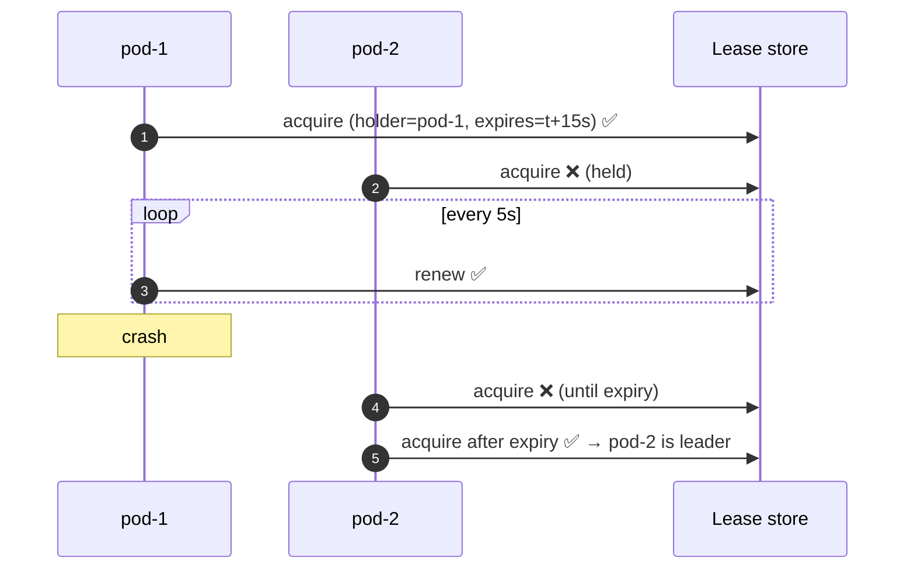
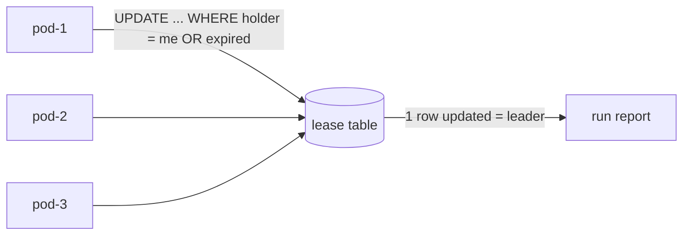
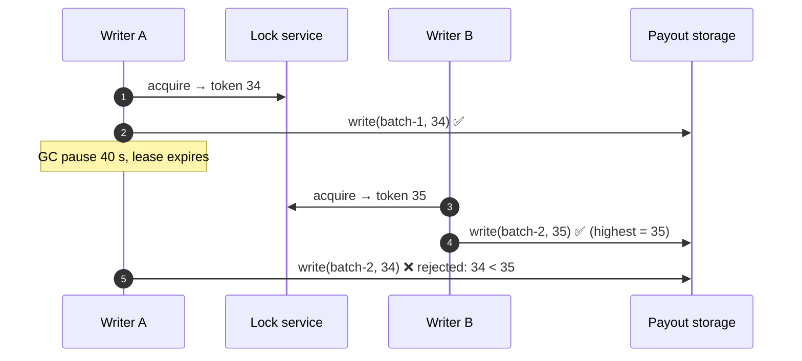
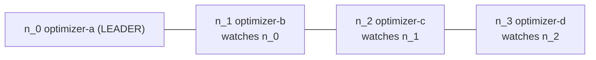

---
tags:
  - Microservices
  - Advanced
  - Coordination
---

# Leader Election

<span class="badge badge--advanced">🔴 Advanced</span>
<span class="badge badge--category">Microservices</span>
<span class="badge badge--interview">Interview frequency ⭐⭐⭐⭐</span>

!!! abstract "TL;DR"
    **When several identical instances run but some work must be done by exactly one of them (a scheduled job, a partition owner, a coordinator), they elect a leader, usually by competing for a time-limited lease. Others stand by and take over when the lease expires.**
    Combine it with **fencing tokens** so a leader that was paused or partitioned can't keep acting after it lost leadership.

---

## See It in Motion

<iframe class="motion-embed" src="../../motion/index.html?p=leader-election&amp;embed=1" title="Animated walkthrough of the Leader Election pattern" loading="lazy"></iframe>

Press **Play** to watch the calls travel between components, or step through with **Next** and **Back**. [Open the full explorer with all 66 patterns](../motion/index.html#leader-election){ target=_blank }

## 1. Intent & Problem It Solves

**The problem in plain English:** the grocery service runs on three pods. At 02:00 a job builds the "substitution report" and emails 800 stores. If every pod runs it, stores get three emails and the database does triple work. If only pod-1 is configured to run it, the job silently stops when pod-1 is rescheduled. You need "exactly one, and always one".

**Definition (Azure Architecture Center, *Leader Election pattern*):**
> Coordinate the actions performed by a collection of collaborating instances by electing one instance as the leader that assumes responsibility for managing the others or for doing work that must not be duplicated.

**Building blocks:**

| Mechanism | How | Examples |
|---|---|---|
| **Lease** | A record with holder + expiry, acquired/renewed atomically | Kubernetes `Lease`, DB row, DynamoDB conditional write, Redis `SET NX PX` |
| **Ephemeral sequential nodes** | Lowest sequence wins; session loss deletes the node | ZooKeeper, etcd (revision-based) |
| **Consensus** | Raft/Paxos elect a leader with majority votes | etcd, Consul, Kafka KRaft, CockroachDB |
| **Bully / ring algorithms** | Message-based election among known peers | Classic textbook algorithms (coding challenge) |

## 2. Real-World Analogy

!!! example "The baton in a relay race"
    Only the runner holding the baton may run. The baton is handed over explicitly or, if a runner collapses, the official declares the leg forfeited after a timeout and gives the next runner a **new** numbered baton. A runner who wakes up with an old baton number isn't allowed back on the track (fencing).

## 3. Structure



| Participant | Responsibility |
|---|---|
| **Candidates** | Identical instances that try to acquire leadership |
| **Coordination store** | Provides an atomic compare-and-set or consensus (DB, etcd, ZooKeeper, Kubernetes API) |
| **Lease / term** | Time-bounded leadership; renewed by the leader; expiry enables failover |
| **Fencing token** | Monotonic number per term, checked by downstream resources |

## 4. Naive Approach (Without the Pattern)

```java
@Scheduled(cron = "0 0 2 * * *")
public void substitutionReport() { ... }   // runs on EVERY replica: 3 emails per store

if (System.getenv("POD_NAME").equals("grocery-0")) { ... }   // stops forever when grocery-0 is down
```

- :material-close-circle:{ style="color:#e53935" } Duplicated work (and duplicated side effects).
- :material-close-circle:{ style="color:#e53935" } A hard-coded "leader" is a single point of failure.
- :material-close-circle:{ style="color:#e53935" } Home-made "check then claim" races let two pods become leader.

---

## 5. Three Real-World Examples

### Example 1: A Database Lease for a Nightly Job (Grocery)

**Scenario:** Three pods of the grocery service all try to acquire the `substitution-report` lease every 5 seconds. The lease lasts 15 seconds and is renewed by the holder. When the leader pod is killed without releasing, another pod takes over **after** the lease expires, never before, so there is never more than one leader.

**Design:**



**Full Code:**

=== "DbLease.java"

    ```java
    --8<-- "code/microservices/src/main/java/com/handbook/microservices/leaderelection/lease/DbLease.java"
    ```

    1.  Acquire **and** renew in one conditional `UPDATE`: it succeeds only if we already hold the lease or it has expired. The database serializes concurrent attempts.
    2.  Exactly one pod sees "1 row updated". No read-then-write race.

=== "LeaseDemo.java"

    ```java
    --8<-- "code/microservices/src/main/java/com/handbook/microservices/leaderelection/lease/LeaseDemo.java"
    ```

**Output:**

```text
--8<-- "code/outputs/microservices/leaderelection/lease/LeaseDemo.txt"
```

**Why a lease here:**

- Uses infrastructure you already have (the service's database); ShedLock does exactly this.
- Failover is automatic, bounded by the lease TTL.
- The gap with no leader (t=10s to t=20s) is the price of never having two.

---

### Example 2: Fencing Tokens for the Payout Writer (Payments)

**Scenario:** A payout service writes settlement batches to the bank's SFTP drop folder. Writer A holds leadership, then freezes in a 40-second GC pause. Its lease expires, B becomes leader and writes batch 2. A wakes up, unaware anything happened, and tries to write batch 2 again, which would pay merchants twice. Each lease grant carries an increasing **fencing token**; the storage rejects writes with an older token.

**Design:**



**Full Code:**

=== "FencedStorage.java"

    ```java
    --8<-- "code/microservices/src/main/java/com/handbook/microservices/leaderelection/fencing/FencedStorage.java"
    ```

    1.  The **resource** enforces safety: a token lower than one it has already accepted means the writer's leadership is over.
    2.  Every grant gets a strictly higher token (ZooKeeper's `zxid`, etcd's revision, a DB sequence).

=== "FencingDemo.java"

    ```java
    --8<-- "code/microservices/src/main/java/com/handbook/microservices/leaderelection/fencing/FencingDemo.java"
    ```

**Output:**

```text
--8<-- "code/outputs/microservices/leaderelection/fencing/FencingDemo.txt"
```

**Why fencing here:**

- A lease guarantees **at most one leader at a time** only if every holder notices expiry instantly, and GC pauses, network partitions and clock drift break that.
- Fencing moves the check to the place where damage happens.
- Martin Kleppmann's critique of Redlock is exactly this: locks without fencing aren't safe for correctness.

---

### Example 3: Sequential Nodes Without a Herd (Logistics)

**Scenario:** Four route-optimizer instances need one leader to assign delivery zones. With ZooKeeper, each creates an ephemeral sequential znode under `/election`; the lowest sequence is the leader. Instead of everyone watching the leader (and stampeding when it dies), each node watches only its **predecessor**, so each failure wakes exactly one node.

**Design:**



**Full Code:**

=== "SequentialElection.java"

    ```java
    --8<-- "code/microservices/src/main/java/com/handbook/microservices/leaderelection/sequential/SequentialElection.java"
    ```

    1.  Ephemeral sequential znodes: the sequence orders candidates; the node disappears when the session dies.
    2.  Only the **next** node is notified, which checks whether it's now the lowest (leader) or should watch a new predecessor.

=== "DispatchLeaderDemo.java"

    ```java
    --8<-- "code/microservices/src/main/java/com/handbook/microservices/leaderelection/sequential/DispatchLeaderDemo.java"
    ```

**Output:**

```text
--8<-- "code/outputs/microservices/leaderelection/sequential/DispatchLeaderDemo.txt"
```

**Why sequential nodes here:**

- Leadership order is deterministic and fair (first come, first lead).
- **No herd effect**: N candidates don't all hit ZooKeeper when the leader dies.
- Session expiry gives failure detection for free.

---

??? example "Unit Tests: `LeaderElectionTest.java`"

    ```java
    --8<-- "code/microservices/src/test/java/com/handbook/microservices/LeaderElectionTest.java"
    ```

## 6. Variations & Modern Java Take

=== "ShedLock (reference)"

    ```java
    @Scheduled(cron = "0 0 2 * * *")
    @SchedulerLock(name = "substitution-report", lockAtMostFor = "PT30M", lockAtLeastFor = "PT1M")
    public void substitutionReport() { ... }   // runs on one replica; lock row in the service DB
    ```

=== "Spring Integration leader (reference)"

    ```java
    @Bean
    LockRegistryLeaderInitiator leader(JdbcLockRegistry locks) {
        return new LockRegistryLeaderInitiator(locks);   // publishes OnGrantedEvent / OnRevokedEvent
    }

    @EventListener(OnGrantedEvent.class)
    void becameLeader() { optimizer.start(); }
    ```

| Variation | Notes |
|---|---|
| **Kubernetes Lease** | `coordination.k8s.io/v1 Lease`; used by controllers (client-go `leaderelection`), Spring Cloud Kubernetes leader election |
| **Kubernetes CronJob `concurrencyPolicy: Forbid`** | For scheduled jobs, often simpler than in-app election |
| **Raft-based stores** | etcd, Consul sessions: linearizable and with revisions usable as fencing tokens |
| **Partition-level leaders** | Kafka partitions, Cassandra/CockroachDB ranges: each has its own leader |
| **Leaderless designs** | Sometimes better: make the work idempotent and let everyone try, or shard work so no global leader is needed |

## 7. Where It Lives in Real Frameworks

| Where | Leader election |
|---|---|
| Kubernetes | `Lease` objects; kube-controller-manager and kube-scheduler run active/standby |
| Kafka (KRaft) | Raft quorum elects the controller; each partition has a leader replica |
| ZooKeeper / Curator | `LeaderLatch`, `LeaderSelector` recipes |
| Spring | Spring Integration `LeaderInitiator` (JDBC, Redis, ZooKeeper, Hazelcast); ShedLock for `@Scheduled` |
| Databases | PostgreSQL advisory locks (`pg_try_advisory_lock`), Patroni (Postgres HA via etcd/Consul) |

## 8. Pros, Cons & Trade-offs

| ✅ Pros | ❌ Cons |
|---|---|
| Exactly-one execution without a dedicated special instance | A coordination dependency to run and secure |
| Automatic failover | Failover gap (up to the lease TTL) with no leader |
| Simple mental model for coordinators and schedulers | Leader can become a bottleneck or single point of slowness |
| Works with infrastructure you have (DB, Kubernetes) | Correctness needs fencing; clocks and pauses break naïve leases |

## 9. Pitfalls & Anti-Patterns

!!! danger "Locks without fencing for correctness-critical work"
    A paused or partitioned ex-leader can still act. If duplicates cost money, the downstream resource must check a fencing token (or the work must be idempotent).

!!! danger "Check-then-claim"
    `if (lease.holder == null) lease.holder = me;` as two operations lets two pods win. Use one atomic conditional write.

!!! warning "TTL too short or too long"
    Too short: GC pauses and slow renewals cause flapping leadership. Too long: slow failover. Renew at ~1/3 of the TTL and size the TTL from observed pauses.

!!! warning "Leader does all the work"
    If the leader also processes every request, you've built a single-node system with extra steps. Let the leader **coordinate** (assign work), and the followers **do** it.

## 10. Senior / Architect Deep Dive (10–15 yrs)

**Time is the enemy.** Leases rely on the holder noticing expiry before others act. Process pauses (GC, VM migration), clock drift and network delays violate that. Defences: renew early, stop acting when a renewal fails (not when the lease "should" expire), use monotonic clocks locally, and fence every write.

**Choose the right store.** For correctness (payouts, partition ownership), use a linearizable store with revisions: etcd, ZooKeeper, a single-primary SQL database. Redis single-node `SET NX PX` is fine for efficiency (avoid duplicate work) but not for safety under failover.

**Prefer not needing a leader.** Idempotent jobs, partitioned work (each pod owns a hash range), or a queue with competing consumers often remove the need for a global leader and its failover gap.

!!! bug "War story: two payout files on a Monday"
    A payout service used a Redis lock with a 30-second TTL. One Monday a full GC paused the leader for 41 seconds; the standby acquired the lock and generated the payout file; the old leader resumed and uploaded its own copy a minute later. The bank processed both: INR 2.3 crore paid twice to 600 merchants.
    **Fix:** etcd-based election with revisions as fencing tokens; the upload step writes the token into the file header and the bank-side importer rejects older tokens; payouts also got idempotency keys per merchant per date.
    **Lesson:** a lock tells you who *should* act; only fencing stops who *shouldn't*.

## 11. Related Patterns & Comparisons

| | Leader Election | Balking | Competing Consumers | Sharding |
|---|---|---|---|---|
| Ensures | One instance does the job | One concurrent run in a process | Each message handled once | Each key owned by one shard |
| Scope | Cluster | One JVM | Queue consumers | Data |
| Failover | Lease expiry / session loss | N/A | Redelivery | Replica promotion |

See [Guarded Suspension & Balking](../concurrency/guarded-suspension-balking.md) for the single-JVM version, and [Competing Consumers](competing-consumers.md) for a leaderless alternative.

## 12. Interview Corner

=== "🟢 Beginner / Service Companies"

    **Q1. What is leader election?**

    Choosing one instance among many to perform a task that must not be duplicated, with automatic replacement if it fails.

    **Q2. How do you run a `@Scheduled` job only once across replicas?**

    ShedLock (a lock row in the DB) or Kubernetes `CronJob`, or leader election.

    **Q3. What is a lease?**

    Leadership that expires unless renewed, so a crashed leader is replaced automatically.

    **Q4. What happens if the leader crashes?**

    After its lease expires, another instance acquires it and becomes leader.

    **Q5. Name tools that provide leader election.**

    ZooKeeper, etcd, Consul, the Kubernetes Lease API, databases.

=== "🟡 Mid-Level"

    **Q1. Why must acquisition be atomic?**

    Otherwise two instances can both see "free" and both claim it.

    **Q2. What's a fencing token?**

    A monotonically increasing number issued with each leadership grant; resources reject requests with older tokens.

    **Q3. How do you choose the lease TTL?**

    Longer than worst-case pauses + renewal latency; short enough for acceptable failover time; renew at about a third of the TTL.

    **Q4. What's the herd effect in ZooKeeper elections?**

    All candidates watching the leader node and stampeding when it disappears; avoided by watching the predecessor.

    **Q5. Is Redis `SET NX PX` safe for leader election?**

    For efficiency, yes; for correctness, not without fencing, especially across failover.

=== "🔴 Senior / FAANG / SAP"

    **Q1. "Design partition ownership for 1,000 partitions across 20 workers."**

    A coordinator (elected via etcd) assigns partitions; workers hold per-partition leases with revisions as fencing tokens; reassign on lease loss; writes carry the token.

    **Q2. "Explain split brain and how to prevent it."**

    Two nodes both believe they lead (partition, pauses). Prevent with majority quorums (Raft), leases with fencing, and stepping down on failed renewal.

    **Q3. "How does Raft elect a leader?"**

    Followers time out, become candidates for a new term, request votes; a majority makes a leader; terms act as fencing; randomized timeouts avoid split votes.

    **Q4. "Leader election vs designing it away?"**

    Prefer idempotent or partitioned work to avoid the failover gap and bottleneck; use election for true coordinators.

    **Q5. "The leader is slow but alive. What happens?"**

    Nothing, by default: a gray failure. Add health-based step-down (leader resigns if its own checks fail) and monitor leader-specific SLIs.

=== "💻 Coding Challenge"

    **Problem:** Implement the Bully algorithm: node 5 (the coordinator) crashed; node 2 notices and starts an election among nodes 1–5. Print the messages and the winner.

    ??? success "Solution"

        === "BullyDemo.java"

            ```java
            --8<-- "code/microservices/src/main/java/com/handbook/microservices/leaderelection/bully/BullyDemo.java"
            ```

        **Output:**

        ```text
        --8<-- "code/outputs/microservices/leaderelection/bully/BullyDemo.txt"
        ```

        **Key points to say:** a node sends ELECTION to all higher ids; any live higher node answers OK and takes over; a node with no higher live nodes declares itself COORDINATOR. It's O(n²) messages in the worst case and assumes reliable failure detection, which is why production systems use Raft or a coordination service instead.

!!! info "Behavioural tie-in (STAR) for experienced candidates"
    - **S:** A GC pause let two payout writers both upload a payout file; 600 merchants were paid twice.
    - **T:** Guarantee one payout file per day even under pauses and failovers.
    - **A:** Moved election to etcd, used revisions as fencing tokens embedded in the file header, had the importer reject stale tokens, and added idempotency keys per merchant per date.
    - **R:** No duplicate payouts since; failover time dropped from 60 s to 15 s with safe TTLs.

## 13. Quick Revision Card

!!! tip "Remember in 30 seconds"
    - **One instance leads; others stand by; lease expiry = failover.**
    - Acquire/renew with **one atomic conditional write**.
    - Leases alone aren't safe: add **fencing tokens**.
    - Watch predecessors, not the leader (no herd).
    - Often better: idempotent or partitioned work, no leader at all.

    ```sql
    UPDATE lease SET holder = :me, expires_at = :now + ttl WHERE name = :job AND (holder = :me OR expires_at < :now);
    ```

## Practice

- [ ] Add a `release(pod)` method for graceful shutdown and show instant failover.
- [ ] Return a fencing token (a version column) from `DbLease.tryAcquireOrRenew`.
- [ ] Make the leader in `LeaseDemo` stop work when a renewal fails, not when the TTL ends.

---

[:material-arrow-left: Competing Consumers](competing-consumers.md){ .md-button }
[Next: Backpressure :material-arrow-right:](backpressure.md){ .md-button .md-button--primary }
