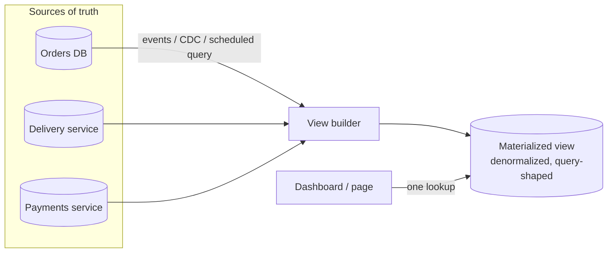
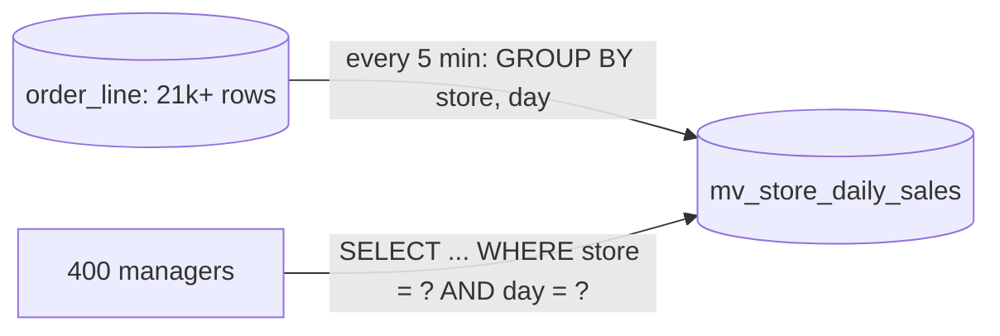
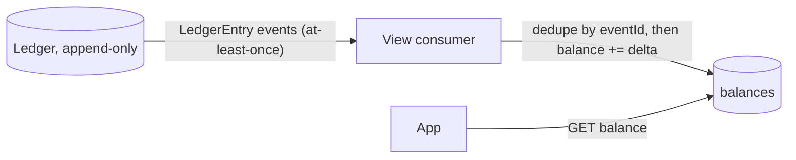
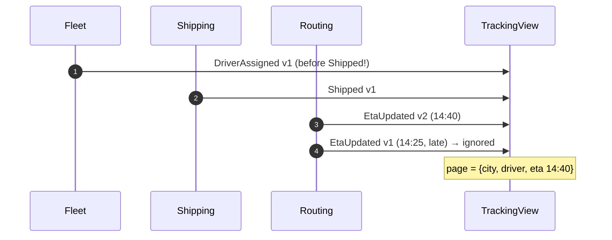

---
tags:
  - Microservices
  - Intermediate
  - Data
---

# Materialized View

<span class="badge badge--intermediate">🟡 Intermediate</span>
<span class="badge badge--category">Microservices</span>
<span class="badge badge--interview">Interview frequency ⭐⭐⭐⭐</span>

!!! abstract "TL;DR"
    **A Materialized View stores the precomputed result of an expensive query (aggregates, joins, data from several services) so reads become a single cheap lookup. It's refreshed on a schedule or kept up to date incrementally from events.**
    Use it when the same expensive question is asked far more often than the underlying data changes, or when the data needed lives in several services or shards.

---

## See It in Motion

<iframe class="motion-embed" src="../../motion/index.html?p=materialized-view&amp;embed=1" title="Animated walkthrough of the Materialized View pattern" loading="lazy"></iframe>

Press **Play** to watch the calls travel between components, or step through with **Next** and **Back**. Switch to **Without it** to see what goes wrong without the pattern, or press a **Break it** button to make something fail while the pattern is in place. [Open the full explorer](../motion/index.html#materialized-view){ target=_blank }

## 1. Intent & Problem It Solves

**The problem in plain English:** the store manager's dashboard shows today's orders and revenue. Computing it means `SUM` over millions of order lines, run every time 400 managers refresh their screens. The tracking page needs shipment, driver and ETA data that live in three different services; joining them over HTTP on every page view is slow and fragile.

**Definition (Azure Architecture Center, *Materialized View pattern*):**
> Generate prepopulated views over the data in one or more data stores when the data isn't ideally formatted for required query operations. The view is a **disposable cache**: it can always be rebuilt from the source of truth.

**Refresh strategies:**

| Strategy | How | Freshness | Cost |
|---|---|---|---|
| **Full refresh** | Recompute everything on a schedule (`REFRESH MATERIALIZED VIEW`) | Minutes / hours | Proportional to all data |
| **Incremental** | Apply each change (event, CDC row) to the view | Seconds | Proportional to changes |
| **On read, cached** | Compute on miss, keep with TTL | Varies | See [Cache-Aside](cache-aside.md) |

## 2. Real-World Analogy

!!! example "The cricket scoreboard"
    Nobody recounts every ball of the match to know the score. The scorer updates the board after each ball (incremental view). The board can always be reconstructed from the ball-by-ball scorebook (source of truth) if someone suspects a mistake.

## 3. Structure



| Participant | Responsibility |
|---|---|
| **Source of truth** | Normalized data owned by its service; never modified by the view |
| **View builder** | Scheduled job, stream processor or CDC consumer that computes/updates the view |
| **Materialized view** | Denormalized, query-shaped storage (table, document, Redis hash, search index) |
| **Readers** | Query the view only; accept its staleness |

## 4. Naive Approach (Without the Pattern)

```java
// Dashboard: full scan on every refresh by every manager
jdbc.queryForObject("SELECT COUNT(*), SUM(amount_paise) FROM order_line WHERE store = ? AND sales_day = ?", ...);

// Tracking page: three synchronous calls and an in-memory join per view
var s = shipmentClient.get(awb); var d = driverClient.get(s.driverId()); var e = etaClient.get(awb);
```

- :material-close-circle:{ style="color:#e53935" } Repeating expensive work for identical answers.
- :material-close-circle:{ style="color:#e53935" } Page latency = sum of three services' latencies; any one down breaks the page.
- :material-close-circle:{ style="color:#e53935" } Heavy analytical queries slow down the transactional database.

---

## 5. Three Real-World Examples

### Example 1: Store Sales Summary with Full Refresh (Grocery)

**Scenario:** 400 dark-store managers refresh a sales dashboard all evening. The raw `order_line` table gets 2 million rows a day. A summary table, refreshed every 5 minutes in one transaction, answers each dashboard request with a single primary-key lookup. A few minutes of staleness is acceptable for a dashboard.

**Design:**



**Full Code:**

=== "StoreSalesView.java"

    ```java
    --8<-- "code/microservices/src/main/java/com/handbook/microservices/materializedview/sales/StoreSalesView.java"
    ```

    1.  A **full refresh**: rebuild the summary from the source of truth. PostgreSQL has this built in (`CREATE MATERIALIZED VIEW ...; REFRESH MATERIALIZED VIEW CONCURRENTLY ...`).
    2.  In **one transaction**, so readers see either the old or the new summary, never a half-built one.

=== "SalesViewDemo.java"

    ```java
    --8<-- "code/microservices/src/main/java/com/handbook/microservices/materializedview/sales/SalesViewDemo.java"
    ```

**Output:**

```text
--8<-- "code/outputs/microservices/materializedview/sales/SalesViewDemo.txt"
```

**Why a materialized view here:**

- Read load is **hundreds of times** the write rate for this question.
- Staleness is explicit and bounded by the refresh interval.
- The transactional workload no longer runs aggregate scans.

---

### Example 2: Incremental Balance View (Banking)

**Scenario:** A banking app shows the balance every time it opens (8 million opens a day). The source of truth is an append-only ledger. Summing the ledger per open is too expensive; a balance view is updated by each ledger event. The broker delivers at least once, so the view must ignore duplicates.

**Design:**



**Full Code:**

=== "BalanceView.java"

    ```java
    --8<-- "code/microservices/src/main/java/com/handbook/microservices/materializedview/balances/BalanceView.java"
    ```

    1.  **Idempotency**: a redelivered event is detected and ignored ([Idempotent Consumer](idempotent-consumer.md)). In SQL, insert the event id and the balance update in the same transaction.
    2.  **Incremental** update: the cost is proportional to the change, not to the history.

=== "BalanceViewDemo.java"

    ```java
    --8<-- "code/microservices/src/main/java/com/handbook/microservices/materializedview/balances/BalanceViewDemo.java"
    ```

**Output:**

```text
--8<-- "code/outputs/microservices/materializedview/balances/BalanceViewDemo.txt"
```

**Why an incremental view here:**

- Freshness in seconds without recomputing history.
- The ledger stays the auditable source of truth; the view is a derived convenience.
- Shown to customers, but payments still validate against the ledger, not the view.

---

### Example 3: Tracking Page from Three Services (Logistics)

**Scenario:** A courier's tracking page needs the shipment's city (shipping service), the driver (fleet service) and the ETA (routing service). Instead of three calls per page view, a view builder consumes all three event streams into one denormalized document per AWB. Events from different services can arrive in any order, and the same source can deliver an older update late.

**Design:**



**Full Code:**

=== "TrackingView.java"

    ```java
    --8<-- "code/microservices/src/main/java/com/handbook/microservices/materializedview/tracking/TrackingView.java"
    ```

    1.  Keep the **last applied version per source**, so a late, older event can't overwrite newer data.
    2.  Each event type updates only **its** fields: arrival order between sources doesn't matter.

=== "TrackingViewDemo.java"

    ```java
    --8<-- "code/microservices/src/main/java/com/handbook/microservices/materializedview/tracking/TrackingViewDemo.java"
    ```

**Output:**

```text
--8<-- "code/outputs/microservices/materializedview/tracking/TrackingViewDemo.txt"
```

**Why a materialized view here:**

- The page works even if the routing service is down (it shows the last ETA).
- One key lookup instead of three network calls.
- The pattern behind [CQRS](cqrs.md) read models and [API composition](database-per-service.md) replacements.

---

??? example "Unit Tests: `MaterializedViewTest.java`"

    ```java
    --8<-- "code/microservices/src/test/java/com/handbook/microservices/MaterializedViewTest.java"
    ```

## 6. Variations & Modern Java Take

=== "PostgreSQL (reference)"

    ```sql
    CREATE MATERIALIZED VIEW mv_store_daily_sales AS
      SELECT store, sales_day, COUNT(*) AS orders, SUM(amount_paise) AS revenue_paise
      FROM order_line GROUP BY store, sales_day;
    CREATE UNIQUE INDEX ON mv_store_daily_sales (store, sales_day);  -- required for CONCURRENTLY
    REFRESH MATERIALIZED VIEW CONCURRENTLY mv_store_daily_sales;      -- readers aren't blocked
    ```

| Variation | Notes |
|---|---|
| **Database materialized views** | PostgreSQL, Oracle (with fast refresh), SQL Server indexed views |
| **Stream-processed views** | Kafka Streams `KTable` / state stores, Flink, Materialize, RisingWave: incremental SQL views over streams |
| **CDC-fed views** | Debezium → consumer → Elasticsearch/Redis/another DB |
| **Search index as a view** | OpenSearch documents built from several services for full-text and faceted queries |
| **Blue/green rebuild** | Build `view_v2` alongside `view_v1`, verify, switch readers, drop old (coding challenge) |

## 7. Where It Lives in Real Frameworks

| Where | Materialized views |
|---|---|
| PostgreSQL | `CREATE MATERIALIZED VIEW`, `REFRESH ... CONCURRENTLY` (schedule with `pg_cron`) |
| Kafka Streams | `groupByKey().aggregate(...)` → `KTable` with interactive queries |
| Spring | `@Scheduled` refresh jobs; Spring Kafka listeners building projections |
| Axon | Event-handling projections (`@EventHandler` updating query models) |
| Cloud | BigQuery / Snowflake materialized views; DynamoDB Streams → aggregates |

## 8. Pros, Cons & Trade-offs

| ✅ Pros | ❌ Cons |
|---|---|
| Expensive queries become cheap lookups | Data is stale (by refresh interval or event lag) |
| Combine data from several services/shards | Extra storage and a builder to operate |
| Reads keep working when sources are down | Incremental logic must handle duplicates and ordering |
| Offloads the transactional database | Views drift if events are lost; need rebuild tooling |

## 9. Pitfalls & Anti-Patterns

!!! danger "Making decisions from a stale view"
    Approving a payment from a balance view that lags the ledger allows overdrafts. Use views for display; check the source of truth for decisions.

!!! danger "Non-idempotent incremental updates"
    At-least-once delivery + `balance += delta` without dedupe = double counting. Track applied event ids or versions.

!!! warning "Full refresh that blocks readers"
    PostgreSQL's plain `REFRESH MATERIALIZED VIEW` takes an exclusive lock. Use `CONCURRENTLY` (needs a unique index) or swap tables.

!!! warning "No way to rebuild"
    If the view can't be recomputed from the source of truth (events retained, or source tables queryable), a single bug corrupts it permanently.

## 10. Senior / Architect Deep Dive (10–15 yrs)

**Treat views as disposable.** Keep enough history (Kafka retention, event store, CDC from source tables) to rebuild any view from scratch. Build new versions side by side and switch readers atomically. This makes schema changes to views low-risk.

**Lag is a product metric.** Measure "event time → visible in view" and alert on it. Expose freshness to users where it matters ("updated 2 minutes ago").

**Ordering.** Per-key ordering (Kafka partition by aggregate id) handles most cases; across sources, apply per-source versions or "last-writer-wins by event time" carefully, and design fields so each source owns its own part of the document.

!!! bug "War story: the balance that was off by one payment"
    A wallet's balance view consumer crashed after updating the balance but before committing its Kafka offset. On restart it re-applied the event: thousands of users saw a refund twice. Some spent it, because the payment check used the same view.
    **Fix:** event id stored in a `processed_events` table in the same transaction as the balance update; payments validated against the ledger; nightly rebuild-and-compare job that alerts on drift.
    **Lesson:** incremental views need idempotency, decisions need the source of truth, and drift needs a detector.

## 11. Related Patterns & Comparisons

| | Materialized View | Cache-Aside | CQRS Read Model | Event Sourcing |
|---|---|---|---|---|
| Built | Ahead of time (scheduled/incremental) | On demand (miss) | From events | Is the source of truth |
| Shape | Query-shaped, often aggregated | Same as source | Query-shaped | Event log |
| Staleness | Refresh interval / lag | TTL | Event lag | None (it's the truth) |
| Rebuildable | Yes, from sources | Trivially | Yes, by replay | N/A |

## 12. Interview Corner

=== "🟢 Beginner / Service Companies"

    **Q1. What is a materialized view?**

    A stored, precomputed query result that is refreshed periodically or incrementally.

    **Q2. View vs materialized view in SQL?**

    A view is a saved query run every time; a materialized view stores the result.

    **Q3. Why is it stale?**

    It only changes when refreshed or when updates are applied.

    **Q4. When would you use one?**

    For expensive, frequently repeated queries like dashboards and reports.

    **Q5. What happens if it gets corrupted?**

    Rebuild it from the source data; it's derived.

=== "🟡 Mid-Level"

    **Q1. Full vs incremental refresh?**

    Full recomputes everything (simple, expensive); incremental applies changes (fresh, needs idempotency and ordering).

    **Q2. How do you refresh without blocking readers in PostgreSQL?**

    `REFRESH MATERIALIZED VIEW CONCURRENTLY` with a unique index, or build a new table and swap.

    **Q3. How do you handle duplicate events?**

    Store processed event ids or per-key versions, updated in the same transaction as the view.

    **Q4. Materialized view vs cache?**

    A view is built proactively and query-shaped; a cache-aside entry is filled on demand and mirrors the source.

    **Q5. How do views help with database-per-service?**

    They let one service hold a read-only, denormalized copy of others' data built from their events, avoiding synchronous joins.

=== "🔴 Senior / FAANG / SAP"

    **Q1. "Design a seller dashboard for 1M sellers with near-real-time numbers."**

    Order events → Kafka (partition by seller) → stream processor aggregating per seller per day → key-value store; lag SLO of 30 s; nightly batch rebuild for correction.

    **Q2. "How do you change a view's schema safely?"**

    Build v2 alongside v1 from retained history, compare, switch reads behind a flag, then retire v1.

    **Q3. "Events from three services arrive out of order."**

    Each source owns its own fields; track per-source versions; ignore older versions; never let one source overwrite another's fields.

    **Q4. "How do you detect drift?"**

    Periodic rebuild-and-compare (or checksums per partition) against the source of truth, alerting on differences.

    **Q5. "When not to use one?"**

    Rapidly changing data needing strong consistency (stock reservations, balances for authorisation), or queries already cheap with an index.

=== "💻 Coding Challenge"

    **Problem:** A live balance view silently missed one event months ago. Write a job that rebuilds the view from the ledger and reports which accounts drifted.

    ??? success "Solution"

        === "RebuildCheckDemo.java"

            ```java
            --8<-- "code/microservices/src/main/java/com/handbook/microservices/materializedview/rebuild/RebuildCheckDemo.java"
            ```

        **Output:**

        ```text
        --8<-- "code/outputs/microservices/materializedview/rebuild/RebuildCheckDemo.txt"
        ```

        **Key points to say:** the ledger is the source of truth, so the view can be replayed into a fresh copy and compared; swap tables to fix; run the comparison on a schedule and alert. At scale, compare per-partition checksums instead of every row.

!!! info "Behavioural tie-in (STAR) for experienced candidates"
    - **S:** A wallet view double-applied refunds after consumer restarts, and the payment check trusted the view.
    - **T:** Make the view exact and stop decisions depending on it.
    - **A:** Added transactional event-id dedupe, moved authorisation checks to the ledger, and built a nightly rebuild-and-compare job with blue/green swaps.
    - **R:** Drift incidents went from weekly to zero; the comparison job caught one consumer bug in staging before release.

## 13. Quick Revision Card

!!! tip "Remember in 30 seconds"
    - **Precomputed, query-shaped, disposable** copy of data.
    - Full refresh (simple) vs incremental (fresh, idempotent).
    - Combine services/shards without runtime joins.
    - Stale by design: display, don't decide.
    - Keep history so you can **rebuild and compare**.

    ```sql
    REFRESH MATERIALIZED VIEW CONCURRENTLY mv_store_daily_sales;
    ```

## Practice

- [ ] Make `StoreSalesView` refresh incrementally (only today's partition).
- [ ] Add `lastUpdatedAt` to `TrackingView.Page` and show "updated N minutes ago".
- [ ] Store `BalanceView`'s applied ids and balances in H2 within one transaction.

---

[:material-arrow-left: Sharding](sharding.md){ .md-button }
[Next: Competing Consumers :material-arrow-right:](competing-consumers.md){ .md-button .md-button--primary }
