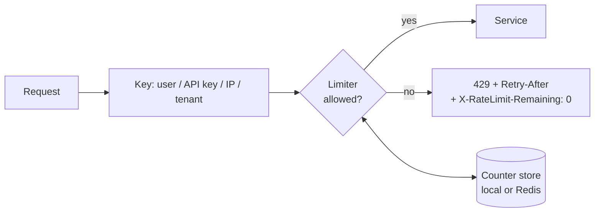

---
tags:
  - Microservices
  - Intermediate
  - Resilience
---

# Rate Limiter

<span class="badge badge--intermediate">🟡 Intermediate</span>
<span class="badge badge--category">Microservices</span>
<span class="badge badge--interview">Interview frequency ⭐⭐⭐⭐⭐</span>

!!! abstract "TL;DR"
    **A rate limiter caps how many requests a client (user, API key, IP, tenant) can make in a period. Excess requests get `429 Too Many Requests`, ideally with `Retry-After`.**
    Common algorithms are the **token bucket** (allows bursts), **sliding-window log** (exact), **sliding-window counter** (cheap and close to exact) and **fixed window** (simplest, but allows bursts at window boundaries). With many instances, counters must be **shared** (Redis).

---

## 1. Intent & Problem It Solves

**The problem in plain English:**

- A buggy client loops and sends 5,000 requests per second to checkout.
- Bots try to grab all concert seats in the first second of a sale.
- Attackers trigger OTP SMS to a victim's phone 1,000 times. Every SMS costs money, and the victim is spammed.
- A free-tier customer uses as much capacity as an enterprise customer.

Rate limiting protects **availability** (overload), **cost** (SMS, third-party APIs), **fairness** (one client can't starve others) and **security** (brute force, scraping).

## 2. Real-World Analogy

!!! example "A ticket counter with tokens"
    A museum hands out entry tokens: a bowl holds up to 5, and one new token is added every minute. A group of 5 can walk in at once (burst), but after that, people enter at one per minute. If the bowl is empty, you wait. That's a token bucket.

## 3. Structure



| Algorithm | Memory per key | Bursts | Accuracy |
|---|---|---|---|
| **Fixed window** | 1 counter | Up to 2× limit at boundaries | Low |
| **Sliding-window log** | 1 timestamp per request | No | Exact |
| **Sliding-window counter** | 2 counters | Smoothed | Close to exact |
| **Token bucket** | Tokens + timestamp | Up to capacity (intended) | Exact average rate |
| **Leaky bucket** | Queue | Smoothed output | Constant outflow |

## 4. Naive Approach (Without the Pattern)

```java
// "We'll just scale up"
@PostMapping("/otp") void sendOtp(String phone) { smsProvider.send(phone, code()); }
// Attacker: 10,000 requests/minute → 10,000 SMS billed → provider blocks your account,
// and real users can't log in.
```

---

## 5. Three Real-World Examples

### Example 1: Token Bucket per User (Grocery checkout)

**Scenario:** Each customer may burst up to **5** checkout API calls (the app makes a few calls when the screen opens), refilling at **1 token per second**. A 7-request burst gets 5 × 200 and 2 × 429. Other customers have their own buckets. After waiting, tokens refill, but never above capacity.

**Full Code:**

=== "TokenBucket.java"

    ```java
    --8<-- "code/microservices/src/main/java/com/handbook/microservices/ratelimit/tokenbucket/TokenBucket.java"
    ```

    1.  Starts **full**, so the first burst is allowed.
    2.  **Lazy refill**: no background timer; tokens are computed from elapsed time on each call (O(1) per request).

=== "TokenBucketDemo.java"

    ```java
    --8<-- "code/microservices/src/main/java/com/handbook/microservices/ratelimit/tokenbucket/TokenBucketDemo.java"
    ```

**Output:**

```text
--8<-- "code/outputs/microservices/ratelimit/tokenbucket/TokenBucketDemo.txt"
```

**Why a token bucket here:**

- Legitimate **bursts** are allowed, while the long-run rate stays capped.
- Two numbers per user: cheap.
- This is the algorithm behind Spring Cloud Gateway's Redis rate limiter, Bucket4j and most cloud gateways.

---

### Example 2: Sliding-Window Log for OTP (Fintech login)

**Scenario:** At most **3 OTP SMS per phone per 10 minutes**. A fixed window would let an attacker send 3 at 10:09 and 3 more at 10:10. The sliding log stores each request's timestamp and counts those in the last 10 minutes, so it's exact and tells the user precisely how long to wait.

**Full Code:**

=== "OtpRateLimiter.java"

    ```java
    --8<-- "code/microservices/src/main/java/com/handbook/microservices/ratelimit/slidinglog/OtpRateLimiter.java"
    ```

    1.  Drop timestamps that have left the window.
    2.  The **exact wait time** is when the oldest request leaves the window, which makes a good `Retry-After`.

=== "OtpDemo.java"

    ```java
    --8<-- "code/microservices/src/main/java/com/handbook/microservices/ratelimit/slidinglog/OtpDemo.java"
    ```

**Output:**

```text
--8<-- "code/outputs/microservices/ratelimit/slidinglog/OtpDemo.txt"
```

**Why a sliding log here:**

- Low volumes per key (a few per phone), so storing timestamps is cheap.
- **Exactness matters**: each SMS costs money and abuse must not slip through window boundaries.
- In production, add limits per IP and per device too, plus CAPTCHA after failures.

---

### Example 3: Distributed Limit Across Gateway Nodes (Ticketing)

**Scenario:** During a concert sale, each fan may make **4 seat-hold requests per minute**. Traffic is spread across **3 gateway nodes**. With per-node counters, a fan gets 4 per node = **12** (3× the limit). With a shared counter (Redis `INCR` + `EXPIRE`, keyed by user and minute), the limit is global.

**Full Code:**

=== "GatewayNode.java"

    ```java
    --8<-- "code/microservices/src/main/java/com/handbook/microservices/ratelimit/distributed/GatewayNode.java"
    ```

    1.  The key includes the **window number** (minute), so old windows expire naturally.
    2.  One **atomic increment** in the shared store. No read-then-write race between nodes.
    3.  A local counter only sees this node's share of the traffic.

=== "SharedCounterStore.java"

    ```java
    --8<-- "code/microservices/src/main/java/com/handbook/microservices/ratelimit/distributed/SharedCounterStore.java"
    ```

=== "DistributedLimiterDemo.java"

    ```java
    --8<-- "code/microservices/src/main/java/com/handbook/microservices/ratelimit/distributed/DistributedLimiterDemo.java"
    ```

**Output:**

```text
--8<-- "code/outputs/microservices/ratelimit/distributed/DistributedLimiterDemo.txt"
```

**Why a shared counter here:**

- The limit is per **user**, not per node: it must be enforced globally.
- Atomic increments in Redis are fast (sub-millisecond) and race-free.
- Trade-off: an extra network hop per request, and you must decide what happens if Redis is unavailable (fail open vs. closed).

---

??? example "Unit Tests: `RateLimiterTest.java`"

    ```java
    --8<-- "code/microservices/src/test/java/com/handbook/microservices/RateLimiterTest.java"
    ```

## 6. Variations & Modern Java Take

**Redis token bucket in Spring Cloud Gateway** (reference):

```yaml
spring.cloud.gateway.routes:
  - id: checkout
    uri: lb://checkout-service
    predicates: [ "Path=/checkout/**" ]
    filters:
      - name: RequestRateLimiter
        args:
          redis-rate-limiter.replenishRate: 1     # tokens per second
          redis-rate-limiter.burstCapacity: 5     # bucket size
          redis-rate-limiter.requestedTokens: 1
          key-resolver: "#{@userKeyResolver}"     # Bean: exchange -> user id from JWT
```

**Atomic sliding window in Redis** uses a sorted set per key inside a Lua script: `ZREMRANGEBYSCORE` old entries, `ZCARD`, then `ZADD` if under the limit, all atomically.

| Option | Notes |
|---|---|
| **Bucket4j** | Java token-bucket library; local or distributed (Redis, Hazelcast, JCache) |
| **Resilience4j RateLimiter** | Limits *outgoing* calls from your service (protect a partner API's quota) |
| **Gateway / mesh** | Envoy local + global rate limit service, Kong, NGINX `limit_req` (leaky bucket) |
| **Cloud** | AWS API Gateway usage plans, Azure APIM, Cloudflare |

## 7. Where It Lives in Real Frameworks

| Where | Rate limiting |
|---|---|
| Spring Cloud Gateway | `RequestRateLimiter` + `RedisRateLimiter` (token bucket) |
| Resilience4j | `@RateLimiter` for client-side limits |
| Guava | `RateLimiter` (smooth token bucket, in-process) |
| NGINX | `limit_req` (leaky bucket) |
| Envoy | Local token bucket + global rate limit service |

## 8. Pros, Cons & Trade-offs

| ✅ Pros | ❌ Cons |
|---|---|
| Protects availability and cost | Legitimate users can be blocked (false positives) |
| Fairness between clients/tenants | Distributed counters add latency and a dependency |
| Blunts brute force and scraping | Choosing keys is hard (NAT shares IPs; attackers rotate IPs) |
| Enables pricing tiers | Clients need to handle 429 correctly |

## 9. Pitfalls & Anti-Patterns

!!! danger "Per-instance limits for a global policy"
    Ten instances with a local limit of 100/min allow 1,000/min (Example 3). Use a shared store, or divide the limit by instance count as an approximation.

!!! warning "Rate limiting by IP only"
    Corporate NAT and mobile carriers put thousands of users behind one IP; attackers use many IPs. Combine keys: user ID, API key, device, IP.

!!! warning "No Retry-After"
    Clients without guidance retry immediately and make things worse. Send `Retry-After` and rate-limit headers.

!!! warning "Failing closed when Redis is down"
    If the limiter's store is unavailable and you reject everything, your limiter caused an outage. Usually **fail open** with a local fallback limit.

## 10. Senior / Architect Deep Dive (10–15 yrs)

**Layers of limiting.** Edge (CDN/WAF: per IP, bot detection) → gateway (per user/API key/tenant, by plan) → service (concurrency limits, load shedding by priority) → outgoing (respect partner quotas with client-side limiters).

**Rate limiting vs. load shedding.** Rate limits enforce **policy** per client. Load shedding protects the **server** regardless of client: when CPU or queue depth is high, reject low-priority traffic first (e.g. prefetch before checkout). Adaptive concurrency limits (Netflix's concurrency-limits library) adjust based on observed latency.

**Accuracy vs. cost.** A Redis round trip per request at 100k rps is real load. Options: local token buckets synchronized periodically, or "approximately global" limits that allow small overshoot. Choose based on what overshoot costs (SMS money vs. a few extra API calls).

### Production checklist

- [ ] Keys chosen per threat: user, API key, tenant, IP, device; limits per **plan**.
- [ ] Shared counters (Redis, atomic Lua) for global limits; decide fail-open vs. fail-closed.
- [ ] `429` + `Retry-After` + `X-RateLimit-Limit/Remaining/Reset` headers.
- [ ] Metrics: rejections by key and route; alerts on spikes (attack or client bug).
- [ ] Allow-lists for internal/health traffic; documented limits for API customers.
- [ ] Load shedding by priority for overload, separate from per-client policy.

### Explain it in 2 minutes (system design round)

> "I'd rate limit at the gateway with a **token bucket per user and per API key**, stored in Redis with an atomic Lua script, so limits are global across gateway instances. Limits depend on the customer's plan. Rejected requests get 429 with `Retry-After`. Sensitive endpoints like OTP use stricter sliding-window limits per phone, IP and device. If Redis is down, gateways fall back to approximate local buckets (fail open). Separately, services shed low-priority load when overloaded."

!!! bug "War story: the SMS bill"
    A fintech startup's OTP endpoint had a limit of 5 per minute **per IP**. An attacker used a botnet to send OTPs to premium-rate numbers they controlled (SMS pumping fraud). In one weekend, the company paid for about 400,000 SMS messages.
    **Fix:** per-phone sliding limits (3 per 10 min, 10 per day), per-country caps and allow-lists, device fingerprints, CAPTCHA after the first resend, and alerts on SMS spend per hour.
    **Lesson:** pick rate-limit keys based on **what the attacker can't easily change**, and limit by cost, not only by traffic.

## 11. Related Patterns & Comparisons

| | Rate Limiter | Bulkhead | Circuit Breaker | Throttling (queue) |
|---|---|---|---|---|
| Limits | Requests per time per key | Concurrent calls | Calls to an unhealthy dependency | Work processed per time |
| Protects | Server from clients | Caller from one dependency | Caller and dependency | Downstream from bursts |
| Rejection | 429 | Immediate error | Fail fast / fallback | Requests wait |

See [API Gateway](api-gateway.md) (where limits usually live) and [Retry / Timeout / Bulkhead](retry-timeout-bulkhead.md).

## 12. Interview Corner

=== "🟢 Beginner / Service Companies"

    **Q1. What is rate limiting?**

    Limiting how many requests a client can make in a time period, to protect the service from overload and abuse.

    **Q2. Which HTTP status code is returned?**

    **429 Too Many Requests**, ideally with a `Retry-After` header.

    **Q3. Name rate-limiting algorithms.**

    Fixed window, sliding-window log, sliding-window counter, **token bucket**, leaky bucket.

    **Q4. Where is rate limiting usually implemented?**

    At the **API gateway** (Spring Cloud Gateway, Kong, AWS API Gateway), sometimes also inside services.

    **Q5. What is the problem with a fixed window?**

    Bursts at boundaries: a client can send the full limit at the end of one window and again at the start of the next, so 2× in a short time.

=== "🟡 Mid-Level"

    **Q1. How does a token bucket work?**

    A bucket holds up to C tokens and refills at R per second; each request takes a token or is rejected. It allows bursts up to C and an average rate of R.

    **Q2. Token bucket vs. leaky bucket?**

    The token bucket allows bursts; the leaky bucket smooths output to a constant rate (requests queue and leak out).

    **Q3. How do you rate limit across 10 instances?**

    A shared store (Redis) with atomic operations (`INCR`+`EXPIRE`, or a Lua script for a token bucket or sliding window).

    **Q4. What headers should a rate-limited API return?**

    `Retry-After`, `X-RateLimit-Limit`, `X-RateLimit-Remaining`, `X-RateLimit-Reset` (or the IETF `RateLimit` headers).

    **Q5. Resilience4j `@RateLimiter` limits what?**

    Calls **from** your service (e.g. to respect a partner's quota), not incoming traffic.

=== "🔴 Senior / FAANG / SAP"

    **Q1. "Design a distributed rate limiter for 1M requests/second."**

    Gateway-local token buckets for the bulk, synchronized with a Redis Cluster (sharded by key) via atomic Lua scripts; config service for per-plan limits; fail open with local limits; hot-key mitigation; metrics and alerts. Discuss accuracy vs. latency trade-offs.

    **Q2. "Sliding window counter: how does it estimate?"**

    `estimate = previousWindowCount × (overlap fraction) + currentWindowCount`. Two counters per key, nearly as accurate as a log (coding challenge).

    **Q3. "Multi-tenant SaaS: one tenant's batch job overloads shared services. Fix?"**

    Per-tenant quotas at the gateway, per-tenant concurrency limits and fair queuing in services, separate pools or queues for batch traffic, and plan-based limits.

    **Q4. "Rate limiting vs. load shedding?"**

    Rate limiting enforces per-client policy even when the server is healthy; load shedding drops low-priority work when the **server** is overloaded, regardless of client.

    **Q5. "Redis for rate limiting is down. What happens?"**

    Decide explicitly: fail open (availability, risk of abuse) with a local fallback limit, or fail closed for high-risk endpoints (OTP, payments). Alert and degrade gracefully.

=== "💻 Coding Challenge"

    **Problem:** Implement a **sliding-window counter** with O(1) memory per key, and show that it avoids the fixed window's boundary burst.

    ??? success "Solution"

        === "SlidingWindowCounter.java"

            ```java
            --8<-- "code/microservices/src/main/java/com/handbook/microservices/ratelimit/slidingcounter/SlidingWindowCounter.java"
            ```

        === "SlidingCounterDemo.java"

            ```java
            --8<-- "code/microservices/src/main/java/com/handbook/microservices/ratelimit/slidingcounter/SlidingCounterDemo.java"
            ```

        **Output:**

        ```text
        --8<-- "code/outputs/microservices/ratelimit/slidingcounter/SlidingCounterDemo.txt"
        ```

        **Key points to say:** at 10:01:05, 5 s into the new window, the previous window still counts 55/60 ≈ 92%, so only about one more request fits; the fixed window resets to zero and allows all 10. Memory is two counters per key; the error comes from assuming the previous window's requests were evenly spread.

!!! info "Behavioural tie-in (STAR) for experienced candidates"
    - **S:** One partner's misconfigured integration sent 3,000 rps to our public API and degraded it for all 400 partners.
    - **T:** Isolate partners from each other without blocking legitimate traffic.
    - **A:** Implemented plan-based token buckets per API key at the gateway (Redis-backed), `Retry-After` headers, a usage dashboard per partner, and alerts on sustained 429 rates.
    - **R:** The next misbehaving integration was capped within a second; other partners saw no impact, and we used the same limits to launch paid tiers.

## 13. Quick Revision Card

!!! tip "Remember in 30 seconds"
    - **429 + Retry-After.** Key by user / API key / tenant / IP.
    - **Token bucket**: bursts to capacity, average refill rate.
    - **Sliding log**: exact. **Sliding counter**: two counters, near exact. **Fixed window**: boundary bursts.
    - Many instances → **shared atomic counter** (Redis + Lua). Fail open vs. closed.
    - Rate limit (policy) ≠ load shedding (server protection).

## Practice

- [ ] Add a `Retry-After` value (seconds until the next token) to `TokenBucket`.
- [ ] Implement per-plan limits (free 10/min, pro 100/min) using one `TokenBucket` per (plan, key).
- [ ] Write the Redis Lua script for a sliding-window log using a sorted set.

---

[:material-arrow-left: Retry / Timeout / Bulkhead](retry-timeout-bulkhead.md){ .md-button }
[Next: Saga :material-arrow-right:](saga.md){ .md-button .md-button--primary }
