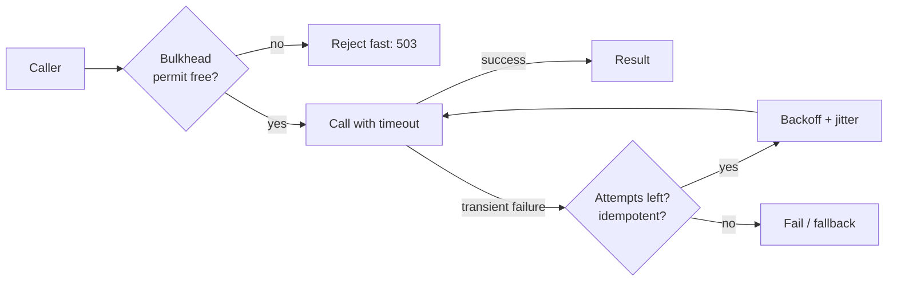

---
tags:
  - Microservices
  - Intermediate
  - Resilience
---

# Retry, Timeout & Bulkhead

<span class="badge badge--intermediate">🟡 Intermediate</span>
<span class="badge badge--category">Microservices</span>
<span class="badge badge--interview">Interview frequency ⭐⭐⭐⭐⭐</span>

!!! abstract "TL;DR"
    **Three small patterns that together keep remote calls safe:**
    **Timeout**: never wait forever; give each call a deadline.
    **Retry**: repeat calls that failed for *transient* reasons, with exponential backoff and **jitter**, and only if the operation is idempotent.
    **Bulkhead**: cap concurrent calls per dependency so one slow dependency can't consume all threads.

---

## 1. Intent & Problem It Solves

**The problem in plain English:**

- Without **timeouts**, one hung supplier blocks the search page forever (the default socket read timeout in many clients is *infinite*).
- Without **retries**, a 50 ms network blip during a deploy becomes a customer-facing error.
- With **naive retries**, 10,000 clients retry at the same instant and knock the recovering service over again (a *retry storm*).
- Without **bulkheads**, slow statement PDFs use every thread, so payments, which share the pool, fail too.

The name *bulkhead* comes from ships: watertight compartments mean one breach doesn't sink the ship.

## 2. Real-World Analogy

!!! example "Calling a busy restaurant"
    **Timeout**: you hang up after 2 minutes on hold. **Retry**: you call back later, but not every 5 seconds, and you don't place the same order twice. **Jitter**: if everyone in town calls back at exactly 7:00, the line jams again, so you try at a random minute. **Bulkhead**: the restaurant has separate phone lines for deliveries and table bookings, so a flood of delivery calls doesn't block bookings.

## 3. Structure



| Pattern | Key settings |
|---|---|
| **Timeout** | Connect timeout, read timeout, overall deadline (budget) |
| **Retry** | Max attempts, base delay, cap, jitter, which errors are retryable |
| **Bulkhead** | Max concurrent calls (semaphore) or a dedicated thread pool per dependency |

## 4. Naive Approach (Without the Patterns)

```java
for (int i = 0; i < 5; i++) {               // retries every error, including 400 Bad Request
    try {
        return http.get(url);                // no timeout: may block forever
    } catch (Exception e) {
        Thread.sleep(1000);                  // fixed delay: all clients retry in lockstep
    }
}
// and every dependency shares the same 200-thread Tomcat pool
```

---

## 5. Three Real-World Examples

### Example 1: Retry with Backoff and Jitter (Grocery inventory)

**Scenario:** Reserving stock gets two `503`s during an inventory-service deploy, then succeeds. A `400` (invalid quantity) is **never** retried. A long outage gives up after 4 attempts. Waits are random between 0 and an exponentially growing ceiling ("full jitter"). The random source is seeded and sleeping is injected, so the output is reproducible.

**Full Code:**

=== "Retry.java"

    ```java
    --8<-- "code/microservices/src/main/java/com/handbook/microservices/resilience/retry/Retry.java"
    ```

    1.  The **sleeper is injected**, so tests don't actually sleep and the demo is deterministic.
    2.  Only **transient** errors are retried, and never past `maxAttempts`.
    3.  **Full jitter**: `random(0, min(cap, base × 2^attempt))`. It spreads retries out and reduces load spikes on the recovering service.

=== "HttpError.java"

    ```java
    --8<-- "code/microservices/src/main/java/com/handbook/microservices/resilience/retry/HttpError.java"
    ```

=== "RetryDemo.java"

    ```java
    --8<-- "code/microservices/src/main/java/com/handbook/microservices/resilience/retry/RetryDemo.java"
    ```

**Output:**

```text
--8<-- "code/outputs/microservices/resilience/retry/RetryDemo.txt"
```

**Why this design:**

- Transient blips become invisible to customers.
- **Bounded** attempts and jitter protect the dependency.
- Reserving stock is safe to retry only because the inventory API uses an **idempotency key** (the order ID). Without one, a retry after a timeout could reserve twice.

---

### Example 2: Per-Supplier Timeouts (Travel flight search)

**Scenario:** A search page queries four airline suppliers in parallel. `AirNova` hangs; `BlueWing` returns 502. With a 300 ms deadline per supplier, the page shows fares from the two healthy suppliers on time and records which suppliers timed out or failed.

**Full Code:**

=== "FlightSearch.java"

    ```java
    --8<-- "code/microservices/src/main/java/com/handbook/microservices/resilience/timeout/FlightSearch.java"
    ```

    1.  `orTimeout` completes the future exceptionally after the deadline. It does **not** stop the underlying task, so real code also sets HTTP client timeouts so sockets are released.
    2.  **Distinguish** timeouts from errors: they mean different things for alerts and supplier SLAs.

=== "FlightSearchDemo.java"

    ```java
    --8<-- "code/microservices/src/main/java/com/handbook/microservices/resilience/timeout/FlightSearchDemo.java"
    ```

**Output:**

```text
--8<-- "code/outputs/microservices/resilience/timeout/FlightSearchDemo.txt"
```

**Why timeouts here:**

- The page latency is bounded by the **deadline**, not by the slowest supplier.
- Partial results are better than no results for search.

---

### Example 3: Semaphore Bulkhead (Banking)

**Scenario:** Generating PDF statements is slow today. Statements get a bulkhead of **3** concurrent calls; payments get their own bulkhead of 10. With 3 statement requests in flight, a 4th is **rejected immediately** (the client gets 503 and retries later), while payments continue normally. Latches make the timing deterministic.

**Full Code:**

=== "Bulkhead.java"

    ```java
    --8<-- "code/microservices/src/main/java/com/handbook/microservices/resilience/bulkhead/Bulkhead.java"
    ```

    1.  `tryAcquire()` without waiting means **reject fast**. Resilience4j's `maxWaitDuration` lets callers queue briefly instead.
    2.  Release in `finally`, or permits leak and the bulkhead slowly closes.

=== "BulkheadDemo.java"

    ```java
    --8<-- "code/microservices/src/main/java/com/handbook/microservices/resilience/bulkhead/BulkheadDemo.java"
    ```

**Output:**

```text
--8<-- "code/outputs/microservices/resilience/bulkhead/BulkheadDemo.txt"
```

**Why a bulkhead here:**

- **Failure isolation**: one slow feature can't starve a critical one.
- Rejection is immediate and visible (metrics), instead of a slow pile-up.

---

??? example "Unit Tests: `ResilienceTest.java`"

    ```java
    --8<-- "code/microservices/src/test/java/com/handbook/microservices/ResilienceTest.java"
    ```

## 6. Variations & Modern Java Take

```yaml
# Resilience4j (reference): see the Circuit Breaker page for the annotated client
resilience4j:
  retry.instances.inventory:
    max-attempts: 3
    wait-duration: 100ms
    enable-exponential-backoff: true
    exponential-backoff-multiplier: 2
    enable-randomized-wait: true          # jitter
    retry-exceptions: [org.springframework.web.client.HttpServerErrorException]
    ignore-exceptions: [org.springframework.web.client.HttpClientErrorException]
  timelimiter.instances.flights:
    timeout-duration: 300ms               # for CompletableFuture-returning methods
  bulkhead.instances.statements:
    max-concurrent-calls: 3
    max-wait-duration: 0
  thread-pool-bulkhead.instances.reports:  # a separate pool: isolates blocking code
    core-thread-pool-size: 4
    max-thread-pool-size: 4
    queue-capacity: 10
```

```java
// HTTP client timeouts (JDK HttpClient)
HttpClient client = HttpClient.newBuilder().connectTimeout(Duration.ofMillis(500)).build();
HttpRequest req = HttpRequest.newBuilder(uri).timeout(Duration.ofSeconds(2)).build(); // per request
```

| Variation | Notes |
|---|---|
| **Deadline propagation** | Pass the remaining budget downstream (gRPC deadlines, a `X-Request-Deadline` header) so callees don't work on requests the caller already abandoned |
| **Hedged requests** | Send a second request to another replica if the first is slower than p95; use the first answer (reads only) |
| **Retry budget** | Allow retries only up to e.g. 10% of traffic, so retries can't multiply load during outages |
| **Thread-pool bulkhead** | A separate pool per dependency; stronger isolation, more threads |
| **Virtual threads** | Make threads cheap but **not** the downstream: a semaphore bulkhead still matters |

## 7. Where It Lives in Real Frameworks

| Where | Retry / Timeout / Bulkhead |
|---|---|
| Resilience4j | `Retry`, `TimeLimiter`, `Bulkhead`, `ThreadPoolBulkhead` |
| Spring Retry | `@Retryable(maxAttempts, backoff = @Backoff(delay, multiplier, random = true))` |
| gRPC | Deadlines, retry policies in service config |
| Envoy / Istio | Route timeouts, retry policies with retry budgets, connection pool limits |
| AWS SDKs | Built-in exponential backoff with jitter |

## 8. Pros, Cons & Trade-offs

| ✅ Pros | ❌ Cons |
|---|---|
| Transient failures hidden from users (retry) | Retries **multiply load** during outages |
| Bounded latency and freed resources (timeout) | Too-short timeouts cause false failures and duplicate work |
| Failure isolation between features (bulkhead) | Bulkhead sizing needs load testing |
| Cheap to add with libraries | Retrying non-idempotent operations causes **duplicates** |

## 9. Pitfalls & Anti-Patterns

!!! danger "Retries at every layer"
    Gateway retries 3×, BFF retries 3×, service retries 3× → **27** calls to the database for one user click. Retry at **one** layer (usually closest to the failure) and use retry budgets.

!!! danger "Retrying non-idempotent operations"
    A timeout doesn't mean the payment failed. Retry only idempotent operations, or make them idempotent with an **idempotency key**.

!!! warning "Timeouts longer than the caller's timeout"
    If the mobile app gives up after 5 s but the backend waits 30 s for a supplier, the work is wasted. Timeouts should **shrink** going downstream.

!!! warning "Fixed delays without jitter"
    Synchronized retries cause periodic load spikes (thundering herd). Always add jitter.

## 10. Senior / Architect Deep Dive (10–15 yrs)

**Timeout budgets.** Start from the user-facing SLO (e.g. 1 s), subtract network and processing, and give each hop a share. Propagate the remaining deadline so downstream services stop when the caller is gone.

**Retry amplification math.** With 3 attempts at each of 3 layers, worst-case load is 3³ = 27×. During a partial outage, retries can turn a 10% failure rate into overload. Use retry **budgets** (Envoy, gRPC) or retry only at the edge.

**Little's law for bulkheads.** Concurrency ≈ throughput × latency. 100 req/s at 200 ms needs ~20 concurrent calls; a bulkhead of 25 gives headroom. When latency degrades to 2 s, the bulkhead caps concurrency at 25 instead of 200. That's the point.

### Production checklist

- [ ] Connect + read timeouts on **every** client (HTTP, JDBC, Redis, Kafka producer).
- [ ] Timeouts shrink downstream; deadlines propagated.
- [ ] Retries: transient errors only, exponential backoff + jitter, max 2–3 attempts, idempotency keys.
- [ ] Retry at one layer; retry budgets in the mesh.
- [ ] Bulkheads per dependency, sized from Little's law + load tests; rejections exported as metrics.
- [ ] Combined with circuit breakers and fallbacks.

### Explain it in 2 minutes (system design round)

> "Every remote call has a timeout derived from the end-to-end budget, and deadlines are propagated. Idempotent calls get at most 2 retries with exponential backoff and full jitter, only for 5xx, 429 and connection errors, and only at one layer so retries don't multiply. Non-idempotent calls use idempotency keys before they can be retried. Each dependency has its own bulkhead sized by Little's law, so a slow dependency degrades one feature, not the whole service. Breakers sit on top to stop calling dependencies that are clearly down."

!!! bug "War story: 27 retries per click"
    A travel site's search went down for 40 minutes after a database replica briefly lagged. Investigation showed the gateway, the search BFF, and the search service each retried 3 times with fixed 100 ms delays. A small slowdown became 27× traffic to the database, arriving in synchronized waves every 100 ms, which kept it overloaded long after the original lag ended.
    **Fix:** retries removed from the gateway and BFF; the service retries at most twice with jittered backoff; Envoy retry budget of 20%; timeouts aligned to the page budget.
    **Lesson:** retries are load. Count them across the whole call chain.

## 11. Related Patterns & Comparisons

| | Retry | Timeout | Bulkhead | Circuit Breaker |
|---|---|---|---|---|
| Handles | Transient blips | Hangs, slowness | Resource exhaustion | Sustained failure |
| Risk if misused | Load amplification, duplicates | False failures | Rejections | Flapping, hidden errors |
| Typical order | Outermost | Innermost (around the call) | Around the call | Between retry and call |

See [Circuit Breaker](circuit-breaker.md), [Rate Limiter](rate-limiter.md), [Idempotent Consumer](idempotent-consumer.md), and [Thread Pool](../concurrency/thread-pool.md).

## 12. Interview Corner

=== "🟢 Beginner / Service Companies"

    **Q1. Why are timeouts important?**

    Without them, a slow or hung dependency blocks threads forever, and the caller eventually runs out of threads.

    **Q2. What is exponential backoff?**

    Waiting longer between each retry (e.g. 100 ms, 200 ms, 400 ms) so a struggling service gets time to recover.

    **Q3. What is jitter?**

    Randomness added to the backoff so many clients don't retry at the same moment.

    **Q4. What is a bulkhead?**

    Limiting concurrent calls (or using separate thread pools) per dependency, so one failing dependency can't consume all resources.

    **Q5. Which errors should be retried?**

    Transient ones: timeouts, connection errors, 502/503/504, 429. Not 400/401/404 or business errors.

=== "🟡 Mid-Level"

    **Q1. Is it safe to retry a POST?**

    Only if the operation is **idempotent**, for example with an `Idempotency-Key` the server deduplicates. Otherwise a retry after a timeout can create duplicates.

    **Q2. Semaphore vs. thread-pool bulkhead?**

    Semaphore: limits concurrency on the caller's thread (cheap). Thread pool: runs calls on a dedicated pool, isolating blocking code completely, but costs threads and a context switch.

    **Q3. How do you choose a timeout value?**

    From the dependency's latency distribution (a bit above p99) and the caller's overall budget. Measure, don't guess.

    **Q4. How do retries and circuit breakers interact?**

    Retries handle short blips; the breaker stops retries from hammering a dependency that is clearly down. Don't retry `CallNotPermittedException`.

    **Q5. What does `orTimeout` on a `CompletableFuture` not do?**

    It doesn't cancel or interrupt the underlying work; it only completes the future exceptionally.

=== "🔴 Senior / FAANG / SAP"

    **Q1. "Explain retry storms and how to prevent them."**

    Many clients retrying at once multiply load on a degraded service, keeping it down. Prevent with jitter, capped attempts, retrying at one layer, retry budgets, circuit breakers, and server-side load shedding (429 with `Retry-After`).

    **Q2. "What is deadline propagation?"**

    Passing the remaining time budget to downstream calls (gRPC does this natively) so every hop knows when to stop. It avoids wasted work for requests the user has abandoned.

    **Q3. "Size a bulkhead for a dependency doing 200 rps at 50 ms p99."**

    Little's law: 200 × 0.05 = 10 concurrent calls at p99; add headroom (e.g. 20). During degradation (500 ms) demand jumps to 100; the bulkhead caps it at 20 and rejects the rest quickly.

    **Q4. "What are hedged requests and when would you use them?"**

    Sending a duplicate request to another replica if the first exceeds ~p95, using whichever returns first. It cuts tail latency for **idempotent reads**; cap the hedging rate to avoid doubling load.

    **Q5. "Timeouts are set everywhere but latency incidents still cascade. Why?"**

    Timeouts may be longer than callers' timeouts (wasted work), retries multiply load, shared pools lack bulkheads, or there is no load shedding at the server. Audit timeouts across the chain.

=== "💻 Coding Challenge"

    **Problem:** Implement and compare backoff strategies: plain exponential, full jitter, and AWS's decorrelated jitter. Then show why jitter matters when 1,000 clients fail at the same moment.

    ??? success "Solution"

        === "BackoffSchedule.java"

            ```java
            --8<-- "code/microservices/src/main/java/com/handbook/microservices/resilience/backoff/BackoffSchedule.java"
            ```

        === "BackoffDemo.java"

            ```java
            --8<-- "code/microservices/src/main/java/com/handbook/microservices/resilience/backoff/BackoffDemo.java"
            ```

        **Output:**

        ```text
        --8<-- "code/outputs/microservices/resilience/backoff/BackoffDemo.txt"
        ```

        **Key points to say:** without jitter, every client's retry lands in the same millisecond, so the service gets a spike exactly when it's weakest. Full jitter spreads the load evenly over the window; decorrelated jitter grows more smoothly. Always cap the delay.

!!! info "Behavioural tie-in (STAR) for experienced candidates"
    - **S:** Our partner-statement exports shared a thread pool with card payments; on month-end, exports slowed and card payments started timing out.
    - **T:** Guarantee payment availability regardless of export load.
    - **A:** Added per-dependency bulkheads (exports 8, payments 50), aligned timeouts with the API budget, and replaced fixed-delay retries with jittered backoff limited to idempotent calls.
    - **R:** At the next month-end, exports queued and finished 20 minutes later than usual; payment p99 was unaffected.

## 13. Quick Revision Card

!!! tip "Remember in 30 seconds"
    - **Timeout** every call; budgets shrink downstream.
    - **Retry** transient + idempotent only; backoff + **jitter**; max 2–3; one layer.
    - **Bulkhead** per dependency (semaphore or pool); size with Little's law.
    - Combine with **circuit breakers** and fallbacks.
    - Retries are load: watch for amplification.

## Practice

- [ ] Add a retry budget to `Retry`: allow retries only while retries are under 10% of calls in the last minute.
- [ ] Make `FlightSearch` take an overall deadline and give each supplier the *remaining* time.
- [ ] Replace the semaphore bulkhead with a thread-pool bulkhead and compare behaviour.

---

[:material-arrow-left: Circuit Breaker](circuit-breaker.md){ .md-button }
[Next: Rate Limiter :material-arrow-right:](rate-limiter.md){ .md-button .md-button--primary }
