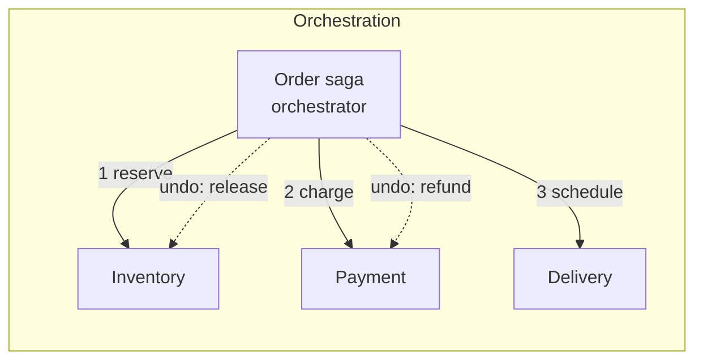
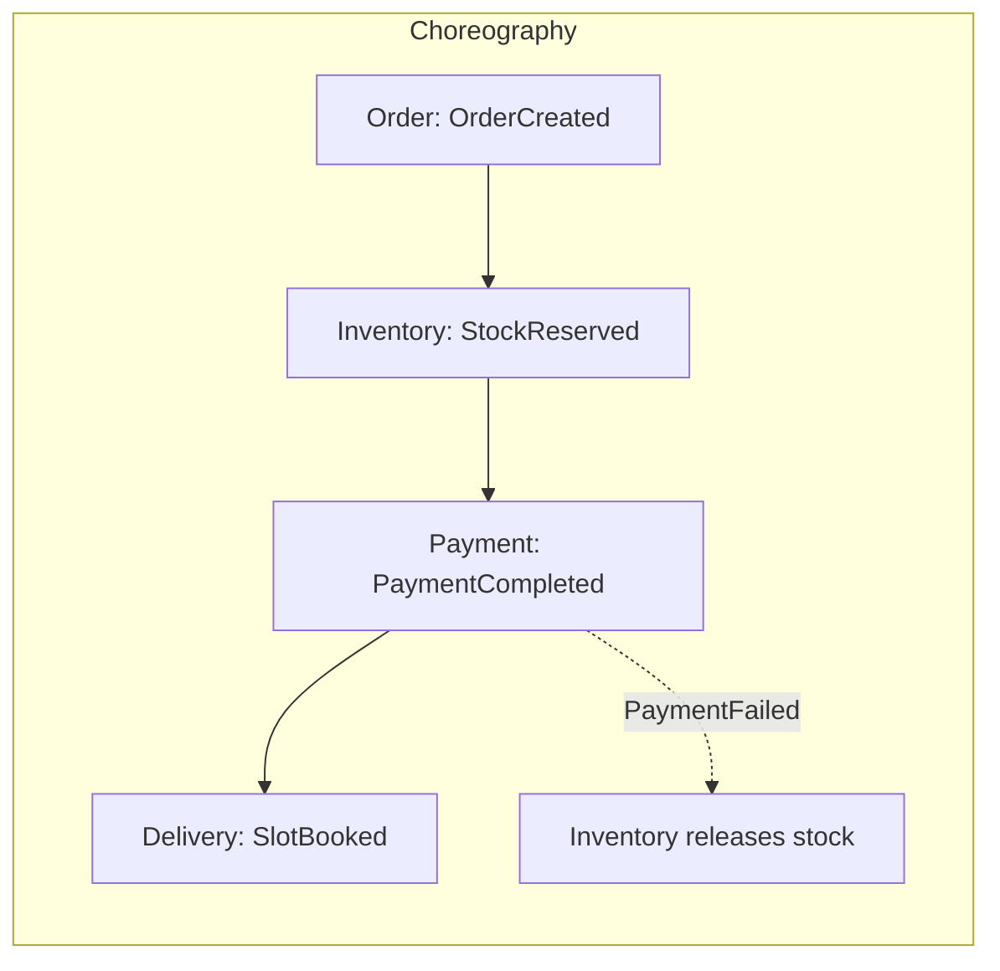
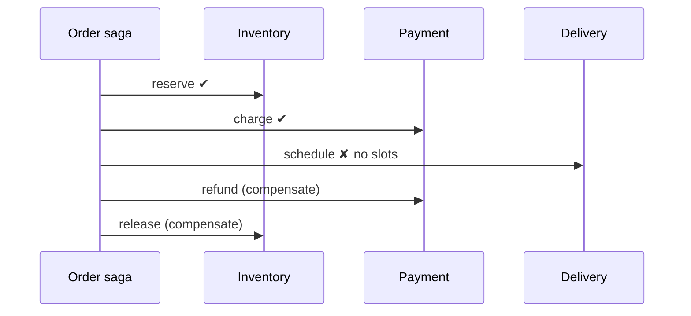
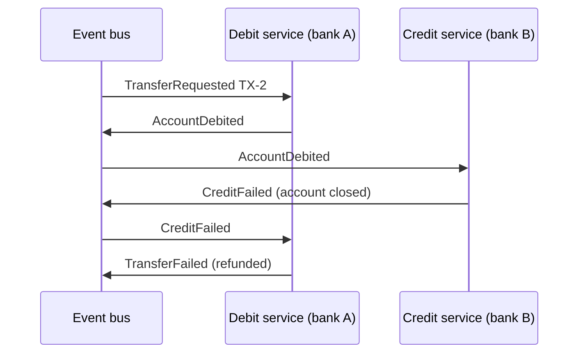

---
tags:
  - Microservices
  - Advanced
  - Data
---

# Saga

<span class="badge badge--advanced">🔴 Advanced</span>
<span class="badge badge--category">Microservices</span>
<span class="badge badge--interview">Interview frequency ⭐⭐⭐⭐⭐</span>

!!! abstract "TL;DR"
    **A saga keeps data consistent across services without a distributed transaction. It is a sequence of local transactions, one per service. If a step fails, the saga runs compensating transactions that semantically undo the steps already completed.**
    It can be coordinated by an **orchestrator** (a central "conductor") or by **choreography** (services reacting to each other's events).

---

## 1. Intent & Problem It Solves

**The problem in plain English:** placing a grocery order touches inventory (reserve stock), payments (charge the card) and delivery (book a slot). Each service has **its own database**, so there's no single `BEGIN ... COMMIT` across them. Two-phase commit (2PC/XA) is slow, couples services' availability, and isn't supported by most brokers and NoSQL stores. Yet "charged but no delivery slot" is unacceptable.

**Definition (Hector Garcia-Molina & Kenneth Salem, 1987; microservices.io):**
> A saga is a sequence of local transactions. Each local transaction updates the database and publishes a message or event to trigger the next local transaction. If a local transaction fails, the saga executes a series of compensating transactions that undo the changes made by the preceding local transactions.

**Key vocabulary:**

| Term | Meaning |
|---|---|
| **Compensating transaction** | Semantic undo: *refund* a charge, *release* a reservation (not a database rollback) |
| **Pivot transaction** | The go/no-go step; after it succeeds, the saga must complete |
| **Retriable transaction** | Steps after the pivot; retried until they succeed |
| **Orchestration** | A coordinator tells each participant what to do |
| **Choreography** | Participants subscribe to events and decide what to do next |

## 2. Real-World Analogy

!!! example "Planning a trip with separate bookings"
    You book a flight, then a hotel, then try to pay for a tour. The tour is sold out, so you **cancel the hotel** and **cancel the flight**, in reverse order, maybe paying a cancellation fee. Nobody "rolls back time"; you perform new actions that undo the effect. That's a saga.

## 3. Structure





| | Orchestration | Choreography |
|---|---|---|
| Flow visible in | One class | Spread across services |
| Coupling | Orchestrator knows participants | Services know events |
| Good for | Complex flows, many steps | Simple flows, 2–4 steps |
| Risk | Orchestrator becomes a "god service" | Cyclic, hard-to-follow event chains |

## 4. Naive Approach (Without the Pattern)

```java
@Transactional // only covers order-service's database!
public void placeOrder(Order o) {
    inventoryClient.reserve(o);   // remote call: committed in inventory's DB
    paymentClient.charge(o);      // remote call: committed in payment's DB
    deliveryClient.schedule(o);   // fails → local rollback only
}   // result: stock reserved and card charged for an order that doesn't exist
```

---

## 5. Three Real-World Examples

All orchestrated examples share one small orchestrator:

=== "SagaOrchestrator.java"

    ```java
    --8<-- "code/microservices/src/main/java/com/handbook/microservices/saga/core/SagaOrchestrator.java"
    ```

    1.  **Retriable** steps (after the pivot) are never compensated; they are retried.
    2.  Completed steps go on a **stack**, so compensations run in reverse order.
    3.  Compensations themselves must be **idempotent and retriable**: in production, a failed compensation is retried, not abandoned.
    4.  Retries are bounded; exhausted retries go to a human (a dead-letter queue plus an alert).

### Example 1: Place-Order Saga (Grocery, orchestration)

**Scenario:** Reserve stock → charge payment → schedule delivery. ORD-1 succeeds. ORD-2's pincode has no delivery slots, so the payment is **refunded** and stock **released**. ORD-3 fails at the first step, so there's nothing to undo.

**Design:**



**Full Code:**

=== "PlaceOrderSaga.java"

    ```java
    --8<-- "code/microservices/src/main/java/com/handbook/microservices/saga/grocery/PlaceOrderSaga.java"
    ```

    1.  Each action is paired with its **compensation** right where it's defined, so they can't drift apart.

=== "GroceryServices.java"

    ```java
    --8<-- "code/microservices/src/main/java/com/handbook/microservices/saga/grocery/GroceryServices.java"
    ```

=== "PlaceOrderSagaDemo.java"

    ```java
    --8<-- "code/microservices/src/main/java/com/handbook/microservices/saga/grocery/PlaceOrderSagaDemo.java"
    ```

**Output:**

```text
--8<-- "code/outputs/microservices/saga/grocery/PlaceOrderSagaDemo.txt"
```

**Why a saga here:**

- Three databases, no distributed transaction, yet **no orphaned charges or reservations**.
- The whole flow is readable in one place (orchestration).
- **Ordering tip:** put steps that are most likely to fail, or cheapest to undo, **first** (validate delivery before charging in a real design).

---

### Example 2: Trip Booking with a Pivot (Travel)

**Scenario:** Hold a flight and a hotel (both cancellable), then **charge the card: the pivot**. After payment, the trip is sold; if the airport-cab partner is flaky, the saga **retries forward** instead of refunding the whole trip. If the hotel is sold out before payment, the flight hold is cancelled.

**Full Code:**

=== "TripBookingSaga.java"

    ```java
    --8<-- "code/microservices/src/main/java/com/handbook/microservices/saga/travel/TripBookingSaga.java"
    ```

    1.  The **pivot**: the point of no return. Before it, compensate; after it, complete.
    2.  **Retriable** steps must eventually succeed (idempotent calls, retries, a manual fallback).

=== "TripBookingDemo.java"

    ```java
    --8<-- "code/microservices/src/main/java/com/handbook/microservices/saga/travel/TripBookingDemo.java"
    ```

**Output:**

```text
--8<-- "code/outputs/microservices/saga/travel/TripBookingDemo.txt"
```

**Why a pivot here:**

- Refunding a whole holiday because a cab API timed out is bad business.
- Making the structure explicit (compensatable → pivot → retriable) forces the right conversation with the product owner.

---

### Example 3: Inter-Bank Transfer (Banking, choreography)

**Scenario:** No orchestrator. The debit service reacts to `TransferRequested` by debiting and publishing `AccountDebited`. The credit service reacts by crediting, or publishes `CreditFailed` if the target account is closed. The debit service listens for `CreditFailed` and **refunds** (the compensation), then publishes `TransferFailed`.

**Design:**



**Full Code:**

=== "TransferChoreography.java"

    ```java
    --8<-- "code/microservices/src/main/java/com/handbook/microservices/saga/banking/TransferChoreography.java"
    ```

    1.  The **compensation** is triggered by an event, not called by a coordinator.

=== "TransferChoreographyDemo.java"

    ```java
    --8<-- "code/microservices/src/main/java/com/handbook/microservices/saga/banking/TransferChoreographyDemo.java"
    ```

=== "EventBus.java (support)"

    ```java
    --8<-- "code/microservices/src/main/java/com/handbook/microservices/support/EventBus.java"
    ```

**Output:**

```text
--8<-- "code/outputs/microservices/saga/banking/TransferChoreographyDemo.txt"
```

**Why choreography here:**

- Two participants and a short flow: no orchestrator needed.
- The banks are separate organizations; neither should own a central coordinator.
- The demo bus is synchronous for clarity; with Kafka, the same flow is asynchronous and **at-least-once**, so each handler must be idempotent (see [Idempotent Consumer](idempotent-consumer.md)).

---

??? example "Unit Tests: `SagaTest.java`"

    ```java
    --8<-- "code/microservices/src/test/java/com/handbook/microservices/SagaTest.java"
    ```

## 6. Variations & Modern Java Take

**A choreography participant with Spring Kafka** (compiled in the `spring-reference` module):

```java
--8<-- "code/spring-reference/src/main/java/com/handbook/springref/saga/PaymentSagaListener.java"
```

| Option | Notes |
|---|---|
| **Hand-written orchestrator** with a saga state table | Full control; you build persistence, timeouts, retries |
| **Temporal / Cadence** | Durable workflows in Java code: retries, timers and state persisted for you |
| **Camunda / Zeebe** | BPMN workflows with compensation events |
| **Axon Framework** | `@Saga` with `@SagaEventHandler`, in an event-sourced style |
| **Eventuate Tram Sagas** | Orchestration sagas over the transactional outbox |
| **AWS Step Functions** | Managed state machines with catch/compensate branches |

**Countermeasures for missing isolation** (sagas are ACD, without the I):

- **Semantic lock**: mark records `PENDING` (order `APPROVAL_PENDING`) so other flows treat them carefully.
- **Commutative updates**: design operations that can be applied in any order (debit/credit amounts, not "set balance").
- **Pessimistic view**: order steps to minimize business risk (charge after cheap checks).
- **Reread value**: check data hasn't changed before overwriting.

## 7. Where It Lives in Real Frameworks

| Where | Saga |
|---|---|
| Temporal (Java SDK) | `Saga` helper with `addCompensation()` inside workflows |
| Axon Framework | `@Saga`, `@StartSaga`, `@EndSaga` |
| Camunda | BPMN compensation boundary events |
| Eventuate Tram | `SagaDefinition` with `step().invokeParticipant().withCompensation()` |

## 8. Pros, Cons & Trade-offs

| ✅ Pros | ❌ Cons |
|---|---|
| Consistency **without 2PC** across services | Only **eventual** consistency; intermediate states are visible |
| Each service keeps its own database and availability | **No isolation**: concurrent sagas can interfere (anomalies) |
| Works with brokers and NoSQL | Compensations must be designed for every step |
| Explicit business-level failure handling | Debugging distributed flows is hard without tracing |

## 9. Pitfalls & Anti-Patterns

!!! danger "Non-idempotent steps and compensations"
    Messages are redelivered and orchestrators crash and retry. "Refund" executed twice refunds twice. Every step and compensation needs an idempotency key.

!!! danger "Losing saga state on crash"
    An in-memory orchestrator that crashes mid-saga leaves money charged and stock reserved forever. Persist saga state (see the coding challenge), or use a workflow engine.

!!! warning "Compensations that can't compensate"
    You can't "unsend" an email or "unship" a parcel. Move irreversible actions **after the pivot**, or compensate with a new business action (a correction email, a return label).

!!! warning "Choreography spaghetti"
    Ten services reacting to each other's events with nobody owning the flow. If you need a diagram to understand it, consider orchestration.

## 10. Senior / Architect Deep Dive (10–15 yrs)

**Orchestration vs. choreography in practice.** Most mature teams use **orchestration for core business flows** (order, payment, onboarding) because the flow is versioned, testable and observable in one place, and use **choreography for loose reactions** (send email when an order ships). Workflow engines (Temporal) make orchestration durable without writing the state machine yourself.

**Isolation anomalies.** Lost updates (saga B overwrites saga A's change), dirty reads (reading a reservation that will be compensated), fuzzy reads. Use semantic locks (`PENDING` states), version checks and commutative operations. Discuss which anomalies are acceptable for the business.

**Timeouts.** A participant may never reply. Sagas need deadlines per step ("payment not confirmed in 15 min → cancel order"), implemented with durable timers (a scheduler table or a workflow engine).

### Production checklist

- [ ] Saga state persisted (state table or workflow engine); recovery on restart.
- [ ] Every step and compensation **idempotent** (idempotency keys, processed-message table).
- [ ] Steps ordered: validations and reversible steps first, irreversible steps after the pivot.
- [ ] Commands and events sent via the **transactional outbox**.
- [ ] Per-step timeouts with durable timers; dead-letter handling and alerts for stuck sagas.
- [ ] Semantic locks (`PENDING` states) visible in UIs and APIs.
- [ ] Tracing across all steps (one trace or a correlation ID per saga).

### Explain it in 2 minutes (system design round)

> "Order placement spans inventory, payment and delivery, each with its own database, so I'd use an **orchestrated saga**, owned by the order service or run in Temporal. The order starts as `PENDING`. Steps: reserve stock, charge payment (the pivot), book delivery (retried until it succeeds). If a step before the pivot fails, compensations run in reverse: refund, release. Saga state is persisted, commands go through the outbox, every handler is idempotent, and each step has a timeout. The customer sees 'processing' until the saga completes, then gets a push notification."

!!! bug "War story: the refund that ran three times"
    A marketplace's payment-failure compensation listened to `DeliveryFailed` events. During a broker rebalance, the same event was delivered three times, and the handler issued **three refunds** for one order. Finance found the loss two weeks later.
    **Fix:** compensations keyed by `(sagaId, step)` in a processed-messages table inside the same local transaction; the refund API called with an idempotency key.
    **Lesson:** "at-least-once delivery" means **your code** must make it "exactly-once in effect".

## 11. Related Patterns & Comparisons

| | Saga | 2PC / XA | Transactional Outbox | Event Sourcing |
|---|---|---|---|---|
| Consistency | Eventual, with compensations | Atomic | Atomic DB write + event | Events are the source of truth |
| Availability | High | Lower (coordinator, locks) | High | High |
| Typical use | Cross-service business flows | Single org, XA-capable resources | Reliable event publishing **for** sagas | Audit, temporal queries |

See [Transactional Outbox](transactional-outbox.md), [Idempotent Consumer](idempotent-consumer.md), and the in-process [Command](../behavioral/command.md) pattern (actions with undo).

## 12. Interview Corner

=== "🟢 Beginner / Service Companies"

    **Q1. What is a saga?**

    A sequence of **local transactions** across services; if one fails, **compensating transactions** undo the earlier ones.

    **Q2. Why not use a normal database transaction?**

    Each microservice has its own database; a single transaction can't span them, and distributed transactions (2PC) are slow and reduce availability.

    **Q3. Orchestration vs. choreography?**

    Orchestration: a central coordinator tells services what to do. Choreography: services listen to events and react, with no central coordinator.

    **Q4. What is a compensating transaction? Give an example.**

    A business action that semantically undoes a previous step: refund a payment, release reserved stock, cancel a booking.

    **Q5. Is a saga ACID?**

    No: it's **ACD** without isolation, and **eventually** consistent.

=== "🟡 Mid-Level"

    **Q1. When would you choose orchestration?**

    For complex flows with many steps, conditional logic or timeouts, where seeing the flow in one place matters.

    **Q2. What happens if a compensation fails?**

    Retry it (it must be idempotent); after repeated failures, alert and send to manual handling. Compensations must eventually succeed.

    **Q3. What is a pivot transaction?**

    The go/no-go step. Steps before it are compensatable; steps after it are retriable and must complete.

    **Q4. How do sagas publish events reliably?**

    With the **transactional outbox**: the local state change and the event are written in one local transaction, then relayed to the broker.

    **Q5. Which tools help implement sagas in Java?**

    Temporal, Camunda/Zeebe, Axon, Eventuate Tram, or Spring Kafka with a hand-written state machine.

=== "🔴 Senior / FAANG / SAP"

    **Q1. "Explain isolation anomalies in sagas and countermeasures."**

    Lost updates, dirty reads, non-repeatable reads, because intermediate states are visible. Countermeasures: semantic locks (`PENDING`), commutative updates, version checks (reread value), and ordering steps by risk.

    **Q2. "Design the order saga for a food delivery app, including timeouts."**

    States: `PENDING → RESTAURANT_ACCEPTED → PAID → COURIER_ASSIGNED → CONFIRMED`; compensations: void payment authorization, cancel at restaurant; timeouts: restaurant must accept in 3 min, courier in 10 min (else reassign or cancel and refund); durable timers; outbox; idempotent handlers.

    **Q3. "2PC vs. saga: when would you still use 2PC?"**

    Within one organization, few XA-capable resources, short transactions, strong consistency required, and lower availability acceptable (e.g. DB + legacy queue in a monolith). Not across microservices.

    **Q4. "How do you test sagas?"**

    Unit test the orchestrator with fake participants for every failure point; contract tests for messages; chaos tests that crash the orchestrator mid-flow; and verify idempotency by redelivering every message.

    **Q5. "How would you migrate a monolith's @Transactional checkout to a saga?"**

    Identify steps and compensations, introduce `PENDING` states and the outbox while still in the monolith, extract one participant at a time behind its API, then move coordination to an orchestrator or workflow engine.

=== "💻 Coding Challenge"

    **Problem:** The orchestrator pod crashes in the middle of a saga. Persist a saga log so a new pod can find unfinished sagas on startup and compensate the steps that completed.

    ??? success "Solution"

        === "DurableSaga.java"

            ```java
            --8<-- "code/microservices/src/main/java/com/handbook/microservices/saga/recovery/DurableSaga.java"
            ```

        === "DurableSagaDemo.java"

            ```java
            --8<-- "code/microservices/src/main/java/com/handbook/microservices/saga/recovery/DurableSagaDemo.java"
            ```

        **Output:**

        ```text
        --8<-- "code/outputs/microservices/saga/recovery/DurableSagaDemo.txt"
        ```

        **Key points to say:** write the log **before** and **after** each step. A step with `BEGIN` but no `DONE` is ambiguous (it may or may not have happened), which is why its compensation must also be safe to run when the action never happened. Real systems persist this in a `saga_instance` table or let Temporal do it.

!!! info "Behavioural tie-in (STAR) for experienced candidates"
    - **S:** After splitting checkout into services, about 0.4% of orders ended up charged but not fulfilled; support refunded them by hand.
    - **T:** Make checkout consistent without reintroducing a shared database.
    - **A:** Designed an orchestrated saga with explicit compensations and a pivot at payment capture; added the outbox, idempotency keys and per-step timeouts; built a dashboard of stuck sagas.
    - **R:** Orphaned charges went to zero; the support team's manual refund queue disappeared.

## 13. Quick Revision Card

!!! tip "Remember in 30 seconds"
    - **Local transactions + compensations**, no 2PC.
    - **Orchestration** (central coordinator) vs. **choreography** (events).
    - Compensatable → **pivot** → retriable.
    - Idempotent steps, persisted state, outbox, timeouts.
    - No isolation: semantic locks (`PENDING`).

## Practice

- [ ] Reorder the grocery saga so delivery availability is checked before payment, and explain why that's better.
- [ ] Add a timeout to the trip saga: if the hotel doesn't confirm within 5 minutes (FakeClock), compensate.
- [ ] Rewrite the place-order flow as choreography with the `EventBus` and compare readability.

---

[:material-arrow-left: Rate Limiter](rate-limiter.md){ .md-button }
[Next: Transactional Outbox :material-arrow-right:](transactional-outbox.md){ .md-button .md-button--primary }
