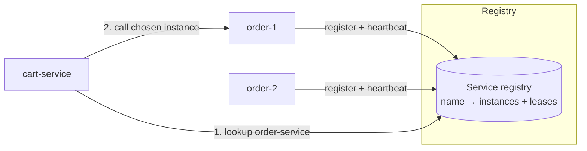
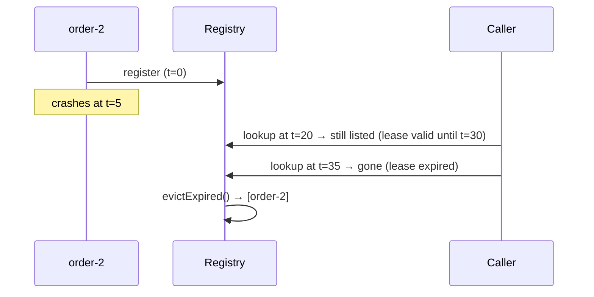
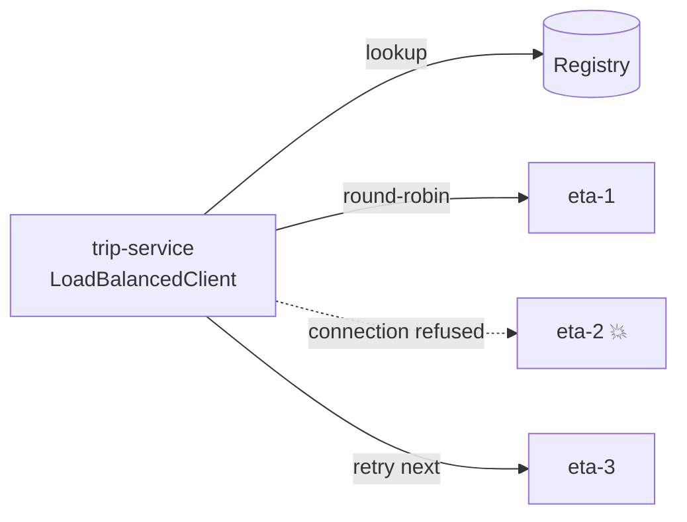
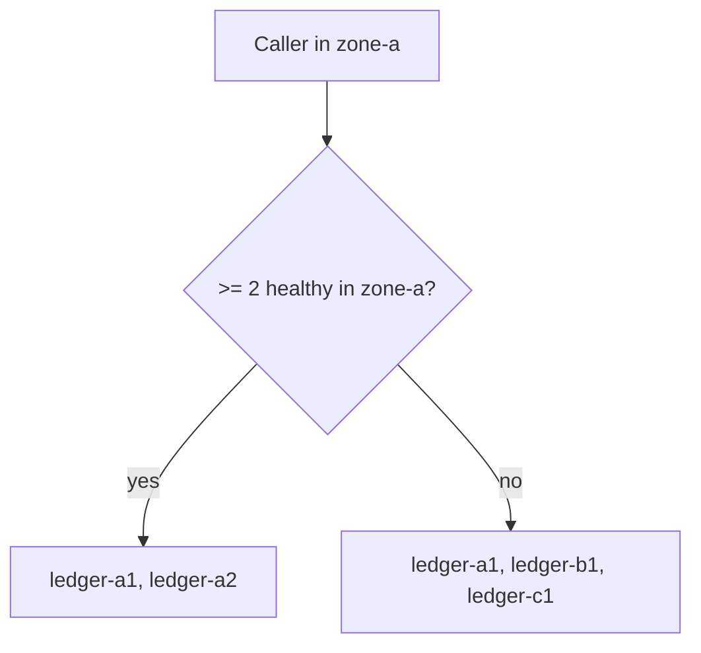

---
tags:
  - Microservices
  - Intermediate
---

# Service Discovery

<span class="badge badge--intermediate">🟡 Intermediate</span>
<span class="badge badge--category">Microservices</span>
<span class="badge badge--interview">Interview frequency ⭐⭐⭐⭐</span>

!!! abstract "TL;DR"
    **Services find each other by name, not hard-coded addresses. Instances register with a registry and renew a lease with heartbeats; callers look up the healthy instances and pick one (client-side), or a load balancer or DNS does it for them (server-side).**
    In cloud environments instances come and go constantly, so addresses must be discovered at runtime.

---

## 1. Intent & Problem It Solves

**The problem in plain English:** `order-service` runs as 3 containers today, 7 during the evening rush, and each deploy replaces them with new IP addresses. A crashed instance should stop getting traffic within seconds. Hard-coding `10.0.1.11:8080` in configuration can't keep up.

**Two halves of the pattern:**

| Part | What happens |
|---|---|
| **Registration** | Instances register on startup (self-registration) or are registered by the platform (Kubernetes, ECS) and are removed on shutdown or when health checks or heartbeats fail |
| **Discovery** | **Client-side**: caller queries the registry and load-balances itself (Eureka + Spring Cloud LoadBalancer). **Server-side**: caller hits a stable name (Kubernetes Service DNS, AWS ALB) and the platform routes |

## 2. Real-World Analogy

!!! example "Taxi dispatch radio"
    Drivers radio in when they start a shift and check in every few minutes ("still available"). The dispatcher (registry) only sends rides to drivers who checked in recently. A driver who goes silent is taken off the board, even if they never said goodbye.

## 3. Structure



| Participant | Responsibility |
|---|---|
| **Registry** | Stores instances and lease timestamps; evicts expired leases |
| **Service instance** | Registers, heartbeats, deregisters on graceful shutdown |
| **Client / load balancer** | Looks up instances, picks one (round-robin, zone-aware), retries the next on connection failure |

## 4. Naive Approach (Without the Pattern)

```properties
# application.properties in cart-service
order.service.urls=http://10.0.1.11:8080,http://10.0.2.12:8080
```

- :material-close-circle:{ style="color:#e53935" } Autoscaling adds instances nobody calls.
- :material-close-circle:{ style="color:#e53935" } A crashed instance keeps receiving traffic until someone edits config.
- :material-close-circle:{ style="color:#e53935" } Every deploy that changes IPs needs a config change in every caller.

---

## 5. Three Real-World Examples

### Example 1: Registry with Leases (Grocery)

**Scenario:** Three `order-service` instances register with a 30-second lease. `order-2` crashes and stops heartbeating, so after 30 s it disappears from lookups and is evicted. During a deploy, `order-3` **deregisters** gracefully (no 30 s of failed calls), and the autoscaler's new `order-4` registers and immediately receives traffic.

**Design:**



**Full Code:**

=== "ServiceRegistry.java"

    ```java
    --8<-- "code/microservices/src/main/java/com/handbook/microservices/discovery/registry/ServiceRegistry.java"
    ```

    1.  **Self-registration** on startup (Spring Cloud does this automatically with `@EnableDiscoveryClient`).
    2.  The **heartbeat renews the lease**. No heartbeat means the instance is assumed dead.
    3.  **Graceful deregistration** on shutdown avoids a window of failed calls during deploys.
    4.  Lookups **filter expired leases**, so callers stop seeing dead instances even before eviction runs.

=== "RegistryDemo.java"

    ```java
    --8<-- "code/microservices/src/main/java/com/handbook/microservices/discovery/registry/RegistryDemo.java"
    ```

**Output:**

```text
--8<-- "code/outputs/microservices/discovery/registry/RegistryDemo.txt"
```

**Why this design:**

- Leases make failure detection **automatic**: silence means gone.
- Note the gap: between t=5 (crash) and t=30 (lease expiry), callers may still pick `order-2`. That's why clients need **retries on connection failure** (Example 2).

---

### Example 2: Client-Side Load Balancing (Ride-hailing)

**Scenario:** The trip service calls `eta-service`, which has three instances. `eta-2` crashed 5 seconds ago, so its lease is still valid and the registry still lists it. The client round-robins across instances and, on a **connection failure**, tries the next one, so riders never see an error.

**Design:**



**Full Code:**

=== "LoadBalancedClient.java"

    ```java
    --8<-- "code/microservices/src/main/java/com/handbook/microservices/discovery/clientside/LoadBalancedClient.java"
    ```

    1.  Real clients **cache** the instance list and refresh it every few seconds instead of calling the registry per request.
    2.  **Round-robin**; `floorMod` keeps the index valid even after the counter overflows.
    3.  Retry another instance only on **connection-level** failures (safe: the request never reached the server). Retrying after a timeout could execute a non-idempotent request twice.

=== "ClientSideDemo.java"

    ```java
    --8<-- "code/microservices/src/main/java/com/handbook/microservices/discovery/clientside/ClientSideDemo.java"
    ```

**Output:**

```text
--8<-- "code/outputs/microservices/discovery/clientside/ClientSideDemo.txt"
```

**Why client-side here:**

- No extra network hop through a central load balancer.
- The client can apply **smart policies** (retry next, zone preference, weighted) per call.
- Cost: every client language needs the library. That's why meshes and Kubernetes moved this into infrastructure.

---

### Example 3: Zone-Aware Routing (Payments)

**Scenario:** A payments caller in `zone-a` should call `ledger-service` instances in its own zone for lower latency and to avoid cross-zone data transfer charges. But if `zone-a` drops below 2 healthy instances, the remaining one would be overloaded, so the balancer **spills over** to all zones.

**Design:**



**Full Code:**

=== "ZoneAwareBalancer.java"

    ```java
    --8<-- "code/microservices/src/main/java/com/handbook/microservices/discovery/zone/ZoneAwareBalancer.java"
    ```

    1.  **Same-zone preference**: lower latency and no cross-zone traffic cost.
    2.  **Spill-over threshold** protects a shrunken zone from being overwhelmed.

=== "ZoneAwareDemo.java"

    ```java
    --8<-- "code/microservices/src/main/java/com/handbook/microservices/discovery/zone/ZoneAwareDemo.java"
    ```

**Output:**

```text
--8<-- "code/outputs/microservices/discovery/zone/ZoneAwareDemo.txt"
```

**Why zone-aware here:**

- Payments are latency-sensitive; same-zone calls are faster.
- Zone failures are a real event in the cloud; spill-over keeps capacity.

---

??? example "Unit Tests: `ServiceDiscoveryTest.java`"

    ```java
    --8<-- "code/microservices/src/test/java/com/handbook/microservices/ServiceDiscoveryTest.java"
    ```

## 6. Variations & Modern Java Take

**Spring Cloud (client-side)** reference configuration:

```yaml
# order-service: registers itself with Eureka
spring.application.name: order-service
eureka:
  client.service-url.defaultZone: http://eureka:8761/eureka
  instance:
    lease-renewal-interval-in-seconds: 10     # heartbeat
    lease-expiration-duration-in-seconds: 30  # lease
```

```java
// cart-service: "order-service" is resolved through discovery + Spring Cloud LoadBalancer
@Bean @LoadBalanced
RestClient.Builder restClientBuilder() { return RestClient.builder(); }

String order = restClientBuilder.build()
        .get().uri("http://order-service/orders/{id}", id)
        .retrieve().body(String.class);
```

**Kubernetes (server-side)**: a `Service` gives a stable DNS name (`order-service.shop.svc.cluster.local`); kube-proxy or the mesh routes to ready pods. **Readiness probes** play the role of heartbeats. In Kubernetes you usually don't need Eureka at all.

| Option | Style |
|---|---|
| Eureka + Spring Cloud LoadBalancer | Client-side, AP (favors availability) |
| Consul | Client- or server-side, health checks, KV store |
| Kubernetes Services + DNS | Server-side, built in |
| Service mesh (Istio/Linkerd) | Sidecar does discovery and balancing |
| AWS Cloud Map / ALB target groups | Managed |

## 7. Where It Lives in Real Frameworks

| Where | Discovery |
|---|---|
| Netflix Eureka | Registry with leases and self-preservation |
| Spring Cloud | `DiscoveryClient`, `@LoadBalanced`, `lb://` URIs in Gateway |
| Kubernetes | Endpoints/EndpointSlices, CoreDNS, readiness probes |
| gRPC | Name resolvers + load-balancing policies (`round_robin`, xDS) |

## 8. Pros, Cons & Trade-offs

| ✅ Pros | ❌ Cons |
|---|---|
| Elastic scaling and self-healing routing | Registry is critical infrastructure (must be HA) |
| No hard-coded addresses | **Staleness window** between crash and lease expiry |
| Client-side: no extra hop, smart policies | Client-side: library needed per language |
| Server-side: simple clients | Server-side: an extra hop through the balancer |

## 9. Pitfalls & Anti-Patterns

!!! danger "Retrying non-idempotent calls after a timeout"
    "Try the next instance" is safe only when the request never reached the first one (connection refused). After a timeout, the first instance may have processed the payment. Use idempotency keys (see [Idempotent Consumer](idempotent-consumer.md)).

!!! warning "No graceful shutdown"
    Killing instances without deregistering (or without failing readiness first) causes a burst of errors on every deploy. Deregister, drain in-flight requests, then stop.

!!! warning "Health check that checks nothing"
    A `/health` that always returns 200 keeps broken instances in rotation. Check what the instance needs to serve traffic, but not shared dependencies (or one database blip removes *every* instance).

## 10. Senior / Architect Deep Dive (10–15 yrs)

**CAP choices.** Eureka is **AP**: during partitions it keeps serving possibly stale data (self-preservation, see the coding challenge), because stale-but-mostly-right beats empty. ZooKeeper/etcd-based registries are **CP**: a minority partition can't serve registrations. For discovery, AP is usually the right call; clients compensate with retries.

**Liveness vs. readiness.** In Kubernetes, *readiness* controls traffic (in or out of the Service); *liveness* restarts the container. Confusing them causes restart storms when a dependency is slow.

**Discovery in a mesh.** Envoy sidecars get endpoints from the control plane (xDS), apply outlier detection (eject instances returning 5xx), zone-aware routing and retries, all without application libraries.

### Production checklist

- [ ] Registry (or platform DNS) is **HA**; clients cache instance lists and survive registry outages.
- [ ] Heartbeat/lease or readiness tuned: fast enough to drop dead instances, not so fast that GC pauses cause flapping.
- [ ] **Graceful shutdown**: fail readiness or deregister → drain → stop.
- [ ] Client retries the next instance on **connection** errors; idempotency for others.
- [ ] **Outlier detection**: eject instances with high error rates.
- [ ] Zone-aware routing with spill-over.

### Explain it in 2 minutes (system design round)

> "On Kubernetes I'd use built-in discovery: each service gets a Service DNS name, readiness probes control which pods get traffic, and the mesh or kube-proxy load-balances. Outside Kubernetes I'd use Consul or Eureka with self-registration and heartbeats, and client-side load balancing via Spring Cloud LoadBalancer. Either way: clients cache endpoints, retry another instance on connection failures, instances drain gracefully on shutdown, and routing prefers the same zone with spill-over."

!!! bug "War story: the health check that removed everyone"
    A payments platform's `/health` endpoint checked the shared Postgres cluster. A 40-second database failover made **every** instance of **every** service report unhealthy. The registry removed them all, so even endpoints that didn't need the database (static config, cached reads) went down. Recovery took 6 minutes because instances rejoined slowly.
    **Fix:** readiness checks only what's local to the instance (process up, warm caches, thread pools not exhausted). Database failures are handled with circuit breakers per request, not by removing instances.
    **Lesson:** a health check that includes shared dependencies turns a partial outage into a total one.

## 11. Related Patterns & Comparisons

| | Client-side discovery | Server-side discovery | DNS |
|---|---|---|---|
| Who picks the instance | Caller's library | Load balancer / proxy | Resolver (coarse) |
| Extra hop | No | Yes | No |
| Language-agnostic | No | Yes | Yes |
| Smart policies | Yes | In the LB | Limited (TTL caching issues) |

Related: [API Gateway](api-gateway.md) (routes to discovered services), [Sidecar / Service Mesh](sidecar-service-mesh.md), [Circuit Breaker](circuit-breaker.md).

## 12. Interview Corner

=== "🟢 Beginner / Service Companies"

    **Q1. What is service discovery?**

    A way for services to find each other's network locations at runtime using a **registry**, instead of hard-coded addresses.

    **Q2. Name a service registry.**

    **Netflix Eureka**, Consul, ZooKeeper, etcd; Kubernetes has discovery built in (Services + DNS).

    **Q3. What is a heartbeat?**

    A periodic "I'm alive" message from an instance to the registry that renews its lease. Missed heartbeats mean the instance is removed.

    **Q4. What does `@LoadBalanced` do in Spring?**

    Makes a `RestTemplate`/`RestClient`/`WebClient` resolve service names (e.g. `http://order-service`) through discovery and balance across instances.

    **Q5. Client-side vs. server-side discovery?**

    Client-side: the caller queries the registry and picks an instance. Server-side: the caller calls a load balancer or DNS name that picks for it.

=== "🟡 Mid-Level"

    **Q1. Do you need Eureka on Kubernetes?**

    Usually no. Kubernetes Services, DNS and readiness probes cover discovery; Spring Cloud Kubernetes can bridge if needed.

    **Q2. An instance crashes. How long until callers stop using it?**

    Up to the **lease expiry** (plus client cache refresh time). Clients should retry another instance on connection errors to cover that window.

    **Q3. What's graceful shutdown in this context?**

    Deregister (or fail readiness), wait for load balancers to notice, finish in-flight requests, then exit. Spring Boot has `server.shutdown=graceful`.

    **Q4. Readiness vs. liveness?**

    **Readiness**: can I take traffic now? (removed from the Service if not). **Liveness**: am I stuck? (container restarted if not).

    **Q5. Why might DNS-based discovery be problematic?**

    **Caching**: clients and JVMs cache DNS records (`networkaddress.cache.ttl`), so changes propagate slowly; and DNS has no health or load awareness.

=== "🔴 Senior / FAANG / SAP"

    **Q1. "Is a service registry CP or AP? Which would you choose?"**

    Discovery should usually be **AP**: serving slightly stale endpoints is better than serving none. Eureka is AP with self-preservation; ZooKeeper is CP. Clients compensate for staleness with retries and outlier detection.

    **Q2. "Design discovery for 2,000 services across 3 regions."**

    Per-region registries or meshes with a control plane pushing endpoints (xDS); locality-aware routing (zone → region → global failover); clients cache; registry scales horizontally; health is local; cross-region calls are explicit.

    **Q3. "Instances flap in and out of the registry every few minutes. Investigate."**

    Check GC pauses or CPU throttling delaying heartbeats, health checks hitting slow dependencies, too-short leases, network packet loss. Fix by tuning leases, making health checks local, and giving heartbeats their own thread.

    **Q4. "How do you do zero-downtime deploys with discovery?"**

    Rolling updates: new instance registers and becomes ready → old instance fails readiness → drains → stops. Pre-stop hooks with a sleep cover propagation delay.

    **Q5. "What's outlier detection and why is it needed on top of health checks?"**

    Passive ejection of instances that return many 5xx or time out, based on **real traffic**. Health checks can pass while the instance fails real requests.

=== "💻 Coding Challenge"

    **Problem:** Eureka's **self-preservation**: if more than 50% of leases expire at once, the registry is probably partitioned from healthy instances. Stop evicting and keep serving the last known instances until heartbeats return.

    ??? success "Solution"

        === "SelfPreservingRegistry.java"

            ```java
            --8<-- "code/microservices/src/main/java/com/handbook/microservices/discovery/selfpreservation/SelfPreservingRegistry.java"
            ```

        === "SelfPreservationDemo.java"

            ```java
            --8<-- "code/microservices/src/main/java/com/handbook/microservices/discovery/selfpreservation/SelfPreservationDemo.java"
            ```

        **Output:**

        ```text
        --8<-- "code/outputs/microservices/discovery/selfpreservation/SelfPreservationDemo.txt"
        ```

        **Key points to say:** a single crash (1 of 4) evicts normally; mass expiry signals a **partition**, not mass death; stale endpoints plus client retries beat an empty list. This is the AP trade-off in code.

!!! info "Behavioural tie-in (STAR) for experienced candidates"
    - **S:** Every deploy caused 20–40 seconds of 502 errors on our order APIs.
    - **T:** Make deploys invisible to customers.
    - **A:** Traced it to instances being killed before deregistering; added graceful shutdown (fail readiness → 15 s drain → stop), client retries on connection errors, and shorter client cache refresh.
    - **R:** Deploy-related errors went to zero; we went from 2 deploy windows a week to deploying on demand.

## 13. Quick Revision Card

!!! tip "Remember in 30 seconds"
    - **Register → heartbeat (lease) → lookup → pick → deregister.**
    - Client-side (Eureka + LoadBalancer) vs. server-side (K8s Service, ALB).
    - Staleness window → retry next instance on **connection** errors.
    - Graceful shutdown; local health checks; zone-aware routing.
    - Registries are usually **AP** (self-preservation).

## Practice

- [ ] Add weighted random selection (seeded `Random`) to `LoadBalancedClient`.
- [ ] Add outlier detection: eject an instance from selection for 30 s after 3 consecutive failures.
- [ ] Write the Kubernetes `Deployment` probes and `preStop` hook for graceful shutdown of `order-service`.

---

[:material-arrow-left: Backend for Frontend](backend-for-frontend.md){ .md-button }
[Next: Circuit Breaker :material-arrow-right:](circuit-breaker.md){ .md-button .md-button--primary }
