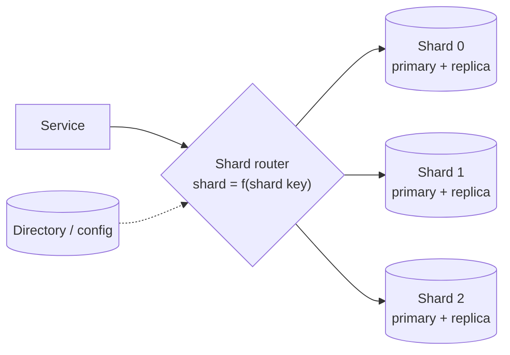
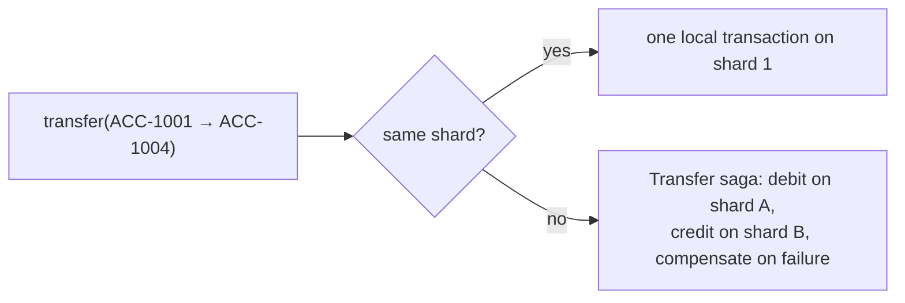
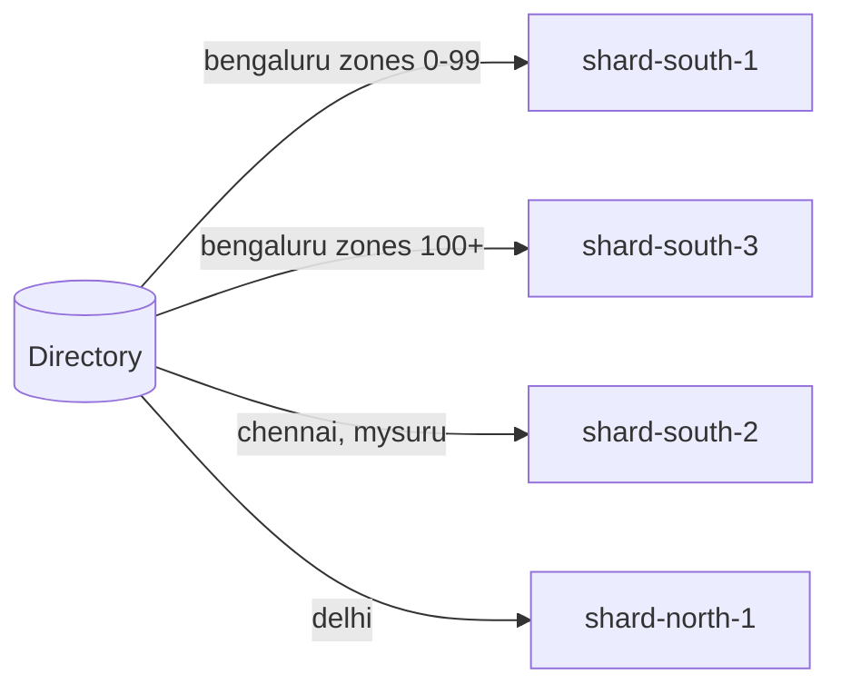
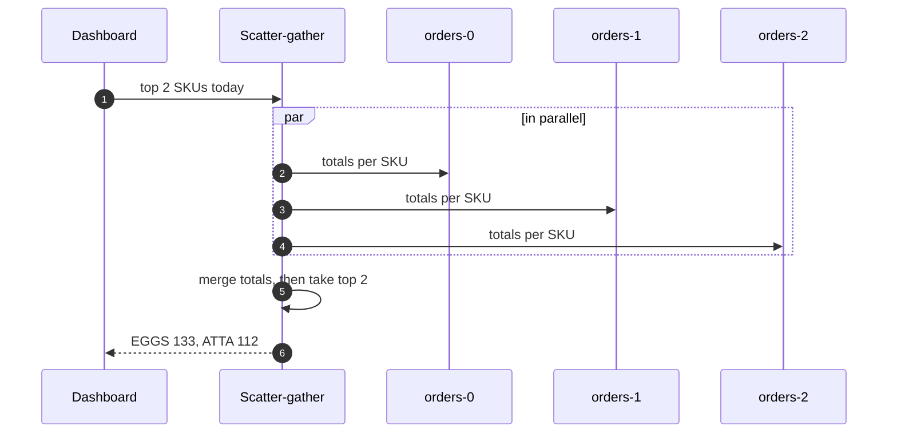

---
tags:
  - Microservices
  - Advanced
  - Data
---

# Sharding

<span class="badge badge--advanced">🔴 Advanced</span>
<span class="badge badge--category">Microservices</span>
<span class="badge badge--interview">Interview frequency ⭐⭐⭐⭐⭐</span>

!!! abstract "TL;DR"
    **Sharding splits one large dataset across several databases (shards) by a *shard key*, so each shard holds only part of the data and takes only part of the load.**
    Use it when a single database can't keep up with writes or storage even after indexing, caching, read replicas and vertical scaling. Choose the shard key from your main access path, because everything else becomes harder.

---

## See It in Motion

<iframe class="motion-embed" src="../../motion/index.html?p=sharding&amp;embed=1" title="Animated walkthrough of the Sharding pattern" loading="lazy"></iframe>

Press **Play** to watch the calls travel between components, or step through with **Next** and **Back**. Switch to **Without it** to see what goes wrong without the pattern, or press a **Break it** button to make something fail while the pattern is in place. [Open the full explorer with all 66 patterns](../motion/index.html#sharding){ target=_blank }

## 1. Intent & Problem It Solves

**The problem in plain English:** a payments ledger grows by 20 million rows a day. One PostgreSQL primary handles reads with replicas, but **writes** all go to one machine; it's at 85% CPU, vacuum can't keep up, and the next bigger instance doesn't exist. You need more than one primary.

**Definition (Azure Architecture Center, *Sharding pattern*):**
> Divide a data store into a set of horizontal partitions or shards. Each shard has the same schema but holds its own distinct subset of the data, and runs on its own server.

**Three ways to pick a shard:**

| Strategy | How | Good at | Bad at |
|---|---|---|---|
| **Hash** | `hash(key) % N` or [consistent hashing](../interview/system-design-patterns.md) | Even spread of writes | Range queries; resharding with `% N` moves most keys |
| **Range** | Key ranges (A–F, dates) per shard | Range scans | Hot spots on sequential keys |
| **Directory / lookup** | A table maps key (tenant, city) → shard | Moving or splitting individual tenants | Directory is a dependency to cache and protect |

**Sharding vs partitioning vs replication:** *partitioning* splits a table **within** one database (PostgreSQL declarative partitions); *sharding* puts partitions on **different servers**; *replication* copies the **same** data for availability and read scaling. Real systems combine all three.

## 2. Real-World Analogy

!!! example "Exam halls by roll number"
    A university with 30,000 students doesn't seat everyone in one hall. Roll numbers 1–5,000 go to Hall A, 5,001–10,000 to Hall B (range sharding). To find a student you only check one hall. A question like "who scored highest across all halls" needs every hall's results combined (scatter-gather).

## 3. Structure



| Participant | Responsibility |
|---|---|
| **Shard key** | The field that decides placement (account id, customer id, tenant id, city) |
| **Router** | Maps a key to a shard: in the app, a library (Vitess, Citus, ShardingSphere) or the database itself |
| **Shards** | Independent databases with the same schema, each usually replicated |
| **Directory** (optional) | Lookup table for directory-based schemes; cached aggressively |
| **Scatter-gather layer** | Runs queries without the shard key on all shards and merges results |

## 4. Naive Approach (Without the Pattern)

```text
Bigger instance → bigger instance → largest instance (still 85% CPU)
Add read replicas → reads fine, writes still on one primary
Archive old rows → buys months, not years
```

- :material-close-circle:{ style="color:#e53935" } Vertical scaling has a hard ceiling and a steep price curve.
- :material-close-circle:{ style="color:#e53935" } Replicas don't help write throughput.
- :material-close-circle:{ style="color:#e53935" } One huge database means huge backups, slow migrations and a single blast radius.

---

## 5. Three Real-World Examples

### Example 1: Hash-Sharded Ledger (Banking)

**Scenario:** A neobank has 40 million accounts and peaks at 15,000 ledger writes per second. Accounts are hash-sharded across databases by account id. Transfers between accounts on the **same** shard are a normal local transaction. Transfers that cross shards can't use one ACID transaction, so they go through a [saga](saga.md) (debit, then credit, with compensation).

**Design:**



**Full Code:**

=== "ShardedLedger.java"

    ```java
    --8<-- "code/microservices/src/main/java/com/handbook/microservices/sharding/banking/ShardedLedger.java"
    ```

    1.  **Routing** is a pure function of the shard key. `% N` is simplest but moves most keys when N changes; production systems use consistent hashing or many fixed virtual shards (e.g. 1,024 logical shards mapped onto 8 servers).
    2.  The router knows when an operation spans shards and refuses to pretend it's atomic.

=== "LedgerShardingDemo.java"

    ```java
    --8<-- "code/microservices/src/main/java/com/handbook/microservices/sharding/banking/LedgerShardingDemo.java"
    ```

**Output:**

```text
--8<-- "code/outputs/microservices/sharding/banking/LedgerShardingDemo.txt"
```

**Why hash sharding here:**

- Writes spread evenly; each shard takes about 1/N of the load.
- Each account's rows live together, so single-account operations stay simple.
- Cross-shard operations are explicit and handled with sagas, not hidden distributed locks.

---

### Example 2: City Shards and a Hot-City Split (Ride-hailing)

**Scenario:** A ride-hailing platform keeps driver locations and trip state per city, because matching only ever looks within one city. Bengaluru on a Friday evening generates 6× the load of the next city. A **directory** maps each city to a shard, and a hot city can be split by zone range without touching anyone else.

**Design:**



**Full Code:**

=== "GeoShardDirectory.java"

    ```java
    --8<-- "code/microservices/src/main/java/com/handbook/microservices/sharding/geo/GeoShardDirectory.java"
    ```

    1.  Splitting changes **one entry** in the directory. With hash `% N`, adding a shard would move every city.
    2.  `floorEntry` finds the range a zone falls into, like range sharding within a city.

=== "GeoShardingDemo.java"

    ```java
    --8<-- "code/microservices/src/main/java/com/handbook/microservices/sharding/geo/GeoShardingDemo.java"
    ```

**Output:**

```text
--8<-- "code/outputs/microservices/sharding/geo/GeoShardingDemo.txt"
```

**Why directory sharding here:**

- The access pattern is naturally **per city**, so queries hit one shard.
- Uneven tenants (Bengaluru vs Mysuru) need individual placement, not a uniform hash.
- Data can be placed near users (data residency, latency).

---

### Example 3: Scatter-Gather for a Cross-Shard Report (Grocery)

**Scenario:** A grocery platform shards orders by **customer id**, so "my orders" hits one shard. But the merchandising dashboard asks "top-selling SKUs today", which has no shard key and must query **every** shard and merge. A common bug is merging each shard's local top-N, which can miss the real winner.

**Design:**



**Full Code:**

=== "ScatterGather.java"

    ```java
    --8<-- "code/microservices/src/main/java/com/handbook/microservices/sharding/scatter/ScatterGather.java"
    ```

    1.  Each shard can compute a local aggregate cheaply...
    2.  ...queried **in parallel**, so latency is the slowest shard, not the sum.
    3.  Merge **complete** partial aggregates, then rank. Ranking before merging is the classic bug.

=== "ScatterGatherDemo.java"

    ```java
    --8<-- "code/microservices/src/main/java/com/handbook/microservices/sharding/scatter/ScatterGatherDemo.java"
    ```

**Output:**

```text
--8<-- "code/outputs/microservices/sharding/scatter/ScatterGatherDemo.txt"
```

**Why scatter-gather here:**

- Some queries legitimately span all data; parallel fan-out keeps them possible.
- It's expensive (N queries, tail latency of the slowest shard), so frequent ones should move to a [materialized view](materialized-view.md) or analytics store.
- Correct merging requires mergeable aggregates (sums, counts), not ranks.

---

??? example "Unit Tests: `ShardingTest.java`"

    ```java
    --8<-- "code/microservices/src/test/java/com/handbook/microservices/ShardingTest.java"
    ```

## 6. Variations & Modern Java Take

| Variation | Notes |
|---|---|
| **Logical (virtual) shards** | 1,024 logical shards mapped to a few physical servers; rebalance by moving logical shards, never rehashing keys |
| **Consistent hashing** | Adding a node moves ~1/N of keys ([LLD: consistent hashing](../interview/system-design-patterns.md)) |
| **Distributed SQL** | CockroachDB, YugabyteDB, Google Spanner, TiDB: automatic range sharding and cross-shard transactions |
| **Sharded PostgreSQL** | Citus (distributed tables, co-location by tenant), Vitess for MySQL |
| **App-level routing in Spring** | `AbstractRoutingDataSource` picks a `DataSource` per request from a shard key in context |
| **NoSQL** | DynamoDB/Cassandra partition keys: sharding is built in, so the key design rules still apply |

## 7. Where It Lives in Real Frameworks

| Where | Sharding |
|---|---|
| Spring | `AbstractRoutingDataSource`, Apache ShardingSphere-JDBC (driver-level sharding) |
| PostgreSQL ecosystem | Citus `create_distributed_table('orders', 'customer_id')`; native partitioning on each shard |
| MySQL | Vitess (YouTube, Slack), ProxySQL |
| Kafka | Topic partitions: `hash(key) % partitions`: same rules, same hot-partition problem |
| Elasticsearch / OpenSearch | Index shards; routing by `_routing` key |
| DynamoDB / Cassandra | Partition key = shard key; avoid hot partitions with high-cardinality keys |

## 8. Pros, Cons & Trade-offs

| ✅ Pros | ❌ Cons |
|---|---|
| Write throughput and storage scale horizontally | Cross-shard queries need scatter-gather |
| Smaller databases: faster backups, migrations, vacuum | Cross-shard transactions need sagas or distributed SQL |
| Failure of one shard affects only part of the users | Resharding is hard and risky |
| Data can live near users (residency, latency) | Operational overhead: N databases to monitor, upgrade, back up |

## 9. Pitfalls & Anti-Patterns

!!! danger "Sharding too early"
    Most services never need it. Exhaust indexing, query fixes, caching, read replicas, partitioning and a bigger instance first. Sharding is a one-way door.

!!! danger "Monotonic shard keys"
    Range-sharding on timestamps or auto-increment ids sends **every new write** to the last shard (coding challenge). Hash them, or prefix with a high-cardinality component.

!!! warning "`hash % N` with no plan for N+1"
    Adding a shard moves ~(N)/(N+1) of keys. Use logical shards or consistent hashing from day one.

!!! warning "Shard key that doesn't match the main query"
    If 80% of queries filter by `store_id` but you shard by `customer_id`, 80% of queries become scatter-gather.

## 10. Senior / Architect Deep Dive (10–15 yrs)

**Choosing the key.** High cardinality, even distribution, present in nearly every query, and stable (never changes for a row). Co-locate data that's queried or updated together under the same key (Citus "co-location": orders, order lines and payments all keyed by `customer_id`).

**Resharding without downtime.** Dual-write or CDC-copy a logical shard to its new home, verify, switch the directory entry, then drain and delete. Logical shards make each move small and reversible. Rehearse it before you need it.

**Hot keys.** A celebrity seller or a viral product can overload one shard regardless of strategy. Split the key (`product#1..#8` for counters), cache reads, queue writes, or give that tenant a dedicated shard via the directory.

!!! bug "War story: the last shard that took every write"
    An e-commerce team range-sharded orders by `created_at` month, reasoning that old months could be archived easily. Every new order went to the current month's shard; at the Diwali sale it hit 100% CPU while the other 11 shards idled at 3%. Checkout errors peaked at 30% for two hours.
    **Fix:** re-shard by hashed `customer_id` into 256 logical shards on 8 servers; time-based archiving moved to PostgreSQL partitioning **inside** each shard.
    **Lesson:** shard keys must spread **writes**, and time is the worst key for that.

## 11. Related Patterns & Comparisons

| | Sharding | Read Replicas | Partitioning (in one DB) | Database per Service |
|---|---|---|---|---|
| Splits | Rows across servers | Nothing (copies) | Rows across tables in one server | Data by business capability |
| Scales | Writes + storage | Reads | Maintenance, pruning | Teams and models |
| Cross-part queries | Scatter-gather | N/A | Transparent | API composition / CQRS |

Related: [Database per Service](database-per-service.md), [CQRS](cqrs.md), [Saga](saga.md) for cross-shard writes, [Materialized View](materialized-view.md) for cross-shard reads.

## 12. Interview Corner

=== "🟢 Beginner / Service Companies"

    **Q1. What is sharding?**

    Splitting data across multiple databases by a key so each database stores and serves only part of it.

    **Q2. Sharding vs replication?**

    Sharding splits data; replication copies it. Sharding scales writes; replication scales reads and availability.

    **Q3. What is a shard key?**

    The field used to decide which shard a row lives on.

    **Q4. Name three sharding strategies.**

    Hash, range, directory (lookup).

    **Q5. What's a hot shard?**

    One shard receiving far more traffic than the others, usually due to a poor key or a very popular entity.

=== "🟡 Mid-Level"

    **Q1. Why is `hash % N` problematic?**

    Changing N remaps most keys, forcing massive data movement.

    **Q2. How do you query across shards?**

    Scatter-gather in parallel and merge results; or maintain a read model/analytics store.

    **Q3. How do you handle a transaction across shards?**

    Avoid it via co-location; otherwise a saga, or a distributed SQL database with distributed transactions.

    **Q4. How do you generate unique ids across shards?**

    UUIDv7, Snowflake-style ids (timestamp + node + sequence) or per-shard ranges.

    **Q5. Why not shard by date?**

    All new writes go to the newest shard.

=== "🔴 Senior / FAANG / SAP"

    **Q1. "Design sharding for an orders database at 50k writes/s."**

    Hash by `customer_id` into 1,024 logical shards on N Citus/Vitess nodes; co-locate order lines/payments; Snowflake ids; CQRS read models for store/merchant views; CDC to an analytics store for reports.

    **Q2. "How do you reshard live?"**

    Logical shards; copy via CDC; verify checksums; flip directory entries per shard; keep the old copy for rollback; throttle to protect production.

    **Q3. "A single seller generates 40% of writes."**

    Dedicated shard via the directory, sub-sharding that seller's key, write queues, and caching their catalog reads.

    **Q4. "When would you choose Spanner/CockroachDB instead?"**

    When you need cross-shard ACID transactions and SQL across regions and can accept higher write latency and cost.

    **Q5. "What are the operational costs?"**

    N× backups, upgrades, schema migrations (must be backward compatible and rolled out per shard), monitoring per shard, and runbooks for shard failover.

=== "💻 Coding Challenge"

    **Problem:** Route today's 100,000 new orders with (a) range-by-quarter on order date and (b) a hash of the order id across 4 shards. Show the distribution and explain the trade-off.

    ??? success "Solution"

        === "ShardKeyDemo.java"

            ```java
            --8<-- "code/microservices/src/main/java/com/handbook/microservices/sharding/hotspot/ShardKeyDemo.java"
            ```

        **Output:**

        ```text
        --8<-- "code/outputs/microservices/sharding/hotspot/ShardKeyDemo.txt"
        ```

        **Key points to say:** range-by-time sends every write to one shard; hashing spreads writes but turns date-range queries into scatter-gather. Pick the key for the dominant access path and serve the other paths with read models.

!!! info "Behavioural tie-in (STAR) for experienced candidates"
    - **S:** Date-range sharding sent all Diwali-sale writes to one shard; checkout errors reached 30%.
    - **T:** Spread writes evenly without losing cheap archiving.
    - **A:** Re-sharded by hashed `customer_id` into 256 logical shards on 8 nodes via CDC copy and per-shard cut-over; kept monthly partitions inside each shard for archiving.
    - **R:** Peak per-shard CPU fell from 100% to 38% the next sale; resharding a logical shard now takes 20 minutes with no downtime.

## 13. Quick Revision Card

!!! tip "Remember in 30 seconds"
    - **Split rows across servers by a shard key**; scales writes and storage.
    - Strategies: **hash** (even), **range** (scans, hotspots), **directory** (flexible).
    - Key: high cardinality, in most queries, stable; co-locate related data.
    - Cross-shard: **scatter-gather** reads, **sagas** for writes.
    - Use logical shards or consistent hashing; shard **last**, not first.

    ```java
    int shard = Math.floorMod(hash(customerId), LOGICAL_SHARDS);   // then logical → physical via directory
    ```

## Practice

- [ ] Replace `% N` in `ShardedLedger` with 64 logical shards mapped onto 3 physical databases.
- [ ] Add a time-ordered unique id generator (timestamp + shard + sequence).
- [ ] Add a timeout to `ScatterGather` that returns partial results with a "partial" flag.

---

[:material-arrow-left: Cache-Aside](cache-aside.md){ .md-button }
[Next: Materialized View :material-arrow-right:](materialized-view.md){ .md-button .md-button--primary }
