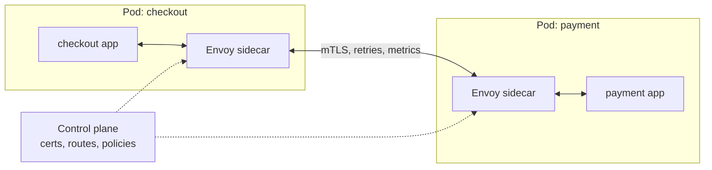
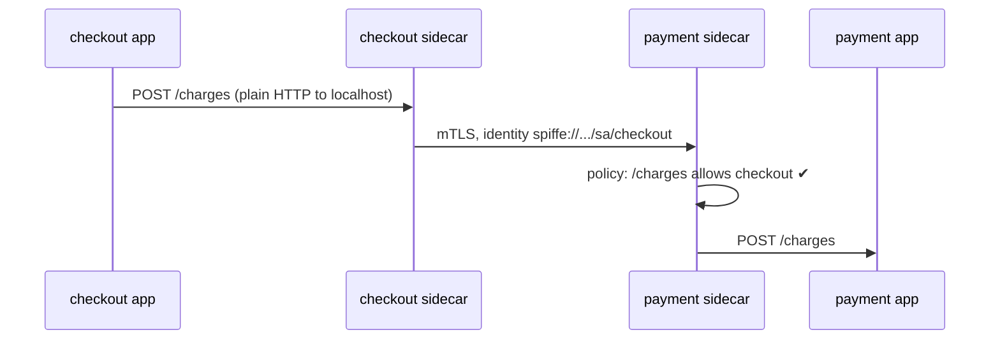

---
tags:
  - Microservices
  - Advanced
  - Platform
---

# Sidecar & Service Mesh

<span class="badge badge--advanced">🔴 Advanced</span>
<span class="badge badge--category">Microservices</span>
<span class="badge badge--interview">Interview frequency ⭐⭐⭐⭐</span>

!!! abstract "TL;DR"
    **A sidecar is a helper process deployed next to each service instance (same pod), adding capabilities such as mTLS, retries, metrics and tracing without changing the service's code. A service mesh is a fleet of sidecar proxies (the data plane) configured centrally by a control plane.**
    Network concerns move out of every application and library into shared infrastructure.

---

## 1. Intent & Problem It Solves

**The problem in plain English:** 80 services in Java, Go, Node and one PHP legacy app. Each needs encryption between services (mTLS), "who may call whom" rules, retries, timeouts, canary routing, metrics and tracing. Implementing these in every language's libraries means 4× the work, inconsistent behaviour and painful upgrades across all services. And security teams want guarantees that don't depend on every team getting it right.

**Definitions:**

> **Sidecar** (Azure Architecture Center): Deploy components of an application into a separate process or container to provide isolation and encapsulation.

> **Service mesh**: A dedicated infrastructure layer for service-to-service communication, made of proxies deployed alongside services (data plane) and a control plane that configures them.

| Plane | What it does | Examples |
|---|---|---|
| **Data plane** | Proxies intercept all traffic: mTLS, routing, retries, metrics | Envoy, linkerd2-proxy, ztunnel |
| **Control plane** | Distributes config, certificates, service discovery | Istiod, Linkerd control plane, Consul |

## 2. Real-World Analogy

!!! example "A motorcycle sidecar, or a diplomat's interpreter"
    The rider (your service) focuses on driving. The sidecar carries the extra equipment. A diplomat doesn't learn every language; an **interpreter** next to them handles communication, checks credentials at the door, and keeps a log, and every diplomat gets one from the same agency (the control plane) with the same rules.

## 3. Structure



| Participant | Responsibility |
|---|---|
| **Application container** | Business logic only; talks plain HTTP to localhost |
| **Sidecar proxy** | Intercepts inbound/outbound traffic (iptables); enforces policy; emits telemetry |
| **Control plane** | Issues workload identities/certificates (SPIFFE), pushes routing and authorization config (xDS) |

## 4. Naive Approach (Without the Pattern)

```text
Java services:    Resilience4j + Spring Security mTLS config + Micrometer + OpenTelemetry agent
Go services:      different retry library, hand-rolled TLS, Prometheus client
Node services:    yet another set; PHP legacy: nothing at all
→ inconsistent retries, some traffic unencrypted, metrics with different names,
  and upgrading the TLS library means 80 pull requests.
```

---

## 5. Three Real-World Examples

### Example 1: Zero-Trust mTLS + Authorization (Grocery payments)

**Scenario:** Only `checkout` may create charges on `payment-service`; `reporting` may read reports but not charge; a compromised pod without a mesh certificate is rejected. Each sidecar presents its workload's **SPIFFE identity** outbound and checks the caller's identity inbound. The payment app contains **no security code**.

**Design:**



**Full Code:**

=== "SidecarProxy.java"

    ```java
    --8<-- "code/microservices/src/main/java/com/handbook/microservices/sidecar/mtls/SidecarProxy.java"
    ```

    1.  In a real mesh, identity comes from the peer's **mTLS certificate** (issued and rotated by the control plane), not from a header; the header stands in for the TLS handshake here.
    2.  No certificate means the caller is outside the mesh: reject.
    3.  **Authorization policy** per path, like Istio's `AuthorizationPolicy`.

=== "ZeroTrustDemo.java"

    ```java
    --8<-- "code/microservices/src/main/java/com/handbook/microservices/sidecar/mtls/ZeroTrustDemo.java"
    ```

**Output:**

```text
--8<-- "code/outputs/microservices/sidecar/mtls/ZeroTrustDemo.txt"
```

**Why a sidecar here:**

- **Zero trust**: being inside the network isn't enough; every call is authenticated and authorized.
- Security rules are enforced uniformly, in every language, and audited centrally.
- Certificates rotate automatically (hours, not years).

---

### Example 2: Canary Traffic Split + Retries (Streaming)

**Scenario:** The recommendations team ships v2. The mesh routes **10%** of calls to v2, then 50%. v2 fails about 5% of requests; the client sidecar **retries once**, and most failures disappear (partly by retrying on v1). The calling app just calls "recommendations"; weights and retries are configuration.

**Full Code:**

=== "TrafficSplitSidecar.java"

    ```java
    --8<-- "code/microservices/src/main/java/com/handbook/microservices/sidecar/traffic/TrafficSplitSidecar.java"
    ```

    1.  **Weighted subsets**, as in Istio `VirtualService` route weights. Seeded random keeps the demo reproducible.
    2.  **Retries in the proxy**. Configure them for idempotent requests only, with a retry budget.

=== "TrafficSplitDemo.java"

    ```java
    --8<-- "code/microservices/src/main/java/com/handbook/microservices/sidecar/traffic/TrafficSplitDemo.java"
    ```

**Output:**

```text
--8<-- "code/outputs/microservices/sidecar/traffic/TrafficSplitDemo.txt"
```

**Why the mesh here:**

- Progressive delivery without touching application code or the client.
- Weights change in seconds; combined with metrics, tools like Flagger/Argo Rollouts automate promotion.

---

### Example 3: Golden Signals for a Legacy App (Ride-hailing)

**Scenario:** The fare service is an old app with no metrics and no tracing. Its sidecar records **traffic, errors and latency** per route (normalizing IDs so `/fares/TRIP-11` and `/fares/TRIP-12` are one route), and starts a trace for requests without one. Dashboards and alerts work on day one, with zero code changes.

**Full Code:**

=== "TelemetrySidecar.java"

    ```java
    --8<-- "code/microservices/src/main/java/com/handbook/microservices/sidecar/telemetry/TelemetrySidecar.java"
    ```

    1.  Start a trace if the caller didn't send one; otherwise continue it (see [Distributed Tracing](distributed-tracing.md)).
    2.  **Normalize** IDs out of paths; otherwise each trip ID becomes its own metric series (cardinality explosion).

=== "TelemetryDemo.java"

    ```java
    --8<-- "code/microservices/src/main/java/com/handbook/microservices/sidecar/telemetry/TelemetryDemo.java"
    ```

**Output:**

```text
--8<-- "code/outputs/microservices/sidecar/telemetry/TelemetryDemo.txt"
```

**Why a sidecar here:**

- **Uniform observability** across all languages, including apps nobody wants to modify.
- Same metric names and labels everywhere, so dashboards and SLOs are standard.

---

??? example "Unit Tests: `SidecarTest.java`"

    ```java
    --8<-- "code/microservices/src/test/java/com/handbook/microservices/SidecarTest.java"
    ```

## 6. Variations & Modern Java Take

**Istio configuration for the examples** (reference):

```yaml
apiVersion: security.istio.io/v1
kind: AuthorizationPolicy
metadata: { name: payment-charges, namespace: prod }
spec:
  selector: { matchLabels: { app: payment } }
  action: ALLOW
  rules:
    - from: [ { source: { principals: ["shop.local/ns/prod/sa/checkout"] } } ]
      to:   [ { operation: { paths: ["/charges*"], methods: ["POST"] } } ]
---
apiVersion: networking.istio.io/v1
kind: VirtualService
metadata: { name: recommendations }
spec:
  hosts: [ recommendations ]
  http:
    - route:
        - { destination: { host: recommendations, subset: v1 }, weight: 90 }
        - { destination: { host: recommendations, subset: v2 }, weight: 10 }
      retries: { attempts: 1, perTryTimeout: 300ms, retryOn: "5xx,reset,connect-failure" }
```

| Variation | Notes |
|---|---|
| **Sidecar mesh** (Istio classic, Linkerd) | One proxy per pod; most features; per-pod resource cost |
| **Sidecar-less / ambient** (Istio ambient, Cilium) | Per-node L4 proxy (ztunnel) + optional L7 waypoint proxies; lower overhead |
| **Library approach** (Resilience4j, gRPC xDS, Spring Cloud) | No extra hop; per-language |
| **Other sidecars** | Log shippers (Fluent Bit), secret fetchers (Vault Agent), Dapr runtime, config reloaders |
| **Ambassador** | A sidecar specialized for outbound calls of a legacy app (retries, routing) |

## 7. Where It Lives in Real Frameworks

| Where | Sidecar / mesh |
|---|---|
| Istio, Linkerd, Consul Connect, Kuma | Service meshes |
| Envoy | The most common data-plane proxy (xDS API) |
| Dapr | Sidecar runtime providing pub/sub, state, bindings via HTTP/gRPC |
| Kubernetes | Native sidecar containers (`restartPolicy: Always` init containers, stable since 1.33) |
| SPIFFE/SPIRE | Workload identity used by meshes |

## 8. Pros, Cons & Trade-offs

| ✅ Pros | ❌ Cons |
|---|---|
| **Language-agnostic** cross-cutting features | **Operational complexity**: a distributed system to run the distributed system |
| Uniform mTLS, policy, telemetry | Extra **latency** (two proxy hops per call, often ~1 ms or less) and **resources** per pod |
| Changes via config, not redeploys | Debugging gets harder (is it the app or the proxy?) |
| Gradual delivery and traffic control | Version upgrades of the mesh are significant projects |

## 9. Pitfalls & Anti-Patterns

!!! danger "Retries in the app AND the mesh"
    Resilience4j retries 3×, the sidecar retries 3× → 9 attempts per call, and more across hops. Decide which layer owns retries.

!!! warning "Adopting a mesh for 5 services"
    The mesh's operational cost only pays off at scale or with strict security requirements. Libraries or the platform's built-ins may be enough.

!!! warning "Treating mTLS as full authorization"
    mTLS proves **which workload** is calling, not **which user**. User-level authorization (JWT claims) still belongs in the app.

!!! warning "Startup/shutdown ordering"
    The app starts before its sidecar is ready (calls fail), or the sidecar exits before the app drains. Use native sidecar containers or `holdApplicationUntilProxyStarts`, and graceful drain settings.

## 10. Senior / Architect Deep Dive (10–15 yrs)

**Mesh vs. libraries.** A homogeneous Spring estate with good platform libraries may not need a mesh; a polyglot estate with zero-trust requirements usually benefits. Many orgs adopt mTLS + telemetry from the mesh and keep business-aware resilience (fallbacks) in the app.

**North-south vs. east-west.** The [API gateway](api-gateway.md) handles client traffic; the mesh handles service-to-service traffic. Meshes often provide an ingress gateway too.

**Cost and performance.** Sidecars consume CPU/memory per pod (sizable at thousands of pods). Ambient/sidecar-less modes reduce this; measure p99 latency overhead under real load.

### Production checklist

- [ ] Clear reason (zero trust, polyglot, traffic management) and an owning platform team.
- [ ] STRICT mTLS with automatic certificate rotation; default-deny authorization policies.
- [ ] One layer owns retries/timeouts; budgets configured.
- [ ] Telemetry: standard metrics, tracing propagation (apps still forward headers!), access logs.
- [ ] Sidecar lifecycle (startup/drain) handled; resource requests sized.
- [ ] Mesh upgrade runbooks and canaries for mesh config changes.

### Explain it in 2 minutes (system design round)

> "Service-to-service traffic goes through a mesh (Istio or Linkerd). Each pod's proxy gets a SPIFFE identity from the control plane, so all traffic is mutually authenticated and encrypted, and authorization policies say which services may call which endpoints, deny by default. The mesh also gives uniform metrics and tracing, timeouts, limited retries, outlier detection, and weighted routing for canaries. Business-aware fallbacks stay in the apps. If sidecar overhead becomes an issue, ambient mode moves L4 to per-node proxies."

!!! bug "War story: the retry storm in the mesh"
    An e-commerce company enabled mesh retries (3 attempts on 5xx) globally while several Java services still had Resilience4j retries (3 attempts). During a database slowdown, one user click produced up to 9 attempts at each of 3 hops. The database load multiplied, and a 2-minute slowdown became a 40-minute outage.
    **Fix:** retries removed from the apps; mesh retries limited to idempotent routes with a retry budget of 20%; per-try timeouts aligned to the request deadline.
    **Lesson:** a mesh adds behaviour **between** your services. Audit how it combines with what's already in your code.

## 11. Related Patterns & Comparisons

| | Sidecar / Mesh | API Gateway | Library (Resilience4j) | Ambassador |
|---|---|---|---|---|
| Traffic | East-west | North-south | In-process | Outbound of one app |
| Language-agnostic | ✅ | ✅ | ❌ | ✅ |
| Business-aware fallback | ❌ | Limited | ✅ | ❌ |

See [Circuit Breaker](circuit-breaker.md), [Service Discovery](service-discovery.md) and the in-process cousins [Proxy](../structural/proxy.md) and [Decorator](../structural/decorator.md).

## 12. Interview Corner

=== "🟢 Beginner / Service Companies"

    **Q1. What is a sidecar?**

    A helper container that runs next to the main application container in the same pod, adding features (proxying, logging, security) without changing the app.

    **Q2. What is a service mesh?**

    An infrastructure layer of sidecar proxies plus a control plane that handles service-to-service communication: mTLS, routing, retries, telemetry.

    **Q3. Name a service mesh and its proxy.**

    **Istio** (Envoy proxy), **Linkerd** (linkerd2-proxy), Consul Connect.

    **Q4. What is mTLS?**

    Mutual TLS: both client and server present certificates, so each side verifies the other's identity, and traffic is encrypted.

    **Q5. Gateway vs. service mesh?**

    The gateway handles traffic **from clients** into the system; the mesh handles traffic **between services**.

=== "🟡 Mid-Level"

    **Q1. What are the data plane and control plane?**

    The data plane is the proxies handling traffic; the control plane configures them (routes, policies, certificates).

    **Q2. How does a mesh do canary releases?**

    Weighted routing between service subsets (e.g. 90/10), adjusted gradually, often automated with metrics analysis.

    **Q3. Does a mesh give you distributed tracing automatically?**

    It creates spans per hop, but **apps must forward trace headers** from inbound to outbound requests, or traces break into pieces.

    **Q4. Downsides of sidecars?**

    Per-pod CPU/memory, extra latency, operational complexity, lifecycle ordering issues.

    **Q5. What's the Ambassador pattern?**

    A sidecar that handles outbound connections for an app (routing, retries, TLS), useful for legacy apps you can't modify.

=== "🔴 Senior / FAANG / SAP"

    **Q1. "Would you introduce a mesh? Make the case for or against."**

    For: polyglot services, zero-trust/compliance, need for uniform telemetry and traffic control, a platform team to run it. Against: small, homogeneous estates; no platform capacity; latency-critical paths where libraries suffice.

    **Q2. "Explain how workload identity works in a mesh."**

    The control plane (SPIFFE/SPIRE or Istiod) issues short-lived X.509 certificates bound to the Kubernetes service account; proxies use them for mTLS; authorization policies refer to these identities.

    **Q3. "Sidecar vs. ambient mesh?"**

    Sidecar: per-pod proxies, full L7 features everywhere, higher resource cost. Ambient: per-node L4 (mTLS, telemetry) plus optional per-namespace L7 waypoints; lower overhead, simpler upgrades.

    **Q4. "Outlier detection vs. circuit breaker?"**

    Outlier detection ejects individual misbehaving **hosts** from the pool; circuit breakers stop calls to a whole **dependency** and offer fallbacks. The mesh does the former well; apps do the latter.

    **Q5. "How do you roll out mesh config changes safely?"**

    GitOps, validation (istioctl analyze), canary namespaces, staged rollout, monitoring error rates, and quick revert, just like application deploys.

=== "💻 Coding Challenge"

    **Problem:** Implement Envoy-style **outlier detection**: after 3 consecutive 5xx from a host, eject it for 30 s, but never eject more than 50% of hosts (or a bad dependency could eject everyone).

    ??? success "Solution"

        === "OutlierDetector.java"

            ```java
            --8<-- "code/microservices/src/main/java/com/handbook/microservices/sidecar/outlier/OutlierDetector.java"
            ```

        === "OutlierDemo.java"

            ```java
            --8<-- "code/microservices/src/main/java/com/handbook/microservices/sidecar/outlier/OutlierDemo.java"
            ```

        **Output:**

        ```text
        --8<-- "code/outputs/microservices/sidecar/outlier/OutlierDemo.txt"
        ```

        **Key points to say:** consecutive failures (not a rate) keep it simple; the **max ejection percent** protects against a shared-dependency failure ejecting all hosts; ejected hosts return automatically after the ejection time (Envoy also increases ejection time for repeat offenders).

!!! info "Behavioural tie-in (STAR) for experienced candidates"
    - **S:** A security audit found that 40% of our internal service traffic was unencrypted and any pod could call payment APIs.
    - **T:** Achieve encrypted, authorized service-to-service traffic within one quarter without changing 60 services.
    - **A:** Rolled out Linkerd namespace by namespace in permissive mode, then strict mTLS; added default-deny authorization policies generated from observed traffic; dashboards from mesh metrics.
    - **R:** 100% of east-west traffic encrypted and authorized; the audit finding was closed; p99 latency increased by under 1 ms.

## 13. Quick Revision Card

!!! tip "Remember in 30 seconds"
    - **Sidecar** = helper container next to the app; **mesh** = sidecars + control plane.
    - Gives mTLS identity, authorization, retries/timeouts, traffic splitting, telemetry.
    - **East-west** (mesh) vs. **north-south** (gateway).
    - Apps still forward trace headers and own business fallbacks.
    - Watch retry layering, overhead, lifecycle ordering.

## Practice

- [ ] Add a per-path `methods` check to `SidecarProxy` (reporting may `GET` but not `POST` reports).
- [ ] Add header-based routing to `TrafficSplitSidecar` (`x-canary: true` always goes to v2).
- [ ] Make `OutlierDetector` double the ejection time for a host ejected twice in 5 minutes.

---

[:material-arrow-left: Strangler Fig](strangler-fig.md){ .md-button }
[Next: Idempotent Consumer :material-arrow-right:](idempotent-consumer.md){ .md-button .md-button--primary }
