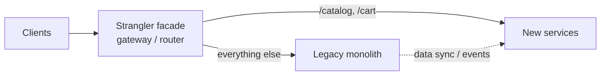
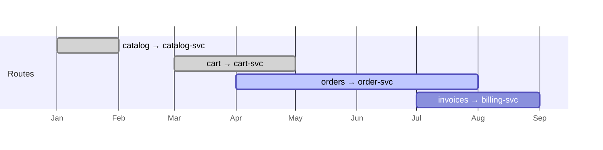

---
tags:
  - Microservices
  - Intermediate
  - Migration
---

# Strangler Fig

<span class="badge badge--intermediate">🟡 Intermediate</span>
<span class="badge badge--category">Microservices</span>
<span class="badge badge--interview">Interview frequency ⭐⭐⭐⭐</span>

!!! abstract "TL;DR"
    **Replace a legacy system gradually: put a routing facade in front of it, rebuild one capability at a time as a new service, and switch that capability's traffic over, until nothing is left of the old system.**
    Every step is small, reversible and delivers value, instead of a risky "big-bang rewrite".

---

## 1. Intent & Problem It Solves

**The problem in plain English:** the grocery business runs on a 12-year-old monolith. A full rewrite would take two years with no new features. Meanwhile the old system keeps changing, the rewrite chases a moving target, and launch day is a single enormous risk. Many big-bang rewrites are abandoned.

**Definition (Martin Fowler, named after the strangler fig tree):**
> Gradually create a new system around the edges of the old, letting it grow slowly over several years until the old system is strangled.

**The loop:**

1. **Intercept**: put a facade (gateway, proxy, router) in front of the legacy system.
2. **Extract**: build one capability as a new service.
3. **Route**: send that capability's traffic to the new service (gradually, reversibly).
4. **Retire**: delete the legacy code for it. Repeat.

## 2. Real-World Analogy

!!! example "Renovating a restaurant that stays open"
    You can't close for a year. So you rebuild the kitchen one station at a time over weekends: first the grill, then the fryer. Each Monday, cooks use the new station while the rest stays as before. If the new fryer has a problem, they use the old one for a day. One day, the last old station is removed.

## 3. Structure



| Participant | Responsibility |
|---|---|
| **Facade** | Routes per capability; supports rollback; invisible to clients |
| **Legacy system** | Keeps serving everything not yet migrated |
| **New services** | Own migrated capabilities and (eventually) their data |
| **Sync mechanism** | CDC/events keep data consistent while both systems are live |

## 4. Naive Approach (Without the Pattern)

```text
Big-bang rewrite:
  Month 0-24: build "v2" in parallel; legacy still gets new features (now built twice)
  Month 24:   cut-over weekend; data migration; everything switches at once
  Month 24+1: unknown behaviours of v1 discovered in production, no rollback path
```

---

## 5. Three Real-World Examples

### Example 1: Strangling a Grocery Monolith Route by Route

**Scenario:** A router sits in front of the monolith. Over nine months, catalog, cart, orders and invoices move to new services. When a bug appears in the new order service, `/orders` is **rolled back** to the monolith with one call, without a deploy, while the other migrated routes stay put.

**Design:**



**Full Code:**

=== "StranglerRouter.java"

    ```java
    --8<-- "code/microservices/src/main/java/com/handbook/microservices/strangler/grocery/StranglerRouter.java"
    ```

    1.  Migration is a **routing change**: in production, gateway configuration rather than code.
    2.  **Rollback** is just as cheap, which is what makes each step safe.
    3.  The default stays **legacy**, so unmigrated paths keep working.

=== "StranglerDemo.java"

    ```java
    --8<-- "code/microservices/src/main/java/com/handbook/microservices/strangler/grocery/StranglerDemo.java"
    ```

**Output:**

```text
--8<-- "code/outputs/microservices/strangler/grocery/StranglerDemo.txt"
```

**Why a strangler here:**

- Value ships every few weeks, not after two years.
- Each step can be **rolled back** in seconds.
- The monolith shrinks steadily until retiring it is a non-event.

---

### Example 2: Percentage Rollout of Statements (Banking)

**Scenario:** The new statement service goes live for staff first, then 5%, 25% and 100% of customers. Each customer's bucket comes from a hash of their ID, so they **consistently** see one system (no flip-flopping between old and new statements). A kill switch returns everyone to the legacy system instantly.

**Full Code:**

=== "PercentageRollout.java"

    ```java
    --8<-- "code/microservices/src/main/java/com/handbook/microservices/strangler/banking/PercentageRollout.java"
    ```

    1.  The **kill switch** beats everything, for instant rollback during an incident.
    2.  **Dogfooding**: staff always use the new path first.
    3.  **Sticky** bucketing by customer ID; the same customer gets the same system every time.

=== "PercentageRolloutDemo.java"

    ```java
    --8<-- "code/microservices/src/main/java/com/handbook/microservices/strangler/banking/PercentageRolloutDemo.java"
    ```

**Output:**

```text
--8<-- "code/outputs/microservices/strangler/banking/PercentageRolloutDemo.txt"
```

**Why gradual here:**

- Banking customers notice everything; the blast radius of a bug is limited to a small percentage.
- Real production traffic validates the new service before everyone depends on it.

---

### Example 3: Parallel Run of a Premium Engine (Insurance)

**Scenario:** The rewritten premium engine must give **exactly** the same quotes as the legacy one. During a **parallel run**, every quote is computed by both; customers get the legacy answer, and differences are logged. The log reveals a misread spec: the legacy system compounds the claims loading; the new one doesn't. That's fixed before any customer is affected.

**Full Code:**

=== "ShadowComparator.java"

    ```java
    --8<-- "code/microservices/src/main/java/com/handbook/microservices/strangler/insurance/ShadowComparator.java"
    ```

    1.  The **legacy answer is authoritative** during the parallel run.
    2.  The new engine runs on the same input. In production, run it asynchronously so it can't slow down or break the response.
    3.  Failures of the new engine are recorded, never surfaced to customers.

=== "ShadowRunDemo.java"

    ```java
    --8<-- "code/microservices/src/main/java/com/handbook/microservices/strangler/insurance/ShadowRunDemo.java"
    ```

**Output:**

```text
--8<-- "code/outputs/microservices/strangler/insurance/ShadowRunDemo.txt"
```

**Why a parallel run here:**

- Legacy logic is often the **only accurate spec**; comparing outputs finds undocumented rules.
- Zero customer risk while gaining confidence on real data.
- Only works for **side-effect-free** operations (quotes, calculations); never shadow "charge card".

---

??? example "Unit Tests: `StranglerFigTest.java`"

    ```java
    --8<-- "code/microservices/src/test/java/com/handbook/microservices/StranglerFigTest.java"
    ```

## 6. Variations & Modern Java Take

```yaml
# Spring Cloud Gateway as the strangler facade (reference)
spring.cloud.gateway.routes:
  - id: catalog-new
    uri: lb://catalog-service
    predicates: [ "Path=/catalog/**" ]
  - id: orders-canary                   # 10% of order traffic to the new service
    uri: lb://order-service
    predicates: [ "Path=/orders/**", "Weight=orders, 10" ]
  - id: orders-legacy
    uri: http://legacy-monolith:8080
    predicates: [ "Path=/orders/**", "Weight=orders, 90" ]
  - id: everything-else
    uri: http://legacy-monolith:8080
    predicates: [ "Path=/**" ]
    order: 1000                         # lowest priority: the fallback
```

| Technique | Use |
|---|---|
| **Branch by abstraction** | Inside the monolith: introduce an interface, implement the new version behind it, switch, delete the old |
| **Event interception / CDC** | Keep new services' data in sync with the legacy DB during migration (Debezium) |
| **Feature flags** | Per-user/tenant routing decisions (LaunchDarkly, Unleash, OpenFeature) |
| **Shadow traffic** | Mirror requests to the new service (Envoy/Istio `mirror`) and compare |
| **Asset capture** | Migrate one business entity type at a time (e.g. new customers go to the new system) |

## 7. Where It Lives in Real Frameworks

| Where | Strangler support |
|---|---|
| Spring Cloud Gateway / NGINX / Envoy | Path- and weight-based routing as the facade |
| Istio | `VirtualService` weights and `mirror` for shadow traffic |
| Debezium | CDC to sync data between old and new stores |
| AWS Migration Hub Refactor Spaces | Managed strangler-fig routing |

## 8. Pros, Cons & Trade-offs

| ✅ Pros | ❌ Cons |
|---|---|
| **Incremental**, reversible, low-risk | Two systems live for a long time (cost, cognitive load) |
| Continuous value delivery | Data synchronization between old and new is hard |
| Learn and adjust as you go | The facade is critical infrastructure |
| Business keeps running normally | Risk of "never finishing" (90% migrated forever) |

## 9. Pitfalls & Anti-Patterns

!!! danger "Starting with the hardest, most coupled capability"
    Start with something **valuable but loosely coupled** (catalog, notifications) to prove the approach and the platform. Leave the core order/billing logic for when you've learned.

!!! danger "Shared database forever"
    New services reading and writing the monolith's tables gives you a distributed monolith. Plan the data migration per capability: sync via CDC, then switch ownership.

!!! warning "No retirement step"
    If legacy code isn't deleted after migration, both versions get patched and the monolith never shrinks. Track "lines of legacy removed" as a goal.

!!! warning "Shadowing side effects"
    Mirroring a "send email" or "charge card" request to the new system does it twice. Shadow only reads and pure calculations, or stub the side effects.

## 10. Senior / Architect Deep Dive (10–15 yrs)

**Choosing the order.** Score capabilities by business value, coupling (calls and shared tables), change frequency and risk. Early candidates: high change frequency + low coupling. Dependencies are often **data**, not code, so map table access first.

**Data migration patterns.** (1) New service reads legacy DB through an ACL (temporary); (2) CDC replicates legacy tables into the new service's store; (3) the new service becomes the writer and syncs back to legacy for remaining legacy readers; (4) legacy readers migrate; (5) sync removed. Each step has a reconciliation job.

**Organizational side.** Fund the migration as a product with milestones; stop adding features to legacy code for migrated areas; celebrate deletions.

### Production checklist

- [ ] Facade in place and fully tested before any extraction; routing changes need no deploy.
- [ ] Per-capability plan: code, data ownership, sync, rollback, retirement.
- [ ] Gradual rollout (staff → % → 100%) with sticky bucketing and a kill switch.
- [ ] Parallel run / shadow comparison for calculation-heavy logic.
- [ ] Reconciliation jobs while data lives in two places.
- [ ] Legacy code and tables deleted after each migration; progress tracked.

### Explain it in 2 minutes (system design round)

> "I'd avoid a big-bang rewrite. First, put an API gateway in front of the monolith so routing is under our control. Then extract capabilities one by one, starting with something valuable and loosely coupled like catalog. Each new service gets its data through CDC from the monolith at first, then becomes the owner. Traffic shifts gradually (staff, 5%, 50%, 100%) with a kill switch; calculation-heavy parts like pricing get a parallel run comparing outputs. After each cut-over, we delete the legacy code. It's slower on paper, but every month delivers something and every step is reversible."

!!! bug "War story: the rewrite that never launched"
    A travel company spent 26 months rewriting its booking platform as microservices, aiming for a single cut-over. The old platform kept getting urgent features that had to be built twice. At the dress rehearsal, the new system disagreed with the old on 7% of fare calculations because of rules that existed only in old code. The launch was postponed indefinitely and the program cancelled.
    **What worked the second time:** a strangler facade, search moved first (read-only, high value), parallel runs for fares, and one capability per quarter. The last legacy module was retired 3 years later, with value delivered every quarter on the way.
    **Lesson:** the legacy system **is** the spec. Migrate in slices you can compare and roll back.

## 11. Related Patterns & Comparisons

| | Strangler Fig | Big-bang rewrite | Branch by abstraction | Anti-Corruption Layer |
|---|---|---|---|---|
| Scope | System → services, over months | Everything at once | Within one codebase | Translation at a boundary |
| Rollback | Per capability | Hard | Per change (flag) | n/a |
| Often combined | ACL, CDC, feature flags | — | Strangler | Strangler |

See [Anti-Corruption Layer](anti-corruption-layer.md), [API Gateway](api-gateway.md) and [Decomposition](decomposition.md).

## 12. Interview Corner

=== "🟢 Beginner / Service Companies"

    **Q1. What is the strangler fig pattern?**

    Migrating a legacy system **incrementally** by routing one feature at a time to new services, until the old system can be removed.

    **Q2. Why is it named after a fig?**

    The strangler fig grows around a host tree and eventually replaces it, just as the new system grows around the old.

    **Q3. What component makes it possible?**

    A **facade/router** (often an API gateway) in front of the legacy system that decides where each request goes.

    **Q4. Why not rewrite everything at once?**

    Big-bang rewrites are risky, deliver no value until the end, and often fail; incremental migration is reversible and delivers continuously.

    **Q5. What do you migrate first?**

    A valuable but loosely coupled capability, to prove the approach with low risk.

=== "🟡 Mid-Level"

    **Q1. How do you handle data during migration?**

    Sync data between legacy and new stores (CDC/events), switch ownership per capability, and run reconciliation until the legacy side stops using it.

    **Q2. What's a parallel run?**

    Running old and new logic on the same input, returning the old result and comparing, to find differences before switching.

    **Q3. How do you roll back a migrated route?**

    Change the routing rule (or flip the feature flag) back to legacy, which requires no deploy.

    **Q4. What is branch by abstraction?**

    Introducing an abstraction inside the monolith so old and new implementations can coexist and be switched behind it.

    **Q5. How do you avoid "90% migrated forever"?**

    Track retirement milestones, stop feature work in legacy areas, budget for the long tail, and delete legacy code after each migration.

=== "🔴 Senior / FAANG / SAP"

    **Q1. "Plan the migration of a 15-year-old ERP-integrated monolith to services."**

    Facade first; capability map with coupling and value scores; ACL toward the ERP; CDC-based data sync; order of extraction; gradual rollouts with kill switches; parallel runs for financial logic; reconciliation; retirement plan; team topology.

    **Q2. "How do you migrate a capability whose data is joined by 20 legacy queries?"**

    Keep legacy as reader via a synced copy (the new service writes, CDC syncs back) while migrating readers to the new API one by one; remove sync at the end.

    **Q3. "What metrics show migration progress and health?"**

    Share of traffic on new services, legacy LOC/tables removed, mismatch rate in parallel runs, incident rate per migrated capability, lead time for changes in migrated vs. legacy areas.

    **Q4. "Shadow traffic for writes: is it possible?"**

    Only with side effects stubbed or isolated (separate sandbox DB, no external calls), and compare resulting state. Usually limit shadowing to reads and pure computations.

    **Q5. "How do SAP customers apply this when moving to S/4HANA or the cloud?"**

    Keep the core clean and move custom extensions to side-by-side services gradually, using APIs and events; route and migrate extensions one at a time instead of rewriting all custom code at once.

=== "💻 Coding Challenge"

    **Problem:** Route requests to the new service but monitor its error rate over the last 10 calls. If it exceeds 20%, automatically roll back to legacy (and stay there until a human re-enables it). Users must always get an answer.

    ??? success "Solution"

        === "GuardedRouter.java"

            ```java
            --8<-- "code/microservices/src/main/java/com/handbook/microservices/strangler/autorollback/GuardedRouter.java"
            ```

        === "GuardedRouterDemo.java"

            ```java
            --8<-- "code/microservices/src/main/java/com/handbook/microservices/strangler/autorollback/GuardedRouterDemo.java"
            ```

        **Output:**

        ```text
        --8<-- "code/outputs/microservices/strangler/autorollback/GuardedRouterDemo.txt"
        ```

        **Key points to say:** a failed request **falls back** to legacy so users don't see errors; rollback is sticky (no flapping) and needs a human to re-enable; in production this is what progressive-delivery tools (Argo Rollouts, Flagger) automate using metrics.

!!! info "Behavioural tie-in (STAR) for experienced candidates"
    - **S:** Our insurer's quoting monolith had 14-week release cycles; a previous rewrite attempt had been cancelled after 18 months.
    - **T:** Modernize quoting without stopping the business.
    - **A:** Introduced a gateway facade, extracted vehicle lookup first, then the premium engine with a 6-week parallel run that found 11 undocumented rules; rolled out by region with a kill switch.
    - **R:** Quoting moved fully to services in 10 months; release cycle dropped to weekly; zero pricing incidents during migration.

## 13. Quick Revision Card

!!! tip "Remember in 30 seconds"
    - **Facade first**, then extract → route → retire, one capability at a time.
    - Gradual rollout: staff → % → 100%, **sticky**, with a kill switch.
    - **Parallel run** for calculations; never shadow side effects.
    - Data: CDC sync → ownership switch → remove sync.
    - Delete legacy code after every step.

## Practice

- [ ] Add per-tenant routing to `StranglerRouter` (tenant `acme` uses the new cart service first).
- [ ] Make `ShadowComparator` run the modern call on a separate executor with a timeout.
- [ ] Give `GuardedRouter` a minimum number of calls before it can roll back.

---

[:material-arrow-left: Database per Service](database-per-service.md){ .md-button }
[Next: Sidecar / Service Mesh :material-arrow-right:](sidecar-service-mesh.md){ .md-button .md-button--primary }
