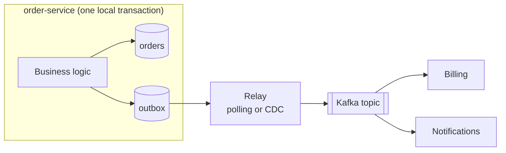
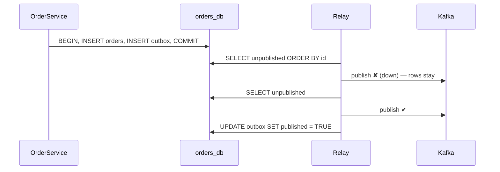

---
tags:
  - Microservices
  - Advanced
  - Data
---

# Transactional Outbox

<span class="badge badge--advanced">🔴 Advanced</span>
<span class="badge badge--category">Microservices</span>
<span class="badge badge--interview">Interview frequency ⭐⭐⭐⭐</span>

!!! abstract "TL;DR"
    **To publish an event reliably when your data changes, insert the event into an `outbox` table in the same local database transaction as the data change. A separate relay (a polling job or CDC such as Debezium) reads the outbox and publishes to the broker.**
    The data change and the event become atomic: no lost events, no events for changes that never happened. Delivery is **at-least-once**, so consumers deduplicate.

---

## 1. Intent & Problem It Solves

**The problem in plain English, the "dual write":**

```java
orderRepository.save(order);                 // 1. commit to the database
kafkaTemplate.send("orders", orderPlaced);   // 2. publish
```

- Crash or broker blip **between 1 and 2** → the order exists, but nobody hears about it (no invoice, no fraud check).
- Publish first, then the DB commit fails → consumers act on an order that **doesn't exist**.
- You can't put Kafka and Postgres in one ACID transaction (no XA support in Kafka, and 2PC is undesirable anyway).

**Definition (microservices.io, Chris Richardson):**
> A service that uses a relational database inserts messages/events into an outbox table as part of the local transaction. A separate message relay process publishes the events inserted into the database to a message broker.

## 2. Real-World Analogy

!!! example "The office outbox tray"
    A clerk files a contract **and** drops the notification letter into the outbox tray in one motion before going home. The mail room collects letters from the tray later. If the mail van breaks down, the letters wait in the tray; nothing is lost, and no letter goes out for a contract that was never filed.

## 3. Structure



| Participant | Responsibility |
|---|---|
| **Service** | Writes business rows + outbox row in one transaction |
| **Outbox table** | `id`, `aggregate_id` (message key), `type`, `payload`, `created_at`, `published_at` |
| **Relay** | Reads unpublished rows in order, publishes, marks published (or CDC tails the DB log) |
| **Consumers** | Idempotent: deduplicate by event ID |

## 4. Naive Approach (Without the Pattern)

See section 1: save then publish, or publish then save. Both have a failure window, and those windows are hit at scale every day. Example 2 below reproduces it.

---

## 5. Three Real-World Examples

### Example 1: Order + OrderPlaced Atomically (Grocery)

**Scenario:** Placing an order writes the `orders` row and an `OrderPlaced` row in the `outbox` within **one JDBC transaction** (real H2 database). A duplicate submit violates the primary key, so **both** writes roll back. The relay polls while Kafka is down: nothing is lost, and the events stay in the outbox. When Kafka returns, both events are published in order.

**Design:**



**Full Code:**

=== "OrderService.java"

    ```java
    --8<-- "code/microservices/src/main/java/com/handbook/microservices/outbox/grocery/OrderService.java"
    ```

    1.  One **local** transaction: the only kind the database guarantees.
    2.  The event row is just another insert, so it commits or rolls back with the order.
    3.  On any failure, **neither** the order nor the event exists.

=== "OutboxRelay.java"

    ```java
    --8<-- "code/microservices/src/main/java/com/handbook/microservices/outbox/grocery/OutboxRelay.java"
    ```

    1.  The aggregate ID becomes the **message key**, so all events for one order go to the same Kafka partition, **in order**.
    2.  Stop at the first failure to preserve ordering; the next poll resumes from the same row.

=== "Db.java (support)"

    ```java
    --8<-- "code/microservices/src/main/java/com/handbook/microservices/support/Db.java"
    ```

=== "OrderOutboxDemo.java"

    ```java
    --8<-- "code/microservices/src/main/java/com/handbook/microservices/outbox/grocery/OrderOutboxDemo.java"
    ```

**Output:**

```text
--8<-- "code/outputs/microservices/outbox/grocery/OrderOutboxDemo.txt"
```

**Why an outbox here:**

- **Atomicity** of state change and event, using only the database's own transaction.
- Broker outages delay events; they never lose them.
- Ordering per aggregate is preserved.

---

### Example 2: Dual Write vs. Outbox (Insurance claims)

**Scenario:** Every submitted claim must trigger a fraud check. With a dual write, a broker timeout at exactly the wrong moment means **CLM-2 is saved but never checked**, and would be paid out. With the outbox, the same broker failure only **delays** CLM-2's event; the next relay poll delivers it.

**Full Code:**

=== "ClaimServices.java"

    ```java
    --8<-- "code/microservices/src/main/java/com/handbook/microservices/outbox/insurance/ClaimServices.java"
    ```

    1.  The **failure window**: the claim is already committed; if this line fails, the event is gone forever.
    2.  Claim and event commit **together**.

=== "DualWriteDemo.java"

    ```java
    --8<-- "code/microservices/src/main/java/com/handbook/microservices/outbox/insurance/DualWriteDemo.java"
    ```

**Output:**

```text
--8<-- "code/outputs/microservices/outbox/insurance/DualWriteDemo.txt"
```

**Why an outbox here:**

- In regulated domains, a **missing event** is a compliance and fraud risk, not just a bug.
- The fix needs no new infrastructure: one table and a relay.

---

### Example 3: At-Least-Once and Consumer Dedupe (Ride-hailing)

**Scenario:** The relay publishes `TripCompleted TRIP-1`, then **crashes before marking the row**. On restart it publishes TRIP-1 again. The billing consumer keeps processed event IDs (the outbox row ID), so the rider gets **one** receipt per trip.

**Full Code:**

=== "TripEventsConsumer.java"

    ```java
    --8<-- "code/microservices/src/main/java/com/handbook/microservices/outbox/ridehailing/TripEventsConsumer.java"
    ```

    1.  In production, insert the event ID into a `processed_events` table **in the same transaction** as the consumer's own update (see [Idempotent Consumer](idempotent-consumer.md)).

=== "CrashingRelayDemo.java"

    ```java
    --8<-- "code/microservices/src/main/java/com/handbook/microservices/outbox/ridehailing/CrashingRelayDemo.java"
    ```

**Output:**

```text
--8<-- "code/outputs/microservices/outbox/ridehailing/CrashingRelayDemo.txt"
```

**Why dedupe is part of the pattern:**

- The outbox guarantees **at-least-once**, not exactly-once: "publish" and "mark published" can't be atomic.
- Outbox + idempotent consumer = **exactly-once effect**.

---

??? example "Unit Tests: `TransactionalOutboxTest.java`"

    ```java
    --8<-- "code/microservices/src/test/java/com/handbook/microservices/TransactionalOutboxTest.java"
    ```

## 6. Variations & Modern Java Take

**Spring Boot** (compiled in the `spring-reference` module):

=== "PlaceOrderHandler.java"

    ```java
    --8<-- "code/spring-reference/src/main/java/com/handbook/springref/outbox/PlaceOrderHandler.java"
    ```

=== "OutboxRelayJob.java"

    ```java
    --8<-- "code/spring-reference/src/main/java/com/handbook/springref/outbox/OutboxRelayJob.java"
    ```

=== "outbox.sql (PostgreSQL)"

    ```sql
    CREATE TABLE outbox (
      id           BIGSERIAL PRIMARY KEY,
      topic        TEXT        NOT NULL,
      aggregate_id TEXT        NOT NULL,           -- message key (ordering per aggregate)
      payload      JSONB       NOT NULL,
      created_at   TIMESTAMPTZ NOT NULL DEFAULT now(),
      published_at TIMESTAMPTZ
    );
    CREATE INDEX outbox_unpublished ON outbox (id) WHERE published_at IS NULL;
    ```

| Relay style | How | Trade-offs |
|---|---|---|
| **Polling publisher** | Scheduled `SELECT ... FOR UPDATE SKIP LOCKED` | Simple; polling load and latency (100 ms–1 s) |
| **Change Data Capture** | **Debezium** reads the DB's WAL/binlog; the Outbox Event Router routes rows to topics | Low latency, no polling; more infrastructure (Kafka Connect) |
| **Listen/notify** | PostgreSQL `LISTEN/NOTIFY` wakes the relay | Lower latency than polling, still simple |
| **Spring Modulith** | Event publication registry persists events with the transaction | Great for modular monoliths |

## 7. Where It Lives in Real Frameworks

| Where | Outbox |
|---|---|
| Debezium | Outbox Event Router SMT (CDC) |
| Eventuate Tram | Transactional messaging built on an outbox |
| Spring Modulith | `@ApplicationModuleListener` + event publication registry |
| Axon Framework | Events stored in the event store (similar guarantee) |
| MassTransit / NServiceBus (.NET) | Built-in transactional outbox |

## 8. Pros, Cons & Trade-offs

| ✅ Pros | ❌ Cons |
|---|---|
| **Atomic** state change + event without 2PC | **At-least-once**: consumers must deduplicate |
| Survives broker outages | Extra table, relay process, cleanup |
| Ordering per aggregate | Event latency (polling interval or CDC lag) |
| Works with any relational DB | Outbox table can grow; needs housekeeping |

## 9. Pitfalls & Anti-Patterns

!!! danger "Publishing from inside the transaction"
    Calling `kafkaTemplate.send()` inside `@Transactional` doesn't make it transactional with the DB. If the DB commit fails afterwards, the event is already out.

!!! danger "Multiple relays without claiming"
    Two relay instances reading the same unpublished rows publish everything twice. Use `FOR UPDATE SKIP LOCKED`, leader election, or atomic claims (see the coding challenge).

!!! warning "Never cleaning the outbox"
    Millions of published rows slow the relay's query. Delete or archive published rows (e.g. older than 7 days) on a schedule, or partition by date.

!!! warning "Breaking ordering with parallel publishing"
    Publishing rows in parallel or with retries out of order can deliver `OrderCancelled` before `OrderPlaced`. Keep per-aggregate order (the key) and publish sequentially per key.

## 10. Senior / Architect Deep Dive (10–15 yrs)

**Polling vs. CDC.** Polling is the pragmatic default: easy to understand, monitor and debug. CDC (Debezium) is better at high volume or when you also need the database's change stream for other consumers, at the cost of running Kafka Connect and managing connector offsets and schema changes.

**Event payload design.** Outbox payloads are a **public contract**: version them, prefer business events (`OrderPlaced` with the needed fields) over raw row dumps, and avoid leaking internal schema. CDC on raw tables couples consumers to your schema; the outbox decouples them.

**The inbox counterpart.** On the consumer side, a **transactional inbox** (processed-message table) gives exactly-once effect. Together: outbox (producer) + inbox (consumer).

### Production checklist

- [ ] Outbox insert in the **same transaction** as the state change (`@Transactional` covers both).
- [ ] Relay: ordered by ID, keyed by aggregate ID, waits for broker ack before marking.
- [ ] Multiple relays coordinated (`SKIP LOCKED`, leader election, or CDC).
- [ ] Consumers idempotent (event ID dedupe).
- [ ] Metrics: outbox lag (oldest unpublished age), relay errors; alert when lag grows.
- [ ] Housekeeping job for published rows; versioned payload schemas.

### Explain it in 2 minutes (system design round)

> "Every service that changes state and publishes events writes the event into an **outbox table in the same local transaction**. A relay (polling with `SKIP LOCKED`, or Debezium CDC at higher volume) publishes rows to Kafka keyed by aggregate ID, so per-entity order is preserved, and marks them published after the broker acks. That's at-least-once, so every consumer deduplicates by event ID in its own transaction. We alert on outbox lag and clean up published rows daily. This removes the dual-write problem without distributed transactions."

!!! bug "War story: the missing invoices"
    A B2B platform saved orders, then published `OrderPlaced` to RabbitMQ in the same method. During a 4-minute broker failover, the publish calls failed after the DB commits. About 1,800 orders were saved but never invoiced. Nobody noticed for a month, until the quarterly revenue reconciliation came up short.
    **Fix:** a transactional outbox with a polling relay and a lag alert; a one-time reconciliation job compared orders with invoices and backfilled the missing events.
    **Lesson:** dual writes fail silently. Make the event part of the same transaction, and reconcile.

## 11. Related Patterns & Comparisons

| | Transactional Outbox | Dual write | 2PC/XA | Event Sourcing | Listen to yourself |
|---|---|---|---|---|---|
| Atomic data + event | ✅ | ❌ | ✅ | ✅ (events are the data) | ✅ (publish first, update on consume) |
| Needs broker in transaction | No | No | Yes | No | No |
| Delivery | At-least-once | Lossy | Exactly-once (in theory) | At-least-once | At-least-once |

See [Saga](saga.md) (which relies on reliable events), [Idempotent Consumer](idempotent-consumer.md) and [Event Sourcing](event-sourcing.md).

## 12. Interview Corner

=== "🟢 Beginner / Service Companies"

    **Q1. What is the dual-write problem?**

    Writing to a database and publishing to a broker as two separate operations: if one succeeds and the other fails, the systems become inconsistent.

    **Q2. What is the transactional outbox pattern?**

    Save the event into an **outbox table in the same DB transaction** as the business data, then a separate relay publishes it to the broker.

    **Q3. Does it guarantee exactly-once delivery?**

    No: **at-least-once**. Consumers must handle duplicates.

    **Q4. What is Debezium?**

    A **change data capture** tool that reads the database's transaction log and publishes changes (including outbox rows) to Kafka.

    **Q5. Why not publish to Kafka inside `@Transactional`?**

    Kafka isn't part of the database transaction; the event could be sent even if the DB commit later fails.

=== "🟡 Mid-Level"

    **Q1. Polling relay vs. CDC?**

    Polling: simple, adds query load and latency. CDC: low latency, no polling, but needs Kafka Connect/Debezium infrastructure.

    **Q2. How do you preserve event order?**

    Relay in ID order and use the aggregate ID as the **message key**, so all events for one entity land in one partition.

    **Q3. How do multiple relay instances avoid duplicates?**

    `SELECT ... FOR UPDATE SKIP LOCKED`, atomic claim updates, or a single active relay via leader election.

    **Q4. How do consumers handle duplicates?**

    Store processed event IDs (unique constraint) in the same transaction as their own update and skip IDs already seen.

    **Q5. What do you monitor?**

    **Outbox lag** (age of the oldest unpublished row), relay error rate, and table size.

=== "🔴 Senior / FAANG / SAP"

    **Q1. "Design reliable event publishing for 50k writes/second."**

    CDC (Debezium) from the WAL instead of polling, outbox partitioned by time, events keyed by aggregate, consumers idempotent; capacity for connector lag; schema registry for payloads.

    **Q2. "Outbox vs. event sourcing?"**

    The outbox adds events **alongside** state; event sourcing makes events **the** state. The outbox is far easier to adopt in an existing CRUD service.

    **Q3. "What if the relay publishes, the broker acks, and the DB update to mark published fails?"**

    The event is republished on the next poll, which is expected under at-least-once. Consumers deduplicate. Never try to make it exactly-once at the producer.

    **Q4. "Should the outbox contain the full entity or a minimal event?"**

    A business event with the fields consumers need (and a version). Thin events ("OrderPlaced id=1") force consumers to call back (coupling and load); full row dumps leak internals. Design them as public contracts.

    **Q5. "How do you migrate a service with dual writes to the outbox safely?"**

    Add the outbox table and write to it in the transaction, run the relay to a shadow topic and compare, switch consumers, remove the direct publish, and run a reconciliation job for the past window.

=== "💻 Coding Challenge"

    **Problem:** Run **three relay instances** concurrently over 500 outbox rows. No row may be published twice and none may be missed. (PostgreSQL would use `SKIP LOCKED`; implement it with an atomic conditional `UPDATE`.)

    ??? success "Solution"

        === "ClaimingRelay.java"

            ```java
            --8<-- "code/microservices/src/main/java/com/handbook/microservices/outbox/claiming/ClaimingRelay.java"
            ```

        === "ClaimingRelayDemo.java"

            ```java
            --8<-- "code/microservices/src/main/java/com/handbook/microservices/outbox/claiming/ClaimingRelayDemo.java"
            ```

        **Output:**

        ```text
        --8<-- "code/outputs/microservices/outbox/claiming/ClaimingRelayDemo.txt"
        ```

        **Key points to say:** `UPDATE ... WHERE claimed_by IS NULL` is atomic per row, so only one relay's update returns 1. Also add a claim **timeout** (if a relay dies after claiming, the rows must be re-claimable), and remember that cross-relay ordering per aggregate needs partitioning rows by key.

!!! info "Behavioural tie-in (STAR) for experienced candidates"
    - **S:** Our notification service occasionally missed "order shipped" events; customers called support asking where their parcels were.
    - **T:** Guarantee every shipment produced a notification.
    - **A:** Found dual writes in 6 services; introduced a shared outbox library with a polling relay, lag metrics, and consumer dedupe; ran a reconciliation to backfill.
    - **R:** Missed notifications went from about 300/week to zero; outbox lag p99 stayed under 800 ms.

## 13. Quick Revision Card

!!! tip "Remember in 30 seconds"
    - Dual write = **lost or phantom events**.
    - Business row + outbox row in **one local transaction**.
    - Relay: polling (`SKIP LOCKED`) or **CDC (Debezium)**; key = aggregate ID.
    - **At-least-once** → idempotent consumers.
    - Monitor outbox lag; clean up published rows.

## Practice

- [ ] Add a `created_at` column and a cleanup job that deletes published rows older than 7 days.
- [ ] Add a claim timeout to `ClaimingRelay` so rows claimed by a dead relay become available again.
- [ ] Change `OutboxRelay` to continue with other aggregates when one aggregate's event fails (per-key ordering only).

---

[:material-arrow-left: Saga](saga.md){ .md-button }
[Next: CQRS :material-arrow-right:](cqrs.md){ .md-button .md-button--primary }
