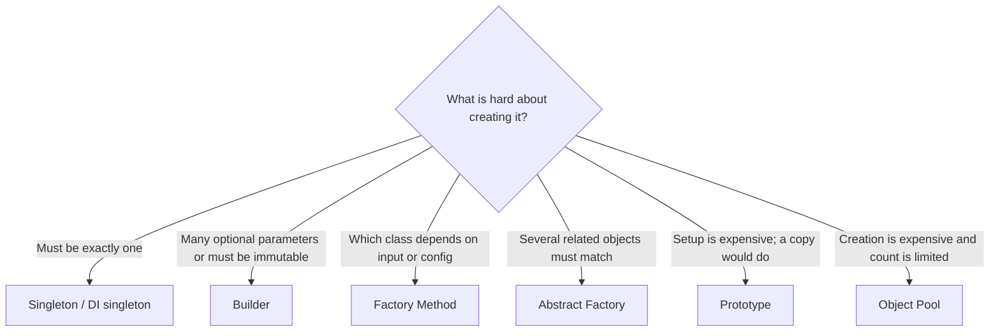
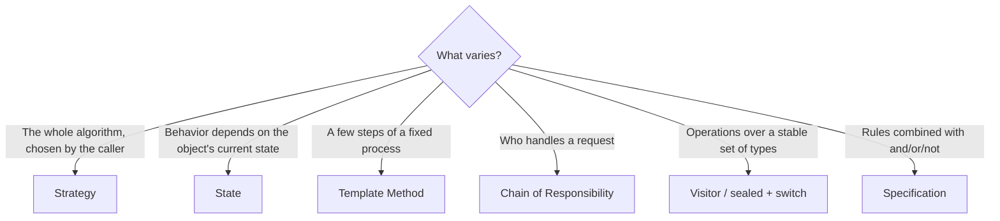
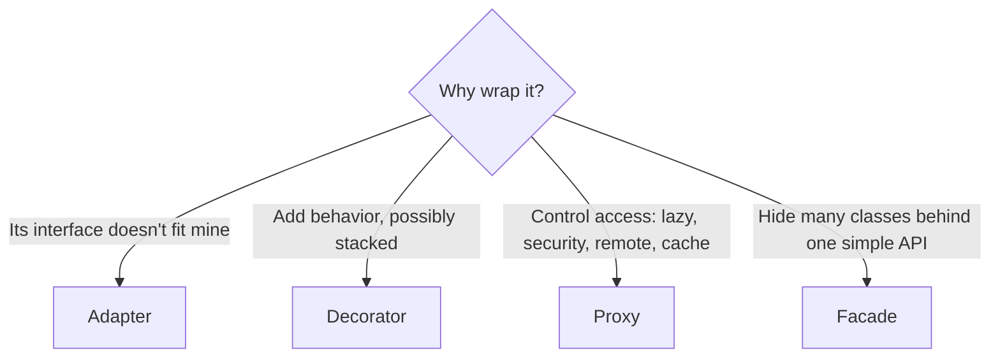
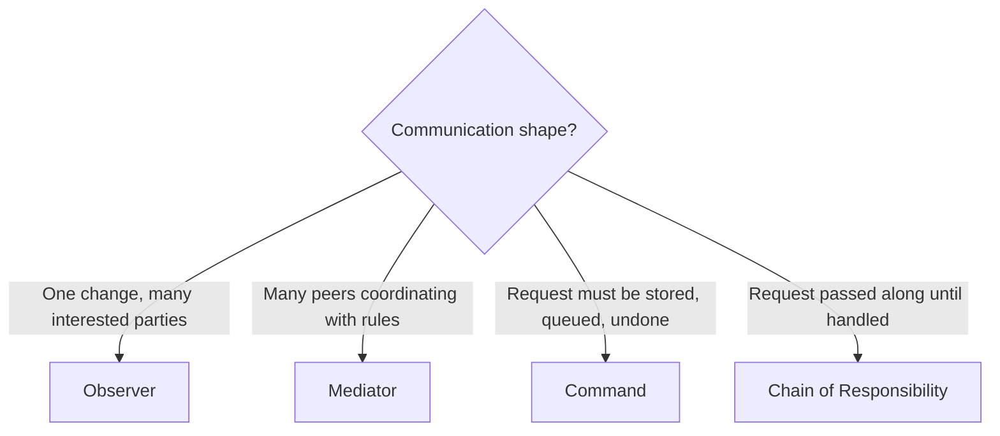

---
tags:
  - Guide
---

# Pattern Selection Guide

Knowing 30 patterns is easy; picking the **right** one under interview pressure or in a design review is the real skill. This guide works backwards: start from the **symptom** in your code or the **requirement** in the problem, and find the pattern.

!!! tip "Two rules before you pick any pattern"
    1. **Name the force first.** "Payment methods keep being added" (a variation point) or "two threads update this" (shared state). A pattern is a response to a force, not a decoration.
    2. **Start simple.** If an `if` statement is clear and won't grow, keep it. Introduce the pattern when the second or third variation shows up (YAGNI).

---

## 1. From code smell to pattern

| You see this in the code... | Consider | Why |
|---|---|---|
| `if/else` or `switch` on a **type** to decide **which class to `new`** | [Factory Method](creational/factory-method.md) | Centralize creation; new types without editing callers |
| Constructors with 6+ parameters, many `null`s | [Builder](creational/builder.md) | Readable, validated, immutable construction |
| Objects that must always be used **together** (AWS storage + AWS queue) | [Abstract Factory](creational/abstract-factory.md) | Guarantees consistent families |
| `new ExpensiveThing()` copied with small changes | [Prototype](creational/prototype.md) | Copy a configured template |
| A connection/session created per request | [Object Pool](creational/object-pool.md) | Reuse expensive, limited resources |
| `if/else` choosing **an algorithm** (fees, routing, sorting) | [Strategy](behavioral/strategy.md) | Swap algorithms at runtime |
| `switch (status)` repeated in many methods | [State](behavioral/state.md) | Behavior lives with each state; illegal transitions closed |
| Several classes copy the same **workflow** with small differences | [Template Method](behavioral/template-method.md) | One `final` skeleton, variable steps |
| A method that calls 5 services in a fixed order, copied in many clients | [Facade](structural/facade.md) | One task-level entry point |
| A vendor SDK's types and error codes all over your code | [Adapter](structural/adapter.md) | Translate at the boundary |
| `LoggingRetryingCachingService` subclasses | [Decorator](structural/decorator.md) | Stack behaviors at runtime |
| Security checks / lazy loading mixed into business code | [Proxy](structural/proxy.md) | Control access transparently |
| `instanceof` checks to treat a single item and a group differently | [Composite](structural/composite.md) | Uniform part-whole trees |
| Class names that are two nouns glued together (`SalesCsvReport`) | [Bridge](structural/bridge.md) | M + N classes instead of M × N |
| Millions of objects repeating the same heavy data | [Flyweight](structural/flyweight.md) | Share immutable intrinsic state |
| One service calls email, inventory, analytics after saving | [Observer](behavioral/observer.md) | Publish an event; listeners react |
| Widgets/peers calling each other in a tangle | [Mediator](behavioral/mediator.md) | Centralize coordination |
| A request must be **queued, retried, undone or logged** | [Command](behavioral/command.md) | Request as an object |
| Validation/approval handled by a growing `if` ladder | [Chain of Responsibility](behavioral/chain-of-responsibility.md) | Ordered, independent handlers |
| Undo, drafts, checkpoints | [Memento](behavioral/memento.md) | Snapshots without breaking encapsulation |
| Many operations added to a stable class hierarchy | [Visitor](behavioral/visitor.md) / sealed + `switch` | New operations without touching types |
| `if (x != null)` everywhere for an optional collaborator | [Null Object](behavioral/null-object.md) | Neutral behavior, no checks |
| Business rules duplicated in Java and SQL | [Specification](behavioral/specification.md) | Named, composable rules |
| Business users want to write rules or formulas | [Interpreter](behavioral/interpreter.md) | Small DSL with an AST |
| Paginated or merged data consumed in loops | [Iterator](behavioral/iterator.md) | Lazy, uniform traversal |
| Exactly one instance must exist per process | [Singleton](creational/singleton.md) (or DI singleton scope) | One instance, global access |

## 2. From concurrency symptom to pattern

| Symptom | Consider |
|---|---|
| Bursty work arriving faster than it can be processed | [Producer-Consumer](concurrency/producer-consumer.md) with a **bounded** queue |
| `new Thread()` per task, or CPU oversubscribed | [Thread Pool](concurrency/thread-pool.md) (CPU-bound) |
| Thousands of tasks mostly waiting on I/O | [Virtual Threads](concurrency/virtual-threads.md) + explicit resource limits |
| Calling several services one after another | [Future / Promise](concurrency/future-promise.md) (parallel + timeouts) |
| Read-mostly shared data with multi-field updates | [Read-Write Lock](concurrency/read-write-lock.md) or immutable snapshots |
| Data shared between threads that "never changes" but has setters | [Immutable Object](concurrency/immutable-object.md) |
| Expensive lazy initialization under concurrency | [Double-Checked Locking](concurrency/double-checked-locking.md) / holder / `computeIfAbsent` |

## 3. Decision trees

### "I need to create objects"

### "Behavior varies"

### "I'm wrapping something"

### "Objects need to talk"

## 4. Patterns behind classic interview problems

These are **common** choices, not the only correct ones; explain the force behind each.

| Problem (LLD round) | Patterns that usually fit |
|---|---|
| **Parking lot** | Strategy (pricing, spot allocation), Factory (vehicle/spot types), Singleton/DI (the lot), Observer (display boards), State (spot status) |
| **Elevator system** | State (moving up/down, idle, doors), Strategy (scheduling: nearest car, SCAN), Command (floor requests), Mediator/Observer (controller and panels) |
| **Vending machine** | State (idle, has money, dispensing, sold out), Strategy (payment), Chain of Responsibility (change-making by denomination) |
| **Food / grocery delivery** | State (order lifecycle), Strategy (delivery fee, rider matching), Observer (tracking, notifications), Facade (checkout), Builder (order), Saga (distributed order flow) |
| **Splitwise / expense sharing** | Strategy (split equally, exact, percentage), Immutable `Money`, Observer (balance updates), Factory (expense types) |
| **Rate limiter** | Strategy (token bucket, sliding window), Proxy/Decorator (wrap the API), Singleton per key or `computeIfAbsent` |
| **LRU cache** | Hash map + doubly linked list; Decorator/Proxy (caching layer); Strategy (eviction policy) |
| **Logger** | Singleton/DI, Chain of Responsibility (levels/appenders), Strategy (formatters), Producer-Consumer (async appender), Decorator |
| **Notification system** | Bridge (type × channel), Strategy (channel selection), Observer (events), Template Method (send pipeline), Decorator (retry/rate-limit) |
| **Payment system** | Strategy/Factory (methods), Adapter (gateways), State (payment lifecycle), Command (queued instructions), Proxy (security), Template Method (flow) |
| **Movie / ticket booking** | State (seat status), Strategy (pricing), Observer (seat map updates), Builder (booking), locking/optimistic concurrency for seats |
| **Chess / board games** | Strategy (move rules per piece), Command (moves with undo), Memento (save game), State (game phase), Factory (pieces) |
| **Document editor** | Command (undo/redo), Memento (versions), Composite (document tree), Visitor (export), Flyweight (styles) |

!!! question "How to present a pattern in an interview"
    1. **State the force**: "Payment methods will grow, and each has different rules."
    2. **Name the pattern**: "So I'll use Strategy behind a `PaymentMethod` interface."
    3. **Show the extension point**: "Adding wallets is one new class; checkout doesn't change."
    4. **Mention the trade-off**: "A factory chooses the strategy; for two fixed methods I'd keep a simple switch."

## 5. When NOT to use a pattern

- **One implementation and no realistic second**: skip Strategy, Factory and Abstract Factory.
- **Simple, stable conditionals**: a 3-case `switch` expression on a sealed type is often clearer than State or Visitor.
- **DI already gives it to you**: Spring singletons, profiles (Abstract Factory), AOP (Proxy/Decorator).
- **The language gives it to you**: lambdas (Strategy, Command), records (immutable values), `sealed` + pattern matching (Visitor), streams (Iterator).
- **Performance-critical inner loops**: measure before adding layers of indirection.

---

[:material-arrow-left: Modular Monolith](architecture/modular-monolith.md){ .md-button }
[Next: Pattern Comparisons :material-arrow-right:](comparisons.md){ .md-button .md-button--primary }
