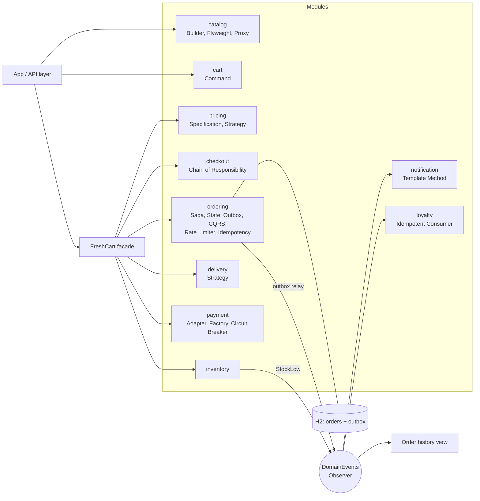
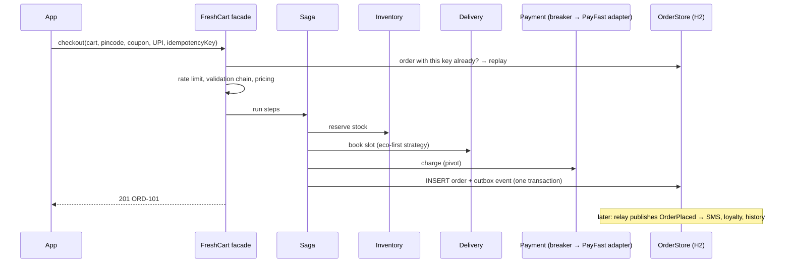

---
tags:
  - Project
  - Advanced
---

# Capstone: FreshCart Grocery Platform

<span class="badge badge--advanced">🔴 Advanced</span>
<span class="badge badge--category">Capstone</span>

!!! abstract "TL;DR"
    **FreshCart is a small but complete grocery platform (catalog, cart, pricing, checkout, inventory, payments, delivery slots, orders, notifications, loyalty) built as a modular monolith in plain Java 21, with a real H2 database for orders and the outbox.** It combines **22 patterns** from this handbook in one runnable program, and shows each one doing a real job, including failure scenarios: declined payments, a provider outage, duplicate taps, a crashing relay and a misbehaving script.

    Run it: `cd code && ./run-demos.sh`, then read `code/outputs/capstone/FreshCartDemo.txt`, or run `com.handbook.capstone.FreshCartDemo` from your IDE.

---

## 1. Requirements

**Functional**

- Browse products (fast, cached); categories carry GST rates.
- Cart with add/remove and **undo**.
- Coupons: "10% off fruit (max ₹100)", "₹75 off above ₹1,000"; free delivery above ₹500.
- Checkout: validate, reserve stock, book a delivery slot, take payment (UPI via a third-party provider, or cash on delivery), create the order.
- Order lifecycle: confirmed → packed → out for delivery → delivered (cancel only before dispatch).
- SMS on every order change; loyalty points (1 per ₹100); "My orders" screen; low-stock alerts for the ops team.

**Non-functional**

- A **double tap** on "Pay" never creates two orders or two charges.
- A failed checkout never leaves stock reserved, slots booked or money taken.
- A **payment provider outage** must not hang checkouts; customers can still pay by COD.
- Events are **never lost** when the database commit succeeds, and duplicates have no effect.
- Scripts and bots can't hammer checkout.

## 2. Architecture

FreshCart is a [modular monolith](../architecture/modular-monolith.md): one deployable, with modules that talk through small APIs and in-process events, and could later be extracted into [microservices](../microservices/index.md).



**Checkout flow**



## 3. Where each pattern lives

| # | Pattern | Where | Why it's there |
|---|---|---|---|
| 1 | [Singleton](../creational/singleton.md) | `Ids` enum | One ID generator per JVM, thread-safe |
| 2 | [Builder](../creational/builder.md) | `Product.builder()` | Many optional attributes, validated together |
| 3 | [Flyweight](../structural/flyweight.md) | `Category.of()` | Thousands of products share a few category objects |
| 4 | [Proxy](../structural/proxy.md) | `Catalog.CachingCatalog` | Caching without changing callers |
| 5 | [Command](../behavioral/command.md) | `Cart.AddItem`, `RemoveItem` | Undo for cart changes |
| 6 | [Specification](../behavioral/specification.md) | `Pricing.minSubtotal`, `containsCategory` | Coupon eligibility as composable rules |
| 7 | [Strategy](../behavioral/strategy.md) | Discount functions; `DeliveryService.SlotStrategy` | Swappable calculations and slot choice |
| 8 | [Chain of Responsibility](../behavioral/chain-of-responsibility.md) | `CheckoutChecks` | Pre-checkout validations, easy to extend |
| 9 | [Facade](../structural/facade.md) | `FreshCart` | One entry point hiding eight modules |
| 10 | [Factory Method](../creational/factory-method.md) | `Payments.GatewayFactory` | "UPI" or "COD" → the right gateway |
| 11 | [Adapter](../structural/adapter.md) | `Payments.PayFastAdapter` | Third-party SDK → our payment port |
| 12 | [Decorator](../structural/decorator.md) | `Payments.CircuitBreakerGateway` | Adds resilience around any gateway |
| 13 | [Circuit Breaker](../microservices/circuit-breaker.md) | `CircuitBreakerGateway` | Fail fast during a provider outage |
| 14 | [Saga](../microservices/saga.md) | `CheckoutSaga` | Undo reservation and slot when payment fails |
| 15 | [Transactional Outbox](../microservices/transactional-outbox.md) | `OrderStore.insert/updateState/relay` | Order and event committed atomically |
| 16 | [Observer](../behavioral/observer.md) | `DomainEvents` | Modules react without knowing each other |
| 17 | [CQRS](../microservices/cqrs.md) | `OrderHistoryView` | "My orders" served from a read model |
| 18 | [Idempotent Consumer](../microservices/idempotent-consumer.md) | Checkout idempotency key; `LoyaltyProgram`; `Notifications` | Double taps and redelivered events have no effect |
| 19 | [Template Method](../behavioral/template-method.md) | `Notifications.SmsTemplate` | Same SMS skeleton, different bodies |
| 20 | [State](../behavioral/state.md) | `OrderState` | Legal lifecycle transitions only |
| 21 | [Rate Limiter](../microservices/rate-limiter.md) | `TokenBucket` | Stops scripts hammering checkout |
| 22 | [Modular Monolith](../architecture/modular-monolith.md) | Package per module | Clear boundaries, one deployable |

## 4. Code walkthrough

### The facade: the whole checkout in one method

```java
--8<-- "code/capstone/src/main/java/com/handbook/capstone/FreshCart.java"
```

1.  **Idempotency first**: a retried request with the same key returns the original order, without charging again.
2.  **Rate limiting** before any expensive work.
3.  The **validation chain** rejects bad requests with a reason (422).
4.  The **factory** picks the gateway; the checkout doesn't know PayFast exists.
5.  The **saga**: each step has a compensation. Payment is the pivot; saving the order is the last, local step.
6.  The order and its `OrderPlaced` event are written in **one database transaction** (outbox).
7.  The **state object** decides whether the action is legal.

### Modules

=== "catalog"

    ```java
    --8<-- "code/capstone/src/main/java/com/handbook/capstone/catalog/Product.java"
    ```

    ```java
    --8<-- "code/capstone/src/main/java/com/handbook/capstone/catalog/Category.java"
    ```

    ```java
    --8<-- "code/capstone/src/main/java/com/handbook/capstone/catalog/Catalog.java"
    ```

=== "cart"

    ```java
    --8<-- "code/capstone/src/main/java/com/handbook/capstone/cart/Cart.java"
    ```

=== "pricing"

    ```java
    --8<-- "code/capstone/src/main/java/com/handbook/capstone/pricing/Pricing.java"
    ```

=== "checkout"

    ```java
    --8<-- "code/capstone/src/main/java/com/handbook/capstone/checkout/CheckoutChecks.java"
    ```

=== "inventory"

    ```java
    --8<-- "code/capstone/src/main/java/com/handbook/capstone/inventory/InventoryService.java"
    ```

=== "payment"

    ```java
    --8<-- "code/capstone/src/main/java/com/handbook/capstone/payment/Payments.java"
    ```

=== "delivery"

    ```java
    --8<-- "code/capstone/src/main/java/com/handbook/capstone/delivery/DeliveryService.java"
    ```

=== "ordering"

    ```java
    --8<-- "code/capstone/src/main/java/com/handbook/capstone/ordering/OrderState.java"
    ```

    ```java
    --8<-- "code/capstone/src/main/java/com/handbook/capstone/ordering/CheckoutSaga.java"
    ```

    ```java
    --8<-- "code/capstone/src/main/java/com/handbook/capstone/ordering/OrderStore.java"
    ```

    ```java
    --8<-- "code/capstone/src/main/java/com/handbook/capstone/ordering/OrderHistoryView.java"
    ```

    ```java
    --8<-- "code/capstone/src/main/java/com/handbook/capstone/ordering/TokenBucket.java"
    ```

=== "notification & loyalty"

    ```java
    --8<-- "code/capstone/src/main/java/com/handbook/capstone/notification/Notifications.java"
    ```

    ```java
    --8<-- "code/capstone/src/main/java/com/handbook/capstone/loyalty/LoyaltyProgram.java"
    ```

=== "shared"

    ```java
    --8<-- "code/capstone/src/main/java/com/handbook/capstone/shared/Money.java"
    ```

    ```java
    --8<-- "code/capstone/src/main/java/com/handbook/capstone/shared/Ids.java"
    ```

    ```java
    --8<-- "code/capstone/src/main/java/com/handbook/capstone/shared/DomainEvents.java"
    ```

    ```java
    --8<-- "code/capstone/src/main/java/com/handbook/capstone/shared/MutableClock.java"
    ```

=== "FreshCartDemo.java"

    ```java
    --8<-- "code/capstone/src/main/java/com/handbook/capstone/FreshCartDemo.java"
    ```

## 5. The full run

Twelve scenarios, from browsing to a crashing outbox relay. Order IDs jump from ORD-101 to ORD-106 because the failed checkouts in between also took IDs, which is normal: IDs need to be unique, not gap-free.

```text
--8<-- "code/outputs/capstone/FreshCartDemo.txt"
```

**What to notice:**

- **(4)** The low-stock alert fires *inside* the reservation step; it isn't critical, so it goes straight onto the in-process bus rather than through the outbox.
- **(6)** The double tap returns **200** with the original order and makes **zero** calls to PayFast.
- **(8)** The declined payment triggers compensations in **reverse order**; ghee stock is back to 40.
- **(9)** After two timeouts the breaker opens; the third attempt **fails fast without calling PayFast**, and cash on delivery still works because it's a different gateway behind the same factory.
- **(10)** Cancelling an order that's out for delivery is rejected by the **state** object; the status changes reach the customer as SMS via the **outbox relay**.
- **(12)** After the relay "crashes", every event is delivered again: loyalty ignores both duplicate `OrderPlaced` events and no SMS is sent twice.

??? example "Unit Tests: `FreshCartTest.java`"

    ```java
    --8<-- "code/capstone/src/test/java/com/handbook/capstone/FreshCartTest.java"
    ```

## 6. From this demo to production

| Demo | Production |
|---|---|
| Plain Java wiring in `FreshCartDemo` | Spring Boot: modules as packages verified by Spring Modulith, beans wired in `@Configuration` |
| `DomainEvents` in-process bus | Spring `ApplicationEventPublisher` + `@ApplicationModuleListener`, then Kafka when modules are extracted |
| H2 in memory | PostgreSQL; outbox relay with `FOR UPDATE SKIP LOCKED` or Debezium |
| `CircuitBreakerGateway` | Resilience4j circuit breaker + timeout + bulkhead + retry with idempotency keys |
| `TokenBucket` in memory | Gateway-level token buckets in Redis |
| `OrderHistoryView` in memory | A read table or Elasticsearch index fed by Kafka |
| Payment timeout treated as failure | Also query the provider for the payment status (a timeout may have captured money) and **reconcile** daily |
| `MutableClock` | `Clock` bean (system clock in production, fixed in tests) |

**If FreshCart grows to several teams**, the modules are already the extraction plan: payment first (compliance, provider integrations), then catalog/search (read-heavy scaling), then delivery (separate team). Each extraction swaps an in-process call for an API and the in-process bus for Kafka, behind the same interfaces, following the [strangler fig](../microservices/strangler-fig.md) approach.

## 7. Explain it in 5 minutes (interview script)

> "FreshCart is a modular monolith: catalog, cart, pricing, checkout, inventory, delivery, payment, ordering, notification and loyalty, behind a facade. Checkout is an orchestrated **saga**: reserve stock, book a delivery slot, charge payment (the pivot), then save the order. If payment fails, the saga releases the slot and the stock in reverse order. The order row and its `OrderPlaced` event are written in **one transaction** using the **outbox**; a relay publishes events to an in-process bus, which feeds SMS, loyalty points and a **CQRS** 'My orders' view. Every consumer is **idempotent**, so redelivered events are harmless, and checkout takes an **idempotency key**, so double taps don't double-charge. Payments go through a **factory** that returns an **adapter** for our provider wrapped in a **circuit breaker**, so an outage fails fast and customers can switch to COD. Orders follow a **state machine**; coupons are **specifications** with **strategies**; validations form a **chain**. A **token bucket** limits checkout attempts per customer. Each module has a small API, so the same design can be split into services later."

## 8. Extend it yourself

- [ ] Add a **"Buy again"** feature: a command that adds a previous order's items to the cart (and can be undone).
- [ ] Add an **ExpressDelivery** slot strategy that picks the earliest slot for an extra ₹49, and price it in `Pricing`.
- [ ] Add **order cancellation with refund**: `cancel` must also release stock, cancel the slot and refund via the original gateway, as a saga.
- [ ] Persist loyalty's processed event IDs in H2 with a unique constraint, as in the [Idempotent Consumer](../microservices/idempotent-consumer.md) page.
- [ ] Add ArchUnit rules (like the [architecture tests](../architecture/index.md)) so `loyalty` can't depend on `ordering`.
- [ ] Add [distributed tracing](../microservices/distributed-tracing.md): a trace ID created in `checkout` and carried in every event.

---

[:material-arrow-left: Revision Cheat Sheet](../interview/revision-cheatsheet.md){ .md-button }
[Back to Home :material-home:](../index.md){ .md-button .md-button--primary }
