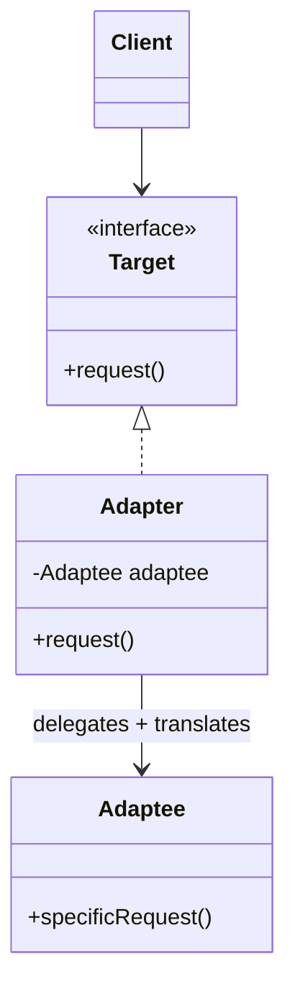
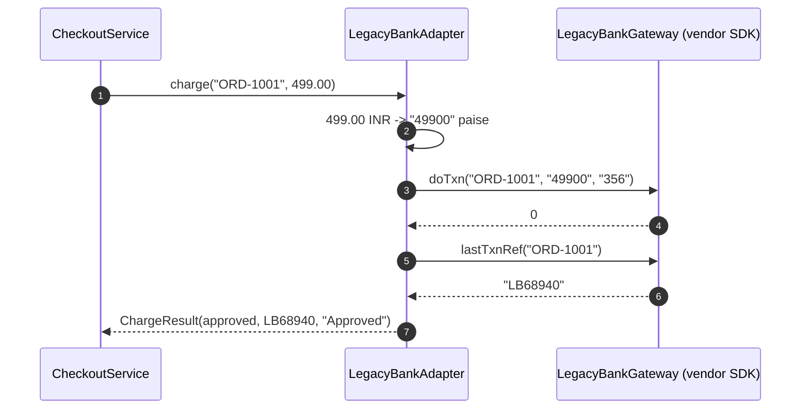
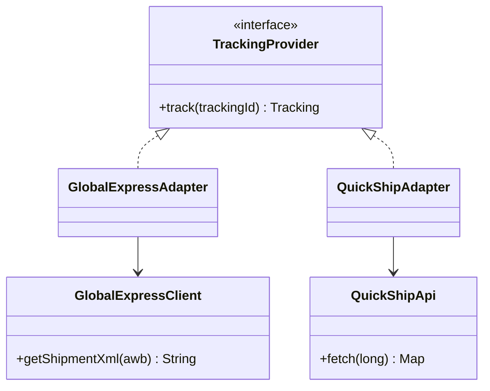
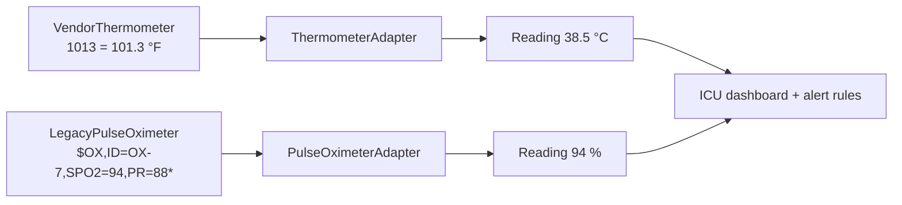

---
tags:
  - Structural
  - Beginner
---

# Adapter

<span class="badge badge--beginner">🟢 Beginner</span>
<span class="badge badge--category">Structural</span>
<span class="badge badge--interview">Interview frequency ⭐⭐⭐⭐⭐</span>

!!! abstract "TL;DR"
    **Adapter converts the interface of an existing class into the interface your code expects, so classes that couldn't work together now can.**
    Use it to plug in third-party SDKs, legacy systems or devices without letting their quirks leak into your codebase.

---

## 1. Intent & Problem It Solves

**The problem in plain English:** your checkout is written against a clean `PaymentGateway.charge(orderId, BigDecimal)` interface. The bank gives you an SDK where amounts are strings in paise, currencies are numeric codes and results are magic numbers like `51`. You can't change the SDK, and you don't want `"356"` and `51` scattered across your business code.

**Formal definition (GoF):**
> Convert the interface of a class into another interface clients expect. Adapter lets classes work together that couldn't otherwise because of incompatible interfaces.

## 2. Real-World Analogy

!!! example "A travel plug adapter"
    Your Indian laptop charger has a Type-D plug; the hotel in London has Type-G sockets. You don't rewire the hotel or your charger. You put a small adapter between them. The charger still "thinks" it's plugged into an Indian socket, and the wall still "sees" a British plug.

## 3. Structure



| Participant | Responsibility |
|---|---|
| **Target** | The interface your code wants to use (`PaymentGateway`) |
| **Adaptee** | The existing class with an incompatible interface (vendor SDK, legacy system) |
| **Adapter** | Implements Target, holds the Adaptee, **translates** calls, data and errors |
| **Client** | Talks only to Target |

**Object adapter vs. class adapter:** the version above (holding the adaptee in a field) is an **object adapter**, which is what you'll use in Java 99% of the time. A **class adapter** *extends* the adaptee and implements the target. It needs inheritance, so it only works if the adaptee isn't `final`, and it couples you to one concrete class.

## 4. Naive Approach (Without the Pattern)

```java
public class CheckoutService {
    private final LegacyBankGateway bank = new LegacyBankGateway();

    public String pay(String orderId, BigDecimal amount) {
        String paise = amount.movePointRight(2).toPlainString();   // vendor detail
        int code = bank.doTxn(orderId, paise, "356");               // magic currency code
        if (code == 0) return "ok " + bank.lastTxnRef(orderId);
        if (code == 51) return "limit";                              // magic result codes
        ...
    }
}
// The same conversions are copied into RefundService, SubscriptionService...
```

**What goes wrong:**

- :material-close-circle:{ style="color:#e53935" } **Vendor details everywhere.** Paise conversion and code tables are duplicated, and drift.
- :material-close-circle:{ style="color:#e53935" } **Vendor lock-in.** Switching banks means editing every service.
- :material-close-circle:{ style="color:#e53935" } **Hard to test.** Business logic can't run without the vendor SDK.

---

## 5. Three Real-World Examples

### Example 1: Checkout on a Legacy Bank SDK (Payments)

**Scenario:** An e-commerce company signs with a bank whose payment SDK predates modern Java: amounts are **strings in paise**, the currency is the ISO numeric code `"356"`, results are **integer codes**, and the transaction reference is fetched with a second call. Checkout, refunds and subscriptions are all written against the company's own `PaymentGateway` interface, which another bank also implements. The new bank must plug in **without changing any business code**.

**Design:**



**Full Code:**

=== "LegacyBankAdapter.java"

    ```java
    --8<-- "code/structural/src/main/java/com/handbook/structural/adapter/payments/LegacyBankAdapter.java"
    ```

    1.  **Object adapter**: holds the adaptee and delegates to it. The SDK is passed in, so tests can pass a fake.
    2.  `RoundingMode.UNNECESSARY` makes the adapter **refuse** amounts with fractions of a paisa rather than silently rounding money. The unit test checks this.
    3.  Error translation is part of adapting: magic numbers become **meaningful messages** (or domain exceptions), and unknown codes are still handled.

=== "PaymentGateway.java"

    ```java
    --8<-- "code/structural/src/main/java/com/handbook/structural/adapter/payments/PaymentGateway.java"
    ```

=== "LegacyBankGateway.java"

    ```java
    --8<-- "code/structural/src/main/java/com/handbook/structural/adapter/payments/LegacyBankGateway.java"
    ```

=== "CheckoutService.java"

    ```java
    --8<-- "code/structural/src/main/java/com/handbook/structural/adapter/payments/CheckoutService.java"
    ```

=== "PaymentsDemo.java"

    ```java
    --8<-- "code/structural/src/main/java/com/handbook/structural/adapter/payments/PaymentsDemo.java"
    ```

**Output:**

```text
--8<-- "code/outputs/structural/adapter/payments/PaymentsDemo.txt"
```

**Why Adapter here:**

- The SDK **can't be changed**, and the business code **shouldn't** change.
- All vendor knowledge (units, codes, call order) lives in **one class** that's easy to test.
- Switching or adding banks means **a new adapter**, not a rewrite.

---

### Example 2: One Tracking Page, Many Couriers (Logistics)

**Scenario:** An online store ships through several couriers. An international courier returns tracking as an **XML-like string** with event codes (`OFD`); a regional courier returns a **map with numeric stages** and expects a numeric consignment number. The customer's "Track my order" page must show one consistent status (`PICKED_UP`, `IN_TRANSIT`, `OUT_FOR_DELIVERY`, `DELIVERED`) no matter who's carrying the parcel. New couriers are added every quarter.

**Design:**



**Full Code:**

=== "TrackingProvider.java"

    ```java
    --8<-- "code/structural/src/main/java/com/handbook/structural/adapter/logistics/TrackingProvider.java"
    ```

=== "GlobalExpressAdapter.java"

    ```java
    --8<-- "code/structural/src/main/java/com/handbook/structural/adapter/logistics/GlobalExpressAdapter.java"
    ```

=== "QuickShipAdapter.java"

    ```java
    --8<-- "code/structural/src/main/java/com/handbook/structural/adapter/logistics/QuickShipAdapter.java"
    ```

    1.  Adapting **inputs** too: our tracking IDs are strings like `QS-554201`, but this API wants a `long`.

=== "Courier clients"

    ```java
    --8<-- "code/structural/src/main/java/com/handbook/structural/adapter/logistics/GlobalExpressClient.java"
    ```

    ```java
    --8<-- "code/structural/src/main/java/com/handbook/structural/adapter/logistics/QuickShipApi.java"
    ```

=== "TrackingDemo.java"

    ```java
    --8<-- "code/structural/src/main/java/com/handbook/structural/adapter/logistics/TrackingDemo.java"
    ```

**Output:**

```text
--8<-- "code/outputs/structural/adapter/logistics/TrackingDemo.txt"
```

**Why Adapter here:**

- **Many adaptees, one target**: the page doesn't know or care how each courier reports status.
- Each adapter **normalizes** to a shared enum and fails loudly on unknown codes, rather than showing customers garbage.
- This is the **Anti-Corruption Layer** idea from Domain-Driven Design at class level: external models never enter your domain.

---

### Example 3: ICU Devices from Different Vendors (Healthcare)

**Scenario:** An ICU dashboard shows each bed's vitals and raises alerts (fever ≥ 38.0 °C, SpO2 < 95%). The hospital buys devices from different vendors: a US thermometer that reports **tenths of a degree Fahrenheit as an int**, and an older pulse oximeter that emits a **raw serial-protocol frame** like `$OX,ID=OX-7,SPO2=94,PR=88*`. The alerting logic must work on clean, metric readings. A corrupt frame must be rejected, never shown as a number.

**Design:**



**Full Code:**

=== "VitalsSensor.java"

    ```java
    --8<-- "code/structural/src/main/java/com/handbook/structural/adapter/healthcare/VitalsSensor.java"
    ```

=== "ThermometerAdapter.java"

    ```java
    --8<-- "code/structural/src/main/java/com/handbook/structural/adapter/healthcare/ThermometerAdapter.java"
    ```

    1.  Unit conversion (°F to °C) plus rounding to one decimal. Adapters often convert **units and scales**, not just method names.

=== "PulseOximeterAdapter.java"

    ```java
    --8<-- "code/structural/src/main/java/com/handbook/structural/adapter/healthcare/PulseOximeterAdapter.java"
    ```

    1.  Validation belongs in the adapter: it's the last place that knows what a **valid frame** from this device looks like. In a clinical system, a wrong number is far worse than no number.

=== "Devices"

    ```java
    --8<-- "code/structural/src/main/java/com/handbook/structural/adapter/healthcare/VendorThermometer.java"
    ```

    ```java
    --8<-- "code/structural/src/main/java/com/handbook/structural/adapter/healthcare/LegacyPulseOximeter.java"
    ```

=== "IcuDashboardDemo.java"

    ```java
    --8<-- "code/structural/src/main/java/com/handbook/structural/adapter/healthcare/IcuDashboardDemo.java"
    ```

**Output:**

```text
--8<-- "code/outputs/structural/adapter/healthcare/IcuDashboardDemo.txt"
```

**Why Adapter here:**

- Devices are **hardware with fixed protocols**: you can only adapt them.
- Alert rules are written **once**, in metric units, against one interface.
- Each adapter can be **certified and tested on its own**, which matters in regulated software.

---

??? example "Unit Tests: `AdapterTest.java` (all three examples + challenge)"

    ```java
    --8<-- "code/structural/src/test/java/com/handbook/structural/adapter/AdapterTest.java"
    ```

## 6. Variations & Modern Java Take

| Variation | Example |
|---|---|
| **Object adapter** (composition) | All examples here. Preferred. |
| **Class adapter** (inheritance) | `class Adapter extends Adaptee implements Target`. Only when you must override adaptee behavior |
| **Two-way adapter** | Implements both interfaces so old and new code can call it during a migration |
| **Lambda / method-reference adapter** | When Target is a functional interface: `Supplier<Reading> s = () -> convert(device.getTempF10());` |
| **Bulk adapters** | `Arrays.asList(array)` adapts an array to `List`; `Collections.enumeration(list)` goes the other way |

**Records make adapter outputs safe:** return immutable records (`ChargeResult`, `Tracking`, `Reading`) so callers can't depend on mutable vendor objects.

**Spring and adapters.** Name adapters after the vendor (`StripePaymentAdapter`, `RazorpayPaymentAdapter`), implement your port interface, and pick one with `@ConditionalOnProperty` or a map of beans. This is how **Hexagonal Architecture** names them: *adapters* plugged into *ports*.

## 7. Where It Lives in Real Frameworks

| Where | Example |
|---|---|
| JDK | `Arrays.asList(T...)`: array to `List` |
| JDK | `InputStreamReader` / `OutputStreamWriter`: byte streams to character streams |
| JDK | `Collections.enumeration(collection)`, `Collections.list(enumeration)` |
| JDK | `Executors.callable(Runnable)`: `Runnable` to `Callable` |
| Spring MVC | **`HandlerAdapter`**: lets `DispatcherServlet` call `@Controller` methods, `HttpRequestHandler`s and plain servlets the same way |
| Spring | `MessageListenerAdapter` (JMS), `WebMvcConfigurer`-style adapters, `HttpMessageConverter`s |
| SLF4J | Bridges such as `jul-to-slf4j` and `log4j-over-slf4j` adapt other logging APIs to SLF4J |
| JPA | `AttributeConverter<X, Y>`: adapts a Java type to a column type |

## 8. Pros, Cons & Trade-offs

| ✅ Pros | ❌ Cons |
|---|---|
| Reuse existing classes you **can't or shouldn't change** | One more layer of indirection |
| **Single Responsibility**: conversion logic in one place | Many adapters if you integrate many vendors (each needs tests) |
| **Open/Closed**: new vendors mean new adapters | Can hide performance costs (extra calls, parsing) |
| Easy to test: fake the adaptee or the target | A "leaky" adapter that exposes vendor types defeats the purpose |

## 9. Pitfalls & Anti-Patterns

!!! danger "Leaky adapters"
    Returning vendor objects (`LegacyTxnResponse`) or throwing vendor exceptions from the adapter spreads the vendor's model into your code. Translate **data, errors and units**, and return your own types.

!!! danger "Silent defaults on unknown values"
    Mapping unknown status codes to "OK", or an unknown courier stage to `IN_TRANSIT`, hides integration breakages. Fail loudly (Examples 2 and 3) and alert.

!!! warning "Business logic inside adapters"
    An adapter converts; it doesn't decide. "Apply a 2% fee for this bank" belongs in the domain, not in `LegacyBankAdapter`.

!!! warning "Adapting what you own"
    If you control both sides, change the interface instead of adding an adapter. Adapters are for boundaries you can't move.

## 10. Senior / Architect Deep Dive (10–15 yrs)

**Adapters are where integrations fail; treat them as production code.** For each adapter:

- **Contract tests** against recorded vendor responses (WireMock, Pact) so vendor changes break the build, not production.
- **Timeouts, retries and circuit breakers** around the adaptee call (Resilience4j), configured per vendor.
- **Metrics tagged by vendor** (latency, error codes) so you can see "bank X is declining 30% of charges" before customers do.
- **Mapping tables as data** for codes that change often, with a default "unknown, alert" path.

**Anti-Corruption Layer (DDD).** At system level, a set of adapters plus translators that protects your domain model from a legacy or external system's model is an *anti-corruption layer*. When migrating off a legacy monolith, the ACL lets the new service speak its own language while still reading and writing the old system.

**Versioned vendors.** When a vendor ships API v2, write a **new adapter** alongside the old one and switch with a feature flag per merchant. Don't add `if (v2)` branches inside one adapter.

!!! bug "War story: the decimal that cost a lakh"
    A marketplace integrated a new payment provider whose API took amounts in **paise** while the old provider took **rupees**. The adapter was copied from the old one and nobody changed the conversion. In staging every test charge was INR 1 and "worked" (charged 1 paisa). In production, a INR 1,000 order was charged INR 10. Over a weekend the company under-collected roughly INR 1 lakh before reconciliation caught it.
    **Fix:** the adapter now converts with `movePointRight(2)` and `RoundingMode.UNNECESSARY`; contract tests assert the exact request body for known amounts; reconciliation runs hourly with an alert on mismatched totals.
    **Lesson:** unit conversion is the most important line in a payment adapter. Test the **wire format**, not just the happy path.

## 11. Related Patterns & Comparisons

| | Adapter | Facade | Decorator | Proxy | Bridge |
|---|---|---|---|---|---|
| Interface | **Changes** it to what the client expects | **New, simpler** one over many classes | **Same** as the wrapped object | **Same** as the real object | Separates abstraction from implementation |
| Wraps | One adaptee (usually) | A whole subsystem | One component | One subject | Implementor |
| Purpose | Make incompatible things work together | Simplify | Add behavior | Control access | Let two dimensions vary |
| When designed | **After the fact** (integration) | Any time | Any time | Any time | **Up front** |

## 12. Interview Corner

=== "🟢 Beginner / Service Companies"

    **Q1. What is the Adapter pattern?**

    A structural pattern that **converts one interface into another** that the client expects, letting **incompatible classes work together**. Like a travel plug adapter.

    **Q2. Object adapter vs. class adapter?**

    An **object adapter** holds the adaptee as a field (**composition**). A **class adapter** extends the adaptee (**inheritance**). Java prefers the object adapter: it works with `final` classes and with any subclass of the adaptee.

    **Q3. Give JDK examples.**

    `Arrays.asList()`, `InputStreamReader` (bytes to characters), `Collections.enumeration()`, and `Executors.callable(Runnable)`.

    **Q4. When would you use Adapter?**

    When integrating a **third-party library or legacy code** whose interface doesn't match yours, and you **can't change** it.

    **Q5. Adapter vs. Facade?**

    Adapter makes **one existing interface fit** an expected interface. Facade provides a **new, simpler interface** to a **whole subsystem**.

=== "🟡 Mid-Level"

    **Q1. What else besides method names does an adapter translate?**

    **Data formats** (XML, maps to records), **units** (°F to °C, rupees to paise), **identifiers**, **error codes and exceptions**, and sometimes **call sequences** (two vendor calls for one target call, as in Example 1).

    **Q2. How do you test an adapter?**

    With a **fake adaptee** (assert the exact values sent, as in `AdapterTest`) and **contract tests** against recorded real responses. Cover unknown codes and malformed data.

    **Q3. How does Spring MVC use Adapter?**

    `DispatcherServlet` works with many handler types. A **`HandlerAdapter`** for each type (`RequestMappingHandlerAdapter` for `@Controller` methods, and others) adapts them all to one `handle(request, response, handler)` call.

    **Q4. What is a two-way adapter?**

    One class that implements **both** the old and new interfaces, so both kinds of client can use it during a gradual migration.

    **Q5. Where should retries and timeouts live?**

    Around the call to the external system: either inside the adapter or as a **decorator/proxy** wrapping it. Keep them out of business code, and configure them per vendor.

=== "🔴 Senior / FAANG / SAP"

    **Q1. "We integrate 40 shipping carriers. Design the integration layer."**

    A `CarrierPort` interface (rate, label, track, cancel) with **one adapter per carrier**, packaged as plug-ins and selected from a registry. Add a **canonical data model**, **contract tests** per carrier, **per-carrier resilience** (timeouts, circuit breakers, bulkheads), **mapping tables as config**, **webhook adapters** for carriers that push updates, and **observability** by carrier. Consider generating adapters for carriers that share a standard.

    **Q2. "How do you migrate from a legacy ERP to a new one without a big bang?"**

    An **anti-corruption layer** of adapters behind a stable domain interface; **strangler fig** routing by entity or tenant; **dual writes or CDC** during the transition with **reconciliation**; flip reads per module with feature flags; retire the legacy adapter at the end.

    **Q3. "A vendor changes an error code without notice and checkout breaks. How do you design against that?"**

    Unknown codes map to an **explicit "unknown" outcome that alerts**, never to success. **Contract tests** run daily against the vendor sandbox. **Metrics per code** detect a new code within minutes, and a **circuit breaker** can fail over to a second provider.

    **Q4. "Is an adapter a performance problem?"**

    The wrapper itself is negligible (often inlined by the JIT). Costs come from **what it does**: parsing, extra network calls, object mapping. Measure, cache static mappings, and avoid adapters that make **N+1 calls** to the adaptee.

    **Q5. "Adapter vs. Anti-Corruption Layer vs. API Gateway?"**

    **Adapter**: a class-level translation. **ACL**: a set of adapters and translators that protects a **bounded context's model**. **API Gateway**: a network-level entry point that routes, authenticates and rate-limits. It may also adapt protocols, but its main job is edge concerns.

=== "💻 Coding Challenge"

    **Problem:** A legacy invoicing library returns `java.util.Enumeration`, but your code uses `Iterator` and for-each loops. Write `EnumerationIterator<T>` so legacy results work in a for-each loop. What should `remove()` do?

    ??? success "Solution"

        === "EnumerationIterator.java"

            ```java
            --8<-- "code/structural/src/main/java/com/handbook/structural/adapter/legacy/EnumerationIterator.java"
            ```

        === "LegacyDemo.java"

            ```java
            --8<-- "code/structural/src/main/java/com/handbook/structural/adapter/legacy/LegacyDemo.java"
            ```

        **Output:**

        ```text
        --8<-- "code/outputs/structural/adapter/legacy/LegacyDemo.txt"
        ```

        **Key points to say:** `hasNext`/`next` map directly; `remove()` has **no equivalent** in `Enumeration`, so the adapter throws `UnsupportedOperationException`, which is honest and documented. Adapters can't invent capabilities the adaptee doesn't have. The JDK has this built in since Java 9: `enumeration.asIterator()`.

!!! info "Behavioural tie-in (STAR) for experienced candidates"
    - **S:** We were onboarding a second payment provider, and payment code was spread across 6 services.
    - **T:** Add the provider in one quarter without regressions in checkout.
    - **A:** Defined a `PaymentGateway` port, wrapped the existing provider in an adapter first (no behavior change), then built the new adapter with contract tests and a per-merchant feature flag.
    - **R:** Shipped in 7 weeks; the third provider took 9 days; failover between providers became possible.

## 13. Quick Revision Card

!!! tip "Remember in 30 seconds"
    - **Converts an interface** so incompatible classes work together. Think **plug adapter**.
    - **Object adapter** (composition) over class adapter (inheritance).
    - Translate **calls, data, units and errors**; return **your** types; fail loudly on unknowns.
    - **JDK:** `Arrays.asList`, `InputStreamReader`. **Spring:** `HandlerAdapter`.
    - At system scale, it's the **Anti-Corruption Layer** / Hexagonal **adapter**.

    ```java
    class LegacyBankAdapter implements PaymentGateway { private final LegacyBankGateway legacy; /* translate */ }
    ```

## Practice

- [ ] Add a third courier that pushes updates through webhooks, and adapt it to `TrackingProvider`.
- [ ] Make `LegacyBankAdapter` throw a domain exception (`PaymentDeclinedException`) instead of returning a message.
- [ ] Write a WireMock contract test for a pretend REST version of `QuickShipApi`.
- [ ] Replace `EnumerationIterator` with `Enumeration.asIterator()` and compare.

---

[:material-arrow-left: Structural overview](index.md){ .md-button }
[Next: Bridge :material-arrow-right:](bridge.md){ .md-button .md-button--primary }
